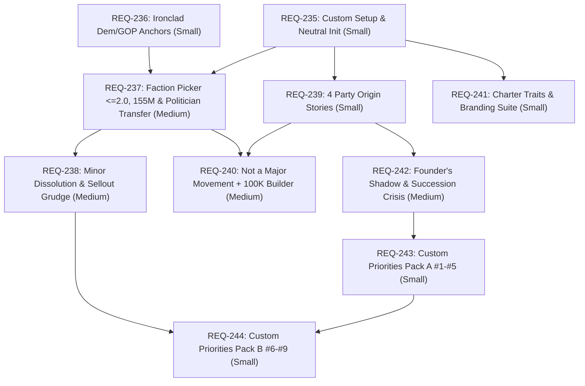

# Coalition Builder: Party Chair — Custom Party Mode & Faction Anchor Rework (`CUSTOM_PARTY_REWORK_DESIGN.md`)

> **Document Type:** Feature Design Specification (Version-Agnostic Backlog Reference)  
> **Status:** Decomposed, Sized & Logged in [DESIGN_BACKLOG.md](DESIGN_BACKLOG.md) — **Unscheduled** *(Build timing, release version assignment, and implementation waves will be organized later when the target version design document is created)*  
> **Features Covered:** `REQ-235` through `REQ-244` (**10 Sub-Features: 4 Medium, 6 Small; 0 Tiny**)  
> **Style & Scale Invariants:** Strictly complies with [GAME_STYLE_GUIDE.md](GAME_STYLE_GUIDE.md) — `155,000,000` represented-voter zero-variance conservation (Rule 3), zero `REQ-XX` strings in player-facing UI (Rule 4), qualitative atmospheric framing (Rule 7), AI Games Studio palette ([ART_STYLE.md](ART_STYLE.md)), and Universal Politician Terminology (Rule 6.5).

---

## 1. Overview & Modular Sub-Feature Breakdown

The **Custom Party Mode & Faction Anchor Rework** fixes preset-party template bleed in Custom Party creation, establishes ironclad leading-faction anchors for the Democratic and Republican parties, introduces strategic starting-faction coalition assembly (where both voters and politicians follow their factions) with minor-party merger dissolution, adds 5 distinct Party Origin Stories (including a zero-bonus `Not a Major Movement` hard mode with a Custom `100K` Founding Faction Builder), defines Founding Charter Traits and broadcast branding, introduces the `"Founder's Shadow"` & First Succession Crisis arc, and adds **9 Custom-Party-Exclusive Major Priorities** integrated into the Draft-of-7 Priorities engine.

| Req ID | Sub-Feature Title | Size | Target Files | Dependencies | Core Design Summary |
| :--- | :--- | :---: | :--- | :--- | :--- |
| **REQ-235** | Dedicated `Create Custom Party` Setup Flow & Clean Neutral Initialization | Small | `app.js`, `engine.js`, `styles.css` | `REQ-176` | Remove `#custom-mode` checkbox; standalone `Create Custom Party` button (`selectedTemplate = 'custom'`); zero preset bleed in `createGame()`; voter-derived `baseShare` & dynamic Ascent Tier. |
| **REQ-236** | Ironclad Democratic & Republican Leading-Faction Anchor Lock | Small | `engine.js`, `factions-0.15.js`, `app.js`, `party-systems-engine.js` | `REQ-151`, `REQ-159` | Hard-lock `dem_liberal_establishment` (`people`) & `gop_maga` (`heritage`) against setup poaching, `boltFaction()`, summits, and party-system splits; route extreme unrest into Internal Anchor Crisis penalties. |
| **REQ-237** | Custom Party Starting Factions Picker, Pairwise `<= 2.0` Compatibility, `155M` Voter Transfer & Universal Politician Transfer | Medium | `app.js`, `engine.js`, `factions-0.15.js`, `styles.css` | `REQ-235`, `REQ-236`, `REQ-171` | Pick `0..N` of 36 non-anchored factions; enforce pairwise `|dEcon| <= 2.0 && |dSoc| <= 2.0`; live playstyle advisory banner; exact state-by-state `155M` voter transfer + post-hydration transfer of all aligned politicians, seats, governors, and Senate rosters. |
| **REQ-238** | Minor-Party Merger Dissolution, Orphaned Breakaway Factions & `"Sellout Grudge"` (B-6) | Medium | `engine.js`, `app.js`, `data.js` | `REQ-237` | Taking any `liberty`/`green`/`constitution`/`socialist` faction dissolves that minor party (`game.dissolvedParties`); unselected sibling hardliners (voters + politicians) become Independent (`seekingPartyHome: true`) with `"Sellout Grudge"` media snipes & rival-bolstering behavior. |
| **REQ-239** | Party Origin Stories — 4 Archetype Modifiers (Schism, Civic Reform, Grassroots Viral, Executive Third Way) | Small | `data.js`, `engine.js`, `app.js`, `styles.css` | `REQ-235`, `REQ-170`, `REQ-185`, `REQ-189` | Implement 4 mechanical Origin Story archetypes with distinct starting budgets, poaching/Fusion rules, RCV/PR leverage, small-dollar scaling, and media blackout offsets. |
| **REQ-240** | `Not a Major Movement` Exclusivity Lock & Custom `100K` Founding Faction Builder | Medium | `app.js`, `engine.js`, `styles.css` | `REQ-235`, `REQ-237`, `REQ-239` | 5th Origin Story granting zero bonus modifiers, locking out all 36 catalog factions, and opening a `100,000`-voter custom faction builder (state allocator summing to `100,000`, Econ/Social `1–10`, 2 Core Issues) conserving `155M`. |
| **REQ-241** | Founding Charter Traits (Pick 1–2 DNA Rules) & Party Branding Suite (Emblem, 3-Letter Code & Motto) | Small | `data.js`, `engine.js`, `app.js`, `styles.css` | `REQ-235`, `REQ-223`, `REQ-224` | 4 Charter Traits (pick 1–2); 10 vector SVG emblems; custom 3-letter ticker code rendered across Election Night Broadcast Screen / maps / "Just Called" feed; 1-line founding motto. |
| **REQ-242** | The `"Founder's Shadow"` Movement Aura & `"Survive the Founder"` First Succession Crisis (C-7) | Medium | `engine.js`, `app.js`, `data.js`, `styles.css` | `REQ-235`, `REQ-239`, `REQ-92` | Early Movement Aura boosting fundraising & recruitment around Founding Leader; fires interactive Succession Crisis modal when Founder retires, loses a major bid, or steps down. |
| **REQ-243** | Custom-Party-Exclusive Priorities Pack A — Founding Momentum & Merger Arcs (`#1–#5`) | Small | `data.js`, `engine.js` | `REQ-230`, `REQ-235`, `REQ-237`, `REQ-242` | Add 5 custom-party quests to Draft-of-7 catalog: *Beat the Sophomore Slump*, *Seal the Merger*, *Outpoll Your Former Home*, *Survive the Founder*, *Prove You're Not a Spoiler*. |
| **REQ-244** | Custom-Party-Exclusive Priorities Pack B — Fortress, Grudge, Cross-Aisle & Homegrown Bench (`#6–#9`) | Small | `data.js`, `engine.js` | `REQ-230`, `REQ-238`, `REQ-224`, `REQ-243` | Add 4 custom-party quests to Draft-of-7 catalog: *Build a Home-State Fortress*, *Silence the "Sellout" Critics*, *Forge an Unlikely Alliance*, *Homegrown Bench* (explicitly excludes `#10`, `#11`, and `B-4`). |

---

## 2. Sub-Feature Dependency Map *(For Future Release Organization)*



---

## 3. Target Save & State Data Schemas

All new state fields initialize cleanly in `createGame()` (`engine.js`) and migrate backward-compatibly with safe defaults in `normalizeGame()` (`engine.js`) and `startNextCycle()` (`engine.js`):

```javascript
// 1. Player Identity Extensions (game.player)
game.player = {
  id: 'player',
  custom: true,
  baseTemplateId: 'custom',               // NEVER leaks 'people' | 'heritage' | 'liberty' etc.
  name: 'Common Ground Party',            // max 32 chars
  customCode: 'CGP',                      // 3-letter uppercase ticker (A-Z, default derived from name)
  customEmblem: 'compass',                // 1 of 10 SVG emblem IDs
  customMotto: 'Pragmatism over partisanship.', // max 90 chars
  color: '#8b5cf6',
  foundingStateId: 'PA',                  // Home-state fortress anchor (2-letter state ID)
  customOrigin: 'civic_reform',           // 'not_major_movement' | 'major_schism' | 'civic_reform' | 'grassroots_viral' | 'executive_third_way'
  schismParentPartyId: null,              // 'people' | 'heritage' | null (required when customOrigin === 'major_schism')
  customCharterTraits: ['big_tent_pragmatism', 'state_first_federation'], // 1 to 2 trait IDs
  startingSelectedFactionIds: [],         // Catalog faction IDs chosen at setup (empty for not_major_movement)
  startingMajorParentIds: [],             // Unique major party IDs ('people'|'heritage') whose factions were pulled at setup
  baseShare: 0.06,                        // Strictly (startingVoters / 155_000_000) * 100
  // ...standard economic, social, climate, local, issuePositions, leaderArchetype, leaderName, claimedSeat
};

// 2. Dissolved Minor Parties Registry (game.dissolvedParties & game.dissolvedPartyDetails)
game.dissolvedParties = ['liberty'];      // Array of dissolved minor party IDs
game.dissolvedPartyDetails = {
  liberty: {
    mergedInto: 'player',
    year: 2028,
    absorbedFactionIds: ['lib_true_libertarians'],
    orphanedFactionIds: ['lib_ancaps'],
  },
};

// 3. Custom 100K Founding Faction Schema (game.customFaction100k — only for 'not_major_movement')
game.customFaction100k = {
  id: 'custom_founding_faction',
  name: 'Heartland Civic League',         // max 36 chars
  partyId: 'player',
  type: 'ideological',
  status: 'leading',                      // Leading faction of the custom party
  isCustomFounding: true,
  targetVoters: 100000,                   // Always strictly 100,000 represented voters
  sliders: {
    economic: 5.0,                        // 1.0 - 10.0
    social: 5.0,                          // 1.0 - 10.0
    governance: 5.0,                      // derived or neutral 5.0
  },
  keyIssues: ['healthcare-model', 'campaign-finance'], // Exactly 2 valid issue IDs from VERSION_021_ISSUES
  stateAllocations: { PA: 40000, OH: 30000, MI: 30000 }, // Exact sum === 100,000 (multiples of 100)
};

// 4. Faction Runtime Extensions (on each object in game.factions)
// Added cleanly to orphaned sibling factions of dissolved minor parties:
faction = {
  // ...existing catalog fields (id, name, partyId, sliders, happiness, confidence, etc.)
  isIroncladAnchor: false,                // true ONLY for 'dem_liberal_establishment' & 'gop_maga'
  seekingPartyHome: false,                // true for orphaned breakaway factions after minor-party dissolution
  originMinorPartyId: null,               // e.g. 'liberty' | 'green' | 'constitution' | 'socialist'
  selloutGrudge: {
    active: false,                        // true while seekingPartyHome === true & cyclesRemaining > 0
    targetPartyId: 'player',
    cyclesRemaining: 3,                   // Decays by 1 each cycle, or resolves on rehoming/quest
    snipesFired: 0,
    rehomedPartyId: null,                 // Set if faction joins a surviving rival party
  },
};

// 5. Founder's Shadow & First Succession State (game.founderLegacy)
game.founderLegacy = {
  active: true,                           // true for custom parties until succession resolves
  founderId: 'custom-leader-<seed>',
  founderName: 'Jordan Sterling',
  founderArchetypeId: 'tech-outsider',
  movementAuraCyclesRemaining: 3,         // Active across opening 3 cycles (2028, 2030, 2032) while Founder leads
  auraFundraisingBonus: 0.20,             // +20% early small-donor & recruitment energy
  auraRecruitmentLift: 1.0,               // +1 starting recruit quality / morale floor while Founder active
  successionTriggered: false,
  successionResolved: false,
  successionTriggerReason: null,          // 'retirement' | 'major_defeat' | 'stepped_down'
  successionYear: null,
  successionOutcome: null,                // 'institutionalized' | 'dynastic_heir' | 'factional_fracture'
  postSuccessionCyclePending: false,      // Used by Priority #4 ('Survive the Founder')
  preSuccessionBaseline: { voteShare: 0, seats: 0 },
};

// 6. Custom-Party Priority Tracking Metadata (game.customPriorityTracking)
game.customPriorityTracking = {
  debut2028VoteShare: null,               // Populated after 2028 Election Night (Priority #1)
  homegrownOfficeholderIds: [],           // Non-defector recruits elected under player banner (Priority #9)
  summitAbsorbedFactionsThisCycle: 0,     // Incremented on Coalition Accord / Faction Summit absorption (Priority #2)
};
```

---

## 4. Detailed Sub-Feature Specifications (`REQ-235` – `REQ-244`)

### REQ-235: Dedicated `Create Custom Party` Setup Flow & Clean Neutral Initialization
- **Classification:** Small (`app.js`, `engine.js`, `styles.css`)
- **Root Cause & Fix (`app.js#L1383-L1425`, `#L7190-L7355`):**
  1. Remove the `#custom-mode` checkbox (`<label class="custom-toggle">`) completely from `setupMarkup()`.
  2. Add a prominent standalone **`Create Custom Party`** action button (`id="enter-custom-party"`, `data-template="custom"`) directly beneath the 6 preset party cards.
  3. Clicking **`Create Custom Party`** sets `selectedTemplate = 'custom'` and `custom = true`, immediately clearing `.selected` styling from all 6 preset cards (`people`, `heritage`, `liberty`, `green`, `constitution`, `socialist`) and expanding the **Custom Party Creator Drawer** cleanly.
  4. Clicking any of the 6 preset party cards sets `selectedTemplate = card.dataset.template` and `custom = false`, collapsing the Custom Party Creator Drawer so preset and custom states are strictly mutually exclusive.
- **Clean Neutral `createGame()` Initialization (`engine.js#L2774-L3130`):**
  1. Introduce a `NEUTRAL_CUSTOM_TEMPLATE`:
     ```javascript
     const NEUTRAL_CUSTOM_TEMPLATE = {
       id: 'custom', name: 'Custom Party', color: '#8b5cf6',
       baseShare: 0, economic: 0, social: 0, climate: 0, local: 0,
       isMajor: false, lastPresidentialShare: 0, startingBudget: 25,
     };
     ```
  2. When `isCustom` is true (`baseTemplateId === 'custom' || Boolean(customName.trim())`), resolve `base = NEUTRAL_CUSTOM_TEMPLATE` rather than `templateFor(baseTemplateId)`.
  3. Set `player.baseTemplateId = 'custom'` everywhere—never inherit Democratic/Republican `contestedStateLegSlates`, `factionStandings`, `issuePositions`, `seats`, `superPacs`, or `baseShare - 2`.
  4. Initialize default custom issue sliders to neutral `5` (`5/10`) across all issues unless explicitly customized by the player (or auto-aligned to selected starting factions' centroid when factions are chosen).
  5. After applying starting faction / `100K` custom voter transfers, compute:
     $$\text{player.baseShare} = \text{round}\!\left(\frac{\text{startingPlayerRepresentedVoters}}{155{,}000{,}000} \times 100,\; 2\right)$$
  6. Calibrate starting Institutional Ascent Tier (`REQ-176`, `buildInitialPartyTiers`) dynamically from `player.baseShare` (and transferred congressional/gubernatorial seat counts):
     - `< 2.0%` $\to$ **Tier 1 (Fringe, 3 Focus Slots)**
     - `2.0% – 4.99%` $\to$ **Tier 2 (Ballot-Qualified Minor, 3 Focus Slots)**
     - `5.0% – 14.99%` $\to$ **Tier 3 (Federally Recognized, 5 Focus Slots)**
     - `15.0% – 19.99%` $\to$ **Tier 4 (Debate-Qualified Contender, 5 Focus Slots)**
     - `>= 20.0%` (or critical mass of transferred seats: `>= 35` House, `>= 8` Senate, or `>= 5` Governors) $\to$ **Tier 5 (Major Party, 7 Focus Slots)**
  7. Set `game.seats` and `game.contestedStateLegSlates` strictly from actual transferred sitting lawmakers and state legislative footholds (never from a previously clicked preset party).

---

### REQ-236: Ironclad Democratic & Republican Leading-Faction Anchor Lock
- **Classification:** Small (`engine.js`, `factions-0.15.js`, `app.js`, `party-systems-engine.js`)
- **Authoritative Anchor Constants:**
  ```javascript
  const IRONCLAD_PARTY_ANCHORS = Object.freeze({
    people: 'dem_liberal_establishment',   // The Liberal Establishment (12.27M)
    heritage: 'gop_maga',                  // Nationalist Populists (MAGA) (7.01M)
  });
  const IRONCLAD_ANCHOR_IDS = new Set(Object.values(IRONCLAD_PARTY_ANCHORS));
  function isIroncladPartyAnchor(factionId) {
    return IRONCLAD_ANCHOR_IDS.has(factionId);
  }
  ```
- **Four Mandatory Enforcement Points:**
  1. **Custom Party Faction Setup (`app.js` & `engine.js`):** Render `dem_liberal_establishment` and `gop_maga` with a lock icon and disabled state (`Party Anchor — Cannot Leave Party`). Defensively strip both IDs if passed into `createGame({ customValues: { selectedFactionIds } })`.
  2. **`boltFaction(game, factionId)` (`engine.js#L849`):** At the top of `boltFaction`, if `isIroncladPartyAnchor(factionId)` is true:
     - **Abort severance:** Do NOT change `f.partyId`, do NOT transfer voters to `independent`, and do NOT defect sitting lawmakers.
     - **Apply Internal Anchor Crisis instead:** Inflict a severe internal party crisis on that anchor's party (`anchorCrisisTurns = 1`: `-4.0%` national base turnout drag, `-15%` committee fundraising yield, `+15` primary challenge heat across open seats, and a clear headline in `yearLog`: *"INTERNAL PARTY CRISIS: [Faction Name] revolts against party leadership—turning out primary challengers and stalling fundraising rather than abandoning the party line!"*).
  3. **Faction Summits, Courting & Poaching (`engine.js`):** Exclude `IRONCLAD_ANCHOR_IDS` from cross-party Coalition Accord poaching / recruitment offers.
  4. **Party-System Splits & Bolt Evaluators (`engine.js#L2512`, `party-systems-engine.js`):** Guard `evaluatePartySplitsAndSwitches()` and dynamic era transitions so `dem_liberal_establishment` stays bound to `people` and `gop_maga` stays bound to `heritage` (internal revolts remain intra-party).

---

### REQ-237: Custom Party Starting Factions Picker, Pairwise `<= 2.0` Compatibility, `155M` Voter Transfer & Universal Politician Transfer
- **Classification:** Medium (`app.js`, `engine.js`, `factions-0.15.js`, `styles.css`)
- **Availability:** Shown in the Custom Party Creator drawer for all Origin Stories **except** `not_major_movement` (which locks out catalog factions per `REQ-240`).
- **Eligible Pool:** All **36 non-anchored factions** from `factions-0.15.js` (7 Dem, 10 GOP, 9 Independent/Swing, 7 Minor Party, 3 Unaffiliated), grouped cleanly by origin party with Econ/Social badges and represented voter count.
- **Strict Pairwise `<= 2.0` Compatibility Rule:**
  - Helper `areFactionsMutuallyCompatible(factionIds, catalog)` verifies every pair $(A, B)$:
    $$|A.\text{sliders.economic} - B.\text{sliders.economic}| \le 2.0 + 10^{-9} \quad \text{AND} \quad |A.\text{sliders.social} - B.\text{sliders.social}| \le 2.0 + 10^{-9}$$
  - **Dynamic UI Feedback (`app.js`):** Whenever a faction is toggled on, immediately grey out/disable any unselected faction violating `<= 2.0` against **any** already-selected faction, displaying an exact tooltip (e.g., *"Incompatible with Bernie Bros: ΔEcon +3.2 (max 2.0)"*).
  - **Defensive Engine Validation (`engine.js`):** `createGame()` re-runs `areFactionsMutuallyCompatible()` and drops any invalid or anchored IDs before mutating state.
- **Live Playstyle Advisory Meter (Non-Blocking Banner):**
  - Sums exact represented voters `V` and count `N` of selected factions:
    - `V < 1,000,000`: **Emerald Pill — *Realism Recommended*** (*"Authentic grassroots climb from the political margins."*)
    - `2,000,000 <= V <= 5,000,000 && N >= 3 && N <= 5`: **Teal Pill — *Healthy Balance Recommended*** (*"Cohesive emerging coalition with real mid-game leverage."*)
    - `V > 5,000,000`: **Copper/Amber Pill — *Roleplay / Sandbox Experience*** (*"Alternate-history powerhouse start capable of immediate national disruption."*)
    - *(Intermediate `1.0M–2.0M` or `2.0M–5.0M` outside `3–5` factions displays **Slate Pill — *Custom Coalition Start*** with voter/faction summary.)*
- **Exact `155,000,000` Zero-Variance State-by-State Voter Transfer Algorithm (`engine.js`):**
  1. For each selected catalog faction `fid` (with original `srcPartyId = f.partyId`):
     - Reassign `f.partyId = 'player'` in `game.factions`.
     - For every jurisdiction `st` in `game.voterModel.states` (all 51 jurisdictions):
       - Read `repVoters = Number(st.factions?.[fid] || 0)`.
       - Compute `sampleShift = Math.round(repVoters / 100)`.
       - Map source affiliation bucket: `srcBucket = ['people', 'heritage', 'liberty', 'green', 'constitution', 'socialist'].includes(srcPartyId) ? srcPartyId : 'independent'`.
       - Clamp `actualShift = Math.min(sampleShift, st.affiliations[srcBucket] || 0)`.
       - Mutate atomically:
         - `st.affiliations[srcBucket] -= actualShift`
         - `st.affiliations.player = (st.affiliations.player || 0) + actualShift`
       - Because `-actualShift + actualShift === 0`, `st.sampleVoters` and `st.representedVoters` stay **100% invariant** across all 51 jurisdictions (`sum === 155,000,000`).
     - Reconcile `voterModel.affiliations[bucket].representedVoters = sum(st.affiliations[bucket]) * 100` for all party buckets and `voterModel.factions`.
- **Universal Politician & Officeholder Transfer (`REQ-171` Post-Hydration Synchronization):**
  - **Critical Execution Order (`engine.js#L3131-L3172`):** Must execute **immediately AFTER** `hydrateV07GameState(game)` (which populates `game.sittingMembers`) and `game.politicians` construction, **and reconcile** with `foundingLegislature` / map state so transferred officeholders are never overwritten:
  - Every **Politician** across the entire roster—**sitting U.S. Senators, U.S. House Representatives, Governors, state lawmakers, party leaders, and unseated bench/recruitment prospects** in `game.sittingMembers`, `game.politicians`, `game.generatedMembers`, and `game.offers`—whose `factionId` matches any selected starting faction `fid` immediately transfers with their faction to the Custom Party (`party: 'player'`, `partyId: 'player'`, `caucus: 'player'`, `rawParty: player.customCode || 'C'`).
  - **Live Map, Seat & Leadership Synchronization:**
    - *Transferred Governors (`office === 'governor'`):* Immediately flip `game.governorships[m.stateId] = 'player'` so the Governors Map, Trifectas Map, and dashboard reflect Custom Party control.
    - *Transferred U.S. House Representatives (`office === 'house'`):* Sync their districts in `game.representatives` (`partyId = 'player'`) and recalculate `game.seats` and rival `organizations[pid].seats` from the actual post-transfer sitting House delegation so `calculateDistrictElection(game, 2024)` never overwrites transferred incumbents.
    - *Transferred U.S. Senators (`office === 'senate'`):* Update `party`, `partyId`, and `caucus` to `'player'` so all 3 Senate Class maps and the Combined 50-State Senate map immediately show them under the Custom Party.
    - *Leadership Vacancies & Eligibility:* Vacate any prior-party leadership posts held by transferred politicians and make them immediately eligible for the Custom Party's Leadership Hierarchy (`syncLeadershipRolesState`) and bottom-up Tier 5 Major Party critical-mass checks (`REQ-176`: `>= 35` House, `>= 8` Senate, or `>= 5` Governors).
    - *Orphaned Sibling Factions (`REQ-238`):* All politicians belonging to unselected sibling factions of a dissolved minor party simultaneously transfer to `party: 'independent', partyId: 'independent', caucus: 'independent', rawParty: 'I'` (and follow their faction if it later rehomes to a surviving rival party).
  - Record `player.startingMajorParentIds` if any `people` or `heritage` faction was pulled (used by Priority #3 *Outpoll Your Former Home* & Priority #8 *Forge an Unlikely Alliance*).
- **Starting Ballot Access & Chapters:** Grant state ballot access (`game.ballotAccess.player`) in any state where the custom party begins with `>= 10,000` transferred registered voters (or `>= 2%` state voter share) and auto-seed `foundingStateId` to the state with the highest starting custom voter count unless overridden by the player.

---

### REQ-238: Minor-Party Merger Dissolution, Orphaned Breakaway Factions & `"Sellout Grudge"` (B-6)
- **Classification:** Medium (`engine.js`, `app.js`, `data.js`)
- **Dissolution Trigger (`createGame()` in `engine.js`):**
  - Check each of the 4 preset minor parties (`liberty`, `green`, `constitution`, `socialist`):
    - `liberty`: `['lib_true_libertarians', 'lib_ancaps']`
    - `green`: `['grn_eco_socialist_vanguard', 'grn_yimby']`
    - `constitution`: `['con_christian_dominionists']`
    - `socialist`: `['soc_socialists', 'soc_communists']`
  - If **at least one** faction of a minor party `minorPid` is selected at Custom Party setup:
    1. **Permanent Dissolution:** Add `minorPid` to `game.dissolvedParties` and record metadata in `game.dissolvedPartyDetails[minorPid]`.
    2. **Complete Ecosystem Scrub:**
       - Remove `minorPid` from `game.rivals`, `game.organizations`, `game.ballotAccess`, and `game.partyTiers` (or mark `tier: 0, dissolved: true`).
       - Guard `partyList(game)`, `allPartyArchetypes()` consumers, `presidentialForecast()`, `supportByState()`, `nationalPoll()`, `buildForecasters()`, `applyMinorPartyCounterGrowth()`, and Election Night ballot generation so dissolved parties **never** appear on ballots, maps, or pundit forecasts.
    3. **Orphaned Sibling Hardliners (`seekingPartyHome: true`):**
       - Any faction of `minorPid` **not** selected by the Custom Party (e.g., `lib_ancaps` when player absorbs `lib_true_libertarians`; `grn_eco_socialist_vanguard` when player absorbs `grn_yimby`; `soc_communists` when player absorbs `soc_socialists`):
         - Set `f.partyId = 'none'`, `f.seekingPartyHome = true`, `f.originMinorPartyId = minorPid`.
         - Transfer its state voters cleanly from `st.affiliations[minorPid]` to `st.affiliations.independent` (and flush any residual `st.affiliations[minorPid]` to `independent` so `minorPid` has strictly `0` voters nationwide, preserving `155M` exact conservation).
         - Sync all politicians in that sibling faction to `party: 'independent'` (`REQ-171`).
       - Log merger flavor in `yearLog`: *"MERGER & DISSOLUTION: The [Minor Party Name] formally merged into [Custom Party Name] and dissolved—hardline [Orphaned Faction Name] activists walked out in protest."*
- **Seeking New Party Home & `"Sellout Grudge"` (B-6) Inter-Cycle Loop (`processOrphanedFactionRehoming(game)`):**
  - While `f.seekingPartyHome === true` and `f.selloutGrudge.active === true`:
    1. **Media Snipes:** Once per cycle (during Phase 1 or Phase 3), fire a punchy qualitative news headline / log event criticizing the merger (e.g., *"[Orphaned Faction] blasts [Custom Party] as 'establishment sellouts,' urging purists to withhold votes"*), inflicting a mild `-1.5` Supporter Trust or `-1.0%` drag in states where the orphaned faction is concentrated.
    2. **Rival Coalition Bolstering & Rehoming:** At each cycle boundary (`startNextCycle`), evaluate all surviving non-dissolved parties **other than `'player'`** (`rivals`). If a surviving party (e.g., `people`, `heritage`, or another minor party) has an internal faction within `<= 2.5` Econ AND `<= 2.5` Social of the orphaned faction, roll rehoming probability (`35%` base + `15%` per cycle elapsed):
       - On rehoming: transfer `f.partyId = rivalPartyId`, shift its state voters cleanly from `independent` to `rivalPartyId` (`155M` conserved), transfer its politicians to `rivalPartyId` (`REQ-171`), clear `seekingPartyHome = false`, record `f.selloutGrudge.rehomedPartyId = rivalPartyId` (hooked by Priority #7 *Silence the "Sellout" Critics*), and log the rival recruitment coup!
    3. If still unhomed after `3` cycles, `selloutGrudge.active` expires cleanly (`cyclesRemaining === 0`) so the player can eventually court them via normal Faction Summits.

---

### REQ-239: Party Origin Stories — 4 Archetype Modifiers (A-1)
- **Classification:** Small (`data.js`, `engine.js`, `app.js`, `styles.css`)
- **Catalog Constant (`CUSTOM_PARTY_ORIGINS` in `data.js`):**
  Define all 5 Origin Stories (4 mechanical archetypes here + `not_major_movement` wired in `REQ-240`):

| Origin ID | Display Name | Starting Budget | Core Mechanical Upsides | Core Mechanical Trade-Offs | Engine Hook Points |
| :--- | :--- | :---: | :--- | :--- | :--- |
| `not_major_movement` | **Not a Major Movement** | `$25M` | **Zero mechanical bonuses**; unlocks Custom `100K` Founding Faction Builder (`REQ-240`) | Locks out all 36 catalog factions; pure hard-mode ground-up climb | `REQ-240` |
| `major_schism` | **Major-Party Schism** *(Requires selecting parent: Dem or GOP)* | `$25M` | **+12 courting tolerance** (`happiness <= 52` vs `40`) & `-50%` courting cost against parent party (`REQ-170`); `+1` defector bench prospect from parent | **Blood Rivalry:** Zero Fusion Voting deals (`REQ-189`) with parent party; parent launches aggressive ballot petition challenges & `+1.5%` counter-mobilization in shared strongholds | `createGame`, `courtPolitician`, `canOfferFusion`, petition challenge rate |
| `civic_reform` | **Civic Reform / Anti-Duopoly** | `$25M` | **`+12` starting Independents Trust**; **`+25%` electoral reform leverage** (stronger RCV/Approval/PR push `REQ-185` & boosted reform event odds) | **Anti-Machine Sensitivity:** Softer partisan loyalty (`-20%` base turnout bonus if chair behaves like an establishment machine, e.g., primary filtering support backlash doubled) | `createGame`, `filterPrimarySupport`, `REQ-185` / `REQ-186` |
| `grassroots_viral` | **Grassroots Viral Movement** | **`$15M`** | **Explosive small-dollar scaling** (`1.5x` Small-Donor Drive yield); **2x Volunteer Drive voter registration efficiency**; `+12` starting Fame bonus for newly recruited candidates | Lower `$15M` starting war chest; slower early corporate/institutional donor scaling | `createGame`, `runSmallDonorDrive`, `executeVolunteerDrive`, `recruitCandidate` |
| `executive_third_way` | **Executive / Self-Funded Third Way** | **`$50M`** | Large **`$50M` starting war chest**; **early Media Visibility** (cuts Tier 1–3 Media Blackout penalty by `50%` in `getMediaVisibilityProfile`) | **Grassroots Cynicism:** `-30%` Small-Donor Drive yield; `-10` initial happiness / harder persuasion with populist & vanguard factions | `createGame`, `getMediaVisibilityProfile`, `runSmallDonorDrive`, summit persuasion |

- **UI (`app.js`):** Render a clean 5-card Origin Story selector inside Section 02 of the Custom Party Creator drawer showing qualitative upsides/downsides (`GAME_STYLE_GUIDE.md` Rule 7 — atmospheric prose, no raw formula dump). Selecting `major_schism` reveals an inline radio toggle: **Split from Democratic Party** vs. **Split from Republican Party**.

---

### REQ-240: `Not a Major Movement` Exclusivity Lock & Custom `100K` Founding Faction Builder
- **Classification:** Medium (`app.js`, `engine.js`, `styles.css`)
- **Exclusivity Lock:**
  - Selecting `customOrigin === 'not_major_movement'` immediately clears `selectedStartingFactionIds = []`, hides/disables the 36-faction catalog picker with an explanatory banner (*"Not a Major Movement starts outside all existing party factions — craft your own 100,000-voter founding movement below."*), and ensures zero bonus modifiers are applied in `createGame()`.
  - Defensively enforced in `createGame()`: if `customOrigin === 'not_major_movement'`, ignore any passed `selectedFactionIds`.
- **Custom `100,000`-Voter Founding Faction Builder UI (`app.js`):**
  1. **Faction Identity:** Name input (max 36 chars, e.g., *"Heartland Civic League"*).
  2. **Ideological Alignment Sliders:**
     - **Economic Alignment (`1.0 – 10.0`, step `0.5`)** — Left / Interventionist (`1`) $\leftrightarrow$ Free-Market (`10`).
     - **Social Alignment (`1.0 – 10.0`, step `0.5`)** — Progressive / Permissive (`1`) $\leftrightarrow$ Traditional / Conservative (`10`).
  3. **2 Core / Key Issues:** Two dropdown selectors populated from `VERSION_021_ISSUES` (must select 2 distinct issues).
  4. **State-by-State `100,000` Voter Allocator:**
     - Live counter badge: **`Allocated: X / 100,000`** (`Remaining: 100,000 - X`), blocking `Take the chair` until exact sum `=== 100,000` (with step granularity of `100` voters so every state converts cleanly to integer sample units).
     - **Fast Distribution Helpers (1-Click Presets):**
       - **`100% Home State`** (places all `100,000` in chosen home state, capped at that state's available Independents with overflow spill to region if needed)
       - **`Regional Concentration`** (distributes `100,000` across states in a chosen `OVERLAPPING_REGIONS` cluster weighted by Independent population)
       - **`Proportional National`** (distributes `100,000` across all 51 jurisdictions proportional to state Independent share, normalized to exact `100,000` in `100`-voter increments)
       - **`Clear All`** (resets to `0`)
     - **Manual 51-Jurisdiction Table/Grid:** Compact filterable state list with numeric input (`min=0`, `step=100`, `max = min(100000, stateIndependentVoters)`) so players can fine-tune exact state-by-state counts (e.g., `60,000` in VT + `40,000` in NH).
- **Exact `155,000,000` Zero-Variance Injection Algorithm (`engine.js`):**
  1. Validate total `sum(stateAllocations) === 100000`, every state value is a non-negative multiple of `100`, and `alloc <= st.affiliations.independent * 100`.
  2. Register `game.customFaction100k` into `game.factions` with `partyId: 'player', status: 'leading', happiness: 72, confidence: 55` and set `game.identityCrisis.foundingFactionIds = ['custom_founding_faction']`, `puristVanguardFactionId = 'custom_founding_faction'`.
  3. For each state `st` with `alloc > 0`:
     - `sampleShift = Math.round(alloc / 100)` (`exact integer`)
     - `st.affiliations.independent -= sampleShift`
     - `st.affiliations.player = (st.affiliations.player || 0) + sampleShift`
     - Set `st.factions['custom_founding_faction'] = sampleShift * 100`.
     - **Zero-Variance Faction Matrix Conservation:** Deduct `sampleShift * 100` proportionally from that state's Independent swing factions (`swg_*` in `st.factions`, largest-remainder integer rounding so `sum(deductions) === sampleShift * 100`) so BOTH `sum(st.affiliations) * 100 === st.representedVoters` AND `sum(st.factions) === st.representedVoters` remain **bit-for-bit equal to `155,000,000`**.
  4. Set `player.baseShare = round((100000 / 155000000) * 100, 2)` (`0.06%`) and `player.foundingStateId` to the state with the highest allocation.

---

### REQ-241: Founding Charter Traits (A-2) & Party Branding Suite (A-3)
- **Classification:** Small (`data.js`, `engine.js`, `app.js`, `styles.css`)
- **Founding Charter Traits (`CUSTOM_CHARTER_TRAITS` in `data.js` — Player Picks `1` or `2`):**
  1. **`no_super_pac_pledge` — *No Super PAC / Small-Dollar Pledge***
     - *Effect:* Permanently locks out Super PAC formation/requests (even at Tier 4–5); `+35%` Small-Donor Drive yield and `+2.0%` electoral lift for candidates carrying the `Squeaky Clean` trait.
  2. **`big_tent_pragmatism` — *Big-Tent Pragmatism***
     - *Effect:* Loosens ongoing **in-game** faction ideological compatibility tolerance from `2.0` to **`2.5`** (for `REQ-170` courting, Faction Summits, and `SUM-05` cohabitation drag) and cuts purist backlash penalties by `30%`; `-1.5%` peak base turnout enthusiasm ceiling. *(Note: Setup faction picker still enforces strict `<= 2.0`.)*
  3. **`doctrinal_vanguard` — *Doctrinal Vanguard***
     - *Effect:* `+2.5%` base turnout and `+10%` volunteer efficiency whenever party platform stays within `1.5` points of core factions; `1.5x` faction happiness penalty when compromising on platform sliders or cutting "wrong-party" Kingmaker/Fusion deals.
  4. **`state_first_federation` — *State-First Federation***
     - *Effect:* `-33%` State Chapter opening cost (`$4M` vs `$6M`) and `+1` starting Quality (up to `8`) / `+5` Fame for Breakout State Legislator standouts (`REQ-224`); `-1.0` national top-down whip/discipline modifier on national environment pushes.
  - *Mutual Exclusion Guard:* `big_tent_pragmatism` and `doctrinal_vanguard` are mutually exclusive (cannot pick both simultaneously).
- **Party Branding Suite (`CUSTOM_PARTY_EMBLEMS` in `data.js`, `app.js`, `styles.css`):**
  1. **10 Inline SVG Vector Emblems** (crisp `64x64` studio style on transparent backgrounds per `ART_STYLE.md`): `torch`, `oak`, `compass`, `scales`, `phoenix`, `gear`, `pine`, `bison`, `starburst`, `shield`.
  2. **3-Letter Broadcast Ticker Code (`customCode`):** Uppercase 2–4 char input (standard 3 letters, e.g., `FWD`, `CGP`, `LAB`, `REF`; auto-suggested from initials of Party Name). Rendered across:
     - Topbar / Party Info header alongside the selected vector emblem,
     - Forecast Maps & Pundit Ratings (`Tilt CGP`, `Lean FWD`),
     - Election Night Broadcast Screen (`REQ-223`), Chyrons, and `"Just Called"` race ticker feed.
  3. **1-Line Founding Motto (`customMotto`):** Displayed as an italicized epigraph on the Party Info header, National Convention banner, and Election Night Broadcast header.

---

### REQ-242: The `"Founder's Shadow"` Movement Aura & `"Survive the Founder"` First Succession Crisis (C-7)
- **Classification:** Medium (`engine.js`, `app.js`, `data.js`, `styles.css`)
- **Early Movement Aura (`game.founderLegacy`):**
  - While `game.founderLegacy.active === true && game.founderLegacy.movementAuraCyclesRemaining > 0` (first 3 cycles: `2028`, `2030`, `2032`, provided the Founding Leader remains active in the party):
    - **`+20%` Small-Donor & Committee Fundraising lift** (reflecting personal movement charisma around the Founder).
    - **`+1` Recruiting Morale / Quality Floor lift** on candidate recruitment (`Step 3` / `Step 5`).
    - Displayed qualitatively as an active badge on the Party Info / Leadership panel: *"Founder's Movement Aura — Early fundraising & recruitment energized by [Founder Name]."*
  - Decrements `movementAuraCyclesRemaining` by `1` at each `startNextCycle()`.
- **First Succession Crisis Triggers (`checkFounderSuccessionTrigger(game)`):**
  Fires **once** per custom party playthrough when **any** of these occurs:
  1. **Founder Retires:** Aging/retirement roll (`REQ-92`, `age >= 70`) retires `founderId` to the Council of Elders.
  2. **Major Electoral Defeat:** The Founder loses a high-profile bid (Presidential run finishing below expectation / `< 5%` after Cycle 1, or loses a Senate/Governor race they personally ran in).
  3. **Voluntary Step-Down / Aura Expiration:** The Chair manually clicks **`Initiate Leadership Transition`** in the Leadership tab, **OR** the Founder's Movement Aura expires after Cycle 3 (`2034` turnover) with the Chair prompted to institutionalize.
- **"Survive the Founder" Succession Crisis Modal (`app.js`, `engine.js`):**
  - Removes the Movement Aura permanently, records `preSuccessionBaseline = { voteShare, seats }`, sets `postSuccessionCyclePending = true` (unlocking Priority #4 *Survive the Founder*), and presents **3 Chair Strategic Paths**:
    1. **Institutionalize the Party Machine *(Recommended Institutional Path)*:** Hand the reins to elected chapters and Faction Leaders. *Effect:* `-10%` short-term fundraising dip for 1 cycle and `-5` base excitement, **but** permanently eliminates "Personality Cult" fragility, grants `+6` Faction Confidence across all factions, and locks in steady institutional survival.
    2. **Anoint a Handpicked Heir *(Continuity Path)*:** Select a high-Fame sitting politician or Party Leader to inherit the Founder's mantle. *Effect:* Preserves half of the fundraising momentum (`+10%` for 2 cycles) and gives the Heir `+15` Fame, **but** inflicts `-10` Happiness on rival factions passed over for the succession.
    3. **Open Factional Primary / Power Struggle *(High-Risk Populist Path)*:** Refuse to stage-manage succession and let factions battle for control. *Effect:* Triggers a 1-cycle internal friction spike (`+15` Friction, `-10` Happiness for losing wings), **but** the ascendant winning faction gains `+15` Happiness, `+10` Confidence, and `+2.0%` turnout surge if the party stays intact without a bolt.

---

### REQ-243: Custom-Party-Exclusive Priorities Pack A — Founding Momentum & Merger Arcs (`#1–#5`)
- **Classification:** Small (`data.js`, `engine.js`)
- **Integration:** Appended to `OVERALL_PRIORITY_QUESTS` (`data.js`) with `customOnly: true` and `category: 'contextual'` so `generateOfferedPrioritiesHand()` (`REQ-230`) automatically slots them into the **2–3 Contextual / Milestone Slots** of the Draft-of-7 hand exclusively for Custom Parties (`game.player.custom === true`).

| # | Quest ID & Title | Eligibility Trigger (`customOnly: true`) | Goal / Target | Acceptance Bonus | Difficulty & Completion Reward |
| :---: | :--- | :--- | :--- | :--- | :--- |
| **1** | `custom_sophomore_slump` — **Beat the Sophomore Slump** | Custom party; Cycle 2 (`year === 2030`) | Exceed `2028` debut national popular vote share (`customPriorityTracking.debut2028VoteShare`) in `2030` | `+1.5%` midterm grassroots turnout retention | **Medium** · `+8` Member Happiness; `+25,000` registered voters nationwide; locks in media credibility. |
| **2** | `custom_seal_merger` — **Seal the Merger** | Custom party; at least 1 Independent or orphaned (`seekingPartyHome`) faction exists | Absorb **`>= 1` additional Independent or orphaned faction** via Faction Summit / Coalition Accord during the cycle | `-20%` Coalition Accord friction cost on first summit this cycle | **Medium** · `+8` Member Happiness; `+5` Confidence to all party factions; permanently halves cohabitation drag with the absorbed faction. |
| **3** | `custom_outpoll_former_home` — **Outpoll Your Former Home** | Custom party that pulled `>= 1` `people` or `heritage` faction at setup (`startingMajorParentIds.length > 0`) OR `major_schism` origin | Outpoll that former parent major party statewide in **any state where the pulled faction is concentrated** (top 10 states for that faction) | `+2.5%` persuasion in top 3 parent-party battleground states | **Hard** · `+12` Member Happiness; triggers a `+50,000` voter realignment wave from the parent party in that state. |
| **4** | `custom_survive_founder` — **Survive the Founder** | Custom party; `founderLegacy.postSuccessionCyclePending === true` (first full cycle after Founder retires/steps down) | Maintain or exceed pre-succession national vote share **AND** seat total on Election Night | `+4` Faction Confidence across all factions | **Hard** · `+15` Member Happiness; permanently grants **Institutionalized Party** trait (`+10%` baseline fundraising stability). |
| **5** | `custom_not_a_spoiler` — **Prove You're Not a Spoiler** | Custom party; Tier 1–4 (`!isMajorParty`) | Win a contested **3-way federal or gubernatorial race outright** OR finish **ahead of a major party statewide** in a federal/gov/pres contest | `+2.0%` swing persuasion in your top 3 closest 3-way contests | **Hard** · `+12` Member Happiness; shatters the local Duverger wasted-vote ceiling (`REQ-184`) in that state immediately. |

---

### REQ-244: Custom-Party-Exclusive Priorities Pack B — Fortress, Grudge, Cross-Aisle & Homegrown Bench (`#6–#9`)
- **Classification:** Small (`data.js`, `engine.js`)
- **Explicit Scope Exclusions:** Do **NOT** include any `#10` or `#11` priorities, and do **NOT** auto-generate a generic custom faction (`B-4`) outside of `Not a Major Movement` (`REQ-240`).

| # | Quest ID & Title | Eligibility Trigger (`customOnly: true`) | Goal / Target | Acceptance Bonus | Difficulty & Completion Reward |
| :---: | :--- | :--- | :--- | :--- | :--- |
| **6** | `custom_home_state_fortress` — **Build a Home-State Fortress** | Custom party with `foundingStateId`; has not yet reached max 5 chapters + threshold there | Reach **5 State Chapters** in `foundingStateId` **AND** win **`>= 15.0%` statewide vote OR `>= 10` state legislative seats** there | `-33%` chapter & organizing cost in `foundingStateId` this cycle | **Medium** · `+10` Member Happiness; permanently shifts `foundingStateId` baseline lean `+2.0` toward your party & grants automatic ballot retention there. |
| **7** | `custom_silence_sellout_critics` — **Silence the "Sellout" Critics** | Custom party with `dissolvedParties.length > 0` and an active orphaned faction grudge | Keep the absorbed minor-party faction at **`>= 70` Happiness** through Election Night **AND** outpoll any rival party that took in the estranged breakaway faction (or finish `>= 3%` nationally if still unhomed) | `+5` Happiness to absorbed minor-party faction immediately | **Hard** · `+10` Member Happiness; permanently ends the `"Sellout Grudge"` media snipes and opens normal summit diplomacy with the orphaned faction. |
| **8** | `custom_unlikely_alliance` — **Forge an Unlikely Alliance** | Custom party simultaneously holding **`>= 1` former Democratic (`dem_*`) faction AND `>= 1` former Republican (`gop_*`) faction** | Hold both through Election Night with **zero faction bolts** and **`>= 60` Happiness** on each | `+4` Independents Trust immediately | **Hard** · `+14` Member Happiness; permanently reduces cross-ideological cohabitation drag (`SUM-05`) by `40%`. |
| **9** | `custom_homegrown_bench` — **Homegrown Bench** | Custom party; `< 15` total sitting officeholders | Recruit and elect **`>= 3` new non-defector officeholders** across U.S. House, U.S. Senate, Governor, or Breakout Statehouse (`REQ-224`) slots | `+1` Quality (up to `8`) and `+5` Fame to your top 3 non-defector recruits this cycle | **Medium** · `+10` Member Happiness; `+30,000` new registered voters nationwide (`155M` represented scale). |

---

## 5. UI Wireframes (AI Games Studio Style — `ART_STYLE.md`)

### A. Setup Screen Entry & Custom Party Creator Drawer (`REQ-235`, `REQ-239`, `REQ-241`)
```text
┌────────────────────────────────────────────────────────────────────────────┐
│ 01 / CHOOSE THE PARTY YOU WILL CHAIR                                       │
│ [ Democrats ]  [ Republicans ]  [ Libertarian ]                            │
│ [ Green ]      [ Constitution ] [ Socialist ]                              │
│                                                                            │
│ ╔════════════════════════════════════════════════════════════════════════╗ │
│ ║  ✦  CREATE CUSTOM PARTY  (Start fresh — no preset template inherited) ║ │
│ ╚════════════════════════════════════════════════════════════════════════╝ │
├────────────────────────────────────────────────────────────────────────────┤
│ CUSTOM PARTY CREATOR                                                       │
│ Party Name: [ Common Ground Party   ]  Code: [ CGP ]  Color: [■ #8b5cf6]  │
│ Founding Motto: [ Pragmatism over partisanship.                        ]  │
│ Founding State: [ Pennsylvania (PA) v ]  Emblem: [🔥][🌳][🧭*][⚖️][🦅]... │
│                                                                            │
│ 02 / PARTY ORIGIN STORY (Pick 1 of 5)                                      │
│ [ Not a Major Movement ] [ Major-Party Schism ] [ Civic Reform * ]        │
│ [ Grassroots Viral ($15M) ] [ Executive Third Way ($50M) ]                 │
│                                                                            │
│ 03 / FOUNDING CHARTER TRAITS (Pick 1–2)                                    │
│ [ ] No Super PAC Pledge   [x] Big-Tent Pragmatism                          │
│ [ ] Doctrinal Vanguard    [x] State-First Federation                       │
│                                                                            │
│ 04 / STARTING FACTIONS (Pairwise <= 2.0 Econ & Social)                     │
│  Banner: [● Healthy Balance Recommended · 4 Factions · 3.82M Voters]       │
│  Democrats:   [🔒 The Liberal Establishment (Anchor)] [x] Blue Dogs (3.78M)│
│  Republicans: [🔒 MAGA (Anchor)] [ ] Suburban Moderates (ΔSoc +1.5 OK)     │
│  Minor:       [ ] True Libertarians (⚠ Dissolves Libertarian Party)        │
│  Swing:       [x] True Centrists ... [disabled: Capital L Left ΔEcon -3.5] │
└────────────────────────────────────────────────────────────────────────────┘
```

### B. `Not a Major Movement` — Custom `100K` Founding Faction Builder (`REQ-240`)
```text
┌────────────────────────────────────────────────────────────────────────────┐
│ 04 / BUILD YOUR CUSTOM FOUNDING FACTION (100,000 VOTERS)                   │
│ Note: Existing catalog factions are locked in Not a Major Movement mode.   │
│                                                                            │
│ Faction Name: [ Heartland Civic League          ]                          │
│ Economic (1–10): ━━━●━━━━━━ [ 4.5 ]   Social (1–10): ━━━━●━━━━━ [ 5.5 ]   │
│ Core Issue 1: [ Campaign Finance Reform v ]  Core Issue 2: [ Healthcare v ]│
│                                                                            │
│ STATE VOTER ALLOCATION   [ Allocated: 100,000 / 100,000 ✓ ]                │
│ Quick Fill: [100% Home State] [Regional Cluster] [National Prop.] [Clear]  │
│ Filter State: [ pa________ ]                                               │
│   Pennsylvania (PA) · Ind Avail: 1.42M  → [  60000 ]                       │
│   Ohio (OH)         · Ind Avail: 1.18M  → [  40000 ]                       │
└────────────────────────────────────────────────────────────────────────────┘
```

### C. `"Survive the Founder"` First Succession Crisis Modal (`REQ-242`)
```text
┌────────────────────────────────────────────────────────────────────────────┐
│ ★ PARTY CROSSROADS · THE FOUNDER'S SHADOW                                  │
│ Jordan Sterling has stepped back from active leadership.                   │
│ The Movement Aura that carried your early cycles has faded.                │
│                                                                            │
│ [ Institutionalize the Party Machine ] — Build durable chapters & caucuses │
│ [ Anoint a Handpicked Heir           ] — Select successor [Dropdown v]     │
│ [ Open Factional Power Struggle      ] — Let party wings contest control   │
└────────────────────────────────────────────────────────────────────────────┘
```

---

## 6. Verification & Acceptance Criteria *(For Future Implementation)*

When these sub-features are scheduled and implemented into a future version build, a dedicated Node verification script (`scripts/test-custom-party-rework.cjs`) must assert:
1. **Zero Template Bleed (`REQ-235`):** Creating a custom party after clicking `people` or `heritage` produces `baseTemplateId === 'custom'`, `contestedStateLegSlates` matching only transferred footholds, `baseShare === round(voters / 155e6 * 100, 2)`, and accurate dynamic Ascent Tier (`1–5`) & focus slot count (`3 / 5 / 7`).
2. **Ironclad Anchors (`REQ-236`):** Attempting to pass `dem_liberal_establishment` or `gop_maga` into `createGame()` rejects them; calling `boltFaction(game, 'dem_liberal_establishment')` or `boltFaction(game, 'gop_maga')` preserves `partyId`, `voterModel`, and `sittingMembers` while applying the Internal Anchor Crisis penalty.
3. **Pairwise `<= 2.0`, Universal Politician Transfer & `155M` Zero-Variance Conservation (`REQ-237`):** Incompatible faction pairs (`ΔEcon > 2.0` or `ΔSoc > 2.0`) are rejected; valid multi-party coalitions transfer exact state voters with `totalRepresentedVoters === 155_000_000` (`delta === 0` across all 51 jurisdictions), AND transfer **every** politician (`sittingMembers`, `politicians`, `generatedMembers`, `offers`) belonging to selected factions to `'player'`—updating `game.governorships`, `game.representatives`, `game.seats`, Senate rosters, and rival seat counts accurately after `hydrateV07GameState`.
4. **Minor-Party Dissolution & Sellout Grudge (`REQ-238`):** Selecting `lib_true_libertarians` adds `'liberty'` to `game.dissolvedParties`, removes `'liberty'` from `rivals`/`partyList`/`organizations`, zeros `liberty` voters nationwide, moves `lib_ancaps` (voters + politicians) to `partyId: 'none'` (`independent` affiliation, `seekingPartyHome: true`, `selloutGrudge.active: true`), and verifies `155M` conservation.
5. **5 Origin Stories & Custom `100K` Builder (`REQ-239`, `REQ-240`):**
   - `not_major_movement` blocks catalog factions, injects `custom_founding_faction` with exact `100,000` voters across allocated states, deducts from `independent` and `swg_*` proportionally, preserves `155,000,000` total voters & `155,000,000` total faction counts (`0` variance), and applies zero bonus modifiers.
   - `major_schism` blocks Fusion Voting with parent party; `grassroots_viral` starts at `$15M` with boosted donor/volunteer yield; `executive_third_way` starts at `$50M` with halved Media Blackout; `civic_reform` raises starting `independents` trust.
6. **Charter Traits & Branding (`REQ-241`):** `no_super_pac_pledge` blocks Super PACs even at Tier 4+; `big_tent_pragmatism` + `doctrinal_vanguard` mutual exclusion enforced; `customCode`, `customEmblem`, and `customMotto` persist across `saveGame` / `normalizeGame` / `startNextCycle`.
7. **Founder's Shadow & Succession (`REQ-242`):** Movement Aura boosts early fundraising/recruitment, decrements across cycles, triggers the Succession Crisis modal upon retirement/defeat/step-down, and resolves all 3 succession paths cleanly.
8. **9 Custom-Party Priorities (`REQ-243`, `REQ-244`):** Exactly 9 `customOnly: true` quests exist in `OVERALL_PRIORITY_QUESTS` (zero `#10`/`#11` quests), none appear for preset parties, eligible ones appear in custom-party Draft-of-7 hands, and all 9 completion evaluators pass targeted state checks.
9. **Rule 4 & Rule 3 Audit:** Static assertion confirming zero `REQ-` strings and zero `1.55` sample-abstraction strings appear in newly added player-facing markup.
