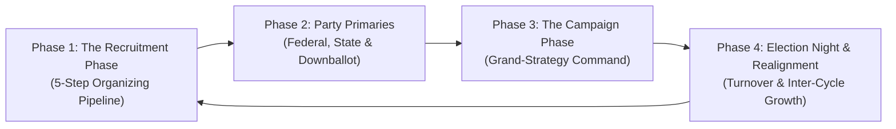

# Coalition Builder: Party Chair — Game Design

> **Version 0.19.3 is the active implemented game baseline.**  
> *(Latest Release: Version 0.19.3 building on v0.19.2; delivering the Gameplay Mechanics Overhaul across F1–F19: candidate recruitment overhaul & duplicate focus prevention, General Persuasion state boost, multi-race average performance drift & signed post-drift voter migration badges, voter-scaled funding lift, State Legislature slate funding, unhappiness exemptions, Live Polling header, Election Night Senate cycle filtering vs 100-seat tracking, top-2 redistricting battle gating, Tier 3/4 courting rebalances, 5 new States officials/seat matrix subtabs, 0-action Step 1 operations, `$2M` chapters & 2× starting balances, scripted party switching, tier-based fundraising yields, and Universal Senate split coloring. Full release history lives in `PRIOR_UPDATES.md`; active backlog tracking lives in [**DESIGN_BACKLOG.md**](DESIGN_BACKLOG.md) and [**TBD_UPDATES.md**](TBD_UPDATES.md)).*

---

## 1. Product Vision & Core Philosophy

**Coalition Builder: Party Chair** is a deep, atmospheric grand-strategy political simulator where the player assumes the role of National Party Chair. The core game philosophy is **continuous, multi-cycle political evolution**: playthroughs unfold continuously across consecutive 2-year cycles (2028, 2030, 2032, 2036, and beyond), where past organizational investments, legislative records, leadership choices, and electoral wins reshape the American political landscape over decades.

- **Voter Scale:** All in-game voter totals and memberships operate on the **155 million actual represented-voter scale** (where each internal sample record represents 100 real citizens), with the single authorized exception of **Era #16 (*Robots Become Citizens*)**, which expands the represented electorate to **~310M+** (`155M human + 155M synthetic` citizens with zero-variance 100% algorithmic participation).
- **Emergent Narrative:** Political drama emerges organically from living numbers, shifting national environments, forecaster predictions, faction revolts, and election night returns.
- **Parties & Ideology:** Players can lead the Democratic Party, Republican Party, Libertarian Party, Green Party, Constitution Party, Socialist Party, or establish an entirely custom political party with its own platform identity.

---

## 2. Two-Year Cycle Progression Architecture

Each two-year election cycle follows a structured four-phase progression:

### Phase 1: The Recruitment Phase (Pre-Campaign Organizing)
The pre-campaign phase is organized into a clean 5-step operational pipeline with a unified pool of **20 Pre-Campaign Leadership Actions**:
1. **Step 1 — Issue Positions:** Chair tunes the party's unified 40-issue platform across 10 core ideological pillars, balancing faction demands and public mood.
2. **Step 2 — Major & Party Focus Priorities:** Select 3 Major Priorities from the Strategic Quests catalog plus Party Focus target slots scaled dynamically by the 5-Stage Institutional Ascent Ladder (**7 for Tier 5 Major parties, 5 for Tiers 3–4 Recognized/Contender parties, 3 for Tiers 1–2 Fringe/Ballot-Qualified parties** via `getMaxFocusSlots()`) across issues, states, and regions (bonuses activate immediately upon clicking the 'Lock In Focuses' button).
3. **Step 3 — Candidate Recruitment & Primary Support:** Inspect 10-stat candidate profiles, Net Approval, and Fame in Senate, House, and Governor races. Recruit top-tier candidates for a flat **$1.0M** fee, or filter primary support (delivering a +10% primary polling boost with faction happiness repercussions: +1 Happiness to the candidate's faction, -3 Happiness to all rival party factions; Confidence is unaffected).
4. **Step 4 — State Legislative Slate Contestation:** 
   - **1-Seat Automatic Contestation:** Parties automatically contest state legislative chambers in any state where they control $\ge 1$ seat.
   - **Slate Action (Unheld States):** In states with zero seats, contesting a full legislative slate costs **$1M–$5M scaled by Electoral Votes** (3 EVs = $1M; 54 EVs CA = $5M) plus 1 Leadership Action.
5. **Step 5 — Direct Organizing Actions:** Spend the 20-action pool on field organizing across a balanced **8-card operational grid (4 on each side)**:
   - *Removed Redundant Cards (`REQ-169`):* Removed 'Hold a Faction Summit' (handled comprehensively in the dedicated top-level Factions Tab) and 'Party Leadership Hierarchy' (redundant shortcut for the persistent Leadership tab), perfectly rebalancing the 2-column recruitment grid to 4 cards on each side.
   - *Core 8 Machine Operations:*
     1. Open a State Chapter ($6M · 1 Action)
     2. Statewide Voter Registration & Outreach ($5M · 1 Action · EV-scaled `REQ-165`)
     3. Court Politician to Caucus / Defect ($4M · 1 Action · `REQ-170`)
     4. State-Targeted Policy Bill ($2–3M · 1 Action)
     5. National Convention Keynote Speaker (Free · 1x Cycle · Party Leaders Only `REQ-168`)
     6. Recruit State Candidate (1 Action)
     7. Send a Leader on State Tour (1 Action · Party Leaders Only `REQ-168`)
     8. Run a Small-Donor Drive (1 Action · dynamic yield)
   - *Streamlined UI Controls:* Features a single target state selector dropdown and a gold `[ Register ]` button (redundant/non-functional second demographic dropdown removed).
   - *EV-Scaled Voter Gains:* Directly enrolls new registered voters in the target state scaled by that state's Electoral Vote count:
     - **Minor Parties:** $+1,000\text{ registered voters per EV}$ (e.g. $+3,000$ in VT/WY/AK, $+6,000$ in UT, $+54,000$ in CA).
     - **Major Parties:** $+2,500\text{ registered voters per EV}$ (e.g. $+7,500$ in VT/WY/AK, $+15,000$ in UT, $+135,000$ in CA).
   - *Instant Live Synchronization:* Voter increases immediately mutate `game.voterModel.states` and reflect in real time on the Disaggregated State Voter Registration Table (`REQ-164`).
   - *Party Leader Requirement for Keynote & Tours (`REQ-168`):* Both the **National Convention Keynote Speaker** and **Send a Leader on State Tour** actions strictly require an **actively appointed Party Leader** (from `game.leadershipRoles`, e.g. Chair, Vice Chair, Faction Leaders, Congressional Leaders, or Cabinet). Holding public office alone is insufficient.
   - *Court Politician Mechanics (`REQ-170`):* Expand courting to sitting **Senators, Governors, and House members** (explicitly labeled by office). Politicians affiliated with or in a party refuse to consider leaving unless personal Happiness $\le 40$. Candidates only appear available if the player's party contains a **non-racial faction within 2.0 points ideologically on both social and economic issues**. Major party courting succeeds immediately; minor/third parties must grant an appointed Party Leadership role to secure the defection. Defecting politicians join the player faction closest to their previous ideology.

### Phase 2: Party Primaries
Federal House races, active Senate class races, gubernatorial elections, and state legislative chamber primaries resolve deterministically based on candidate quality, fieldcraft, faction happiness, and chair filtering support.

### Phase 3: The Campaign Phase (General Election Command)
Post-primary general election campaign command:
- **Turn Cadence & Actions:** Structured turn loop with a dedicated pool of campaign actions per turn.
- **Candidate Triage, Funding & Diminishing Returns Polling Curve:** Allocate party committee treasury funds to battleground Senate, House, and Governor nominees. Candidates can be funded freely regardless of happiness rating (even at 100% happiness). Funding candidates costs different amounts based on office: **House races cost $1.0M**, while **Senate and Governor races cost $2.0M** per funding allocation. Treasury allocations directly boost candidate standing in the polls via a calibrated diminishing-returns curve: $1M $\to$ +1.0%, $3M $\to$ +2.0% ($2M $\to$ +1.5%), $7M $\to$ +3.0%, $15M $\to$ +4.0%, $31M $\to$ +5.0%, $63M $\to$ +6.0%, $150M $\to$ +7.0%, and $500M $\to$ +8.0% (interpolating linearly between brackets).
- **Grand-Strategy Actions:** Execute high-leverage strategic operations including statewide Volunteer Drives ($3M · 1 Action to mobilize field volunteers and register 500–10,000 voters in a chosen state via calibrated hidden probability distribution), opposition research dossiers, candidate self-vetting/quarantine, surrogate media blitzes, state ballot measures, independent caucus courtship, and faction threat appeasement.
- **Atmospheric Events & October Surprise:** Settle weekly campaign event dilemmas, culminating in the penultimate late-campaign October Surprise crisis event.
- **Forecaster Consensus Maps (`REQ-173`):** Real-time polling intelligence synthesizing *Cooked Political Report*, *Sallow's Crystal Ball*, and *Upside Elections* into a unified 13-tier continuous consensus forecast, actively accounting for third parties (siphoning dynamics, third-party leading ratings) and live up-to-date polling, dynamically recalculating at the end of every operational turn and phase.
- **Commissioned Race Polling & Archive ($1.0M/Poll):** Ability on the Live Campaign Polling panel to spend $1.0M treasury funds to commission an internal poll on any contested race of choice (Senate, House, Governor, or State Legislature), with an adjacent 'Commissioned polls' button opening an archive of all commissioned surveys.

### Phase 4: Election Night & Inter-Cycle Realignment
1. **Multi-Chamber Resolution:** Simultaneous reporting for the Presidential Electoral College, active Senate class (33–34 seats), all 435 House districts, 11–36 Governors, and 98 state legislative chambers.
2. **The 1/4th Shift Realignment Rule & State-by-State Execution:** Voter blocks shift between elections based on actual popular vote vs. expected vote share ($\Delta \text{Share} = \frac{\text{Actual} - \text{Expected}}{4}$). Parties gain voters only *between* elections, never during them. Crucially:
   - **State-by-State Realignment Engine:** Shifts calculate and apply independently at the **state-by-state level across all 50 states (+ DC)** rather than as a uniform national aggregate. This allows third parties to concentrate organizing, candidate triage, and Volunteer Drives on a specific state, overperform expected baselines locally, and build up a deep, persistent partisan brand and voter registration base in that state over consecutive election cycles.
   - **Targeted Inter-Party Transfers:** Shifted voters explicitly **leave or join certain parties based on ideological alignment**:
     - **Green Party:** Gained voters are drawn directly from the Democratic Party in that state; lost voters return to Democrats.
     - **Socialist Party:** Gained voters are drawn directly from the Democratic Party in that state; lost voters return to Democrats.
     - **Libertarian Party:** Gained voters are drawn directly from the Republican Party in that state; lost voters return to Republicans.
     - **Constitution Party:** Gained voters are drawn directly from the Republican Party in that state; lost voters return to Republicans.
     - **Major Parties (Democrats & Republicans):** Direct competitive two-way swing voter exchange, plus net inflows/outflows from third-party ideological wings.
     - This ensures third parties actively cannibalize or forfeit voters to their specific major-party counterparts upon overperforming or underperforming in targeted states.
   - **Synchronized Voter Faction Realignment (`REQ-175`):** Whenever voters change parties via the 1/4th Shift Realignment Rule, their underlying faction affiliations (`state.factions` and `voterModel.factions`) change as well. Shifting voters vacate factions in their former party and join ideologically closest recipient factions in their new party (e.g. Greens $\leftrightarrow$ Democrats transferring via *Progressive Activists*; Libertarians $\leftrightarrow$ Republicans transferring via *Liberty Caucus*; Dem $\leftrightarrow$ GOP swing transferring via *Suburban Moderates* and *Main Street Conservatives*), reconciling national faction totals dynamically.
3. **Dynamic Voter Registration Growth via GOTV & Year-Over-Year Persistence (`REQ-172`):** The legacy flat growth rate (+3% annually / +6.09% per cycle) is completely removed. Instead, total voter registration expands dynamically through active **Get Out The Vote (GOTV) and field operations** (such as statewide Volunteer Drives, Statewide Voter Registration & Outreach, and local organizing). GOTV operations bring non-voters into the registered electorate, directly increasing total voter registration in that state rather than taking voters from other parties. Crucially, **all gains made to voter registration carry over permanently between cycles** ($2028 \to 2030 \to 2032 \to 2034+$), cumulatively increasing the total number of registered voters nationwide year over year. Realignment rules and cycle transitions must never reset state voter rolls back to static baselines or erase cumulative expansion.
4. **Constitutional Turnover:** Rotates Senate classes ($\text{Class III} \to \text{Class I} \to \text{Class II}$), alternates between Presidential and Midterm cycles, updates 4-year staggered gubernatorial schedules, and resets leadership action pools.

---

## 3. Candidate Traits Engine

Every politician across the 605-member database is assigned 1 to 3 qualitative personality traits from 8 canonical archetypes:

| Trait | Narrative Profile | Stylized Badge Style |
| :--- | :--- | :--- |
| **Rising Star** | Rapidly gaining national media buzz and grassroots momentum; age $<60$. | Gold Badge |
| **Established politician** | Veteran of Congress, governorships, or party apparatus with seniority. | Platinum Badge |
| **Corrupt** | Dogged by federal ethics probes, campaign finance controversies, or indictments. | Warning Amber Badge |
| **Squeaky Clean** | Flawless public record and unquestioned ethical reputation. | Emerald Badge |
| **Polished** | Charismatic orator, disciplined debater, camera-ready communicator. | Cyan Badge |
| **Rough** | Unfiltered, plainspoken outsider with authentic blue-collar populist appeal. | Bronze Badge |
| **Disciplined** | Sticks strictly to message, manages media appearances, and avoids unforced gaffes. | Royal Blue Badge |
| **Undisciplined** | Prone to off-script controversies and unpredictable media outbursts. | Crimson Badge |

Traits render as visual badges across candidate inspection profiles, primary endorsement cards, and leadership appointment dropdowns.

---

## 4. Institutional Leadership Hierarchy & Chamber Scoping

The party leadership hierarchy models authentic constitutional qualifications and government roles:
- **Dynamic Faction Leaders (Major Factions Only):** Faction Leader leadership slots (Category B) strictly correspond to the actual, living constituent factions of the party. Only **Major factions** ($\ge 2.5\text{M}$ registered voters, including the Leading faction) are entitled to a Faction Leader role. Under the 38-faction model, both the Democratic and Republican parties have **exactly 7 Faction Leaders**:
  - *Democratic Party (7 Leaders):* Liberal Establishment Leader, Black Voters Leader, Capital L Left Leader, Neo-Liberals Leader, Bernie Bros Leader, Faith Based Liberals Leader, Blue Dog Democrats Leader. (Minor faction *Traditional Latin Voters* does not receive a leader).
  - *Republican Party (7 Leaders):* Faith & Flag Conservatives Leader, Nationalist Populists (MAGA) Leader, Liberty & Western Mavericks Leader, Blood and Soil Nationalists Leader, Frontier & Suburban Moderates Leader, Neo-Cons Leader, Paleocons Leader. (Minor factions *Mormons*, *Traditional Farmers*, *Market Conservatives*, and Fringe *Cubans* do not receive leaders).
  - *Appointment Rules:* Candidate appointment dropdowns strictly filter to politicians belonging to that specific faction, and appointing a member immediately awards **+3 Confidence** to that faction. Minor and Fringe factions do not generate leadership roles unless they grow to Major status ($\ge 2.5\text{M}$ voters) at cycle boundaries.
- **Inaccessible Role Masking:** Roles the party cannot hold (e.g. Speaker without a House majority; President when out of power) are hidden from view.
- **Governing Cabinet (4 Roles):** Unlocked when holding the White House:
  - *Chief of Staff* (Administration discipline & party harmony)
  - *Secretary of the Treasury* (Economic stability & donor confidence)
  - *Attorney General* (Ethics insulation & legal oversight)
  - *Secretary of State* (Foreign policy standing & national prestige)
- **Opposition Leadership (3 Roles):** Unlocked for the largest non-governing party:
  - *House Opposition Leader* (House minority coordination)
  - *Senate Opposition Leader* (Senate minority filibuster discipline)
  - *Opposition Chief* (National media spokesperson & messaging)
- **Chamber-Exclusive Scoping:** Strict separation of powers: only sitting House members can serve in House leadership; only sitting Senators can serve in Senate leadership; sitting legislators cannot concurrently serve in executive Cabinet posts.
- **Faction Confidence Reward (+3 Points):** Appointing a politician to any institutional leadership position (Cabinet post, Congressional leadership, Opposition leadership, or Party leadership role) immediately raises that politician's aligned faction confidence by **+3 points** (`faction.confidence = Math.min(100, faction.confidence + 3)`).

---

## 5. Electoral Simulation & Forecaster Modeling

- **House Pure District Leans:** All 435 congressional districts use authentic Cook PVI baselines, decoupling House races from statewide partisan averages.
- **Absolute Baseline Partisan Lean:** Map mode displaying fundamental state partisan DNA completely isolated from short-term national waves, approval drag, or ad spend.
- **Constitutional Senate Class Map:** Defaults to active constitutional Senate class (Class I, II, or III); inactive classes show existing control in muted shades.
- **Unified Trifectas Map:** 3-category display (Democratic Trifecta, Republican Trifecta, Divided Government); Nebraska unicameral neutral gray.
- **Pundit Forecaster Suite & Relocated Forecast Maps:**
  - *Forecasters Tab Architecture:* The interactive Presidential, Senate (cycling active constitutional class), House, and **State Legislatures (50 States)** (`REQ-182`) projection maps are situated inside the **Forecasts** tab, positioned directly between the multi-chamber pundit cards and the battleground ratings comparison table.
  - *Pundit Forecaster Suite (5 Projection Models):*
    - *Consensus Forecast* (13-tier continuous blended gradient)
    - *Cooked Political Report* (Discrete 7-tier battleground ratings)
    - *Sallow's Crystal Ball* (Discrete 7-tier momentum-adjusted ratings)
    - *Upside Elections* (Discrete 7-tier grassroots-weighted ratings)
    - *Polling Average (Live Sim)* (`REQ-181`: Live simulation shares from `supportByState` with continuous margin-intensity gradients, per-party hover breakdown, and national polling scoreboard bar)
  - *Multi-Party & Third-Party Forecaster Ingestion (`REQ-173`):* Forecasters account for 3rd parties (Libertarian, Green, Constitution, Socialist, Independent, and custom parties) based on ballot qualification, candidate quality, state voter registration rolls, and candidate funding. Third-party strength siphons votes from ideological counterparts (Greens/Socialists draw from Dems; Libertarians/Constitution draw from GOP). When third parties lead, forecasters assign ratings to that party (e.g. `Tilt LIB`, `Lean GRN`, `Solid SOC`).
  - *Third-Party Forecast Map Color Gradients (`REQ-174`):* Forecast maps (Presidential, House, Senate) dynamically shade states and districts won or led by third parties using calibrated multi-tier color gradients (Solid, Likely, Lean, Tilt) matching each party's brand (e.g. Emerald Green for Green Party, Gold/Amber for Libertarians, Purple for Constitution, Deep Rose for Socialists, Teal for Independents).
  - *Forecast Legend Omission Protocol (`REQ-174`):* Third-party colors are strictly omitted from forecast map keys, gradient legend bars, and outlet scale bars (`.v08-gradient-legend`, `.map-legend`, `.v08-gradient-continuous-bar`), keeping legends anchored cleanly to the traditional Democratic $\leftrightarrow$ Republican continuum without UI clutter. Any player advancing a third party to leading status will visually understand and recognize the color dynamics on the map.
  - *Live Polling Synthesis (`REQ-173`):* Rather than relying solely on static PVI or baseline state leans, forecasters actively synthesize up-to-date polling data, including internal commissioned polls (`game.commissionedPolls`), weekly campaign tracking shifts, wave momentum, and candidate ad triage.
  - *Turn-End & Phase-End Forecast Refresh Invariant (`REQ-173`):* Forecasts recalculate and update systematically at the end of every individual operational turn (machine operation actions in Phase 1, campaign actions in Phase 3) and at every phase transition (Phase 1 exit, Phase 2 exit, Phase 3 exit, Phase 4 exit), ensuring pundit predictions are continuously reactive to player and rival moves.
- **Political Landscape Maps (Current & Historical Reality):**
  - *Recent Presidential Election Map:* Displays the outcome of the most recent presidential contest (starts with certified 2024 results, updates post-election).
  - *Current House Control Map:* Displays incumbent party control across all 435 congressional districts.
  - *Current Senate Class Map:* Displays current seat control for the active Senate class going into the election (not a forward projection).
  - *Combined 50-State Senate Map:* 50-state delegation map shaded Blue (2 Dem senators), Red (2 GOP senators), or Purple (split 1 Dem / 1 GOP delegation).
- **50-State Directory & Disaggregated State Voter Registration Table:**
  - *Real-Time Reactive Table Updates:* The Disaggregated State Voter Registration Table reflects registered voter gains immediately upon action execution (such as Volunteer Drives, Party Focus lock-ins, or field organizing) rather than waiting for cycle turnover.
  - *Live State Binding & Resolution:* Table rows dynamically query live represented voter counts and party affiliations across all states, providing instant visible confirmation of voter expansion (e.g. newly registered voters in Vermont) with appropriate numerical precision and in-cycle delta feedback.
  - *Multi-Cycle Cumulative Electorate Growth (`REQ-172`):* All registered voter increases achieved during in-cycle operations carry over permanently into subsequent 2-year cycles, accumulating indefinitely to expand the total electorate year over year rather than resetting to hardcoded 155M baselines.

---

## 6. Factions Management & Dashboard Architecture

- **Dedicated Top-Level Factions Tab (`factionsTabMarkup()`):** The primary, authoritative dashboard for faction health, national membership rolls, per-state demographic allocations, dual meters (Standing/Happiness vs. Internal Confidence), Friction Indices, Ultimatum statuses, and multi-cycle Coalition Compacts.
- **National Coalition Directory Filtering (Separate Minor vs. Unaffiliated):**
  In the Factions Tab directory, the filter pills and categorization explicitly separate minor party factions from unaffiliated factions:
  1. *Democratic Factions (8)*
  2. *Republican Factions (11)*
  3. *Independent / Swing Factions (9)*
  4. *Minor Party Factions (7):* Registered third-party factions across Libertarian (*True Libertarians*, *Ancaps*), Green (*Eco-Socialist Vanguard*, *YIMBYs*), Constitution (*Christian Dominionists & Theocrats*), and Socialist (*Socialists*, *Communists*) parties.
  5. *Unaffiliated Factions (3):* Non-party, non-swing extremist factions (*Groypers*, *The Klan*, *Neo-Nazis*) operating outside all party ballot lines.
- **Deprecation and Removal of Legacy "Faction Confidence" Sidebar Panel (Option 3):**
  Now that the dedicated top-level **Factions Tab** (`factionsTabMarkup()`) is fully implemented—featuring the complete 28-faction catalog, state demographic voter matrices, dual meters (Standing/Happiness vs. Internal Confidence), Friction Indices, Ultimatums, and multi-cycle Coalition Compacts—the legacy **"Faction Confidence"** sidebar widget in the Party Information / Dashboard view is obsolete and creates flavor/UI redundancy.
  - *Markup Removal:* Remove the legacy section in `app.js` (lines 5070–5077, `
${factionsMarkup()}
`) and deprecate `factionsMarkup()` (around line 1021).
  - *Sidebar Layout Refit:* Reclaim vertical screen real estate in `<aside class="right-column">`, cleanly prioritizing:
    1. **Unified Platform Profile** (`platformMarkup()`)
    2. **State Policy Bills / Legislative Session** (`legislationMarkup()`)
    3. Other relevant high-level party metadata.
  - *Simulation Engine Preservation:* Ensure removing the visual widget does not affect underlying simulation logic in `engine.js`: faction standing shifts from candidate recruitment defeats, filtering support, events, and convention keynotes continue to feed active state (`game.factionHappiness`, `game.factionConfidence`, `game.factionStandings`), and national turnout drag (`factionPenalty(game)`) remains fully active and reported in the top-level Factions Tab.
- **Primary Filtering Support Shifts Happiness (Not Confidence):**
  Using the "Filtering Support" action to endorse and resource a primary candidate ($100k party funds + 1 Organizing Action) delivers an immediate +10 point polling boost to that candidate:
  - **Happiness Impact:** Awards **+1 Happiness** to the candidate's aligned faction and inflicts **-3 Happiness** on all other party factions (reflecting rank-and-file resentment against establishment favoritism).
  - **Confidence Impact:** Internal Confidence is **unaffected** by primary filtering support.
- **Remove Verification Checkmark Badge from Factions Header:**
  Remove the green verification badge (`.v15-cert-badge`, "✔ Zero-Variance 155M Voter Model Verified") from the top banner in the Factions Tab (`factionsTabMarkup()`), keeping the header clean and eliminating meta-developer clutter.

---

## 7. Politician Faction Affiliation & Dynamic Happiness Coupling

> **Universal Terminology Invariant:** The term **Politician** refers universally to every single character in the game across all roles: **candidates** (recruits, primary hopefuls, nominees), **leaders** (Party Chair, national committee leaders, faction leaders, cabinet heads), and **sitting politicians** (sitting House members, Senators, Governors, and state legislators).

Every politician in the game is anchored to an ideological or demographic faction, binding personal career trajectories to factional fortunes:

### 1. Faction Assignment (Public Perception Mapping)
- Every politician in the roster (sitting House members, Senators, Governors, state legislators, Party Elders, and recruitment prospects) is assigned to **exactly one faction** based on real-world public perception, rhetorical style, and policy record (e.g. progressive insurgents to *The Capital L Left* or *Bernie Bros*; establishment leaders to *The Liberal Establishment*; MAGA firebrands to *Nationalist Populists*; libertarian conservatives to *Liberty & Western Mavericks*; rural centrists to *Blue Dog Democrats*).

### 2. Faction Defection & Collective Exit Rule
- Faction loyalty precedes party loyalty: **If a faction leaves the party, all affiliated politicians follow their faction and exit the party as well.**
- When a faction bolts, detaches, or mounts a regional splinter run (via Bolt Threats `REQ-30`, Coalition Summit collapse `SUM-01`, or cohabitation backlash):
  - All sitting officeholders belonging to that faction instantly defect from the party.
  - Their seats flip to Independent or the faction's new third-party ballot line.
  - Any defecting politicians vacate party leadership posts, congressional gavels, and Cabinet offices immediately.

### 3. Happiness Coupling & Synchronized Co-Movement
- **Starting Baseline:** A politician's starting Happiness is initialized directly from their aligned faction's baseline Happiness:
  $$\text{politician.happiness} = \text{faction.happiness}$$
- **Synchronized Movement:** Whenever a faction's collective Happiness changes ($\Delta H_{\text{faction}}$) due to platform slider realignments, state policy bills, convention keynotes, or government control losses, all member politicians experience the same movement:
  $$\text{politician.happiness} = \text{clamp}(\text{politician.happiness} + \Delta H_{\text{faction}}, 0, 100)$$

### 4. Organic Drift & Personal Chair Favoritism
- While tied to their faction's general trajectory, individual politicians **drift apart** from their faction baseline based on direct personal interactions with the Party Chair:
  - **Primary Filtering Support:** A candidate receiving chair filtering support gains $+10$ individual happiness, while unbacked primary rivals suffer an individual $-5$ penalty.
  - **Campaign Ad Funding Triage:** Pumping treasury ad funds into a nominee during the General Campaign Phase boosts their individual happiness (up to $+15$).
  - **Leadership & Rising Star Elevation:** Appointing a politician to a leadership role or designating them a Rising Star provides personal happiness buffers.
  - **Neglect & Underfunding:** Politicians passed over for promotion or starved of general election campaign funds suffer personal happiness decay, drifting below their faction's average.
- This creates rich emergent narratives where a loyal, well-funded politician remains personally content even while their faction is restless, or where an aggrieved, underfunded candidate bolts early despite their faction being broadly cooperative.

### 5. Universal Faction Display & Legacy Party Wing Deprecation
- **Universal Politician Faction Badge:** Every politician in the game (candidates, leaders, and sitting politicians) visibly displays their aligned faction name via an in-universe badge across all UI screens (Candidate Recruitment, Primary Endorsements, General Election Triage, Leadership Profiles, and 50-State Sitting Member Dossiers).
- **Purge of Legacy "Party Wing" UI:** The obsolete pre-v0.15 "party wing" concept is fully deprecated; all "wing" text, chips, and labels are removed from character inspection markup.
- **Dropdown Exclusion:** Native select dropdown menus (`<select>`) are strictly excluded from injecting HTML badge tags to maintain clean native UI rendering.

### 6. Cross-Party Courting, Defection & Faction Realignment
- **Multi-Chamber Scope:** The Chair can court sitting **Senators, Governors, and House members** (explicitly displaying their sitting office in selection dropdowns).
- **Discontent Gate ($\le 40$ Happiness):** Party members and aligned independents will refuse to consider leaving unless their personal Happiness is **40 or lower**. Content politicians will not consider switching.
- **Ideological Alignment Bridge (Non-Racial Faction):** A disgruntled politician only becomes available to court if the player's party contains a **non-racial faction within 2.0 points ideologically on both social and economic issues** of the politician's current faction ($|\Delta \text{Econ}| \le 2.0$ and $|\Delta \text{Social}| \le 2.0$). Racial identity factions cannot serve as this bridge.
- **Party Tier Demands:**
  - **Fringe Gate (Tier 1 Barred):** Fringe parties (`Tier 1 — Fringe`, `< 2%` national baseline) **cannot court sitting politicians under any circumstances**. Sitting Senators, Governors, and Representatives view joining a 0-ballot, unestablished movement as political oblivion and refuse all approaches.
  - **Tier 2+ Courting:** Major parties (`Tier 5`) succeed unconditionally upon execution ($4M · 1 Action). Minor/emerging parties (`Tier 2` through `Tier 4`) must offer an appointed **Party Leadership role** (`leadershipRoles`) to secure the defection.
- **Immediate Resource Tracker Synchronization:**
  - When a politician successfully defects to the player's party, the top-level KPI resource strip (`.resource-strip.panel` below the National Committee Budget and Represented Voters tracker) **immediately increments the respective chamber/office seat count**:
    - **U.S. House (`office === 'house'`):** Immediately adds **`+1`** to **U.S. House Seats** (`playerHouseSeats()`), updating delegation tallies and maps in real time.
    - **U.S. Senate (`office === 'senate'`):** Immediately adds **`+1`** to **U.S. Senate Seats** (`playerSenateSeats()`), re-attributing the state's sitting Class seat to the player's party.
    - **Governor (`office === 'governor'`):** Immediately adds **`+1`** to the **Governorships Controlled** tally (`game.governorships[stateId] = playerParty`), updating the state executive map and gubernatorial resource metrics in real time.
- **Faction Re-Affiliation:** Upon defecting, the politician joins the faction in the player's party that is closest to their previous faction's ideology, coupling their happiness to that faction baseline.

### 7. Phase-End Faction-to-Party Inheritance Invariant
- **Strict Faction-to-Party Inheritance:** Whenever a politician is in a faction:
  - If that faction belongs to a recognized political party (`faction.partyId` exists), the politician belongs to that party (`politician.party = faction.partyId`).
  - If that faction is not in a party (unaffiliated, independent, or bolted/detached factions), the politician is an **Independent** (`politician.party = 'independent'`).
- **Phase-End Verification:** The simulation engine enforces and updates this inheritance check systematically **every time a phase ends** (Recruitment $\to$ Primaries $\to$ Campaign $\to$ Election Night / Realignment), guaranteeing that faction departures or party mergers instantly and automatically synchronize across all member politicians.

---

## 8. Third-Party Ascent & Multi-Party Democracy Architecture (`REQ-176` – `REQ-194`)

Version 0.15.9 replaces binary two-party assumptions with a full multi-party progression and institutional bargaining architecture:

### 1. 5-Stage Institutional Ascent Ladder (`REQ-176` – `REQ-180`)
- Persisted in `game.partyTiers` (`1` through `5`), with `isMajorParty()` cleanly wrapping `tier >= 5` and `getMaxFocusSlots()` returning `3` (Tiers 1–2), `5` (Tiers 3–4), or `7` (Tier 5):
  - **Tier-Scaled Favorability / Approval Caps:** Minor parties are hard-capped in Unified Party Favorability / Approval (`computeUnifiedPartyApproval`) based on their current tier, preventing premature popularity surges until higher rungs are earned. The cap scales up across rungs and is fully removed once reaching major party status:
    - **Tier 1 (Fringe):** Capped at **`5.0%`**.
    - **Tier 2 (Ballot-Qualified Minor):** Capped at **`10.0%`**.
    - **Tier 3 (Federally Recognized Party):** Capped at **`18.0%`**.
    - **Tier 4 (Debate-Qualified Contender):** Capped at **`25.0%`**.
    - **Tier 5 (Major Party Status):** **Cap Removed** (Unbounded standard major-party range of 8.0%–92.0%).
  1. **Tier 1 — Fringe (`<2%`):** Starting baseline for minor/custom parties; suffers media blackout headwinds (`getMediaVisibilityProfile`); favorability hard-capped at **`5.0%`**.
     - **Ballot Access Invariant:** Fringe parties **do not have ballot access anywhere** across all 50 states + D.C. at baseline, and receive zero automatic statutory retention. They must actively run and certify petition drives (`REQ-207`) state-by-state to appear on any ballot.
     - **Courting Invariant:** Fringe parties **cannot court sitting politicians** under any circumstances (`REQ-170`); sitting federal and gubernatorial lawmakers will not entertain defection until the party ascends to at least Tier 2 (Ballot-Qualified Minor).
  2. **Tier 2 — Ballot-Qualified Minor (`2%–5%` or sustained multi-state ballot access):** Unlocks Regional Chapter Momentum (`REQ-178`) and Fusion Voting cross-endorsements (`REQ-189`); favorability capped at **`10.0%`**.
  3. **Tier 3 — Federally Recognized Party (`>=5%` Pres):** Expands focus slots to 5, grants passive FEC Public Matching Funds (`computeFecMatchingFunds`), and activates Automatic State Ballot Retention at `>=2.0%` (`REQ-179`); favorability capped at **`18.0%`**.
  4. **Tier 4 — Debate-Qualified Contender (`>=15%` national polling):** Shatters broadcast blackout permanently (`REQ-177`), fires the one-time *Presidential Debate Stage* milestone event, and seeds 1–2 fledgling allied Super PACs with \$5M–\$10M warchests (`REQ-180`); favorability capped at **`25.0%`**.
  5. **Tier 5 — Major Party Status:** Achieved via any of three paths—`>=20%` Presidential popular vote, midterm institutional critical mass (`>=35` House seats, `>=8` Senators, or `>=5` Governors), or eclipsing a major party in national popular vote—expanding focus slots to 7, unlocking full national Super PAC coordination, and **removing all favorability caps**.

### 2. Duverger's Law, Breakthroughs & State Electoral Systems (`REQ-183` – `REQ-186`)
- **Strategic Voting Defection (`REQ-183`):** In plurality contests below a 16.5% viability threshold, non-major parties lose 40%–65% of votes on Election Day to the nearest major party (`computeStrategicVotingDefection`).
- **Ceiling Shattering & Regional Snowball (`REQ-184`):** Crossing `>=16.5%` share or winning Governor, Senate, or `>=2` House seats in a state permanently eliminates defection there (`game.viabilityBreakthroughs`) and spreads regional relief via `OVERLAPPING_REGIONS` (halving defection severity and dropping neighboring thresholds to 11%).
- **State Electoral Systems (`REQ-185`):** Per-state rules in `game.stateElectoralSystems` (with Alaska starting on Ranked-Choice Voting), supporting **RCV**, **Approval Voting**, and **Proportional Representation** (5% threshold for `>=5`-seat House delegations and State Legislatures)—all exempting contests from Duverger's penalty (`0%` defection).
- **Inter-Cycle Electoral Reform Prototype (`REQ-186`):** 60% inter-cycle weighted rollout in `startNextCycle()` with dismissible notification popup (temporary playtest prototype pending `TBD-02`).

### 3. Kingmaker Caucuses, Fusion Voting & 12th Amendment Contingent Elections (`REQ-187` – `REQ-191`)
- **Hung Chamber Kingmakers (`REQ-187`, `REQ-188`):** When neither major party reaches 218 House seats, 51 Senate seats, or a state legislative majority and the player's caucus holds the balance of power, Confidence-and-Supply negotiations allow extracting Committee Gavels, Electoral Reform & Ballot Access, or Stronghold State Funding (with purist backlash when backing an ideologically distant major party).
- **Fusion Voting (`REQ-189`):** Tier 2+ minor parties cross-endorse major-party nominees for a Policy Pledge, gaining Ballot Retention Credit, voter registration growth, and legislative leverage.
- **12th Amendment Contingent Elections (`REQ-190`, `REQ-191`):** Sub-270 multi-party Electoral College deadlocks trigger constitutional 50-state U.S. House delegation counting (26 needed) and an Election Night brokering modal for Federal Cabinet appointments, binding platform planks, or multi-state electoral reform.

### 4. Big-Tent Inflection Point, Party Doctrine & Purist Backlash (`REQ-192` – `REQ-194`)
- Minor and custom parties track founding factions and a designated `puristVanguardFactionId`.
- Crossing `>=65%` non-founding swing faction voter share or `>=7.5M` total party voters triggers the **Ideological Crossroads** modal:
  - **Moderate & Professionalize (`doctrine: 'big_tent'`):** Cuts cohabitation turnout drag by 60%, boosts Independent Trust (+9), unlocks institutional donors, and triggers a **"Sellout" Backlash** (-28 happiness shock + 2-turn bolt ultimatum on the purist vanguard that spawns a named Splinter Fourth Party in `game.activeSplinters` if unappeased).
  - **Stay Pure / Populist Vanguard (`doctrine: 'vanguard'`):** Grants permanent Supporter Trust (+9) and grassroots momentum while capping suburban centrist appeal.

---

## 9. The Party Systems Evolution Engine (`MAS-01`)

Version 0.16.0 implements the complete macro-simulation framework governing political eras, ideological transitions, and platform evolution:

### 1. The Party Systems State Machine & Transition Cadence
- **Baseline:** Playthroughs begin in the **7th Party System** (2028).
- **Eligibility Floors:**
  - **8th Party System Floor:** No new party system may trigger prior to **2040**.
  - **9th+ Party System Cooldown:** A minimum of **30 years** must elapse between subsequent party systems (`priorEraStartYear + 30`).
- **Escalating Biennial Probability Roll:**
  - Evaluated once every 2-year election cycle during inter-cycle turnover (`startNextCycle()`).
  - Begins at **10%** in the first eligible year (2040) and increases by **+5% per cycle** (2040: 10%, 2042: 15%, 2044: 20%, 2046: 25%, ... up to 100%).
- **Weighted Selection Pool & No-Repeat Invariant:**
  - **Normal Eras (Weight = 1):** Eligible in any valid transition cycle.
  - **Triggered Eras (Weight = 3):** Eligible when specific conditions are met (e.g. Extremist President, 6-Party Senate, Landslide Wave).
  - **Follow-Up Eras (Weight = 5):** Successor eras eligible when predecessor eras have occurred.
  - **No-Repeat Invariant:** Each era fires at most once per multi-decade campaign.

### 2. 41-Issue Dynamic Platform Swapping Pipeline
- **Continuous Living History:** Surviving parties, factions, and institutional records persist across transitions without resetting to 2028 baselines.
- **1-to-1 Issue Swapping Catalog:**
  - Transitioning into the 8th Party System swaps 5 to 10 era-exclusive issues into the active 41-issue platform, retiring paired baseline issues from `issues-0.2.1.js`.
  - 9th+ transitions introduce new era-exclusive issues while retiring active issues at random (giving earlier era issues a probabilistic chance of sunsetting).
- **Intelligent Stance Initialization:** Newly introduced issues initialize party stances (`1–10`) randomly within $\pm 2$ points of that party's current average stance in that issue's broad category (or within $\pm 2$ points of the party's overall average across all issues if an entirely new issue area).
- **Automatic Faction Key-Issue Replacement:** Factions whose Key Issue is sunsetted automatically inherit another active issue from the same category, ensuring every faction permanently maintains 2 valid Key Issues.

### 3. Atmospheric UI Suite & Qualitative Dossiers
- **Fullscreen Realignment Modal:** Triggers on era entry with historical chronicle narrative, visual theme accents, emergent vs. retired platform planks, and Chair realignment choices (e.g. defecting to the Moderate Party in #2 or choosing a post-breakup party in #18).
- **Top-Bar Era Badge & Qualitative Dossier:** Replaces static era badges with an in-universe top-bar indicator opening a rich qualitative Era Dossier explaining active fault lines, special dynamics, and emergent issues without exposing raw mathematical formulas, weights, or percentages (`GAME_STYLE_GUIDE.md`).
- **Historical Chronicle:** Records a permanent multi-decade log of each experienced Party System, start dates, and lasting legacies.

### 4. Specialized Era Subsystems
- **Independent Presidential Campaigns (Active Across All Eras / Amplified in #5):** 20% quadrennial cadence generating high-fame non-party candidates across 4 archetypes (Centrist Technocrat, Anti-Establishment Populist, Self-Funded Reformer, Maverick Statesman) dynamically peeling votes from both major parties.
- **Nationwide MMP Coalition Governance & 2-Faction Breakup (#18):** Unlocks when $\ge 6$ distinct parties hold seats; shifts House to 435-seat nationwide Mixed-Member Proportional representation, splits major parties into independent 2-faction successor parties, and implements confidence-and-supply coalition ministry pacts.
- **Synthetic Citizen Suffrage (#16 Robots Become Citizens):** Enacts the singular authorized expansion beyond the 155M human voter baseline, integrating 15M–25M registered synthetic citizens into the electorate with unique compute/personhood policy priorities and robot-advocacy party dynamics.
