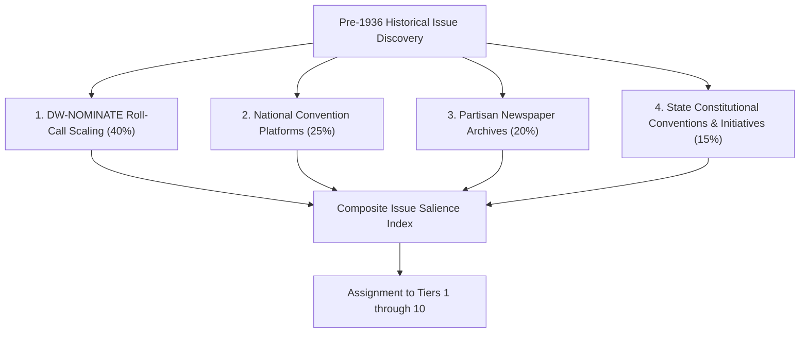

# Historical Issues Methodology: 1936–1960 Weighting & Pre-1936 Framework

This document establishes the formal methodologies for extending historical election issues in *Coalition Builder: Party Chair* back before 1960, fulfilling two specific architectural mandates:
1. **Weighting adjustments for the 1936–1960 era** (calibrating for the emergence of early scientific polling, the bipartisan Conservative Coalition, and mass radio media).
2. **Alternative institutional methodology for pre-1936 cycles (1788–1934)**, where scientific random-sample public opinion polling did not exist.

---

## Part 1: Salience Weighting Adjustments for 1936–1960

In the post-1960 modern era (1960–2026), issue tier assignment is driven by:
- **Scientific Opinion Polling (40%)**: Continuous tracking (Gallup, Roper, Harris, Pew, VNS/Edison exit polls).
- **National News Media (30%)**: Network television evening news, front-page print density, syndicated editorials.
- **Congressional & Legislative Roll Calls (20%)**: Floor votes, filibusters, presidential vetoes, statutory enactments.
- **Grassroots & Direct Democracy (10%)**: State ballot referendums, mass protest rallies, union walkouts.

For the **1936–1960 era** (from the New Deal realignment through the Eisenhower presidency), these weights are modified to reflect the historical realities of information flow and political power:

| Component | Modern Weight (1960–2026) | Adjusted Weight (1936–1960) | Justification & Data Sources |
| :--- | :---: | :---: | :--- |
| **Congressional Roll Calls & Committee Clashes** | **20%** | **35%** | **The Conservative Coalition (1937–1960):** The bipartisan bloc of Southern Democrats and Northern Republicans dominated Capitol Hill. Most contentious domestic battles occurred in committee gatekeeping (House Rules under Howard W. Smith) and Senate filibusters rather than nationwide referendum votes. Source: *DW-NOMINATE congressional roll-call indices & CQ Almanacs*. |
| **National News Media & Radio Transcripts** | **30%** | **25%** | **Mass Radio & Metropolitan Dailies:** Prior to universal television ownership (which reached 85% of homes only by 1958), the public agenda was shaped by radio broadcasts (FDR's Fireside Chats, Edward R. Murrow, Walter Winchell) and syndicated print columns (Walter Lippmann, Arthur Krock). |
| **Early Scientific Polling Time-Series** | **40%** | **25%** | **Nascent Polling Infrastructure:** George Gallup founded the American Institute of Public Opinion in 1935; Archibald Crossley and Elmo Roper launched scientific polls in 1936. While methodologically revolutionary, polling was conducted at lower frequencies (monthly or bi-monthly) with smaller question batteries, heavily skewed toward foreign policy and presidential approval. Source: *Gallup Brain historical archives & Roper Center for Public Opinion Research*. |
| **Organized Sectional & Institutional Pressure** | **10%** | **15%** | **Mass Labor, Agriculture & Civil Rights Institutions:** Direct democracy initiatives were less frequent than in the post-1978 era; public mobilization occurred through institutional pressure groups: the CIO/AFL labor strikes, the American Farm Bureau Federation (farm parity price demands), the American Legion, and early NAACP legal campaigns. |

### The Sectional Bifurcation Modifier (Southern Democrats vs. Northern Democrats)
Between 1936 and 1960, the six starting parties in the game model must account for the unique structural cleavage of the New Deal coalition:
- **Northern Urban Liberals & Machine Democrats**: Pro-labor (Wagner Act), pro-civil rights (FEPC), pro-welfare state.
- **Southern Bourbon / Dixiecrat Democrats**: Anti-labor unionization (Taft-Hartley), pro-segregation (Jim Crow, states' rights, anti-lynching filibusters), fiscally conservative, but strongly interventionist on defense and farm subsidies.
- **Eastern / Wall Street Internationalist Republicans (Dewey, Willkie, Eisenhower)**: Accepted New Deal social welfare baseline, strongly internationalist (NATO, Marshall Plan), pro-civil rights.
- **Midwestern / Conservative Nationalist Republicans (Taft, Bricker)**: Anti-New Deal, anti-statist, strictly isolationist / non-interventionist, anti-labor union monopolies.

**Calculation Formula for Issue Salience Score (1936–1960):**
$$\text{Salience Score} = (0.35 \times \text{RollCall}_{\text{scaled}}) + (0.25 \times \text{Media}_{\text{scaled}}) + (0.25 \times \text{Poll}_{\text{scaled}}) + (0.15 \times \text{Institutional}_{\text{scaled}})$$

Tiers 1 through 10 are assigned by standard decile thresholds of this composite Salience Score.

---

## Part 2: Institutional Methodology for Pre-1936 Cycles (1788–1934)

Scientific random-sample polling did not exist prior to 1935. Straw polls—most notoriously the *Literary Digest* mail-in subscription poll—were unscientific, non-random, and severely biased toward affluent vehicle and telephone owners.

To reconstruct election issues from **1788 to 1934** with high historical fidelity, we use a four-pillar institutional and behavioral methodology:

### Pillar 1: DW-NOMINATE Congressional Roll-Call Scaling (40% Weight)
- **Method**: Keith Poole and Howard Rosenthal's DW-NOMINATE (Dynamic Weighted Nominal Three-step Estimation) scales every roll-call vote taken in the U.S. House and Senate from the 1st Congress (1789) to the present.
- **Metric**:
  1. **Cutting-Line Polarization**: Votes where the party division was highest (polarization index > 0.80) indicate prime partisan wedge issues.
  2. **Topic Concentration**: Grouping roll calls by substantive policy category (e.g., tariffs, internal improvements, National Bank, slavery in the territories, bimetallism/free silver, greenbacks, civil service reform, railway regulation, immigration restriction).
  3. **Agenda Density**: Number of days of floor debate and roll-call votes dedicated to the topic in the biennial congressional session preceding the election.

### Pillar 2: National Party Platforms & Floor Battles (25% Weight)
- **Method**: National party platforms began in 1840 (Democratic Party) and continued every four years for all major and third parties (Whigs, Free Soil, Know-Nothing, Republicans, Liberal Republicans, Greenback, Populist, Socialist, Progressive).
- **Metric**:
  1. **Paragraph & Word Length Density**: Percentage of the total platform word count dedicated to a given topic.
  2. **Minority Platform Floor Fights**: Issues that prompted floor walkouts, roll-call platform amendment votes, or party bolt factions (e.g., 1860 Charleston Democratic walkout over slave code in territories; 1896 Republican walkout over free silver; 1896 Democratic William Jennings Bryan 'Cross of Gold' platform; 1924 Democratic Madison Square Garden anti-Klan platform fight).
  3. **Pre-1840 Baseline**: For cycles prior to 1840 (1788–1836), platform analysis is replaced by:
     - Congressional Nominating Caucus Addresses (King Caucus).
     - State Legislative Nominating Resolutions (e.g., Virginia and Kentucky Resolutions of 1798).
     - Presidential Inaugural and Annual Messages to Congress (State of the Union).

### Pillar 3: Partisan Newspaper Editorial Frequencies (20% Weight)
- **Method**: The 19th-century American press was predominantly partisan—sponsored directly by party committees, patronage printing contracts, and factional leaders.
- **Metric**:
  1. Text mining of the Library of Congress *Chronicling America* digitized historical newspaper database (over 20 million pages).
  2. Frequency of key policy terms in lead editorials during the 90 days preceding the November election.
  3. Key authoritative archival organs sampled:
     - **Era 1 (1788–1824)**: *Gazette of the United States* (Federalist), *National Gazette* / *National Intelligencer* (Democratic-Republican), *Niles' Weekly Register*.
     - **Era 2 (1828–1856)**: *Washington Globe* (Jacksonian Democratic), *National Intelligencer* / *New York Tribune* (Whig), *The Liberator* (Abolitionist).
     - **Era 3 (1860–1892)**: *New York Tribune* / *Harper's Weekly* (Republican), *New York World* / *Louisville Courier-Journal* (Democratic).
     - **Era 4 (1896–1934)**: *The Commoner* (Bryan Democratic), *New York Times*, *Chicago Tribune*, *Wall Street Journal*, *Appeal to Reason* (Socialist).

### Pillar 4: State Constitutional Conventions & Direct Democracy (15% Weight)
- **Method**:
  1. **Post-1898 Direct Democracy**: In 1898, South Dakota became the first state to adopt statewide direct citizen initiatives and referendums, followed by Oregon (1902), California (1911), and 24 other states. Statewide ballot measures (single tax, women's suffrage, prohibition, direct primary) provide hard citizen-voter percent totals.
  2. **Pre-1898 State Constitutional Conventions**: Major policy battles were waged at state constitutional conventions (e.g., eliminating property qualifications for voting in the 1820s; debt limitations and bans on state-funded canal aid after the Panic of 1837; railroad commissions and Granger rate laws in the 1870s; Jim Crow disenfranchisement constitutions in the 1890s South).

---

## Part 3: Historical Era Issue Taxonomy (1788–1934)

| Era | Primary Cleavage | Signature Ideological Issues | Signature News Flashpoints |
| :--- | :--- | :--- | :--- |
| **First Party System (1788–1824)** | Federalists vs. Democratic-Republicans | Assumption of State Debts; First Bank of the United States; Strict vs. Broad Construction; Tariffs vs. Free Trade; Standing Military vs. Militia. | Jay Treaty (1795); XYZ Affair & Quasi-War (1798); Alien and Sedition Acts (1798); Louisiana Purchase (1803); Embargo Act of 1807; War of 1812; Hartford Convention (1814); Panic of 1819; Missouri Compromise (1820). |
| **Second Party System (1828–1852)** | Democrats vs. Whigs | Second Bank of the United States; Independent Treasury; Protective Tariff (Tariff of Abominations); Federal Internal Improvements (Maysville Road); Public Land Distribution. | Nullification Crisis (1832); Specie Circular & Panic of 1837; Trail of Tears / Indian Removal; Dorr Rebellion (1842); Annexation of Texas (1845); Mexican-American War (1846–1848); Wilmot Proviso (1846); Compromise of 1850. |
| **Civil War & Third Party System (1854–1892)** | Republicans vs. Democrats | Expansion of Slavery into Territories; Homestead Act; Transcontinental Railroad Land Grants; Greenbacks vs. Gold Standard; Protective Industrial Tariffs; Civil Service Reform (Pendleton Act). | Kansas-Nebraska Act & 'Bleeding Kansas' (1854); Dred Scott v. Sandford (1857); John Brown's Raid on Harpers Ferry (1859); Emancipation Proclamation (1863); Reconstruction Acts & Impeachment of Andrew Johnson (1868); Panic of 1873; Compromise of 1877; Bland-Allison Act (1878); Chinese Exclusion Act (1882); Interstate Commerce Act (1887); Sherman Antitrust Act (1890). |
| **Fourth Party System (1896–1930)** | Progressive Era & Roaring Twenties | Free Silver / Bimetallism vs. Gold Standard; Imperialism / Overseas Expansion; Direct Election of Senators; Federal Income Tax; Women's Suffrage; Prohibition (Volstead Act); League of Nations / Isolationism. | Panic of 1893; William Jennings Bryan 'Cross of Gold' (1896); Spanish-American War (1898); Annexation of the Philippines & Hawaii; Anthracite Coal Strike (1902); Pure Food and Drug Act (1906); Panic of 1907; Federal Reserve Act (1913); Clayton Antitrust Act (1914); Sinking of Lusitania & WWI Entry (1917); Palmer Raids / First Red Scare (1919–1920); Teapot Dome Scandal (1923); Immigration Act of 1924 (National Origins Quotas); Scopes Monkey Trial (1925); Great Crash of 1929. |
| **Early New Deal Transition (1932–1934)** | New Deal Realignment | Emergency Banking Relief; Agricultural Adjustment Act (AAA); National Industrial Recovery Act (NIRA); Tennessee Valley Authority (TVA); Civilian Conservation Corps (CCC); Gold Clause Abrogation; Repeal of Prohibition (21st Amendment). | Bonus Army Eviction (1932); FDR's 'First 100 Days' (1933); Bank Holiday; Securities Act of 1933; 1934 West Coast Longshoremen General Strike; Midterm Democratic Landslide (1934). |

---

## Part 4: Dataset Manifest & Current Historical Corpus

With this architecture completed, the historical issues corpus for *Coalition Builder: Party Chair* is systematically anchored across the following data files:

1. [**`HISTORICAL_ISSUES_MASTER_1960_2026.csv`**](file:///c:/Users/rober/.gemini/antigravity/scratch/party-chair-game/HISTORICAL_ISSUES_MASTER_1960_2026.csv):
   - **Coverage**: 1960 through 2026 (34 federal election cycles).
   - **Record Count**: **1,724 total issues** (50 to 52 issues per cycle).
   - **Parties Evaluated**: Democratic (`dem`), Republican (`gop`), Libertarian (`lib`), Green (`grn`), Constitution (`con`), and Socialist / Peace and Freedom (`soc`).
2. [**`historical-issues-master-data.js`**](file:///c:/Users/rober/.gemini/antigravity/scratch/party-chair-game/historical-issues-master-data.js):
   - Standalone UMD JavaScript module exporting `HISTORICAL_ISSUES_MASTER` for browser and Node.js environments.
3. [**`HISTORICAL_ISSUES_1960_1998.csv`**](file:///c:/Users/rober/.gemini/antigravity/scratch/party-chair-game/HISTORICAL_ISSUES_1960_1998.csv):
   - **Coverage**: 1960 through 1998 (20 cycles, **1,005 issues**).
4. [**`HISTORICAL_ISSUES_2000_2026.csv`**](file:///c:/Users/rober/.gemini/antigravity/scratch/party-chair-game/HISTORICAL_ISSUES_2000_2026.csv):
   - **Coverage**: 2000 through 2026 (14 cycles, **719 issues**).
5. [**`HISTORICAL_ISSUES_TAXONOMY_2000_2026.md`**](file:///c:/Users/rober/.gemini/antigravity/scratch/party-chair-game/HISTORICAL_ISSUES_TAXONOMY_2000_2026.md):
   - 21st-century issue taxonomy and tier definitions.
