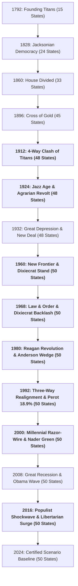

# Historical Start Dates: Electoral Data & Engine Integration Framework

> **Reference Artifact for Coalition Builder: Party Chair**  
> Covers certified historical election data and reconstructed estimates from 1788 to 2024 across all 119 federal election cycles, providing the foundational datasets, state matrices, emergent party definitions, and engine schema to implement historical start dates across Eras 1 through 7.

---

## 1. Overview & Generated Spreadsheets

Three structured CSV spreadsheets and two standalone game definition files have been generated directly in the workspace to power historical start dates and multi-cycle scenario initializers without touching the active release engine:

| Spreadsheet / Module File | Scope & Contents | Total Records | Primary Index |
| :--- | :--- | :--- | :--- |
| [**HISTORICAL_ELECTIONS_CYCLE_MASTER_1788_2024.csv**](file:///c:/Users/rober/.gemini/antigravity/scratch/party-chair-game/HISTORICAL_ELECTIONS_CYCLE_MASTER_1788_2024.csv) | Master chronological record of every 2-year federal election cycle (1788–2024). Details Presidential popular votes, % shares, EVs; House national votes, seats, majorities; Senate seats contested, won, majorities, and direct popular votes post-1913; Gubernatorial seats held; and State Legislative chamber control, total seats, and trifectas. | 120 (119 cycles + header) | `Cycle_Year` |
| [**HISTORICAL_BRANCH_RACES_1788_2024.csv**](file:///c:/Users/rober/.gemini/antigravity/scratch/party-chair-game/HISTORICAL_BRANCH_RACES_1788_2024.csv) | Granular race-level and branch-level rows for every office (Presidential, U.S. House, U.S. Senate, Governors, State Legislatures) where a party or independent candidate achieved $\ge 1.0\%$ of the vote or won seats/EVs. | 1,393 rows | `Cycle_Year` + `Office_Branch` + `Party_Name` |
| [**HISTORICAL_STARTING_DATES_STATE_MATRIX.csv**](file:///c:/Users/rober/.gemini/antigravity/scratch/party-chair-game/HISTORICAL_STARTING_DATES_STATE_MATRIX.csv) | Comprehensive state-by-state breakdown across the **15 landmark historical start dates** (1792, 1828, 1860, 1896, 1912, 1924, 1932, 1960, 1968, 1980, 1992, 2000, 2008, 2016, 2024). Includes Electoral Votes, Presidential vote counts/percentages, Governor party/votes, Senate classes/parties, House seat allocations, State Senate & House chamber seats/control, and baseline partisan leans. | 662 rows (661 state records + header) | `Start_Year` + `State_Abbr` |
| [**historical-emergent-parties.js**](file:///c:/Users/rober/.gemini/antigravity/scratch/party-chair-game/historical-emergent-parties.js) | Standalone game module providing deep mechanical polish for 8 emergent movements: Theodore Roosevelt's Bull Moose Progressives (1912), Eugene Debs' Socialist Party (1912), Robert La Follette's CPPA Progressives (1924), The Dixiecrat Party (1960/1968), John Anderson's National Unity Campaign (1980), Ross Perot's United We Stand / Reform Movement (1992), Ralph Nader's Green Party (2000), and Gary Johnson's Libertarian Party (2016). | 8 Emergent Parties | `Party_ID` |
| [**historical-scenarios-data.js**](file:///c:/Users/rober/.gemini/antigravity/scratch/party-chair-game/historical-scenarios-data.js) | Standalone scenario registry detailing briefing narratives, candidate rosters, EV thresholds, and playable party configurations across all 15 start dates. | 15 Playable Scenarios | `Scenario_ID` |

---

## 2. The 15 Playable Historical Start Dates

The state matrix file ([`HISTORICAL_STARTING_DATES_STATE_MATRIX.csv`](file:///c:/Users/rober/.gemini/antigravity/scratch/party-chair-game/HISTORICAL_STARTING_DATES_STATE_MATRIX.csv)) defines the state-by-state baseline for each playable scenario:



### Full Scenario Catalog Table

| Start Year | Scenario Title & Era | States | EVs | Active & Emergent Parties ($\ge 1.0\%$) | Core Narrative & Playing Dynamic |
| :---: | :--- | :---: | :---: | :--- | :--- |
| **1792** | *The Founding Titans* (Era 1) | 15 | 132 | Federalist, Democratic-Republican | Hamiltonian public credit and debt assumption vs. Jeffersonian-Madisonian agrarian opposition. |
| **1828** | *The Jacksonian Revolution* (Era 2) | 24 | 261 | Democratic, National Republican, Anti-Masonic | Universal white male franchise expansion, Bank War, revenge for the "Corrupt Bargain" of 1824. |
| **1860** | *The House Divided* (Era 3) | 33 | 303 | Republican, Northern Dem, Southern Dem, Const. Union | Four-way sectional fracture; Lincoln sweeps the North; Southern states bolt toward secession. |
| **1896** | *The Cross of Gold* (Era 4) | 45 | 447 | Republican, Democratic/Populist, Gold Dem, Prohibition | McKinley-Hanna corporate campaign machine vs. Bryan's 36-year-old Free Silver prairie crusade. |
| **1912** | *The Clash of Titans* (Era 4) | 48 | 531 | Democratic, Bull Moose Progressive, Republican, Socialist | TR bolts the GOP convention, splitting Republicans; Debs wins 6.0% (900k+ votes); Wilson captures 435 EVs. |
| **1924** | *Jazz Age & Agrarian Revolt* (Era 4) | 48 | 531 | Republican, Democratic, Progressive / CPPA | Coolidge rides urban boom; Fighting Bob La Follette unites AFL unions and prairie grain farmers for 16.6% PV. |
| **1932** | *The Great Depression & New Deal* (Era 5) | 48 | 531 | Democratic, Republican, Socialist, Farmer-Labor | FDR forges the historic New Deal coalition of labor, urban ethnics, and Solid South across 42 states. |
| **1960** | *The New Frontier & Dixiecrat Stand* (Era 5) | 50 | 537 | Democratic, Republican, Dixiecrat (States' Rights) | 112k-vote national cliffhanger between JFK and Nixon; Byrd unpledged Dixiecrats carry MS & AL (15 EVs). |
| **1968** | *Law & Order & Dixiecrat Backlash* (Era 6) | 50 | 538 | Republican, Democratic, Dixiecrat (American Independent) | Vietnam turmoil and urban riots; Nixon Silent Majority wins 301 EVs; George Wallace sweeps 5 Deep South states (46 EVs). |
| **1980** | *The Reagan Revolution & Anderson Wedge* (Era 6) | 50 | 538 | Republican, Democratic, National Unity, Libertarian | Reagan 489-EV sweep and Senate takeover; John Anderson captures 5.7M suburban votes (6.6%); Clark Lib 1.1%. |
| **1992** | *The Three-Way Realignment* (Era 6) | 50 | 538 | Democratic, Republican, United We Stand (Perot) | Ross Perot spends millions on primetime TV infomercials, winning 18.9% (19.7M votes); Clinton wins 370 EVs. |
| **2000** | *The Millennial Razor-Wire* (Era 6) | 50 | 538 | Republican, Democratic, Green (Nader), Reform | 537-vote Florida recount decides 271–266 EV; Nader packs 15,000-seat arenas, securing 2.88M votes (2.7%). |
| **2008** | *The Great Recession & Obama Wave* (Era 7) | 50 | 538 | Democratic, Republican, Libertarian, Independent | Financial Crisis collapse; Obama mobilizes 69.5M voters (365 EVs) to secure brief 60-seat Senate supermajority. |
| **2016** | *The Populist Shockwave* (Era 7) | 50 | 538 | Republican, Democratic, Libertarian, Green | Trump breaches the Rust Belt "Blue Wall" (PA, MI, WI); Gary Johnson / Bill Weld ticket reaches 4.5M votes (3.3%). |
| **2024** | *The Certified Scenario Baseline* (Era 7) | 50 | 538 | Republican, Democratic, Libertarian, Green | Trump sweeps all 7 swing states (312 EVs) and captures Senate (53–47). Active game baseline. |

---

## 3. Dedicated Polish for Emergent Parties

As codified in [**`historical-emergent-parties.js`**](file:///c:/Users/rober/.gemini/antigravity/scratch/party-chair-game/historical-emergent-parties.js), each movement features complete game-engine attributes:

### 3.1 Theodore Roosevelt's Progressive ("Bull Moose") Party (1912)
- **Factions:** Rooseveltian Insurgents (45%), Social Reformers & Suffragists (35%), Conservationists & Public Stewards (20%).
- **Leaders:** Theodore Roosevelt (Charisma 98, Experience 95, Media 92), Hiram Johnson, Jane Addams, Gifford Pinchot.
- **Signature Mechanics:**
  - *Charismatic Bolter Surge:* Steals 35–45% of Republican voters across Northern and Pacific states on Turn 1.
  - *Square Deal Resonance:* Doubles organizing yield among middle-class reform and good-government clubs.

### 3.2 Socialist Party of America (Eugene V. Debs) (1912)
- **Factions:** Debsian Industrial Radicals (50%), Sewer Socialists / Municipal Administrators (35%), Social Gospel Ministers (15%).
- **Leaders:** Eugene V. Debs (Charisma 96, Experience 85, Media 85), Victor L. Berger (U.S. Rep WI-05), Emil Seidel (Milwaukee Mayor).
- **Signature Mechanics:**
  - *Class Consciousness Mobilization:* Immune to corporate Super PAC suppression; massive natural field turnout in rail hubs and mining towns (OK, NV, MT, WI).
  - *Appeal to Reason Press Engine:* Generates free weekly movement pamphlets and volunteer recruitment boosts.

### 3.3 Progressive Party / CPPA (Robert M. La Follette) (1924)
- **Factions:** Wisconsin Prairie Progressives (45%), Railroad Brotherhoods & Labor (35%), Farmer-Labor Radicals (20%).
- **Leaders:** Robert M. "Fighting Bob" La Follette (Charisma 94, Experience 96, Media 88), Burton K. Wheeler (U.S. Senator MT), Henrik Shipstead (U.S. Senator MN).
- **Signature Mechanics:**
  - *Upper Midwest Agrarian Fortress:* 50%+ locked baseline in Wisconsin; second-place momentum in 11 Western and Plains states.
  - *Rail Brotherhood Dispatch:* Cuts field organizing costs by 50% along Northern rail corridors.

### 3.4 Dixiecrat Party (States' Rights Democratic Party) (1960 & 1968)
- **Factions:** Courthouse Machine Traditionalists (50%), Wallace Working-Class Populists (40%), Constitutional Nullifiers (10%).
- **Leaders:** Harry F. Byrd (1960), George C. Wallace (1968), Strom Thurmond, Orval Faubus, Curtis LeMay.
- **Signature Mechanics:**
  - *Deep South Firewall:* 60%+ baseline floor across AL, MS, GA, LA, and SC; unpledged elector legal mechanisms.
  - *Deadlock Gambit:* Triggers special victory condition if neither major party reaches 270 EVs, throwing election to the House.

### 3.5 National Unity Campaign (John B. Anderson) (1980)
- **Factions:** Rockefeller Republican Moderates (50%), Disillusioned Centrists & Reformers (35%), Good Government Technocrats (15%).
- **Leaders:** John B. Anderson (Charisma 88, Experience 88, Media 86), Patrick Lucey (Former Dem Gov of WI).
- **Signature Mechanics:**
  - *Debate Podium Breakthrough:* Reaching 15% in national polling unlocks prime-time debate access.
  - *Suburban University Axis:* +10% polling boost in New England and Pacific Northwest suburban corridors.

### 3.6 United We Stand America / Reform Movement (H. Ross Perot) (1992)
- **Factions:** Deficit Hawks & Small Business Owners (45%), Protectionist Blue-Collar Patriots (35%), Electronic Town Hall Activists (20%).
- **Leaders:** H. Ross Perot (Charisma 94, Experience 82, Media 96), James Stockdale (Vice Admiral & VP), Pat Choate (Author & Economist).
- **Signature Mechanics:**
  - *Primetime Infomercial Blitz:* Buys 30-minute network television blocks to explain budget charts, surging generic support by +8%.
  - *Citizen Petition Avalanche:* Rapidly qualifies on all 50 state ballots with zero established party machinery.

### 3.7 Green Party of the United States (Ralph Nader) (2000)
- **Factions:** Anti-Corporate Consumer Advocates (45%), Ecologists & Climate Action Vanguard (35%), Campus Left & Civil Libertarians (20%).
- **Leaders:** Ralph Nader (Charisma 90, Experience 92, Media 88), Winona LaDuke (VP Nominee & Indigenous Leader).
- **Signature Mechanics:**
  - *Arena Super-Rallies:* Fills 15,000-seat arenas charging $10 admission, yielding massive volunteer influxes.
  - *Left-Flank Spoiler Leverage:* Cannibalizes 2–4% of Democratic vote share in battleground tipping-point states.

### 3.8 Libertarian Party ("The Two-Governor Ticket") (2016)
- **Factions:** Pragmatic Governance Centrists (45%), Austrian Free-Market Purists (35%), Civil Liberties & Crypto Pioneers (20%).
- **Leaders:** Gary Johnson (Former Gov NM, Charisma 82, Experience 90), William Weld (Former Gov MA, Charisma 86, Experience 92).
- **Signature Mechanics:**
  - *Two-Governor Executive Gravitas:* Doubles institutional tier ascension speed and fundraising yield among disaffected centrists.
  - *Western Mountain Bastion:* +8% polling advantage in New Mexico, Utah, Alaska, Idaho, and Wyoming.

---

## 4. Standalone File Structure

To preserve complete release integrity while providing full modular access for future game engine consumption, all files remain completely segregated:

```text
party-chair-game/
├── HISTORICAL_ELECTIONS_CYCLE_MASTER_1788_2024.csv    <- 119 cycles (1788-2024)
├── HISTORICAL_BRANCH_RACES_1788_2024.csv              <- 1,393 race rows (parties >= 1%)
├── HISTORICAL_STARTING_DATES_STATE_MATRIX.csv         <- 661 state rows (15 start dates)
├── historical-emergent-parties.js                     <- Polish, factions, leaders, mechanics
├── historical-scenarios-data.js                       <- 15 playable scenario descriptors
└── HISTORICAL_START_DATES_FRAMEWORK.md                <- Comprehensive technical guide
```
