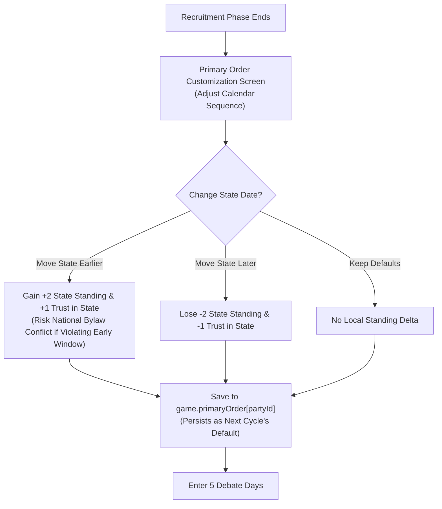
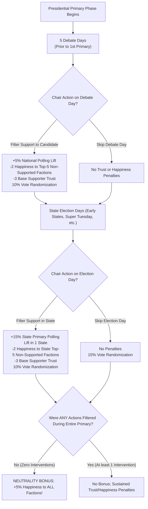

# Coalition Builder: Party Chair — Presidential Primary System Design & Implementation Specification

> **Document Status:** Authoritative Design Proposal & Implementation Specification  
> **Target System:** Presidential Primary System (`presidential-primary` Phase & Delegate Engine)  
> **Cycle Activation:** Actives in **2028** (and every 4-year presidential cycle: 2032, 2036, etc.)  
> **Target Files:** `engine.js`, `data.js`, `app.js`, `factions-0.15.js`, `v07-scaffolding.js`, `scenario-2028.js`

---

## 1. System Vision & Core Design Philosophy

In American politics, the Presidential Primary is the ultimate crucible of party identity. It is where party factions collide, test their national strength, build coalitions, and negotiate ideological supremacy before the general election.

In **Coalition Builder: Party Chair**, the Presidential Primary is introduced as a **fully simulated, interactive game phase** between the Recruitment (`organizing`) Phase and the General Campaign (`general-campaign`) Phase in presidential election years. The player—as National Party Chair—must balance neutrality against the temptation to put their thumb on the scale:

- **Authentic Real-Life Schedules:** The primary follows approved real-world DNC and RNC calendars with distinct state orders, early carve-out states (SC, NV, NH, MI for Democrats; IA, NH, NV, SC for Republicans), a 20–30 state Super Tuesday, and subsequent spring primaries.
- **Factional Representation:** Exactly **one candidate runs from every faction** in the party, selected probabilistically from the faction's most famous politicians (or dynamically generated if no politicians exist).
- **Real-World Delegate Allocation Systems:** Supports every real-world delegate allocation system—Proportional with 15% threshold (DNC standard), Winner-Take-All (WTA), Triggered Winner-Take-Most, Pure Proportional, Loophole/Direct Election, and Multi-Ballot Convention Caucuses.
- **Strategic Calendar Customization:** A "Primary Order" step lets the party rearrange its primary calendar, earning or forfeiting local party standing and voter trust.
- **Interference Dilemma & The No-Interference Reward:** Chairs can intervene across 5 "Debate Days" and before state primaries to filter support, but intervention triggers base trust penalties (-3 Trust), faction jealousy (-2 Happiness), and electoral volatility. Remaining completely neutral across the entire primary awards a **+5% Happiness bonus to all factions**.
- **Living Dynamic Field:** Staggered dropouts, ideological proximity transfers weighted heavily by candidate quality, and an interactive primary map stored in the simulated election archives.

---

## 2. Update Categorization by Size

Per the workspace rules, all requirements and systems are grouped primarily by **Size**:

### Large (Macro Engine & Core Infrastructure)
- **REQ-PRI-01: Presidential Primary Phase Architecture & State-by-State Loop**
  - Introduces `phase: 'presidential-primary'` in presidential years (2028, 2032, etc.), bridging Recruitment and General Campaign.
  - Implements the state-by-state turn progression across early carve-outs, Super Tuesday, and spring election dates.
  - Target Files: `engine.js`, `app.js`.
- **REQ-PRI-02: Faction Candidate Selection, Fame-Weighted Probability & Dynamic Spawner**
  - Selects 1 candidate per faction via 50%/30%/20% fame weighting among top 3 politicians.
  - Excludes former presidents.
  - Generates new office-less candidates for unrepresented factions (starts at 50% expected vote + random; assignable as Faction Leader in party leadership).
  - Assigns unique, randomized map colors per candidate.
  - Target Files: `engine.js`, `v07-scaffolding.js`, `data.js`.
- **REQ-PRI-03: Real-World Delegate Allocation Engine & 51-State Master Tables**
  - Implements all 6 real-world delegate rules: DNC 15% Proportional, RNC Winner-Take-All, Triggered Winner-Take-Most, Pure Proportional, Direct Election/Loophole, and Third-Party Multi-Ballot Convention.
  - Complete 51-state (+ territories) delegate allocation table for DNC (~4,672 total, 1,968 to clinch) and RNC (~2,429 total, 1,215 to clinch).
  - Target Files: `engine.js`, `data.js`.

### Medium (Campaign Mechanics & Systems Interaction)
- **REQ-PRI-04: Primary Order Customization Step & State Standing Mechanics**
  - Dedicated pre-primary interface allowing parties to reorder primary dates.
  - Moving states earlier/later applies local standing and voter trust modifiers (+1 to +3 for early promotion; -1 to -3 for relegation).
  - Primary calendar order persists cycle-to-cycle in `game.primaryOrder[partyId]`.
  - Target Files: `engine.js`, `app.js`.
- **REQ-PRI-05: Debate Days & Primary Day Support Filtering (The Chair's Dilemma)**
  - 5 Debate Days before the first primary (+5% national lift to chosen candidate).
  - Election Day filtering (+15% state lift to chosen candidate in that state).
  - Filtering costs: 10% vote randomization, -2 Happiness to top-5 non-supported factions, -3 Base Supporter Trust.
  - Full neutrality bonus: +5% Happiness to ALL party factions if zero support was filtered throughout.
  - Target Files: `engine.js`, `app.js`.
- **REQ-PRI-06: Dropout Engine & Ideological Proximity Realignment**
  - Eliminates non-viable candidates post-early states and Super Tuesday.
  - Reallocates faction support to the closest ideological candidate on Social, Economic, and Governance sliders, heavily weighted by Candidate Quality.
  - Target Files: `engine.js`, `factions-0.15.js`.

### Small (Formulas, Visuals & Archival Systems)
- **REQ-PRI-07: The Uneven Partition Randomization Formula**
  - Mathematical implementation of the random vote redistribution formula: takes $X\%$ from all candidates, splits into 2–5 uneven pieces (10% to 60%), gives 1 piece to a random candidate, and distributes remaining pieces among top-5 polling candidates.
  - Applies 15% variance when unfiltered, 10% when filtered.
  - Target Files: `engine.js`.
- **REQ-PRI-08: Major Faction Loss Confidence Penalty**
  - Major factions whose candidate fails to win the presidential nomination lose 2 confidence (-2 Confidence).
  - Target Files: `engine.js`.
- **REQ-PRI-09: Interactive SVG Primary Map & Simulated Election Archive**
  - Interactive state primary map colored by winning candidate.
  - Saves full primary election returns and maps into `game.simulatedPrimaries[year][partyId]` for player inspection and cross-party sanity checks.
  - Target Files: `app.js`, `index.html`.

---

## 3. Candidate Selection & Faction Spawner Architecture

### 3.1 One Candidate Per Faction Rule
In any party primary, **every active faction of that party runs exactly one candidate**, with no duplicates:
- Democratic Party (`people`): 8 factions $\to$ 8 candidates.
- Republican Party (`heritage`): 11 factions $\to$ 11 candidates.
- Libertarian Party (`liberty`): 2 factions $\to$ 2 candidates.
- Green Party (`green`): 2 factions $\to$ 2 candidates.
- Constitution Party (`constitution`): 1 faction $\to$ 1 candidate (or challenger).
- Socialist Party (`socialist`): 2 factions $\to$ 2 candidates.
- Custom Parties: 1 candidate for each established custom party faction.

### 3.2 The 50 / 30 / 20 Fame-Weighted Selection Algorithm
For each faction $F$, collect all living politicians in `game.sittingMembers` and `game.politicians` where `politician.factionId === F.id`.

1. **Eligibility Filter:**
   - Exclude any politician who is a former President (`politician.isFormerPresident === true` or included in `game.pastPresidents`).
2. **Sort by Fame:**
   - Sort eligible politicians descending by `fame`: $[P_1, P_2, P_3, \dots]$.
3. **Probabilistic Roll:**
   - Roll random number $R \in [0, 1)$:
     - If $R < 0.50$ (50%): Select $P_1$ (most famous).
     - Else if $R < 0.80$ (30%): Select $P_2$ (2nd most famous; fallback to $P_1$ if only 1 exists).
     - Else (20%): Select $P_3$ (3rd most famous; fallback to $P_2$, then $P_1$).
4. **Duplicate Prevention:**
   - If a selected politician was already drafted by another faction (e.g. cross-faction appeal), advance to the next highest-fame candidate in that faction.

### 3.3 Dynamic Candidate Spawner (Factions with Zero Politicians)
If a faction has **no eligible politicians** in office or in the active pool (common for third-party factions, newly ascended factions, or minor wings):
1. **Instantiate New Politician:**
   - `id`: `cand-pres-${faction.id}-${year}`
   - `name`: Generated name from `VERSION_01_RACE_CANDIDATE_NAMES` (or authentic historic proxy).
   - `office`: `null` (explicitly holds no current office).
   - `party`: `partyId`
   - `factionId`: `faction.id`
   - `isIncumbent`: `false`
   - `quality`: Random float between `5.0` and `7.2` (mean `5.8`).
   - `skill`: Clamped `Math.round(quality / 2)`.
   - `fame`: Random integer between `30` and `52`.
   - `traits`: 2 to 3 traits sampled from `POLITICIAN_TRAITS`.
   - `ratings`: Generated 10-stat profile calibrated to `quality`.
2. **Faction Leadership Assignment:**
   - This newly created politician is immediately added to `game.politicians` and can be assigned as **Faction Leader** in the Party Leadership menu (`game.factionLeaders[faction.id]`).
3. **Expected Vote Baseline Penalty:**
   - In every state, this candidate starts at **50% of their expected vote share** based on their faction's voter count:
     $$E_{\text{new}, S} = 0.50 \times \left(\frac{V(F, S)}{V_{\text{party}}(S)}\right)$$
   - The remaining 50% is distributed randomly among the other candidates in the field.

### 3.4 Unique Map Color Assignment
Upon candidate pool generation, each candidate is assigned a unique hex color from an accessible, high-contrast palette:
```javascript
const PRIMARY_CANDIDATE_PALETTE = [
  '#1f77b4', '#d62728', '#2ca02c', '#ff7f0e', '#9467bd',
  '#8c564b', '#e377c2', '#7f7f7f', '#bcbd22', '#17becf',
  '#393b79', '#843c39', '#637939', '#8c6d31', '#7b4173'
];
```
This color is dedicated exclusively to rendering the interactive primary map for that cycle.

---

## 4. Official 2028 Primary Calendars & Schedules

Different parties follow their own approved, distinct schedules. Below are the default master schedules:

### 4.1 Democratic Party (DNC) Schedule (Approved Early Window Blueprint)
- **Phase 1: Early Carve-Out Window**
  - **Feb 3 (Saturday):** South Carolina
  - **Feb 6 (Tuesday):** Nevada & New Hampshire
  - **Feb 27 (Tuesday):** Michigan
- **Phase 2: Super Tuesday (March 5) — 20 States**
  - Alabama, Arkansas, California, Colorado, Iowa (mail tally), Maine, Massachusetts, Minnesota, North Carolina, Oklahoma, Tennessee, Texas, Utah, Vermont, Virginia, Washington, Democrats Abroad, American Samoa.
- **Phase 3: Mid-March Primaries (March 12 & 19)**
  - **March 12:** Georgia, Mississippi, Missouri.
  - **March 19:** Arizona, Florida, Illinois, Kansas, Ohio.
- **Phase 4: Late Spring Window (April & May)**
  - **April 2:** Connecticut, Delaware, New York, Rhode Island, Wisconsin.
  - **April 23:** Pennsylvania.
  - **May 7:** Indiana.
  - **May 14:** Maryland, Nebraska, West Virginia.
  - **May 21:** Kentucky, Oregon.
- **Phase 5: June Finale (June 4)**
  - Montana, New Jersey, New Mexico, South Dakota, Washington D.C.

### 4.2 Republican Party (RNC) Schedule (Rule 16 Traditional Blueprint)
- **Phase 1: Early Carve-Out Window**
  - **Jan 15 (Monday):** Iowa Caucuses
  - **Jan 23 (Tuesday):** New Hampshire Primary
  - **Feb 8 (Thursday):** Nevada Caucuses
  - **Feb 24 (Saturday):** South Carolina Primary
  - **Feb 27 (Tuesday):** Michigan (Primary portion)
- **Phase 2: Super Tuesday (March 5) — 21 States**
  - Alabama, Alaska, Arkansas, California, Colorado, Maine, Massachusetts, Minnesota, North Carolina, Oklahoma, Tennessee, Texas, Utah, Vermont, Virginia, Idaho (caucus), North Dakota (caucus).
- **Phase 3: Mid-March Primaries (March 12 & 19)**
  - **March 12:** Georgia, Hawaii, Mississippi, Washington.
  - **March 19:** Florida (WTA), Illinois, Ohio (WTA), Kansas, Louisiana.
- **Phase 4: Late Spring Window (April & May)**
  - **April 2:** Connecticut, Delaware, New York, Rhode Island, Wisconsin.
  - **April 23:** Pennsylvania (Loophole system).
  - **May 7:** Indiana.
  - **May 14:** Maryland, Nebraska, West Virginia.
  - **May 21:** Kentucky, Oregon.
- **Phase 5: June Finale (June 4)**
  - Montana, New Jersey, New Mexico, South Dakota.

### 4.3 Third-Party Calendars (Libertarian, Green, Constitution, Socialist)
- **Libertarian Party:** Series of 10 regional state conventions / straw polls between February and April, culminating in the **National Convention Multi-Ballot Floor Vote** in late May.
- **Green Party:** Proportional mail-in and state convention assemblies running from March through May, deciding delegates for the Green National Convention.
- **Constitution / Socialist:** Multi-ballot delegate selection at state conventions throughout April and May.

---

## 5. Primary Order Customization Step ("Primary Order")

Before the primary phase begins, the player enters the **Primary Order Configuration Screen**:



### Gameplay Mechanics of Primary Reordering
1. **Local Standing & Trust Impact:**
   - **Promoting a State Earlier (e.g. into Early Window or Super Tuesday):** Awards **+2 State Standing** and **+1 Base Trust** with voters in that state, representing pride and local economic influx.
   - **Relegating a State Later (e.g. pushing to May or June):** Imposes **-2 State Standing** and **-1 Base Trust** in that state due to perceived disenfranchisement.
2. **Cycle-to-Cycle Persistence:**
   - The final arranged primary calendar is saved in `game.primaryOrder[partyId]` and automatically becomes the starting schedule for the next presidential cycle (2032).

---

## 6. Real-World Delegate Systems & Master Allocation Table

Every party can select its governing delegate allocation rule in the party rules docket:

### 6.1 The Six Real-World Delegate Systems

| System ID | System Name | Real-World Context | Mechanical Rules |
|:---|:---|:---|:---|
| `dnc_prop_15` | **Proportional with 15% Threshold** | Standard DNC Rules (All States) | Candidates with $< 15\%$ get 0 delegates. Votes for viable candidates ($\ge 15\%$) are normalized to 100% and allocated via largest-remainder Hare-Niemeyer. |
| `gop_wta` | **Winner-Take-All (WTA)** | RNC Post-March 15 (FL, OH, etc.) | Plurality winner of the statewide popular vote receives 100% of the state's delegates. |
| `gop_triggered_wtm`| **Triggered Winner-Take-Most** | RNC Standard (TX, GA, etc.) | If 1st place $\ge 50\%$, candidate wins 100% of delegates. If 1st place $< 50\%$, delegates are allocated proportionally among candidates with $\ge 20\%$ (or district winners take district delegates). |
| `pure_proportional` | **Pure Proportional (No Threshold)** | Early RNC States (IA, NH) | All candidates receiving votes earn delegates proportionally; unallocated delegates go to plurality winner. |
| `loophole_direct` | **Direct Election / Loophole** | Pennsylvania & West Virginia GOP | Statewide at-large delegates bound proportionally; Congressional district delegates elected directly on ballot as individual delegates. |
| `convention_caucus`| **Multi-Ballot Convention** | Libertarian, Green, Constitution | State straw polls award delegates to National Convention, where multi-ballot runoff voting continues until one candidate hits $50\% + 1$. |

---

### 6.2 Master 51-State Delegate Allocation Table

Below is the complete state-by-state delegate count mapping 100% of convention delegates:

| State | Postal | DNC Pledged | DNC Total | RNC Total | RNC Default Rule | Super Tuesday? |
|:---|:---:|:---:|:---:|:---:|:---|:---:|
| **Alabama** | AL | 52 | 59 | 50 | Triggered WTM (50%) | ✅ Yes |
| **Alaska** | AK | 15 | 19 | 29 | Pure Proportional (13%) | ✅ Yes (RNC) |
| **Arizona** | AZ | 72 | 85 | 43 | Winner-Take-All | ❌ Mid-March |
| **Arkansas** | AR | 31 | 36 | 40 | Triggered WTM (50%) | ✅ Yes |
| **California** | CA | 424 | 494 | 169 | Triggered WTM (50%) | ✅ Yes |
| **Colorado** | CO | 72 | 87 | 37 | Proportional (15%) | ✅ Yes |
| **Connecticut** | CT | 60 | 74 | 28 | Triggered WTM (50%) | ❌ April |
| **Delaware** | DE | 19 | 26 | 16 | Winner-Take-All | ❌ April |
| **Florida** | FL | 224 | 246 | 125 | Winner-Take-All | ❌ Mid-March |
| **Georgia** | GA | 108 | 124 | 59 | Triggered WTM (50%) | ❌ Mid-March |
| **Hawaii** | HI | 22 | 31 | 19 | Proportional (15%) | ❌ Mid-March |
| **Idaho** | ID | 23 | 27 | 32 | Triggered WTM (50%) | ✅ Yes (RNC) |
| **Illinois** | IL | 147 | 177 | 64 | Loophole / Direct | ❌ Mid-March |
| **Indiana** | IN | 79 | 88 | 58 | Winner-Take-All | ❌ May |
| **Iowa** | IA | 40 | 46 | 40 | Pure Proportional | ❌ Early (RNC) |
| **Kansas** | KS | 33 | 39 | 39 | Proportional (10%) | ❌ Mid-March |
| **Kentucky** | KY | 53 | 60 | 46 | Proportional (15%) | ❌ May |
| **Louisiana** | LA | 48 | 54 | 47 | Proportional (20%) | ❌ Mid-March |
| **Maine** | ME | 24 | 32 | 20 | Proportional (15%) | ✅ Yes |
| **Maryland** | MD | 95 | 118 | 38 | Winner-Take-All | ❌ May |
| **Massachusetts** | MA | 92 | 116 | 40 | Proportional (15%) | ✅ Yes |
| **Michigan** | MI | 117 | 140 | 55 | Proportional / Hybrid | ❌ Early Window |
| **Minnesota** | MN | 75 | 92 | 39 | Proportional (15%) | ✅ Yes |
| **Mississippi** | MS | 35 | 40 | 40 | Proportional (15%) | ❌ Mid-March |
| **Missouri** | MO | 64 | 70 | 54 | Triggered WTM (50%) | ❌ Mid-March |
| **Montana** | MT | 20 | 25 | 31 | Winner-Take-All | ❌ June |
| **Nebraska** | NE | 29 | 34 | 36 | Winner-Take-All | ❌ May |
| **Nevada** | NV | 36 | 48 | 26 | Pure Proportional | ❌ Early Window |
| **New Hampshire** | NH | 25 | 33 | 22 | Proportional (10%) | ❌ Early Window |
| **New Jersey** | NJ | 126 | 146 | 49 | Winner-Take-All | ❌ June |
| **New Mexico** | NM | 34 | 45 | 22 | Proportional (15%) | ❌ June |
| **New York** | NY | 268 | 307 | 91 | Triggered WTM (50%) | ❌ April |
| **North Carolina** | NC | 116 | 130 | 74 | Proportional (20%) | ✅ Yes |
| **North Dakota** | ND | 13 | 18 | 29 | Pure Proportional | ✅ Yes (RNC) |
| **Ohio** | OH | 127 | 143 | 79 | Winner-Take-All | ❌ Mid-March |
| **Oklahoma** | OK | 36 | 41 | 43 | Triggered WTM (50%) | ✅ Yes |
| **Oregon** | OR | 66 | 78 | 31 | Proportional (15%) | ❌ May |
| **Pennsylvania** | PA | 159 | 186 | 67 | Loophole / Direct | ❌ April |
| **Rhode Island** | RI | 26 | 35 | 19 | Proportional (10%) | ❌ April |
| **South Carolina** | SC | 55 | 65 | 50 | Triggered WTM (50%) | ❌ Early Window |
| **South Dakota** | SD | 16 | 21 | 29 | Winner-Take-All | ❌ June |
| **Tennessee** | TN | 63 | 70 | 58 | Triggered WTM (50%) | ✅ Yes |
| **Texas** | TX | 244 | 273 | 161 | Triggered WTM (50%) | ✅ Yes |
| **Utah** | UT | 30 | 34 | 40 | Triggered WTM (50%) | ✅ Yes |
| **Vermont** | VT | 16 | 24 | 17 | Proportional (20%) | ✅ Yes |
| **Virginia** | VA | 99 | 119 | 48 | Proportional (15%) | ✅ Yes |
| **Washington** | WA | 92 | 111 | 43 | Proportional (20%) | ❌ Mid-March |
| **West Virginia** | WV | 20 | 25 | 32 | Winner-Take-All | ❌ May |
| **Wisconsin** | WI | 82 | 95 | 41 | Triggered WTM (50%) | ❌ April |
| **Wyoming** | WY | 14 | 18 | 29 | Proportional (15%) | ❌ April |
| **Dist of Columbia**| DC | 20 | 50 | 19 | Winner-Take-All | ❌ June |
| **Territories / Abroad**| TERR | 53 | 77 | 56 | Proportional / WTA | Various |
| **TOTALS** | — | **3,934** | **4,672** | **2,429** | — | **20–30 States** |

- **DNC Majority to Nominate:** **1,968 Pledged Delegates** (or **2,376** on combined full convention ballot).
- **RNC Majority to Nominate:** **1,215 Total Delegates**.

---

## 7. The Player's Dilemma: Debate Days & Support Filtering



### 7.1 The 5 Debate Days (Pre-Primary)
Before the very first primary election ballots are cast, the party stages **5 Nationally Televised Debate Days**:
- On each Debate Day, the Chair can:
  - **Filter Support:** Choose exactly one candidate to endorse and promote.
  - **Skip:** Allow the debate to unfold organically.
- **Effect of Debate Day Support:**
  - The chosen candidate receives a permanent **+5% national baseline polling lift** across all 50 states.
  - **Backlash:**
    - Factions with a candidate currently polling in the national **Top 5** who was NOT selected **lose 2 Happiness** (-2 Happiness).
    - The party's core **Base Supporters group loses 3 Trust** (-3 Trust) due to perceived backroom rigging.
    - Triggers the **10% Vote Randomization Formula** nationally.

### 7.2 Primary Election Days
Before each primary election date (or multi-state day like Super Tuesday):
- The Chair can filter support in **only ONE state** voting that day (or skip).
- **Effect of Primary Day Support:**
  - The chosen candidate receives a **+15% polling lift in that specific state primary**.
  - **Backlash:**
    - Factions with a candidate polling in the top 5 of that state who was NOT chosen **lose 2 Happiness** in that state's faction chapter.
    - Base supporters **lose 3 Trust** (-3 Trust).
    - Triggers the **10% Vote Randomization Formula** in that state.

### 7.3 The Full Neutrality Reward
If the player exercises absolute discipline and **does not filter support to any candidate during the entire presidential primary** (skips all 5 Debate Days and all Election Days):
- Upon conclusion of the primary, **every single faction in the party gains +5% Happiness** (+5% Faction Happiness across the entire coalition), recognizing the Chair's fair, transparent stewardship!

---

## 8. Vote Share Calculation & The Randomization Partition Formula

### 8.1 State Baseline Vote Calculation
In state $S$, each candidate $i$ represents faction $F_i$.

1. Look up faction voter count $V(F_i, S)$ in `FACTION_STATE_MATRIX[S]`.
2. Total party voters in the state:
   $$V_{\text{party}}(S) = \sum_{j} V(F_j, S)$$
3. Raw demographic baseline share:
   $$B_{i, S} = \frac{V(F_i, S)}{V_{\text{party}}(S)}$$
   *(If candidate is newly created with 0 sitting politicians, scale $B_{i, S} \leftarrow 0.50 \times B_{i, S}$).*
4. Apply candidate quality, fame, and debate lifts:
   $$\text{Score}_{i, S} = B_{i, S} \times \left(1 + \frac{\text{fame}_i - 50}{200}\right) \times \left(1 + \frac{\text{quality}_i - 5.5}{20}\right) + \text{DebateLift}_i + \text{StateFilterLift}_{i, S}$$
5. Normalize to 100%:
   $$P_{i, S}^{(0)} = \frac{\text{Score}_{i, S}}{\sum_j \text{Score}_{j, S}} \times 100\%$$

---

### 8.2 The Randomization Partition Formula
To prevent rigid, identical polling results across states, votes are dynamically randomized before final tallying:
- **If support IS filtered:** Randomize **$X = 10\%$** of the vote.
- **If support IS NOT filtered:** Randomize **$X = 15\%$** of the vote.

#### Execution Algorithm:
1. **Peel Off $X\%$ Pool:**
   - Multiply every candidate's share by $(1 - X/100)$:
     $$P_{i}^{\text{retained}} = P_i \times \left(1 - \frac{X}{100}\right)$$
   - The total peeled pool is exactly $X\%$ (e.g. 10.0 or 15.0 percentage points).
2. **Determine Partition Slices ($K$):**
   - Roll a random integer $K \in \{2, 3, 4, 5\}$.
   - Generate $K$ random non-equal partition weights $[w_1, w_2, \dots, w_K]$ such that $\sum w_k = 1.0$, with individual slices varying widely between $10\%$ and $60\%$ of the pool (e.g. Slice 1 = 12%, Slice 2 = 58%, Slice 3 = 30%).
3. **Award Slice 1 to Any Random Candidate:**
   - Pick one candidate $C_{\text{rand}}$ completely at random from all active candidates in the primary.
   - $$P_{C_{\text{rand}}}^{\text{new}} \leftarrow P_{C_{\text{rand}}}^{\text{retained}} + (w_1 \times X)$$
4. **Award Slices 2 through $K$ to Top-5 Polling Candidates:**
   - Determine the **Top 5 candidates** by current polling average in this race.
   - For each remaining slice $k \in [2, K]$:
     - Select one candidate $C_{\text{top5}}$ randomly from the Top 5.
     - Add $(w_k \times X)$ to their share:
       $$P_{C_{\text{top5}}}^{\text{new}} \leftarrow P_{C_{\text{top5}}}^{\text{retained}} + (w_k \times X)$$
5. **Re-Normalize:**
   - Re-sum all candidates' shares to guarantee an exact $100.00\%$ total.

---

## 9. Dropout Dynamics & Ideological Realignment

A primary with 8 to 11 candidates naturally winnows as underperforming contenders run out of cash, momentum, and media attention.

### 9.1 Winnowing Schedule & Dropout Triggers
- **Post-New Hampshire & South Carolina:** Candidates polling $< 5\%$ nationally who won 0 delegates drop out.
- **Post-Super Tuesday:** Candidates trailing the delegate leader by $> 400$ delegates and polling $< 10\%$ drop out.
- **Late Spring:** Race consolidates to the top 2–3 viable contenders.

### 9.2 Faction Realignment on Dropout
When candidate $C$ drops out, their originating faction $F_C$ does not become inert. Instead, the faction shifts its support to the **closest ideological remaining candidate**, heavily factoring in **Candidate Quality**:

1. **Ideological Distance Metric:**
   For each remaining active candidate $k$ with faction coordinates $(S_k, E_k, G_k)$ on Social, Economic, and Governance sliders:
   $$\text{Dist}(F_C, k) = \sqrt{(S_{F_C} - S_k)^2 + (E_{F_C} - E_k)^2 + (G_{F_C} - G_k)^2}$$
2. **Quality-Weighted Gravitational Appeal:**
   Candidate Quality $Q_k \in [1, 10]$ acts as a powerful attraction force:
   $$\text{Appeal}_k = \left(\frac{1}{\text{Dist}(F_C, k) + 0.4}\right) \times (Q_k)^{1.6}$$
3. **Realignment Decision:**
   - 85% of the time, the faction endorses the candidate with the highest $\text{Appeal}_k$.
   - 15% of the time, the faction fragments proportionally among the top 2 closest contenders.

---

## 10. Major Faction Loss Confidence Penalty

When the primary concludes and a nominee crosses the delegate threshold:
- Every **Major Faction** (`status: 'major'`) in the party whose candidate **did NOT win the presidential nomination** loses **2 Confidence** (-2 Confidence).
- *Narrative Context:* Major factions expect to hold the White House standard. Losing the national primary diminishes their internal clout, making them more demanding during the subsequent General Campaign.

---

## 11. User Interface & Interactive Primary Map

### 11.1 Dedicated `presidential-primary` Phase View
- **Top Bar:** Shows current date, active election day, and primary progress.
- **Candidate Delegate Tracker:** Live horizontal progress bars showing delegate counts toward the clinching threshold (e.g. 1,968 for DNC, 1,215 for RNC).
- **Interactive SVG Map:**
  - States shaded in the winning candidate's assigned color.
  - Hovering a state displays the winner, vote percentages, delegate distribution, and margin.
  - Uncontested/future states remain neutral gray.

### 11.2 Simulated Primaries Archive
- All primary results and interactive maps for all parties (including opposition parties and third parties) are stored permanently in `game.simulatedPrimaries[year][partyId]`.
- Players can open the "Simulated Elections / Primary Archive" drawer in the UI to inspect opposing parties' primary maps, check vote margins, and verify that AI candidates are behaving organically.

---

## 12. Implementation File Modifications & Touch Points

### Target File Checklist

1. `engine.js`:
   - Add `startPresidentialPrimary(game)` transitioning from `organizing` into `presidential-primary`.
   - Implement `generatePrimaryField(game, partyId)` applying 50/30/20 fame rules and dynamic spawner.
   - Implement `advancePrimaryCalendar(game)` advancing through Debate Days and State Primaries.
   - Implement `filterPrimarySupport(game, candidateId, stateId)` handling debate vs. state lifts and trust/happiness penalties.
   - Implement `applyRandomizationPartition(shares, X, top5Ids)` executing the exact partition formula.
   - Implement `evaluatePrimaryDropouts(game)` and faction ideological realignment.
   - Apply the -2 Confidence penalty to losing major factions upon nomination.
2. `data.js`:
   - Add `DNC_MASTER_DELEGATES_2028` and `RNC_MASTER_DELEGATES_2028` with complete 51-state counts.
   - Add `DEFAULT_PRIMARY_SCHEDULES` (DNC, RNC, Third Parties).
   - Add `DELEGATE_ALLOCATION_RULES` dictionary.
3. `v07-scaffolding.js`:
   - Support `office: null` politicians created for unrepresented factions.
   - Allow newly generated faction candidates to be assigned to `game.factionLeaders[faction.id]`.
4. `app.js`:
   - Render the `presidential-primary` phase screen.
   - Render the Interactive SVG Primary Map with dynamic candidate colors.
   - Add the "Primary Order" configuration drag-and-drop / selector step.
   - Build the Simulated Primary Archive inspector drawer.

---

## 13. Verification & Integration Test Plan

1. **Candidate Selection & Spawner Test (`test-primary-candidates.cjs`):**
   - Asserts that exactly 1 candidate per faction is created without duplicates.
   - Confirms 50/30/20 probability distribution across 10,000 iterations.
   - Verifies that factions with 0 politicians generate an office-less candidate who starts at 50% expected vote.
2. **Randomization Formula Test (`test-primary-partition.cjs`):**
   - Tests that taking $X\%$ and splitting into 2–5 uneven pieces maintains a strict 100% total vote share.
   - Verifies that Slice 1 goes to any candidate and Slices 2–$K$ go strictly to Top-5 candidates.
3. **Delegate Allocation Test (`test-primary-delegates.cjs`):**
   - Simulates CA, TX, FL, and NY under both DNC 15% proportional rules and RNC WTA/Triggered rules to verify exact delegate math.
4. **Interference & Neutrality Test (`test-primary-interference.cjs`):**
   - Tests that filtering support triggers the -2 Happiness and -3 Trust penalties.
   - Tests that skipping all debate and election days cleanly grants the +5% Happiness neutrality bonus to all factions.
