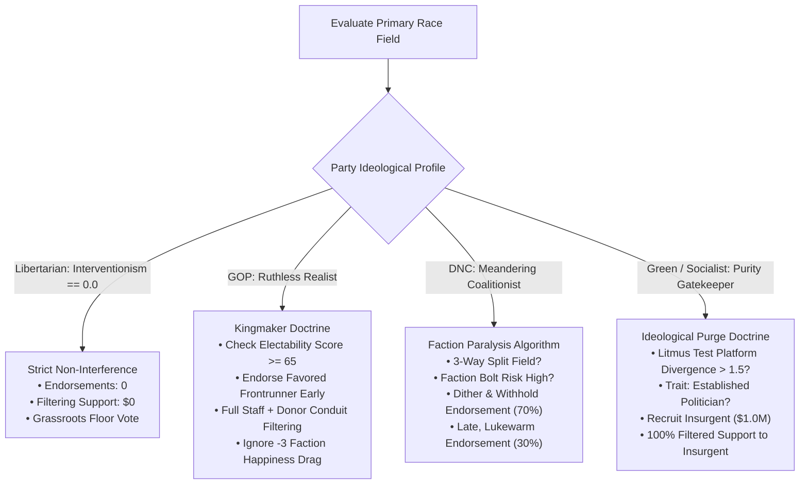

# Coalition Builder: Party Chair — Symmetric Opponent AI & Multi-Party Engine Design Specification

**Status:** Implementation-Ready Design Specification  
**Architecture:** Symmetric Opponent Execution Engine (SOEE)  
**Target Scope:** `engine.js`, `campaign-overhaul.js`, `app.js`, `data.js`, `factions-0.15.js`, `issues-0.2.1.js`, `state-house-data-0.5.js`, `presidential-primaries.js`, `candidate-vetting.js`, `election-drift.js`

---

## 1. System Vision & Architectural Philosophy

In the current baseline of **Coalition Builder: Party Chair**, the player commands a national political party through a rich 2-year operational cycle:
1. **The Recruitment Phase (Steps 1–5):** Tuning 40 unified platform stances, locking in 3 Major Strategic Quests and 3 to 7 Party Focus slots, recruiting candidates ($1.0M fee), filtering primary support and issuing endorsements (+10% primary poll boost, -3 rival faction happiness), contesting state legislative slates ($1M–$5M scaled by EV), and deploying a 20-action pool across the 8-card Party Machine grid.
2. **Party Primaries:** Presidential multi-candidate delegates and state/federal primary fields.
3. **The 5-Month Campaign Command (June–October):** Managing monthly action budgets, navigating the steep Persuasion vs. Turnout Efficiency curve, saturation mechanics in state airwaves, Theme of the Month framing, interactive debates, 42 trait-driven crises, opposition research dossiers, and the Final 72 Hours Blitz.
4. **Election Night & Inter-Cycle Realignment:** Live returns, post-election autopsies, and dynamic voter registration persistence across decades.

Currently, opposing parties are simulated via background aggregate formulas and reactive checks. This design document establishes the **Symmetric Opponent Execution Engine (SOEE)**. Under SOEE:
- **Universal Parity:** Opposing parties do not cheat, spawn phantom resources, or use shortcut formulas. They play through the exact same screens, actions, constraints, and trade-offs as the player.
- **Multiplayer Ready:** By channeling all party operations through an abstract, deterministic **Action Dispatcher Contract**, any seat at the table can be piloted interchangeably by a human, an AI, or a remote peer.
- **Authentic Ideological Archetypes:** Opponents do not behave like identical utility-maximizers. Instead, each party executes authentic real-world institutional habits, biases, and stereotypical tendencies:
  - **Republicans (`heritage`):** **Ruthless, transactional, and disciplined.** Enforces machine loyalty, kingmakes early in primaries, saturates high-EV battlegrounds with attack ads, weaponizes oppo research drops, and aggressively challenges state legislative slates.
  - **Democrats (`people`):** **Meandering, committee-bound, and risk-averse.** Paralyzed by factional friction, hesitates on endorsements, falls into the "50-state dilution trap," runs focus-grouped defensive ads, and waffles during crises.
  - **Libertarians (`liberty`):** **Decentralized, purist, and anti-boss.** Implements strict non-interference in primaries (0 endorsements/filtering), locks economic deregulation to 10.0, obsessively secures 50-state ballot access, and concentrates resources into Mountain West and New Hampshire bastions.
  - **Greens (`green`):** **Eco-socialist gatekeepers.** Intervenes heavily in primaries with strict litmus tests and purges, demands 100% platform pledges, prioritizes youth/campus organizing, and is entirely willing to play the spoiler in critical swing states.
  - **Socialists (`socialist`):** **Militant class warriors.** Heavy vanguardist primary interventions, aggressive rank-and-file union endorsements, urban tenant organizing, and relentless platform purity.
  - **Constitution (`constitution`):** **Theocratic constitutionalists.** Rigid moralistic screening, concentrated in rural Deep South and Prairie heartlands, framing all crises as secular deep-state attacks.

---

## 2. Universal Action Dispatcher Contract & State Schema

### 2.1 Universal Party State Schema (`game.parties[partyId]`)
The core game state is refactored so that every active party in the game (`heritage`, `people`, `liberty`, `green`, `constitution`, `socialist`, plus spawned or custom movements) maintains an identical state object:

```javascript
// Universal Party Chair State Schema
game.parties[partyId] = {
  id: partyId,                               // Canonical party identifier
  name: "Democratic Party",                  // Display label
  isMajor: true,                             // Tier 5 Major status flag
  tier: 5,                                   // Institutional Ascent Ladder Tier (1 to 5)
  treasury: 65.0,                            // Available National Committee funds ($M)
  organizingActionsRemaining: 20,            // Step 5 Recruitment Action pool (0 to 20)
  platformStances: {                         // 40 issue positions (1.0 to 10.0)
    'economic-tax-top': 7.5,
    'social-climate-carbon': 8.0,
    // ... 40 issues total
  },
  activeQuests: ['q_suburban_tilt', 'q_donor_bundling', 'q_labor_revival'], // 3 Major Priorities
  partyFocuses: [                            // Scaled slots (3 to 7) based on Tier
    { type: 'issue', targetId: 'healthcare-universal' },
    { type: 'state', targetId: 'PA' },
    { type: 'state', targetId: 'MI' },
    { type: 'region', targetId: 'Rust Belt' }
  ],
  leadershipRoles: {                         // 14 Constitutional & Machine Hierarchy slots
    partyChair: 'cand_chair_01',
    viceChair: 'cand_vice_02',
    speakerOfHouse: null,
    factionLeaders: {                        // Mapped strictly to major factions (>=2.5M voters)
      dem_liberal_establishment: 'cand_lead_01',
      dem_capital_left: 'cand_lead_02',
      // ... up to 7 major faction leaders
    },
    policyLeader: 'cand_warren_01',
    rhetoricalLeader: 'cand_jeffries_08'
  },
  factionHappiness: {                        // Constituent faction standing (0 to 100)
    dem_liberal_establishment: 75,
    dem_capital_left: 62,
    dem_blue_dogs: 58
  },
  factionConfidence: {                       // Constituent faction internal confidence (0 to 100)
    dem_liberal_establishment: 70,
    dem_capital_left: 68,
    dem_blue_dogs: 52
  },
  recruitedCandidateIds: ['cand_sen_oh_01'], // Candidates recruited for $1.0M fee
  primaryEndorsements: {                     // Race ID -> Candidate ID (triggers faction resentment)
    'senate_OH': 'cand_sen_oh_01'
  },
  filteredSupport: {                         // Race ID -> { candidateId, assets: ['capital','staff','pac'] }
    'senate_OH': { candidateId: 'cand_sen_oh_01', assets: ['capital', 'pac'] }
  },
  stateLegislativeSlates: ['PA', 'MI', 'WI', 'NC', 'GA'], // Contested unheld statehouse slates
  campaign: {                                // Phase 3 General Election state
    monthlyActionsLeft: 5,                   // Monthly action budget (5 actions / month)
    monthlyTheme: 'healthcare_costs',        // Theme of the Month
    airwavesSpendByState: { PA: 4.5, MI: 3.2 }, // Ad spend per state
    fieldOfficesByState: { PA: 12, MI: 8 },  // GOTV field offices deployed
    oppoDossiers: [],                        // Investigated opposition dossiers
    activeSurrogates: [],                    // Top-10 50+ Fame surrogates deployed
    crisisResolutions: {}                    // Log of handled trait crises
  },
  strategyProfile: {                         // Behavioral Heuristic Weights (0.0 to 1.0)
    ruthlessness: 0.30,
    primaryInterventionism: 0.35,
    factionRiskAversion: 0.85,
    geographicConcentration: 0.30,
    negativeAdPropensity: 0.35,
    ideologicalRigidity: 0.45
  }
};
```

### 2.2 The Action Dispatcher API (`executePartyAction`)
All state modifications must route through a single entry point:

```javascript
function executePartyAction(game, partyId, actionType, payload) {
  // 1. Validate party existence and turn authorization
  const party = game.parties[partyId];
  if (!party) throw new Error(`Unknown party: ${partyId}`);

  // 2. Clone state for deterministic functional mutation
  const nextGame = cloneGameState(game);
  const nextParty = nextGame.parties[partyId];

  // 3. Dispatch action by type
  switch (actionType) {
    // Phase 1: Step 1 Platform Stances
    case 'SET_PLATFORM_STANCE':
      return applySetPlatformStance(nextGame, partyId, payload.issueId, payload.stance);

    // Phase 1: Step 2 Priorities & Focuses
    case 'LOCK_IN_PRIORITIES':
      return applyLockInPriorities(nextGame, partyId, payload.quests, payload.focuses);

    // Phase 1: Step 3 Candidate Recruitment & Primary Filtering
    case 'RECRUIT_CANDIDATE':
      return applyRecruitCandidate(nextGame, partyId, payload.candidateId, payload.raceId);
    case 'ENDORSE_PRIMARY_CANDIDATE':
      return applyEndorsePrimaryCandidate(nextGame, partyId, payload.raceId, payload.candidateId);
    case 'FILTER_PRIMARY_SUPPORT':
      return applyFilterPrimarySupport(nextGame, partyId, payload.raceId, payload.candidateId, payload.assets);

    // Phase 1: Step 4 State Legislative Slates
    case 'CONTEST_STATE_SLATE':
      return applyContestStateSlate(nextGame, partyId, payload.stateId);

    // Phase 1: Step 5 Machine Organizing Grid (8 Operations)
    case 'EXECUTE_MACHINE_OPERATION':
      return applyMachineOperation(nextGame, partyId, payload.operationId, payload.targetStateId);

    // Leadership Appointments
    case 'APPOINT_LEADERSHIP_ROLE':
      return applyAppointLeadershipRole(nextGame, partyId, payload.roleId, payload.candidateId);

    // Phase 3: Campaign Operations
    case 'SET_MONTHLY_THEME':
      return applySetMonthlyTheme(nextGame, partyId, payload.issueId);
    case 'BUY_AIRWAVES_BLITZ':
      return applyBuyAirwavesBlitz(nextGame, partyId, payload.stateId, payload.spendMillions, payload.isNegative);
    case 'DEPLOY_SURROGATE':
      return applyDeploySurrogate(nextGame, partyId, payload.surrogateId, payload.stateId);
    case 'MOBILIZE_GOTV_DRIVE':
      return applyMobilizeGotvDrive(nextGame, partyId, payload.stateId, payload.spendMillions);
    case 'INVESTIGATE_OPPO':
      return applyInvestigateOppo(nextGame, partyId, payload.targetCandidateId);
    case 'DETONATE_OPPO_DOSSIER':
      return applyDetonateOppoDossier(nextGame, partyId, payload.dossierId);
    case 'RESOLVE_CRISIS_DECISION':
      return applyResolveCrisisDecision(nextGame, partyId, payload.crisisId, payload.decisionId);
    case 'FINAL_72H_BLITZ':
      return applyFinal72hBlitz(nextGame, partyId, payload.allocations);

    default:
      throw new Error(`Unrecognized actionType: ${actionType}`);
  }
}
```

---

## 3. Party-Specific Tendencies & Stereotypical Profiles

Each AI party is governed by a distinct **Strategy Profile** and cultural archetype matching real-world party dynamics:

```mermaid
quadrantChart
    title Party AI Strategic Archetypes
    x-axis Low Primary Intervention --> High Primary Intervention
    y-axis Decentralized / Cautious --> Ruthless / Combative
    quadrant-1 Vanguardist Fighters (Socialist)
    quadrant-2 Ruthless Realists (Republican)
    quadrant-3 Decentralized Purists (Libertarian)
    quadrant-4 Bureaucratic Coalitionists (Democrat)
    "Republican (GOP)": [0.85, 0.88]
    "Democratic (DNC)": [0.35, 0.28]
    "Libertarian (LP)": [0.02, 0.22]
    "Green (GPUS)": [0.95, 0.70]
    "Socialist (SPUSA)": [0.92, 0.85]
    "Constitution (CP)": [0.60, 0.75]
```

### 3.1 Party Profile Specifications

| Party | Archetype | Ruthlessness | Primary Intervention | Faction Risk Aversion | Geographic Concentration | Negative Ad Propensity |
| :--- | :--- | :---: | :---: | :---: | :---: | :---: |
| **`heritage` (Republican)** | **Ruthless Realist** | **0.85** | **0.80** | **0.25** | **0.85** | **0.80** |
| **`people` (Democrat)** | **Meandering Coalitionist** | **0.30** | **0.35** | **0.85** | **0.30** | **0.35** |
| **`liberty` (Libertarian)** | **Decentralized Purist** | **0.20** | **0.00** | **0.15** | **0.80** | **0.20** |
| **`green` (Green Party)** | **Eco-Socialist Gatekeeper**| **0.70** | **0.95** | **0.40** | **0.65** | **0.65** |
| **`socialist` (Socialist)** | **Militant Class Warrior** | **0.80** | **0.92** | **0.30** | **0.75** | **0.75** |
| **`constitution` (CP)** | **Theocratic Constitutionalist** | **0.65** | **0.60** | **0.20** | **0.80** | **0.50** |

---

## 4. Algorithmic Decision Models & AI Thought Processes

### 4.1 Step 1: 40-Issue Platform Tuning Algorithm
At the beginning of each cycle, the AI calculates its target stance $S_i^* \in [1.0, 10.0]$ for each of the 40 issues:
$$S_i^* = \text{clamp}\left( w_{\text{mood}} \cdot M_i + w_{\text{fac}} \cdot \sum_{f} (\omega_f \cdot F_{f, i}) + w_{\text{doc}} \cdot D_i, 1.0, 10.0 \right)$$
Where:
- $M_i$: Public median preference (1.0 to 10.0) from the voter model.
- $F_{f, i}$: Ideal stance of constituent faction $f$.
- $\omega_f$: Weight of faction $f$ (normalized by registered voters; Major factions $\ge 2.5\text{M}$ have $3\times$ voting power).
- $D_i$: Invariant founding party doctrine.
- $w_{\text{mood}}, w_{\text{fac}}, w_{\text{doc}}$: Weights determined by party profile:
  - **GOP:** $w_{\text{mood}} = 0.15, w_{\text{fac}} = 0.35, w_{\text{doc}} = 0.50$ (Pins platform to conservative/populist doctrine; base mobilization over swing persuasion).
  - **DNC:** $w_{\text{mood}} = 0.45, w_{\text{fac}} = 0.45, w_{\text{doc}} = 0.10$ (Endless compromise; constantly dragged between public polls and 7 competing faction leaders).
  - **Libertarian:** $w_{\text{mood}} = 0.00, w_{\text{fac}} = 0.20, w_{\text{doc}} = 0.80$ (Completely ignores public opinion; pins economic deregulation to 10.0 and social to 1.0/10.0).
  - **Greens & Socialists:** $w_{\text{mood}} = 0.05, w_{\text{fac}} = 0.30, w_{\text{doc}} = 0.65$ (Purity maximalism; refuses to moderate even when public mood is hostile).

#### Authentic Internal AI Monologues:
- **GOP Chair Engine:**
  > `[GOP_AI_THOUGHT]` *"Public mood on border security is 6.2, but our Faith & Flag and MAGA factions demand a 10. We lock it at 9.8. Let the suburban moderates wring their hands; our path to 270 EVs runs through base turnout in Pennsylvania and Georgia, not apologies in Westchester."*
- **Democratic Chair Engine:**
  > `[DEM_AI_THOUGHT]` *"The Capital L Left wants healthcare at 9.0; Blue Dogs want 4.0; the Liberal Establishment says 6.0; public polls show 5.8. If we pick 7.0, donors revolt. If we pick 5.0, Bernie Bros file an Ultimatum. Setting slider to 5.6. We will issue a 16-page white paper framing this as 'pragmatic progressivism'."*
- **Libertarian Chair Engine:**
  > `[LIB_AI_THOUGHT]` *"Voters favor state occupational licensing at 3.5? Irrelevant. Licensing is coercion. Economic slider locked at 10.0. The Libertarian Party will not sell out Bastiat for a two-point polling blip."*

---

### 4.2 Step 2: Major Priorities & Strategic Focuses Algorithm
The AI selects **3 Major Priorities (Quests)** and assigns its **Party Focus Slots** (3 to 7 based on Ascent Ladder Tier):

```javascript
function selectPartyPrioritiesAndFocuses(game, partyId) {
  const party = game.parties[partyId];
  const profile = party.strategyProfile;
  const maxFocusSlots = getMaxFocusSlots(party.tier);

  // 1. Quests Selection Heuristic
  const eligibleQuests = getEligibleQuests(game, partyId);
  const scoredQuests = eligibleQuests.map((q) => {
    let score = q.baseRewardValue;
    if (profile.ruthlessness > 0.6) score += (q.treasuryBonus * 2.0) + (q.seatsFlipBonus * 3.0);
    if (profile.factionRiskAversion > 0.6) score += (q.factionHarmonyBonus * 2.5);
    if (profile.geographicConcentration > 0.6) score += (q.regionalDensityBonus * 2.0);
    return { questId: q.id, score };
  }).sort((a, b) => b.score - a.score);
  const chosenQuests = scoredQuests.slice(0, 3).map((q) => q.questId);

  // 2. Focus Slots Allocation
  const chosenFocuses = [];
  if (profile.geographicConcentration > 0.7) {
    // Concentrated Triage: 70% of slots into top 2-3 Battleground States
    const targetStates = getTopBattlegroundStates(game, partyId, 3);
    targetStates.forEach((st) => chosenFocuses.push({ type: 'state', targetId: st.id }));
    chosenFocuses.push({ type: 'issue', targetId: getTopWedgeIssue(game, partyId) });
    if (chosenFocuses.length < maxFocusSlots) {
      chosenFocuses.push({ type: 'region', targetId: getTopRegion(partyId) });
    }
  } else {
    // 50-State Dilution Trap: Spreads slots across reach states, defensive bastions, and multiple issues
    chosenFocuses.push({ type: 'state', targetId: getDefensiveFirewallState(game, partyId) });
    chosenFocuses.push({ type: 'state', targetId: getAspirationalReachState(game, partyId) });
    chosenFocuses.push({ type: 'issue', targetId: 'healthcare-universal' });
    chosenFocuses.push({ type: 'issue', targetId: 'economic-jobs' });
    while (chosenFocuses.length < maxFocusSlots) {
      chosenFocuses.push({ type: 'state', targetId: getRandomSwingState(game) });
    }
  }

  return { quests: chosenQuests, focuses: chosenFocuses };
}
```

---

### 4.3 Step 3: Candidate Recruitment & Primary Endorsement Logic



#### The Candidate Electability Evaluation Formula
The AI evaluates candidates using a weighted regression score:
$$\text{Electability} = (\text{Fame} \times 0.25) + (\text{Popularity} \times 0.35) + \text{TraitModifiers} - (\text{IdeologicalDistance} \times 12)$$
Where TraitModifiers:
- *Rising Star*: $+12$
- *Polished*: $+10$
- *Disciplined*: $+10$
- *Squeaky Clean*: $+8$
- *Established politician*: $+6$ (or $-15$ for Greens/Socialists)
- *Rough*: $+4$ (for GOP/Socialists) or $-6$ (for Democrats)
- *Undisciplined*: $-18$
- *Corrupt*: $-25$

#### Endorsement Repercussions & Escalation Ladder
When the AI executes `ENDORSE_PRIMARY_CANDIDATE`:
- Endorsed candidate receives $+10\%$ primary polling boost.
- Candidate's aligned faction gains $+1$ Happiness.
- **Rival factions in the party suffer $-3$ Happiness.**
  - If a rival faction's Happiness falls below $35$, they trigger a **Primary Bolt Warning**.
  - If Happiness falls below $20$ and Cohesion $> 0.70$, they launch an independent spoiler bid or withhold donor conduits.

---

### 4.4 Step 4: State Legislative Slate Contestation Logic
Contesting unheld state legislative chambers costs **$1M–$5M scaled by Electoral Votes** (3 EVs = $1M; 54 EVs CA = $5M) plus 1 Leadership Action.

- **Republican AI (Offensive Squeeze):**
  - Evaluates legislative chambers where the seat margin is within 15 seats.
  - Spends up to 5 actions and $15M contesting Pennsylvania, Michigan, Wisconsin, Arizona, and Minnesota.
  - Forces Democrats to bleed cash defending state legislative majorities.
- **Democratic AI (Symbolic 50-State Sprawl):**
  - Allocates actions contesting legislative slates in deep-red states (e.g. Utah, Idaho, Wyoming) for rhetorical "inclusivity," burning $3M–$6M that is starved from the Wisconsin assembly fight.
- **Third Party AI (Sniper Viability):**
  - Contests statehouse slates **only** in states where modeled party registration is $\ge 4.0\%$ or where a single legislative district offers plurality viability (e.g., Libertarians in NH House floterials; Socialists in urban legislative seats; Greens in Humboldt County CA / Portland OR).

---

### 4.5 Step 5: Direct Organizing Actions Pool (20-Action Spending Engine)

```javascript
function allocatePreCampaignOrganizingPool(game, partyId) {
  const party = game.parties[partyId];
  const profile = party.strategyProfile;
  let remainingActions = party.organizingActionsRemaining; // 20 actions
  const actionLog = [];

  while (remainingActions > 0 && party.treasury >= 2.0) {
    let operation = null;
    let targetState = null;

    if (profile.ruthlessness > 0.7) {
      // GOP Doctrine: Heavy Voter Reg & Pipeline in Battlegrounds
      if (remainingActions >= 5 && party.treasury >= 25.0) {
        operation = 'statewide_voter_registration';
        targetState = getTopPriorityBattleground(game, partyId);
      } else if (remainingActions >= 3 && party.treasury >= 6.0) {
        operation = 'candidate_pipeline';
        targetState = getTopPriorityBattleground(game, partyId);
      } else {
        operation = 'gotv_field_organizing';
        targetState = getTopPriorityBattleground(game, partyId);
      }
    } else if (profile.factionRiskAversion > 0.7) {
      // Dem Doctrine: High Volunteer Drives, Youth Drives & Faction Summits
      if (hasDiscontentedFaction(party)) {
        operation = 'faction_concession_summit';
      } else if (remainingActions % 2 === 0) {
        operation = 'volunteer_drive';
        targetState = getRandomTargetState(game, partyId);
      } else {
        operation = 'youth_campus_drive';
        targetState = getRandomTargetState(game, partyId);
      }
    } else if (partyId === 'liberty') {
      // Libertarian Doctrine: Chapter Expansion for 50-State Ballot Access
      operation = getMissingChapterState(game, partyId) ? 'open_state_chapter' : 'digital_media_network';
      targetState = getMissingChapterState(game, partyId) || 'NH';
    } else {
      // Green / Socialist: Campus Drives & Labor Field Organizing
      operation = (remainingActions % 2 === 0) ? 'youth_campus_drive' : 'gotv_field_organizing';
      targetState = getMovementHubState(game, partyId);
    }

    // Execute through universal dispatcher
    const result = executePartyAction(game, partyId, 'EXECUTE_MACHINE_OPERATION', {
      operationId: operation,
      targetStateId: targetState
    });
    remainingActions--;
    actionLog.push({ operation, targetState });
  }

  return actionLog;
}
```

---

### 4.6 Phase 3: The 5-Month Campaign Phase Decision Matrix

During Months 1–5 (June through October), each AI spends 5 monthly actions and allocates treasury under the **Monthly Persuasion vs. Turnout Efficiency Curve**:

```mermaid
sequenceDiagram
    autonumber
    participant Engine as Campaign Engine (June to October)
    participant GOP as GOP AI (Ruthless)
    participant DEM as DEM AI (Meandering)
    participant Airwaves as State Airwaves Saturation Model

    Engine->>GOP: Month 1 (June: 300% Persuasion / 25% Turnout)
    GOP->>Airwaves: Pours $12.0M into Issue Attack Ads in PA, WI, GA
    Airwaves-->>GOP: Markets become "Crowded" (1.25x Cost); Dem net trust drops -2.5%

    Engine->>DEM: Month 1 (June)
    DEM->>Airwaves: Spreads $6.0M across 10 states on positive biographical ads
    Note over DEM: Hesitates to run negative ads; misses 300% persuasion window

    Engine->>GOP: Month 4 (September: 50% Persuasion / 200% Turnout)
    GOP->>Engine: Detonates "October Surprise" Oppo Research Dossier on Dem Nominee
    Engine-->>DEM: Dem Chair hit with -3.8% polling collapse in toss-up states

    Engine->>DEM: Month 4 (September)
    DEM->>Engine: Panics; forms internal ethics committee; issues defensive apology
    Note over DEM: Media coverage extends scandal for 3 weeks
```

#### 1. Airwaves Saturation & Negative Ad Strategy
- **Republicans:** Spends 65% of ad dollars on **Issue Attack Ads** in June–July. Pushes battlegrounds into *Crowded* (1.25x cost) and *Saturated* (1.6x cost) tiers to suppress Democratic independent turnout.
- **Democrats:** Spends 70% of ad dollars on positive policy explainers in June–August. Only switches to negative attacks in October, when persuasion efficiency has collapsed to 25%.

#### 2. Opposition Research Detonation Heuristic
- The AI commissions dossiers on opponent candidates with Fame $\ge 60$ during Month 1.
- If the dossier generates a *High-Severity* ethics or financial dirt finding:
  - **GOP:** Holds the dossier in secret until **Month 5 (October Week 2)**, detonating it alongside an ad blitz for maximum turnout suppression.
  - **DEM:** Internal committee deliberations over negative campaigning delay detonation until the final 72 hours, muting its earned-media cycle.

#### 3. 42 Trait-Driven Crises Decision Matrix
When an opponent candidate triggers a crisis on the campaign trail:

| Party | Crisis Type | Selected Option | Immediate Trade-Off |
| :--- | :--- | :--- | :--- |
| **GOP** | Corrupt / Undisciplined Scandal | **"Attack the Media & Double Down"** | Suburban Moderates lose -1.5% approval; Base turnout remains solid; zero candidate resignation. |
| **DEM** | Donor / Ethics Controversy | **"Appoint Independent Panel & Apologize"** | Scandal dominates 3 news cycles; nets -3.2% national approval; alienates both wings. |
| **LIB** | Tax / Regulatory Evasion | **"Defend as Moral Stand Against Extortion"** | Zero contrition; galvanizes libertarian base; locks out moderate suburban swing. |
| **GRN / SOC**| Corporate / Labor Deviation | **"Purge Candidate from Party Ticket"** | Protects ideological purity; forfeits ballot line viability in the general election. |

---

## 5. Ready-to-Implement Requirements Specification Grouped by Size

Following the Workspace Agent Rules, all updates and architectural requirements are strictly categorized primarily by **Size** (`Massive`, `Huge`, `Large`, `Medium`, `Small`, `Tiny`), with count, requirement IDs, titles, and target files.

### 5.1 Massive Updates (2 Requirements)

#### REQ-299: Symmetric Party State Architecture & Universal Chair Action Dispatcher
- **Size:** `Massive`
- **Count:** 1 of 2 in Massive
- **Target Files:** `engine.js`, `party-systems-engine.js`, `data.js`
- **Specification:**
  - Refactors `game` state so that every active party (`heritage`, `people`, `liberty`, `green`, `constitution`, `socialist`, and custom/spawned parties) possesses an identical, fully populated state container (`game.parties[partyId]`).
  - Implements the headless `executePartyAction(game, partyId, actionType, payload)` contract covering all 42 player-available operations (platform slider edits, quest locks, focus slot assignments, candidate recruitments, primary endorsements, filtering support, slate contestations, 8 machine operations, leadership appointments, campaign ad blitzes, theme selection, debate answers, oppo detonations, and crisis management).
  - Validates that state mutations are 100% deterministic, seed-driven, and compatible with save/load serialization without breaking backward compatibility with existing save keys.

#### REQ-300: Autonomous Opponent Chair AI Engine & Cycle Pipeline Orchestrator
- **Size:** `Massive`
- **Count:** 2 of 2 in Massive
- **Target Files:** `engine.js`, `campaign-overhaul.js`, `app.js`
- **Specification:**
  - Implements `simulateOpponentPhase(game, phaseName)` orchestrating the autonomous execution of all non-player parties through each phase in lockstep with the human player.
  - In Phase 1 (Organizing), runs the 20-action budgeting loop for every opponent party across Steps 1–5, consuming treasury and action pools under identical rules.
  - In Phase 3 (Campaign), executes monthly AI turns (June–October) allocating 5 campaign actions per party, managing airwaves saturation, surrogate deployment, and turnout mobilization.
  - Ensures multi-party game state advances synchronously: when the human chair advances turn or month, all opponent chairs resolve their corresponding turn actions before the next player prompt.

---

### 5.2 Huge Updates (2 Requirements)

#### REQ-301: Party-Specific Ideological AI Personas & Decision Heuristics Matrix
- **Size:** `Huge`
- **Count:** 1 of 2 in Huge
- **Target Files:** `engine.js`, `campaign-overhaul.js`, `data.js`
- **Specification:**
  - Establishes mathematical behavioral weights for each canonical party:
    - `heritage` (GOP): Ruthlessness 0.85, Interventionism 0.80, Negative Propensity 0.80, Triage Focus 0.85.
    - `people` (DNC): Ruthlessness 0.30, Interventionism 0.35, Faction Risk Aversion 0.85, Dilution Bias 0.75.
    - `liberty` (LP): Interventionism 0.00, Ideological Rigidity 0.95, Ballot Priority 0.90, Bastion Focus 0.80.
    - `green` (GPUS): Interventionism 0.95, Purity Gatekeeping 0.95, Anti-Corporate Bias 0.90.
    - `socialist` (SPUSA): Interventionism 0.90, Class Struggle Bias 0.95, Labor Density Focus 0.85.
    - `constitution` (CP): Interventionism 0.60, Theocratic Invariance 0.90, Heartland Focus 0.85.
  - Integrates dynamic persona generation for custom and post-breakup parties based on their founding charter traits and leading faction sliders.

#### REQ-302: Opponent Primary Phase Simulator & Autonomous Candidate Endorsement Engine
- **Size:** `Huge`
- **Count:** 2 of 2 in Huge
- **Target Files:** `engine.js`, `presidential-primaries.js`, `candidate-vetting.js`
- **Specification:**
  - Overhauls `simulateFullPrimaryForParty(game, partyId)` to incorporate active Chair filtering support and endorsements.
  - AI Chairs evaluate candidate traits (*Rising Star*, *Polished*, *Disciplined*, *Corrupt*), public Net Approval, and faction alignment before issuing endorsements.
  - Implements authentic endorsement repercussions for AI parties: endorsing a candidate delivers a +10% primary polling boost while penalizing rival party factions (-3 Happiness), altering AI faction stability and trigger thresholds for primary revolts or ultimatums.

---

### 5.3 Large Updates (3 Requirements)

#### REQ-303: Autonomous 5-Month Campaign Strategy & Strategic Airwaves AI
- **Size:** `Large`
- **Count:** 1 of 3 in Large
- **Target Files:** `campaign-overhaul.js`, `engine.js`
- **Specification:**
  - Expands `runRivalChairMonthlyTurn` into a full strategic campaign AI utilizing monthly persuasion vs. turnout efficiencies.
  - AI allocates funds across the 5 canonical campaign actions (Ad Blitz, Issue Attack Ads, Rally Tour, Surrogates, GOTV Drive).
  - Models realistic airwaves saturation targeting: GOP attacks crowded battleground markets to impose ad fatigue on Democrats; third parties advertise selectively in high-elasticity bastions.

#### REQ-304: AI Crisis Management, Oppo Research Detonation & Debate Decision Matrix
- **Size:** `Large`
- **Count:** 2 of 3 in Large
- **Target Files:** `campaign-overhaul.js`, `candidate-vetting.js`
- **Specification:**
  - Enables AI Chairs to investigate opposition dossiers on player candidates during Months 1–3 and detonate them in Months 4–5 based on tactical desperation and party ruthlessness scores.
  - Implements automated decision trees for all 42 trait-driven crises affecting opponent candidates (Double Down, Throw Under Bus, Censor, Apologize, Counter-Attack).
  - Models AI candidate debate performance based on candidate traits (*Polished* vs *Rough*, *Disciplined* vs *Undisciplined*) and Chair coaching instructions.

#### REQ-305: Opponent Machine Organizing & 20-Action Pre-Campaign Allocation Engine
- **Size:** `Large`
- **Count:** 3 of 3 in Large
- **Target Files:** `engine.js`, `app.js`
- **Specification:**
  - Implements the 20-action spending engine for AI parties during Step 5 of the Recruitment Phase.
  - AI evaluates state chapters, voter registration deficits, downballot pipelines, and volunteer drives against regional priorities.
  - Updates live state voter registration rolls (`game.voterModel.states`) immediately upon AI action execution, creating visible inter-party registration battles visible on the Disaggregated State Voter Registration Table.

---

### 5.4 Medium Updates (3 Requirements)

#### REQ-306: AI Platform Issues & 40-Stance Faction Alignment Logic
- **Size:** `Medium`
- **Count:** 1 of 3 in Medium
- **Target Files:** `engine.js`, `issues-0.2.1.js`
- **Specification:**
  - Automates Step 1 of the Recruitment Phase for all AI chairs across 40 issue positions.
  - Balances median voter mood against constituent faction pull and core doctrine weights.
  - Triggers internal faction standing and happiness shifts for AI parties based on platform distance from faction ideals.

#### REQ-307: Opponent Strategic Quests, Focus Locks & Statehouse Contestation AI
- **Size:** `Medium`
- **Count:** 2 of 3 in Medium
- **Target Files:** `engine.js`, `state-house-data-0.5.js`
- **Specification:**
  - AI selects 3 Major Priorities from the quest catalog and locks in 3 to 7 Party Focus slots (issues, states, regions).
  - Implements state legislative slate contestation logic: AI automatically contests held chambers and spends $1M–$5M contesting unheld chambers based on target PVI competitiveness and EV weight.

#### REQ-308: Opponent Faction Internal Dynamics, Ultimatums & Leadership Hierarchy AI
- **Size:** `Medium`
- **Count:** 3 of 3 in Medium
- **Target Files:** `factions-0.15.js`, `engine.js`
- **Specification:**
  - Automates leadership appointments for AI parties across all 14 hierarchy roles (Chair, Vice Chair, 7 Faction Leaders, Whips, Cabinet/Opposition).
  - Evaluates faction ultimatums and demands: AI decides whether to grant concessions, convene summits, or crush faction revolts based on internal confidence and party discipline.

---

### 5.5 Small Updates (2 Requirements)

#### REQ-309: Multi-Cycle Strategic Memory & Inter-Cycle Ideological Adaptation Engine
- **Size:** `Small`
- **Count:** 1 of 2 in Small
- **Target Files:** `engine.js`, `election-drift.js`
- **Specification:**
  - Tracks post-election performance metrics (seats gained/lost, electoral votes, popular vote share) per party.
  - Updates AI strategic parameters across cycle boundaries: losing parties experience faction reshuffles and adjust their interventionism and ruthlessness parameters for subsequent cycles (2030, 2032+).

#### REQ-310: Opponent Intelligence Telemetry, Morning Wire & Trail Ticker UI Feed
- **Size:** `Small`
- **Count:** 2 of 2 in Small
- **Target Files:** `app.js`, `campaign-overhaul.js`
- **Specification:**
  - Exposes opponent operational actions to the human player through atmospheric intelligence reporting:
    - *The Morning Wire:* Headlines reporting major opponent moves (e.g. *"GOP Chair Endorses Insurgent in Ohio"*, *"DNC Dithers on Focus Priorities"*).
    - *Campaign Trail Ticker:* Real-time feed of opponent monthly ad spending, rally locations, and surrogate drops.
    - *Forecaster Inspection:* Visual indicators on the 50-state map highlighting opponent field offices and ad saturation tiers.

---

### 5.6 Tiny Updates (1 Requirement)

#### REQ-311: Multiplayer Headless Action Contract & Session Serialization Bridge
- **Size:** `Tiny`
- **Count:** 1 of 1 in Tiny
- **Target Files:** `engine.js`, `build.js`
- **Specification:**
  - Encapsulates all chair action calls into a clean, JSON-serializable message envelope (`{ cycle, phase, month, partyId, actionId, payload, timestamp }`).
  - Ensures full replayability and determinism, creating the direct technical foundation for turn-based networked multiplayer or multi-chair pass-and-play sessions.

---

## 6. Telemetry, Player UI & Atmospheric Intelligence

To make opponent actions vivid and atmospheric, the player is provided with continuous intelligence:
1. **The Morning Wire:**
   - Dynamic procedural headlines generated at step/month boundaries reflecting opponent moves:
     - *"RNC Chair Launches $14M Airwaves Assault Across Pennsylvania & Wisconsin"*
     - *"DNC Dithers on Focus Priorities as Blue Dogs and Left Clashing on Energy Stance"*
     - *"Libertarian National Committee Rebuffs Primary Endorsement Petitions: 'The Convention Floor Belongs to the Grassroots'"*
     - *"Green Party Steering Committee Purges Moderate Senate Nominee in Oregon Over Litmus Breach"*
2. **The Campaign Trail Ticker:**
   - A live, ticker-tape feed at the top of the Campaign Phase dashboard logging monthly rival ad buys, rally tours, and surrogate drops.
3. **Interactive 50-State Intel Tooltip:**
   - Hovering over any state on the national map reveals an **Airwaves & Ground Balance** card displaying:
     - Total ad spending by party in that state.
     - Saturation Tier (`Open`, `Crowded`, `Saturated`, `Ad Fatigue`).
     - Number of active ground field offices per party.
     - Detonated oppo dossier drag effects.

---

## 7. Verification & Headless Simulation Strategy

To verify this architecture before production deployment:
1. **Headless 5-Cycle Parity Benchmark:**
   - Execute a 10-year headless simulation (`scripts/test-soee-parity.cjs`) across 100 seeds.
   - Assert that every active party finishes with non-negative treasury, exact 20 organizing action expenditures, and proper delegate clinch resolutions.
2. **Electorate Conservation Audit:**
   - Verify that all AI voter registration drives and field operations conserve the 155M national voter scale while accurately mutating `game.voterModel.states`.
3. **Multiplayer Replay Verification:**
   - Record an action log from a 2-year cycle, serialize it to JSON, replay it through `executePartyAction`, and verify 100% bit-exact state matching.
