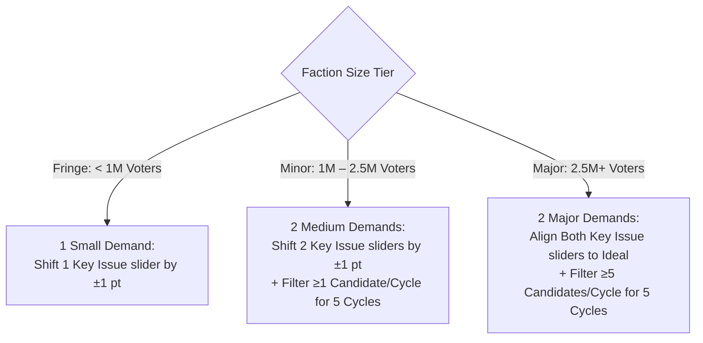

# Version 0.15.1 Design Specification & Implementation Handoff

**Build Target:** Version 0.15.1  
**Working Title:** *Coalition Builder: Party Chair*  
**Theme:** *The Coalition Summit & Ultimatum Engine (Faction Detachment, Coalition Summits, Tiered Charters of Demands, Multi-Cycle Filtering Pacts, and Ideological Cohabitation Backlash)*  
**Target Release Executable:** `dist/release/Coalition Builder - Party Chair.exe`  
**Save Version Compatibility:** `partyChairGame.save.v15.1` (Backward-compatible with `v15.0`, `v14.6` through `v1`)  
**Design Status:** DESIGN SPECIFICATION ONLY. **DO NOT IMPLEMENT IN THIS CONVERSATION.**  
**Prerequisite Baseline:** Assumes Version 0.15.0 has been fully implemented in `data.js`, `engine.js`, and `app.js`.  
**Handoff Prompt:** See Section 5 for the complete, copy-pastable implementation prompt for the coding agent.

---

## 1. Executive Summary & Inventory of Subsystems

In Version 0.15.0, **factions are established as the fundamental atomic units of the electorate**: 100% of the 155.00M registered voters belong to factions, and a party’s size is strictly the sum of its constituent factions. 

Version 0.15.1 introduces dynamic party boundaries via **The Coalition Summit & Ultimatum Engine**: neglected factions issue ultimatums and sever ties into the unaffiliated electorate, while the National Chair can court independent and swing factions into the party base through negotiated **Charters of Demands**.

| # | Feature ID | Feature Title | Tier | Target File(s) | Summary |
| :-: | :---: | :--- | :---: | :--- | :--- |
| **1** | **SUM-01** | Faction Friction & Ultimatum Detachment Loop | **Medium** | `engine.js`, `app.js` | Accumulates a 0–100 Friction Index from chronic unhappiness (<35 for 2 turns), platform drift (>4.5 pts), or hostile filtering. Triggers a 2-turn Ultimatum dispatch. Upon expiration, the faction bolts, converting its voters and lawmakers to Independent status and revoking its Super PAC. |
| **2** | **SUM-02** | The Coalition Summit & Recruitment Protocol | **Medium** | `engine.js`, `app.js` | Chair spends 1 Leadership Action during the organizing phase to convene a summit with any unaffiliated/swing faction. Enforces the 5.0M-member invariant (extremists refuse parties with >5M other members). Upon signing, the party absorbs 100% of the faction's voters nationwide. |
| **3** | **SUM-03** | Streamlined Tiered Demands Engine | **Large** | `engine.js`, `app.js` | Dynamically generates non-negotiable charters by size tier: Fringe (1 slider move $\pm 1$), Minor (2 slider moves $\pm 1$ + 1 candidate filter/cycle for 5 cycles), Major (match ideal coordinates on both key issues + 5 candidate filters/cycle for 5 cycles). |
| **4** | **SUM-04** | Multi-Cycle Filtering Pacts & Breach Consequences | **Small** | `engine.js` | Tracks multi-cycle filtering compacts across primary seasons. Fulfilling the quota awards +5 Happiness; failing to filter the required candidates triggers a Betrayal Crisis (-30 Happiness, -10 Confidence, and immediate 1-turn bolt threat). |
| **5** | **SUM-05** | Ideological Cohabitation & Member Backlash | **Small** | `engine.js` | Admitting a new faction evaluates Euclidean distance against existing member factions ($Dist < 2.5 \to +2$ morale; $2.5–4.0 \to -4$ dip; $> 4.0 \to -12$ to $-18$ Happiness penalty and activist turnout drag). |
| **6** | **SUM-06** | Factions UI Hierarchy & Summit Navigation | **Tiny (UI)** | `app.js`, `index.html` | Studio-compliant summit negotiation modal (Raised Navy, Muted Copper, Slate), faction status pills (Leading, Major, Minor, Fringe, Unaffiliated, Ultimatum), and an Active Compacts tracker widget. |

---

## 2. Technical Subsystem Specifications

### Subsystem A: Faction Friction & Ultimatum Detachment Loop (`SUM-01`)

#### 1. Friction Index Accumulator (`engine.js`)
Each faction in `game.factions` tracks `frictionIndex` (clamped 0 to 100, baseline 0) and `ultimatumTurnsRemaining` (null or integer):
- **Accumulation Triggers (Evaluated at turn/cycle boundaries):**
  1. *Chronic Dissatisfaction:* If faction Happiness remains below 35 for 2 consecutive turns $\implies +25$ Friction per turn.
  2. *Platform Abandonment:* If Euclidean platform distance across the faction's 2 Key Issues exceeds 4.5 points $\implies +15$ Friction per turn.
  3. *Hostile Interventions:* Deploying Filtering Support against a candidate aligned with this faction $\implies +20$ Friction per occurrence.
- **Cooling Down:** If Happiness $\ge 60$ and platform distance $\le 2.5$, Friction decreases by $-15$ per turn.

#### 2. The Ultimatum Warning & 2-Turn Resolution Window
- When `frictionIndex >= 100`, the faction issues an official **Ultimatum Warning**:
  - `faction.ultimatumTurnsRemaining = 2`.
  - Dispatches an executive crisis notification to the Chair: *"The [Faction Name] warns that recent platform and leadership decisions are unacceptable. Address core grievances within 2 turns or the faction will formally withdraw from the party."*
- **Resolution:** Chair can avert the crisis by raising faction Happiness to $\ge 50$ (via slider moves matching key issues, bill sponsorships, or convention honors), resetting `frictionIndex = 40` and clearing the ultimatum.

#### 3. Faction Bolting (Severance Execution)
- If `ultimatumTurnsRemaining` reaches 0 without remediation:
  - Faction status updates: `faction.partyId = 'none'` (shifts to Unaffiliated).
  - **Voter Severance:** All voters of this faction across all 50 states + DC are subtracted from the party's registration and added directly to Independent registration:
    ```javascript
    voterModel.states.forEach((state) => {
      const factionVoters = state.factions?.[factionId] || 0;
      if (factionVoters > 0) {
        state.affiliations[playerPartyId] = Math.max(0, (state.affiliations[playerPartyId] || 0) - Math.round(factionVoters / 100));
        state.affiliations.independent = (state.affiliations.independent || 0) + Math.round(factionVoters / 100);
      }
    });
    ```
  - **Lawmaker Defection:** Any sitting senators, representatives, or governors belonging to this faction become **Independents**.
  - **Super PAC Loss:** Party treasury loses access to the faction's allied Super PAC donor streams.

---

### Subsystem B: Coalition Summit & Recruitment Protocol (`SUM-02`)

#### 1. Summit Action Mechanics (`engine.js`, `app.js`)
- **Cost:** 1 Leadership Action during Phase 1 (Organizing Phase).
- **Target Eligibility:** Any Unaffiliated faction (`partyId === 'none'`), Swing faction (`partyId === 'independent'`), or previously detached faction.
- **Confidence Eligibility Threshold:** A faction can **only be recruited if its internal Confidence is 30 or lower** (`faction.confidence <= 30`). Factions with Confidence $> 30$ are self-sufficient or distrustful of institutional co-optation and refuse to attend recruitment summits (displaying: *"The [Faction Name] is confident in its independent path and refuses to enter coalition talks"*).
- **The 5.0-Million Member Invariant:**
  - Extremist fringe factions (*Ancaps*, *Christian Dominionists*, *Socialists*, *Communists*, *The Klan*, *Neo-Nazis*) verify the party's total non-faction voter count:
    $$\text{OtherMembers} = \text{TotalPartyVoters} - \text{FactionVoters}$$
  - If $\text{OtherMembers} > 5,000,000$, the summit is blocked with the prompt: *"The [Faction Name] refuses to negotiate with a party containing over 5 million members of other factions."*

#### 2. Accord Ratification & Voter Ingestion
- When the Chair clicks **[ Sign Coalition Accord ]**:
  - The faction is admitted: `faction.partyId = playerPartyId`.
  - **Internal Confidence Boost (+30 Points):** The newly recruited faction immediately gains **+30 points to internal Confidence** (`faction.confidence = Math.min(100, faction.confidence + 30)`), reflecting revitalization, institutional backing, and renewed optimism in their new coalition home.
  - **Voter Influx:** All voters belonging to this faction across all 50 states are transferred from Independent into the player's party:
    ```javascript
    voterModel.states.forEach((state) => {
      const factionVoters = state.factions?.[factionId] || 0;
      if (factionVoters > 0) {
        state.affiliations.independent = Math.max(0, (state.affiliations.independent || 0) - Math.round(factionVoters / 100));
        state.affiliations[playerPartyId] = (state.affiliations[playerPartyId] || 0) + Math.round(factionVoters / 100);
      }
    });
    ```
  - Reconcile national party totals: $\text{NationalAffiliation}_{pid} = \sum \text{state.affiliations}_{s, pid} \times 100$.
  - Candidates from the newly admitted faction enter the party's recruitment and primary talent pools.

---

### Subsystem C: Streamlined Tiered Demands Engine (`SUM-03`)

Demands are automatically structured based on the target faction's size tier from Version 0.15:



1. **Fringe Factions (`< 1,000,000` Voters) — 1 Small Demand:**
   - Evaluates the faction's 2 Key Issues. If the party platform does not already match on both:
   - Adjusts **one** 1–10 slider by $\pm 1$ point toward the faction's ideal stance.
   - If the party already matches on both issues, the faction joins with zero platform demands.
2. **Minor Factions (`1,000,000 – 2,499,999` Voters) — 2 Medium Demands:**
   - **Dual Slider Shift:** Adjusts **two** 1–10 sliders by $\pm 1$ point toward ideal stances on **both** Key Issues.
   - **Primary Filtering Pact:** Establishes a 5-cycle compact requiring $\ge 1$ Filtering Support action deployed to this faction's primary candidates per cycle.
3. **Major & Leading Factions (`2,500,000+` Voters) — 2 Major Demands:**
   - **Total Platform Alignment:** Instantly snaps the party's platform sliders to **identically match** the faction's ideal coordinates on **both** Key Issues.
   - **Multi-Candidate Filtering Pact:** Establishes a 5-cycle compact requiring $\ge 5$ Filtering Support actions deployed to this faction's primary candidates per cycle.

---

### Subsystem D: Multi-Cycle Filtering Pacts & Breach Consequences (`SUM-04`)

#### 1. Compact Data Structure (`engine.js`)
Pacts are registered in `game.activeCoalitionPacts`:
```javascript
{
  factionId: 'swg_hard_hats',
  factionName: 'Hard Hats',
  targetFiltersPerCycle: 1, // 1 for Minor, 5 for Major
  cyclesRemaining: 5,
  filtersAppliedThisCycle: 0
}
```

#### 2. Cycle Evaluation & Breach Trigger
- During Phase 2 (Primaries), whenever the Chair uses **Filtering Support** on a candidate, check `candidate.factionId`. If matching an active pact, increment `pact.filtersAppliedThisCycle += 1`.
- At the conclusion of the primary phase:
  - **Quota Met (`filtersApplied >= target`):**
    - Awards $+5$ Faction Happiness and $+2$ Confidence.
    - Decrements `pact.cyclesRemaining -= 1`.
    - If `cyclesRemaining === 0`, pact successfully concludes with permanent $+10$ loyalty.
  - **Quota Breached (`filtersApplied < target`):**
    - Triggers a **Betrayal Crisis**:
      - Faction Happiness drops by $-30$.
      - Faction Confidence drops by $-10$.
      - Faction immediately issues a **1-turn final ultimatum** or bolts the party on the spot.

---

### Subsystem E: Ideological Cohabitation & Member Backlash (`SUM-05`)

Admitting a new faction triggers a balance-of-power calculation among all existing member factions in the party:
1. **Distance Metric:** Calculate 3D Euclidean distance across Social, Economic, and Governance sliders:
   $$\text{Dist}(A, B) = \sqrt{(S_A - S_B)^2 + (E_A - E_B)^2 + (G_A - G_B)^2}$$
2. **Backlash Thresholds:**
   - **Compatible ($\text{Dist} < 2.5$):** Existing factions welcome the growth $\implies +2$ Happiness.
   - **Moderate Strain ($\text{Dist} = 2.5 – 4.0$):** Minor friction $\implies -4$ Happiness to ideologically strained wings.
   - **Hostile Cohabitation ($\text{Dist} > 4.0$):** Diametrically opposed factions trigger severe backlash:
     - Imposes an immediate **$-12$ to $-18$ Happiness penalty** on opposing factions (scaled to distance).
     - Activist volunteers express outrage, imposing a temporary $-3.0\%$ turnout drag for that cycle.

---

### Subsystem F: UI Hierarchy & Summit Navigation (`SUM-06`)

All UI elements adhere strictly to [ART_STYLE.md](file:///c:/Users/rober/.gemini/antigravity/scratch/party-chair-game/ART_STYLE.md) and [GAME_STYLE_GUIDE.md](file:///c:/Users/rober/.gemini/antigravity/scratch/party-chair-game/GAME_STYLE_GUIDE.md):

1. **Summit Modal (`app.js`, `index.html`):**
   - Backdrop overlay using Deep Navy (`hsl(226, 24%, 7%)`).
   - Dialog box rendered in Raised Navy (`hsl(226, 21%, 12%)`) with 1px Slate border (`hsl(220, 14%, 26%)`).
   - Header: Warm Ivory serif (`hsl(42, 25%, 92%)`).
   - Demands checklist with interactive slider shift previews in Muted Teal (`hsl(174, 36%, 56%)`).
   - Cohabitation strain warnings highlighted in Coral (`hsl(7, 62%, 59%)`).
2. **Faction Status Pills (Factions Tab):**
   - **Leading:** Muted Copper (`hsl(32, 48%, 48%)`) with dark text.
   - **Major:** Warm Ivory badge with Slate border.
   - **Minor:** Muted Teal badge.
   - **Fringe:** Subtle Slate grey badge.
   - **Unaffiliated:** Distinct Aquamarine badge (`#1abc9c`).
   - **Ultimatum Alert:** Flashing Coral border with alert icon.
3. **Active Compacts Widget:**
   - Embedded into the Factions Tab dashboard: displays active 5-cycle filtering pacts, cycles remaining (`Cycle X of 5`), and current cycle quota fulfillment (`Filtered: 1 / 1`).
4. **Complete Deprecation & Removal of Legacy Faction Confidence Sidebar Widget:**
   - Now that the dedicated top-level Factions Tab (`factionsTabMarkup()`) is fully implemented—featuring the complete 28-faction catalog, state demographic voter matrices, dual meters (Standing/Happiness vs. Internal Confidence), Friction Indices, Ultimatums, and multi-cycle Coalition Compacts—the legacy "Faction Confidence" sidebar widget in the Party Information / Dashboard view is obsolete and creates flavor/UI redundancy.
   - Completely deprecate and remove this legacy sidebar widget from the Party Information / Dashboard view in `app.js`.
   - Reclaim the vertical screen real estate for the Platform Profile and State Policy Bills.
   - Establish the dedicated top-level Factions Tab as the sole source of truth for faction management.

---

## 3. Advanced TBD Queue Items Logged to `TBD_UPDATES.md`

The following complex demand types have been cataloged in `TBD_UPDATES.md` for post-0.15.1 exploration:
- **TBD-16:** Complex Demands — Congressional Leadership Appointments (Speaker / Committee Gavels).
- **TBD-17:** Complex Demands — Super PAC Independent Expenditure Warchests ($10M–$25M ad commitments).
- **TBD-18:** Complex Demands — Legislative Bill Enactment Guarantees.
- **TBD-19:** Complex Demands — National Convention Prime-Time Keynotes.
- **TBD-20:** Complex Demands — Candidate Slate Recruitment Quotas (25%–35% of all candidates).
- **TBD-21:** Complex Demands — Rival Faction Quarantine & Public Repudiation.

---

## 4. Verification & Testing Protocol

1. **Ultimatum & Detachment Verification:**
   - Manually reduce a faction's Happiness below 35 for 2 turns; verify Ultimatum dispatch triggers with `ultimatumTurnsRemaining === 2`.
   - Allow 2 turns to pass; verify faction shifts to `partyId: 'none'`, all its voters move to `state.affiliations.independent`, and party registration decreases accordingly.
2. **Recruitment Summit Verification:**
   - Convene a summit with *Hard Hats* (Minor); verify 2 demands generated (two $\pm 1$ slider shifts + 1 filter/cycle for 5 cycles).
   - Sign accord; verify 100% of *Hard Hats* voters nationwide transfer from Independent into the player's party with 0 variance.
   - Test 5M-member invariant with *Ancaps* or *Communists*; verify summit is blocked if party has >5M other members.
3. **Filtering Pact Verification:**
   - Advance cycle without filtering required faction candidates; verify Betrayal Crisis (-30 Happiness, -10 Confidence) fires at primary phase conclusion.
4. **Build & Syntax Verification:**
   - Ensure `npm test` and `node build.js` complete with 0 errors.

---

## 5. Coding Agent Implementation Prompt

```markdown
You are implementing Version 0.15.1 of Coalition Builder: Party Chair according to VERSION_0.15.1_DESIGN.md.

Assume Version 0.15.0 has already been fully implemented (FACTIONS_CATALOG exists, voterModel.states[].factions is populated, and dual metrics happiness/confidence are active).

### Implementation Tasks:
1. Faction Friction & Ultimatum Loop (SUM-01 in engine.js):
   - Track faction.frictionIndex (0–100) and faction.ultimatumTurnsRemaining.
   - Accumulate friction from chronic unhappiness (<35 for 2 turns: +25), platform drift (>4.5 pts: +15), or hostile filtering (+20).
   - When friction reaches 100, trigger a 2-turn Ultimatum dispatch.
   - If ultimatum expires without remediation (Happiness >= 50), bolt faction: set partyId = 'none', transfer all its voters across all states into state.affiliations.independent, turn sitting faction lawmakers into Independents, and revoke allied Super PAC.
2. Coalition Summit Action & Invariant Check (SUM-02 in engine.js, app.js):
   - Add "Convene Coalition Summit" (1 Leadership Action) targeting any unaffiliated/swing faction.
   - Enforce Confidence recruitment threshold: only allow summits if faction.confidence <= 30.
   - Block summits for extremist factions (Ancaps, Dominionists, Socialists, Communists, The Klan, Neo-Nazis) if party has >5.0M other members.
   - Signing accord sets faction.partyId = playerPartyId, adds +30 points to faction.confidence (capped at 100), transfers 100% of its voters from independent into party registration, and adds candidates to recruitment pools.
3. Tiered Demands Engine (SUM-03 in engine.js, app.js):
   - Fringe (<1M): Shift 1 Key Issue slider by ±1 pt toward faction ideal.
   - Minor (1M–2.5M): Shift 2 Key Issue sliders by ±1 pt + pledge 1 candidate filter/cycle for 5 cycles.
   - Major (2.5M+): Snap both Key Issue sliders to exactly match faction ideal + pledge 5 candidate filters/cycle for 5 cycles.
4. Multi-Cycle Compact Tracking & Breaches (SUM-04 in engine.js):
   - Track active pacts in game.activeCoalitionPacts.
   - Increment filtersAppliedThisCycle when filtering faction candidates in primaries.
   - At primary end: if quota met, award +5 Happiness and decrement cycles; if breached, trigger Betrayal Crisis (-30 Happiness, -10 Confidence, immediate bolt threat).
5. Ideological Cohabitation Backlash (SUM-05 in engine.js):
   - Calculate Euclidean distance against existing member factions upon summit accord signing.
   - Dist < 2.5: +2 Happiness. Dist 2.5–4.0: -4 Happiness. Dist > 4.0: -12 to -18 Happiness penalty and -3.0% turnout drag.
6. UI Hierarchy, Active Compacts Widget & Legacy Widget Deprecation (SUM-06 in app.js, index.html):
   - Build Studio-compliant Summit negotiation modal (Raised Navy, Muted Copper, Slate).
   - Add Unaffiliated (#1abc9c) and Ultimatum (flashing Coral) badges to Factions tab.
   - Render Active Compacts tracker widget in Factions dashboard.
   - Completely deprecate and remove the legacy "Faction Confidence" sidebar widget from the Party Information / Dashboard view, reclaiming vertical screen real estate for the Platform Profile and State Policy Bills.

Verify that npm test and node build.js run cleanly.
```
