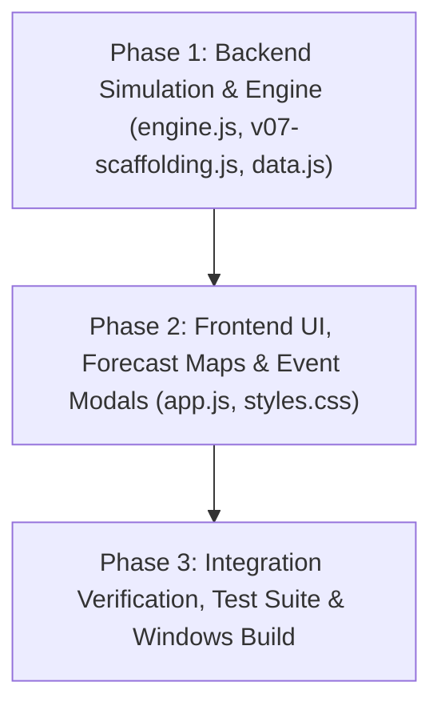

# Coalition Builder: Party Chair — Version 0.15.9 Design Specification

> **Build Type:** Comprehensive Minor Version (`0.0.x`)  
> **Target Version:** Version 0.15.9  
> **Save Key Migration:** `partyChairGame.save.v15.8` $\to$ `partyChairGame.save.v15.9` (full backward compatibility)  
> **Status:** Packaged for Agent Implementation  
> **Features Covered:** `REQ-176` through `REQ-194` (19 Active Requirements: 9 Medium, 10 Small)  
> **Scope:** Third-Party Ascent & Multi-Party Democracy Expansion (Institutional Ascent Ladder, Duverger's Law, State Electoral Systems, Post-Election Kingmaker Caucuses, Fusion Voting, 12th Amendment Contingent Elections, and Big-Tent Party Doctrines).

---

## 1. Executive Summary & Inventory Matrix

Version 0.15.9 represents the most comprehensive expansion of third-party and minor-party grand strategy in **Coalition Builder: Party Chair**. It dismantles the binary two-party assumption across the entire electoral lifecycle—providing minor, ascending, and emerging parties with authentic institutional progression, asymmetric leverage, constitutional crisis opportunities, and deep internal factional trade-offs.

### Core Strategic Themes:
1. **5-Stage Institutional Ascent Ladder (`REQ-176` – `REQ-180`):** Replaces the binary 20% cliff (`REQ-20`) with 5 clear rungs (Fringe $\to$ Ballot-Qualified $\to$ Federally Recognized $\to$ Debate Contender $\to$ Major Party), scaling Party Focus slots from 3 to 5 to 7 and introducing multi-path midterm major party promotion.
2. **Forecast Intelligence Expansion (`REQ-181`, `REQ-182`):** Adds a 5th projection model tab (*Polling Average*) rendering live simulation numbers and gradients, and extends all 5 models to forecast 50-state legislative control alongside Presidential, Senate, and House chambers.
3. **Duverger's Law & State Electoral Systems (`REQ-183` – `REQ-186`):** Models tactical wasted-vote defection below a 15%–18% viability threshold, enables breakthrough states to shatter the ceiling and trigger regional snowballs via `OVERLAPPING_REGIONS`, establishes per-state electoral systems (Alaska RCV start, Approval Voting, Proportional House/Leg), and adds a temporary 60% inter-cycle reform popup for playtesting.
4. **Post-Election Kingmaker Caucuses & Fusion Voting (`REQ-187` – `REQ-189`):** Enables small third-party caucuses holding the balance of power in hung federal (<218 House / <51 Senate) or state chambers to strike confidence-and-supply bargains for gavels, electoral reform, and state funding, and introduces cross-endorsement Fusion voting ballot lines.
5. **Multi-Party Electoral College & 12th Amendment Contingent Elections (`REQ-190`, `REQ-191`):** Tracks multi-party EV awards, detects sub-270 deadlocks, calculates the constitutional 50-state House delegation tally, and triggers an Election Night Contingent Election brokering modal for Cabinet appointments and platform concessions.
6. **Big-Tent Inflection Point & Purist Backlash (`REQ-192` – `REQ-194`):** Tracks founding vs. swing faction voter shares, triggering an Ideological Crossroads modal upon crossing >65% non-founding or >=7.5M voters to choose between *Moderate & Professionalize* (institutional donors, lower cohabitation drag, but purist revolt) vs. *Stay Pure / Populist Vanguard* (movement turnout, grassroots surge, high internal unity).

---

### Inventory Matrix (`REQ-176` – `REQ-194`)

| Req ID | Title | Size | Target Files | Architectural Domain |
| :--- | :--- | :---: | :--- | :--- |
| **REQ-176** | 5-Stage Institutional Ascent Ladder Engine & Focus Slot Scaling | Medium | `v07-scaffolding.js`, `engine.js`, `app.js` | Party Progression & State |
| **REQ-177** | Tier 1 Fringe Headwinds & Tier 4 Media Blackout Breakthrough | Small | `engine.js`, `app.js` | Campaign Headwinds |
| **REQ-178** | Tier 2 Unlocks: Regional Chapter Momentum & Organizing Waves | Small | `engine.js`, `app.js`, `data.js` | Field Organizing |
| **REQ-179** | Tier 3 Unlocks: FEC Public Matching Funds & Ballot Retention | Small | `engine.js`, `app.js` | Campaign Finance & Ballot Access |
| **REQ-180** | Tier 4 Unlocks: Presidential Debate Stage Event & Allied Super PAC Gate | Medium | `engine.js`, `app.js`, `data.js` | Events & Campaign Finance |
| **REQ-181** | Polling Average Projection Model Tab (`supportByState` Map) | Small | `app.js`, `styles.css` | Forecast Intelligence UI |
| **REQ-182** | State Legislature Forecast Projections across All 5 Models | Medium | `engine.js`, `app.js`, `styles.css` | Forecaster Simulation & Map |
| **REQ-183** | Duverger’s Law Strategic Voting Engine & Election-Day Defection | Medium | `engine.js` | Electoral Simulation Math |
| **REQ-184** | Shattering the Ceiling: Breakthrough Triggers & Regional Spillover | Small | `engine.js`, `app.js` | Multi-Cycle State Progression |
| **REQ-185** | State Electoral Systems Engine (Alaska RCV, Approval, Proportional) | Medium | `engine.js`, `app.js`, `data.js` | State Rules & Resolution |
| **REQ-186** | Temporary Inter-Cycle Electoral Reform Popup (60% Playtest Prototype)| Small | `engine.js`, `app.js` | Inter-Cycle Event UI |
| **REQ-187** | Kingmaker Caucus: Federal Hung Chambers & Confidence-and-Supply | Medium | `engine.js`, `app.js` | Post-Election Bargaining |
| **REQ-188** | Kingmaker Caucus: State Legislative Hung Chambers Extension | Small | `engine.js`, `app.js` | State Coalition Bargaining |
| **REQ-189** | Fusion Voting & Cross-Endorsement Ballot Lines | Medium | `engine.js`, `app.js`, `data.js` | Cross-Party Diplomacy |
| **REQ-190** | Multi-Party Electoral College Accounting & Sub-270 Deadlock Detection | Small | `engine.js` | Presidential Outcome Math |
| **REQ-191** | 12th Amendment House Delegation Contingent Election Brokering Event | Medium | `engine.js`, `app.js` | Election Night Crisis Event |
| **REQ-192** | Founding Faction Tagging & Big-Tent Inflection Point Trigger | Small | `engine.js` | Faction Coalition State |
| **REQ-193** | Ideological Crossroads Modal & Permanent Party Doctrine | Medium | `engine.js`, `app.js`, `styles.css` | Strategic Doctrine Event |
| **REQ-194** | "Sellout" Backlash & Founding Purist Splinter Fourth-Party Threat | Small | `engine.js`, `app.js` | Faction Revolt & Splinters |

---

## 2. Technical & Architectural Specifications

### Subsystem A: 5-Stage Institutional Ascent Ladder (`REQ-176` – `REQ-180`)

#### 1. Five Tier Definitions & Persistence (`engine.js`, `v07-scaffolding.js`)
- Store `game.partyTiers = { [partyId]: tierNumber }` (1 to 5), initialized in `createGame` and migrated in `normalizeGame`.
- **Tier 1 — Fringe (`< 2%`):** Starting baseline for sub-2% minor parties and newly formed custom parties. Max Focus Slots: **3**.
- **Tier 2 — Ballot-Qualified Minor (`2%–5%`):** Reached by achieving $\ge 2.0\%$ national popular vote in a Presidential cycle OR sustaining multi-state ballot access. Max Focus Slots: **3**.
  - *Tier 2 Unlock (`REQ-178`):* **Regional Chapter Momentum:** Constructing state chapters in contiguous census regions triggers a Regional Organizing Wave, lifting volunteer and polling gains across the region.
- **Tier 3 — Federally Recognized Party (`>= 5%` Pres.):** Reached by achieving $\ge 5.0\%$ national Presidential vote. Max Focus Slots: **5** (`3 \to 5`).
  - *Tier 3 Unlock (`REQ-179`):* **FEC Public Matching Funds:** Passive treasury infusion each cycle proportional to vote share.
  - *Tier 3 Unlock (`REQ-179`):* **Automatic Ballot Retention:** Retains ballot access automatically in all states where the party polled $\ge 2.0\%–5.0\%$.
- **Tier 4 — Debate-Qualified Contender (`>= 15%` Polling):** Reached dynamically when national polling (`nationalPoll`) or prior Presidential vote hits $\ge 15.0\%$. Max Focus Slots: **5**.
  - *Tier 4 Unlock (`REQ-177`):* **Media Blackout Breakthrough:** Shatters broadcast blackout, unlocking full national earned media and wave momentum.
  - *Tier 4 Unlock (`REQ-180`):* **Presidential Debate Stage Event:** One-time milestone event delivering a major polling, fundraising, and volunteer recruitment surge.
  - *Tier 4 Unlock (`REQ-180`):* **Allied Super PAC Formation Gate:** Seeds 1–2 fledgling faction-tied Super PACs with $5M–$10M warchests.
- **Tier 5 — Major Party Status:** Achieved via any of 3 distinct paths:
  1. *Presidential:* Winning $\ge 20.0\%$ national Presidential popular vote.
  2. *Bottom-Up Institutional Critical Mass:* Simultaneously holding $\ge 35$ sitting U.S. House seats, $\ge 8$ sitting U.S. Senators, OR $\ge 5$ sitting Governors at cycle boundary.
  3. *Major Eclipse:* Finishing ahead of an adjacent major party (Democrat or Republican) in national popular vote.
  - Max Focus Slots expands to **7** (`5 \to 7`).
  - Fully unlocks unrestricted national Super PAC coordination and federal major party model.
- **Shared Helper:** Replace hardcoded `isMajor ? 7 : 3` with:
  ```javascript
  function getMaxFocusSlots(game, partyId) {
    const tier = getPartyInstitutionalTier(game, partyId);
    return tier >= 5 ? 7 : tier >= 3 ? 5 : 3;
  }
  ```
- **Backward Compatibility:** `isMajorParty(game, partyId)` remains a clean wrapper returning `getPartyInstitutionalTier(game, partyId) >= 5`.

---

### Subsystem B: Forecast Intelligence — Polling Average & State Legislatures (`REQ-181`, `REQ-182`)

#### 1. Polling Average Projection Model Tab (`REQ-181` / `app.js`)
- Add `'polling'` to valid values for `forecasterMapSource` (currently `'consensus' | 'cooked' | 'sallow' | 'inside'`).
- Add rightmost button to `v08-pundit-selector-bar`:
  ```html
  <button type="button" data-forecaster-source="polling" class="${forecasterMapSource === 'polling' ? 'selected' : ''}">
    Polling Average <small>(Live Sim)</small>
  </button>
  ```
- **Map Shading in Polling Mode:** Shades each state/district by the leading party's brand color, with intensity proportional to the margin over the nearest competitor ($\ge 20\%$ deep, $10\%–20\%$ strong, $3\%–10\%$ medium, $< 3\%$ near-white/slate). Third parties use REQ-174 color gradients (omitted from legend).
- **Tooltip:** Displays exact per-party polling shares from `supportByState(game, state)`: e.g., *"PA — Dem: 48.2% · Rep: 46.1% · Green: 3.8% · Lib: 1.9%"*.
- **Scoreboard:** Replaces discrete tier chips with a continuous horizontal national polling share bar and per-party percentage pills.

#### 2. State Legislature Chamber Forecast across All 5 Models (`REQ-182` / `engine.js`, `app.js`)
- In `buildForecasters(game)` (`engine.js`), add Section 5 evaluating state legislative control across all 50 states: `stateLeg:${stateId}`.
- In `estimateRaceMarginInternal(game, 'stateLeg:${stateId}')`, evaluate legislative margin using state partisan lean, contested slate quality, coattail weight (~0.30), third-party siphoning (`siphonEffect`), and machine investments.
- Add 4th chamber selector button in `app.js`:
  ```html
  <button type="button" data-forecast-map-chamber="stateLeg" class="${effectiveForecastChamber === 'stateLeg' ? 'selected' : ''}">
    State Legislatures (50 States)
  </button>
  ```
- Provide chamber control scoreboard (Dem-led, GOP-led, Split/Toss-Up) and SVG map rendering for state legislative control across Consensus, Cooked, Sallow, Upside, and Polling models.

---

### Subsystem C: Duverger's Law & State Electoral Systems (`REQ-183` – `REQ-186`)

#### 1. Duverger's Law Strategic Voting Engine (`REQ-183` / `engine.js`)
- **Viability Threshold:** In plurality/FPTP races, test non-major parties against a local threshold of $16.5\%$ projected pre-defection support.
- **Election-Day Defection:** Below threshold, $40\%–65\%$ of ideologically aligned voters strategically defect to the nearest major party on Election Day (scaled by distance below threshold).
- **Defection Routing:** Route defecting votes via `REALIGNMENT_PARTNERS` (`green` / `socialist` $\to$ `people`; `liberty` / `constitution` $\to$ `heritage`; custom parties by shortest two-axis `axisDistance`).
- **Bypass:** `computeStrategicVotingDefection()` returns `0` if:
  1. The party shattered the viability ceiling in that state (`REQ-184`), OR
  2. The race uses an anti-spoiler system (`RCV`, `Approval`, or `Proportional` under `REQ-185`), OR
  3. The party achieved Tier 5 Major Party status.

#### 2. Ceiling Shattering & Regional Spillover (`REQ-184` / `engine.js`, `app.js`)
- Track `game.viabilityBreakthroughs = { [partyId]: { [stateId]: true } }`.
- **Triggers:** Crossing $\ge 16.5\%$ in projected/certified share, OR winning Governor, OR winning U.S. Senate, OR winning $\ge 2$ U.S. House seats in a state.
- **Local Collapse:** Defection collapses to $0\%$ permanently in that state.
- **Regional Snowball:** States sharing a region via `regionsForState()` / `OVERLAPPING_REGIONS` receive regional relief (defection severity halved; local threshold lowered to $10\%–12\%$).
- Log celebratory breakthrough alert and display qualitative status tag in the State Directory.

#### 3. State Electoral Systems Engine (`REQ-185` / `engine.js`, `app.js`, `data.js`)
- Track `game.stateElectoralSystems = { [stateId]: { allRaces: 'plurality'|'rcv'|'approval', legislative: 'plurality'|'proportional' } }`.
- **2028 Baseline:** Alaska (`AK`) begins with `{ allRaces: 'rcv', legislative: 'plurality' }`.
- **RCV:** Resolves multi-party contests via instant-runoff elimination using `rankedChoice()`, eliminating Duverger's penalty ($0\%$).
- **Approval Voting:** Voters approve multiple compatible candidates; cross-approval lifts candidate shares, eliminating Duverger's penalty ($0\%$).
- **Proportional Representation (States with $\ge 5$ House Seats):** Allocates U.S. House delegations and State Legislature seats proportionally using Largest Remainder / Sainte-Laguë with a natural 5% threshold, eliminating Duverger's penalty ($0\%$).

#### 4. Temporary Inter-Cycle Reform Popup Prototype (`REQ-186` / `engine.js`, `app.js`)
- In `startNextCycle()`, roll a **60% chance** for an electoral reform event.
- Weighted distribution (100% total):
  - 30%: 1 state implements RCV
  - 20%: 3 states implement RCV
  - 20%: 1 state implements Approval
  - 10%: 3 states implement Approval
  - 10%: 1 state ($\ge 5$ seats) implements Proportional for House & State Leg
  - 10%: 3 states ($\ge 5$ seats) implement Proportional for House & State Leg
- Minimal popup dialog with single `[ Continue ]` button; cleanly annotated as temporary prototype for `TBD-02`.

---

### Subsystem D: Post-Election Kingmaker Caucuses & Fusion Voting (`REQ-187` – `REQ-189`)

#### 1. Federal Kingmaker Caucus (`REQ-187` / `engine.js`, `app.js`)
- **Trigger:** Neither major party reaches 218 House seats or 51 Senate seats, and the player's third-party caucus holds the balance of power.
- **Confidence-and-Supply Modal:** Choose to back Democrats, Republicans, or Remain Independent.
- **Concessions Won:**
  1. *Committee Gavels:* Elevates caucus members to committee chairs (`+Fame`, `+Faction Confidence`, national legitimacy lift).
  2. *Electoral Reform / Ballot-Access Bill:* Enacts RCV/Approval/Proportional in 1–2 target states (`REQ-185`) or grants automatic ballot access.
  3. *Stronghold State Funding:* Directs federal organizational funds to stronghold states (`+Treasury`, registration surge).
- **Purist Faction Backlash:** Backing the ideologically distant major party inflicts a severe faction happiness penalty.

#### 2. State Legislative Hung Chambers Extension (`REQ-188` / `engine.js`, `app.js`)
- Applies the kingmaker bargaining framework to state legislatures where third-party state reps hold the deciding votes for legislative majorities.

#### 3. Fusion Voting & Cross-Endorsement Ballot Lines (`REQ-189` / `engine.js`, `app.js`, `data.js`)
- Unlocked at Tier 2+ ($2\%+$).
- Offer cross-endorsement to friendly major-party nominee in Senate, Governor, or House races in exchange for signing the minor party's **Policy Pledge**.
- Candidate runs on both major and fusion lines; fusion-line votes deliver:
  1. *State Ballot Retention Credit* (counts toward 2%–5% retention threshold).
  2. *Voter Registration Growth* (converts fusion voters to party members).
  3. *Ideological Leverage* (boosts leverage in future legislative sessions).

---

### Subsystem E: Multi-Party Electoral College & 12th Amendment Contingent Elections (`REQ-190`, `REQ-191`)

#### 1. Multi-Party EV Accounting & Deadlock Detection (`REQ-190` / `engine.js`)
- In `presidentialForecast()` and `resolveGeneralElection()`, award Electoral Votes directly to whichever party finishes 1st in each state (Plurality, RCV, or Approval).
- When $\max(\text{evByParty}) < 270$, flag `contingentElectionRequired: true`.
- Tally the 50-State U.S. House Delegation votes (1 vote per state based on majority party of newly elected House reps; 26 needed to elect).

#### 2. 12th Amendment Contingent Election Brokering Event (`REQ-191` / `engine.js`, `app.js`)
- Fires on Election Night when `contingentElectionRequired: true` and player holds EVs or pivotal House delegations.
- Interactive brokering modal allowing Chair to endorse Dem or GOP ticket in exchange for:
  1. *Federal Cabinet Posts:* Appoints party politicians to `cabinet_state`, `cabinet_treasury`, `cabinet_defense`, or `cabinet_ag` in `leadershipRoles`.
  2. *Binding Platform Planks:* Shifts 2–3 core governing administration policy stances toward your platform.
  3. *Constitutional / Electoral Reforms:* Enacts RCV/Approval/Proportional across 3–5 states (`REQ-185`).
- Record resolution in election history; update `game.governingParty`.

---

### Subsystem F: Big-Tent Inflection Point, Party Doctrine & Purist Backlash (`REQ-192` – `REQ-194`)

#### 1. Founding Faction Tagging & Inflection Point Trigger (`REQ-192` / `engine.js`)
- Tag original founding factions and `puristVanguardFactionId` for each minor party (e.g. `lib_ancaps` for Libertarians; `grn_eco_socialist_vanguard` for Greens; `soc_communists` for Socialists; `con_christian_dominionists` for Constitution).
- `checkIdentityCrisisTrigger()` evaluates at cycle transitions:
  - Fires when non-founding swing factions make up $\ge 65\%$ of party voters, OR
  - Total party voters cross $\ge 7.5\text{M}$ (with at least one admitted swing faction).
- Persist `game.identityCrisis` across cycles.

#### 2. Ideological Crossroads Modal & Party Doctrine (`REQ-193` / `engine.js`, `app.js`, `styles.css`)
- **Path A — Moderate & Professionalize (`doctrine: 'big_tent'`):**
  - Unlocks institutional donors; reduces cohabitation drag (`SUM-05`) by 60%; lifts `trust.independents` (+8 to +10).
  - Triggers the *"Sellout" Backlash* (`REQ-194`).
- **Path B — Stay Pure / Populist Vanguard (`doctrine: 'vanguard'`):**
  - Permanent supporter turnout lift (+8 to +10 `trust.supporters`); boosts grassroots multiplier; dampens base friction; imposes soft ceiling on suburban centrist appeal.
- Displays permanent *Party Doctrine Badge* in Factions Tab and Header.

#### 3. "Sellout" Backlash & Splinter Fourth-Party Threat (`REQ-194` / `engine.js`, `app.js`)
- Selecting `big_tent` inflicts an immediate -25 to -30 happiness shock on the purist vanguard faction, triggering a **Purist Bolt Threat** ultimatum (2 turns to appease).
- If unappeased, executes `boltFaction()`: purist faction bolts, taking affiliated politicians (`REQ-171`) and spawning a named **Splinter Fourth Party** in `game.activeSplinters` that siphons base voters and inflicts spoiler drag.

---

## 3. Implementation Workflow & Architecture Plan

To ensure clean, non-conflicting execution across large files (`engine.js` and `app.js`), implementation is structured into **Three Sequential Execution Phases**:



---

## 4. Copy-Pastable Implementation Prompts for Coding Agents

### Agent Prompt 1: Backend Simulation & Game Engine (Phase 1)

```text
Model: Claude Sonnet 4.6 (Thinking) or Gemini 3.8 Pro
Role: Senior Simulation Systems & Game Engine Engineer
Target Workspace: c:\Users\rober\.gemini\antigravity\scratch\party-chair-game
Target Files:
- v07-scaffolding.js
- engine.js
- data.js (or relevant data modules)

Objective: Implement Phase 1 backend engine mechanics for Version 0.15.9 covering REQ-176, REQ-177, REQ-178, REQ-179, REQ-180, REQ-182, REQ-183, REQ-184, REQ-185, REQ-186, REQ-187, REQ-188, REQ-189, REQ-190, REQ-192, and REQ-194.

Instructions:
1. Institutional Ascent Ladder (REQ-176 - REQ-180):
   - In engine.js and v07-scaffolding.js, implement getPartyInstitutionalTier(game, partyId) returning 1 to 5.
   - Maintain isMajorParty(game, partyId) returning tier >= 5.
   - Store game.partyTiers, initialize in createGame, preserve across startNextCycle(), and migrate in normalizeGame().
   - Implement getMaxFocusSlots(game, partyId) returning 3 (Tiers 1-2), 5 (Tiers 3-4), or 7 (Tier 5). Replace hardcoded isMajor ? 7 : 3 focus slot checks in engine.js.
   - Implement multi-path Major promotion checks at cycle transitions (20% Pres, 35 House / 8 Senate / 5 Govs, or eclipsing a major party).
   - Implement Tier 3 FEC matching fund cashflow and automatic ballot retention logic.
   - Implement Tier 4 media blackout breakthrough and Super PAC formation gate.

2. State Legislature Forecaster Engine (REQ-182):
   - In buildForecasters(game), add Section 5 evaluating state legislative control across all 50 states (stateLeg:${stateId}) for sallow, cooked, inside, and consensus.
   - In estimateRaceMarginInternal(game, raceKey), handle raceKey.startsWith('stateLeg:') using state partisan lean, contested slate quality, coattail weight (~0.30), and third-party siphoning.

3. Duverger's Law & State Electoral Systems (REQ-183 - REQ-186):
   - Implement computeStrategicVotingDefection(game, partyId, stateId, raceKind, projectedShare) applying 40%-65% defection to nearest major party below 16.5% viability threshold in plurality contests.
   - Implement viability ceiling breakthrough tracking in game.viabilityBreakthroughs (REQ-184), collapsing defection to 0% and spreading regional spillover to neighboring states via OVERLAPPING_REGIONS.
   - Implement game.stateElectoralSystems tracking allRaces ('plurality'|'rcv'|'approval') and legislative ('plurality'|'proportional'), with Alaska starting on RCV (REQ-185). Exempt RCV, Approval, and Proportional races from Duverger's defection.
   - Implement rollInterCycleElectoralReform(game) in startNextCycle() with exact 60% trigger and weighted reform distribution (REQ-186).

4. Kingmaker Caucuses & Fusion Voting (REQ-187 - REQ-189):
   - Implement hung chamber detection in resolveGeneralElection() for U.S. House (<218), U.S. Senate (<51), and state legislatures.
   - Implement backend resolution functions for Confidence-and-Supply agreements (applying committee gavels, electoral reform bills, or state funding).
   - Implement Fusion Cross-Endorsement actions and election resolution giving minor parties ballot retention credit, registration growth, and policy leverage (REQ-189).

5. Multi-Party Electoral College & Deadlocks (REQ-190):
   - In presidentialForecast() and election resolution, award EVs to any state winner (evByParty[partyId]).
   - If max(evByParty) < 270, flag contingentElectionRequired: true and compute the 50-State U.S. House Delegation tally (1 vote per state, 26 needed).

6. Big-Tent Inflection Point & Splinter Revolt (REQ-192, REQ-194):
   - Record foundingFactionIds and puristVanguardFactionId for all minor/custom parties.
   - Implement checkIdentityCrisisTrigger(game) checking for >=65% non-founding share or >=7.5M party voters.
   - Implement purist bolt threat ultimatum and execute boltFaction() spawning named Splinter Fourth Party in game.activeSplinters if unappeased.

Verify all functions export properly onto window.PartyChairEngine, maintain backward compatibility, and do not introduce syntax errors.
```

---

### Agent Prompt 2: Frontend UI, Forecast Maps & Event Modals (Phase 2)

```text
Model: Claude Sonnet 4.6 (Thinking) or Gemini 3.8 Pro
Role: Senior UI/UX & Data Visualization Engineer
Target Workspace: c:\Users\rober\.gemini\antigravity\scratch\party-chair-game
Target Files:
- app.js
- styles.css

Objective: Implement Phase 2 user interface, interactive map renderers, and decision modals for Version 0.15.9 covering REQ-176, REQ-181, REQ-182, REQ-184, REQ-185, REQ-186, REQ-187, REQ-188, REQ-189, REQ-191, and REQ-193.

Instructions:
1. Institutional Status Badge & Focus Slots (REQ-176):
   - Replace binary "Major Party Model" / "Emerging Party Model" header tag with an in-universe Institutional Status Badge and tooltip showing current tier (Fringe, Ballot-Qualified, Recognized, Contender, Major) and unlock requirements for the next rung.
   - Update focus slot renderers to read getMaxFocusSlots(game, playerPartyId).

2. Polling Average Model Tab & State Legislature Chamber Map (REQ-181, REQ-182):
   - In v08-pundit-selector-bar, add rightmost button: Polling Average (Live Sim) for data-forecaster-source="polling".
   - In forecast chamber selector, add State Legislatures (50 States) button.
   - In nationalMapSvg(), handle forecasterMapSource === 'polling': shade states by leading party gradient proportional to margin over nearest rival.
   - In nationalMapSvg(), handle effectiveForecastChamber === 'stateLeg' in forecaster mode: render categorical forecaster ratings (Consensus, Cooked, Sallow, Upside) and polling average shares.
   - Update forecastScoreboard for state legislatures and polling average modes.
   - Enable 'stateLeg' filter in the battleground race comparison table.

3. Electoral System Badges & Breakthrough Tags (REQ-184, REQ-185, REQ-186):
   - Display compact state system tags in State Directory (RCV, Approval, Proportional House/Leg).
   - Display qualitative "Viability Ceiling Shattered" and regional spillover status tags.
   - Render temporary minimal modal for inter-cycle electoral reform event (REQ-186) with clean dismiss button.

4. Kingmaker Caucus & Contingent Election Modals (REQ-187, REQ-188, REQ-191):
   - Implement Confidence-and-Supply negotiation modal for hung federal and state legislative chambers: backing Dem, GOP, or Remaining Independent, selecting concessions (Gavels, Electoral Reform, Stronghold Funding).
   - Implement 12th Amendment House Delegation Contingent Election modal when contingentElectionRequired is true: displays EV deadlock, 50-state delegation tally, and lets Chair broker Cabinet posts, platform planks, or electoral reform.

5. Fusion Endorsement UI (REQ-189):
   - Add Fusion Cross-Endorsement option to Phase 1 race recruitment menus for Tier 2+ minor parties.

6. Ideological Crossroads Modal & Party Doctrine Badge (REQ-193):
   - Render Founding Identity Crisis modal contrasting Path A (Moderate & Professionalize) vs. Path B (Stay Pure / Populist Vanguard).
   - Render permanent Party Doctrine Badge in Factions Tab and Party Info header.

Strictly adhere to GAME_STYLE_GUIDE.md:
- Rule 4: Zero internal variable or REQ-XX tags in UI copy.
- Rule 7: Clean in-universe political journalism framing without dumping raw math equations.
```

---

### Agent Prompt 3: Integration Verification, Automated Test Suite & Build (Phase 3)

```text
Model: Claude Sonnet 4.6 (Thinking) or Gemini 3.8 Pro
Role: Senior QA & Release Integration Engineer
Target Workspace: c:\Users\rober\.gemini\antigravity\scratch\party-chair-game
Target Files:
- package.json
- engine.js
- app.js
- scripts/test-v0159-integration.cjs
- PRIOR_UPDATES.md
- DESIGN_BACKLOG.md
- DESIGN.md

Objective: Finalize the Version 0.15.9 release packaging, create the integration test script, verify save migration, update all documentation, and compile the Windows executable.

Instructions:
1. Version & Save Key Bumping:
   - In package.json: Bump version to "0.15.9" and description to "Coalition Builder: Party Chair - Version 0.15.9".
   - In engine.js:
     - Update SAVE_KEY to 'partyChairGame.save.v15.9'.
     - Ensure normalizeGame() migrates partyChairGame.save.v15.8 and all prior save keys, initializing partyTiers, stateElectoralSystems, viabilityBreakthroughs, and identityCrisis cleanly.
     - Bump version strings in createGame, normalizeGame, and version check arrays.
   - In app.js: Bump UI version badges to v0.15.9.

2. Automated Test Script (scripts/test-v0159-integration.cjs):
   - Create a comprehensive CommonJS test suite verifying:
     a) getPartyInstitutionalTier returns valid rungs (1-5) and getMaxFocusSlots returns 3, 5, or 7.
     b) Multi-path major party promotion executes on 20% Pres, 35 House / 8 Senate / 5 Govs, or major party eclipse.
     c) buildForecasters generates stateLeg:* ratings across all 5 models.
     d) computeStrategicVotingDefection applies 40%-65% defection in plurality contests and returns 0 in RCV, Approval, Proportional, or breakthrough states.
     e) rollInterCycleElectoralReform applies reforms according to the 60% probability table.
     f) Hung chamber detection flags hung U.S. House (<218) and Senate (<51) and allows Confidence-and-Supply resolution.
     g) Sub-270 EV tally flags contingentElectionRequired and generates 50-state House delegation counts.
     h) checkIdentityCrisisTrigger detects >=65% non-founding share or >=7.5M voters, and choosing big_tent triggers purist bolt ultimatum.
     i) Legacy save migration from v0.15.8 loads without crashing and initializes all new state structures.

3. Executable Compilation:
   - Run: node scripts/test-v0159-integration.cjs to verify all tests pass.
   - Run: powershell -ExecutionPolicy Bypass -File .\build.ps1 to build dist/release/Coalition Builder - Party Chair.exe.

4. Changelog & Design Backlog Reconciliation:
   - In PRIOR_UPDATES.md: Add complete historical release notes for Version 0.15.9 detailing all 19 delivered requirements.
   - In DESIGN_BACKLOG.md: Clear REQ-176 through REQ-194 from active status, update Section 1 counts (Post-v0.15.9 Queue: 0 Medium, 0 Small pending), and log MAS-01 reminder.
   - In DESIGN.md: Synchronize active feature architecture records.
```

---

## 5. Verification & Acceptance Criteria

1. **Ascent Ladder Acceptance:**
   - Minor parties start at Tier 1 with 3 focus slots.
   - Hitting 5% Pres popular vote expands slots to 5 and grants FEC matching funds.
   - Hitting 15% national polling shatters media blackout, fires Debate Stage event, and seeds allied Super PACs.
   - Winning 35 House seats at midterm ascends party to Tier 5 Major Party with 7 focus slots.
2. **Forecast & State Leg Acceptance:**
   - Selecting "Polling Average" shows live vote percentages on hover and continuous margin shading.
   - Selecting "State Legislatures" renders ratings and scoreboard across all 5 models.
3. **Duverger's Law & Reform Acceptance:**
   - Third party polling 8% in plurality state loses ~55% of votes to nearest major party on Election Day.
   - Crossing 17% in a state shatters ceiling ($0\%$ defection) and lowers threshold in neighboring states via `OVERLAPPING_REGIONS`.
   - Alaska starts on RCV with $0\%$ defection; proportional states allocate House/Leg seats proportionally.
4. **Kingmaker & 12th Amendment Acceptance:**
   - Election resulting in Dem 215 / Rep 212 / Player 8 House seats triggers Confidence-and-Supply modal.
   - Three-way EV split (Dem 261 / Rep 258 / Player 19) flags contingent election and triggers House Delegation Brokering modal.
5. **Big-Tent Identity Acceptance:**
   - Growing past 65% swing factions or 7.5M voters triggers Ideological Crossroads modal.
   - Selecting Big-Tent cuts cohabitation drag by 60% and triggers purist revolt ultimatum.
6. **Save Migration Acceptance:**
   - Existing v0.15.8 saves load seamlessly with full backward compatibility and zero crashes.
