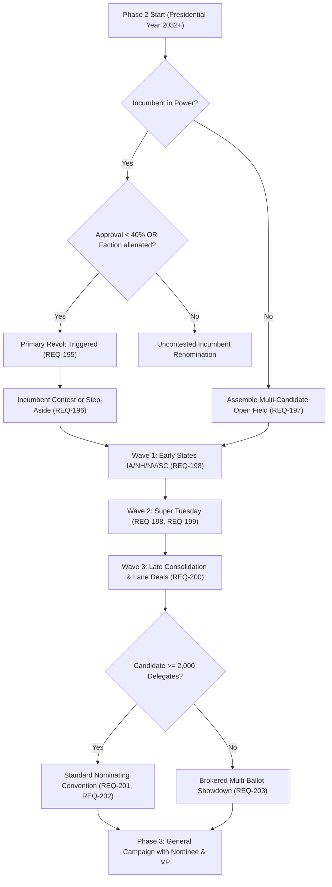
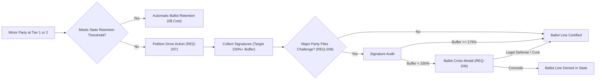
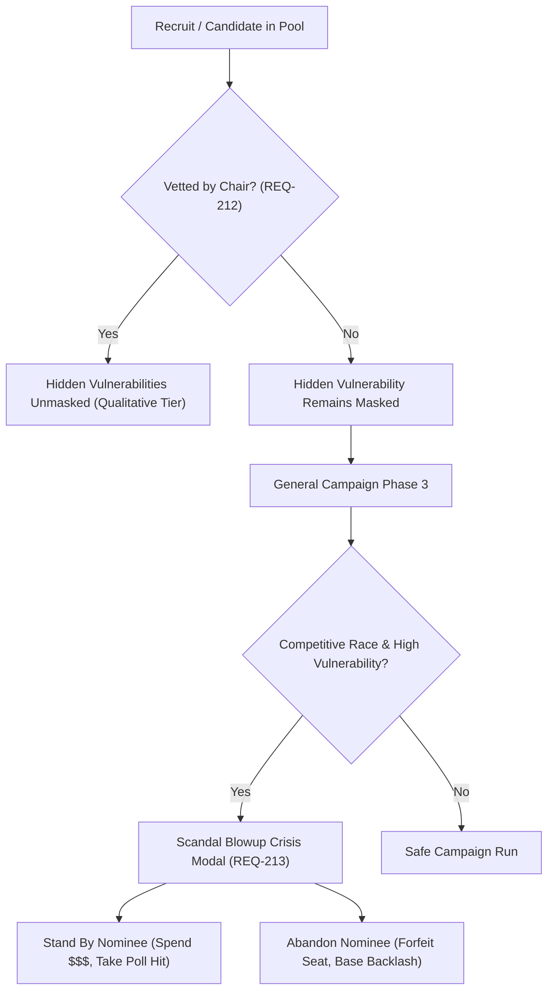
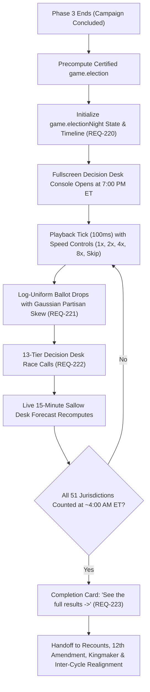

# Coalition Builder: Party Chair — Version 0.16.1 Design Document
## Presidential Race, Ballot Access, Election Uncertainty, Faction Feedback & Election Night Broadcast Desk Expansion

**Document Version:** 1.1  
**Target Release:** `0.16.1`  
**Save Key:** `partyChairGame.save.v16.1` (with backward-compatible migration from `partyChairGame.save.v16.0` and all `v15.x` saves)  
**Scope:** 29 Numbered Requirements (`REQ-195` through `REQ-223` — 21 Small, 8 Medium) across 4 System Clusters  
**Implementation Modules:** `election-night-engine.js`, `presidential-primaries.js`, `ballot-access.js`, `election-drift.js`, `engine.js`, `app.js`, `styles.css`

---

## 1. Executive Summary & Design Goals

**Version 0.16.1** expands Coalition Builder: Party Chair from its high-level general election framework into a living, full-lifecycle presidential nominating system, authentic statutory ballot-access landscape, nuanced electoral uncertainty model, and an immersive **real-time Election Night Decision Desk Broadcast Screen**.

### Core Architecture Pillars
1. **Presidential Primaries & Nominating Conventions (Cluster A | `REQ-195` – `REQ-203`):**
   - Starting in **2032+** (preserving 2028's fixed Jon Ossoff vs. J. D. Vance tickets per `GAME_STYLE_GUIDE.md` Rule 5), cycles feature an authentic primary calendar: Early States momentum bounce (IA, NH, NV, SC) $\to$ Super Tuesday delegate sweeps $\to$ Late consolidation, terminating in an interactive National Nominating Convention with factional floor fights, VP selection, and brokered convention showdowns.
   - Models Incumbent Primary Challenges when approval slips below 40%, including high-pressure "Step Aside" decisions and bruised-incumbent general election penalties.
2. **Ballot Access, Uncertainty & Election Night Administration (Cluster B | `REQ-204` – `REQ-211`):**
   - Replaces flat retention fallbacks with a grounded **50-State Statutory Ballot Access Table**, authentic minor-party Petition Drives, major-party petition signature audits, and high-stakes Legal Defense crises.
   - Enacts correlated regional polling error, "shy voter" non-response biases, late-breaking undecided surges, and dramatic automatic statutory recounts capable of flipping razor-thin states on Election Night.
   - Unlocks State Trifecta Voting-Law policy bills (Voter ID, All-Mail Voting, Drop-Box Expansion).
3. **Candidate Vetting, Dynamic State Drift & Faction Feedback (Cluster C | `REQ-212` – `REQ-219`):**
   - Introduces hidden Candidate Vulnerability ratings coupled with a Phase 1 "Vet Candidate" action, balanced against mid-campaign scandal eruptions forcing "Abandon vs. Defend" dilemmas.
   - Permanently connects voter registration operations (`REQ-172`), State Chapter presence, and sustained election victories into multi-cycle certified performance and demographic drift.
   - Replaces linear swing-voter splits with non-linear multi-party attraction curves and post-election factional autopsy realignments.
4. **Election Night Broadcast Screen & Decision Desk Simulation (Cluster D | `REQ-220` – `REQ-223`):**
   - Adapted faithfully from *Battle for America 2028* (`v35.0.0` / `ELECTION_NIGHT_DESIGN.md`) into a standalone `election-night-engine.js` module.
   - Simulates a real-time Decision Desk covering **51 jurisdictions from `7:00 PM ET` to `4:00 AM ET`** with playback speed controls (`1×`, `2×`, `4×`, `8×`, `Pause`, and instant `Skip to the end`).
   - Implements the non-linear **Seeded Log-Uniform Ballot-Drop Pool (`100`–`10,000` ballots)** with Box-Muller Gaussian partisan skew (`σ = 13.333` pts) and constrained remaining-pool draws, guaranteeing authentic red mirages, blue shifts, and **100% exact mathematical convergence** to precomputed election returns.
   - Features a 13-tier Decision Desk race-calling matrix, 15-minute Sallow Live Desk Forecast, 5 multi-race tabs (`President`, `Senate`, `House`, `Governors`, `State Legislatures`), dynamic map brightness (`0.40 -> 1.00`), closest-first live count table, and a seamless post-election handshake.

---

## 2. Invariants & Style Guide Compliance

Every feature in `v0.16.1` strictly honors the following invariants:
- **155M Represented-Voter Scale:** All voter totals, registration gains, and faction matrices operate on the 155 million represented-voter scale (where 1 internal sample = 100 real voters).
- **Institutional Scale Invariants:** 435 House seats, 100 Senate seats, 538 Electoral College votes (50 states + DC).
- **Atmospheric Vibes Rule (`GAME_STYLE_GUIDE.md` Rule 7):** Raw error percentages ($\pm 3.5\%$), vulnerability numbers (`vulnerabilityScore = 78`), or formula bounds must **never** appear in player-facing UI copy. Players perceive risks through qualitative narrative cues (*"High Exposure"*, *"Suburban Whispers"*, *"Battleground Margin of Error"*).
- **Zero In-Game Requirement Tags:** Requirement identifiers (`REQ-XX`, `TBD-XX`) must never be visible to players.
- **2028 Opening Baseline Preservation:** In 2028, the fixed Jon Ossoff vs. J. D. Vance tickets remain active. The full primary and convention calendar unlocks dynamically in **2032+** (and optionally for minor/custom parties or via a debug toggle).
- **Election Night Save/Reload Safety:** Precomputed election returns are committed to game state before the broadcast desk opens. Reloading mid-broadcast resumes cleanly with zero state corruption or double-counting of inter-cycle realignments.

---

## 3. Data Schemas & State Model Additions

The `v0.16.1` state schema extends `game` with backward-compatible defaults in `normalizeGame()`:

```typescript
// v0.16.1 State Additions
interface GameStateV16_1 {
  // Cluster A: Presidential Primaries & Convention
  presidentialPrimaries?: {
    active: boolean;                     // True in presidential cycles (2032+)
    stage: 'pre_filing' | 'early_states' | 'super_tuesday' | 'late_states' | 'convention' | 'completed';
    incumbentVulnerable?: boolean;       // Flags primary revolt
    incumbentChallengerId?: string;      // Politician ID of primary challenger
    incumbentSteppedAside?: boolean;     // If incumbent declined to run
    bruisedIncumbentPenalty?: number;    // General election margin drag (-0.0 to -6.0)
    primaryFieldByParty: Record<string, PresidentialCandidate[]>;
    delegatesByParty: Record<string, Record<string, number>>; // partyId -> candidateId -> delegateCount
    superTuesdayWinner?: string;
    brokeredConvention?: boolean;
    conventionConcessions?: ConventionConcession[];
    vpSelectionByParty: Record<string, string>; // partyId -> runningMatePoliticianId
  };

  // Cluster B: Ballot Access & Election Uncertainty
  ballotAccessStatutory?: Record<string, StateBallotStatus>; // stateId -> details
  activePetitionDrives?: Record<string, PetitionDriveState>; // stateId -> progress
  activeBallotChallenges?: BallotChallengeCrisis[];
  electionUncertainty?: {
    correlatedRegionalError: Record<string, number>; // censusRegion -> errorDelta (-0.035 to +0.035)
    shyVoterTiedParties: string[];                    // Party IDs experiencing non-response bias
    lateUndecidedSurgeParty?: string;                // Party favored by final-week undecideds
    pendingRecounts?: ElectionRecountState[];
  };
  stateVotingLaws?: Record<string, string[]>;        // stateId -> active voting law bill IDs

  // Cluster C: Vetting, State Drift & Faction Dynamics
  candidateVetting?: Record<string, VettingReport>;  // politicianId -> { vetted: boolean, exposureTier: string }
  activeCampaignScandals?: CampaignScandalDilemma[];
  statePartisanDrift?: Record<string, number>;       // stateId -> cumulative baseline shift delta
  demographicMigrationDrift?: Record<string, number>;// stateId -> cumulative demographic shift delta

  // Cluster D: Election Night Broadcast Screen & Decision Desk
  electionNight?: {
    active: boolean;                     // True while broadcast desk is displayed
    year: number;
    cycleType: 'presidential' | 'midterm';
    elapsedMinutes: number;              // 0 (7:00 PM ET) to ~540 (4:00 AM ET)
    speed: 1 | 2 | 4 | 8;
    paused: boolean;
    activeTab: 'president' | 'senate' | 'house' | 'governors' | 'state_leg';
    mapMode: 'winner' | 'margin';
    breakingBannerDismissed: boolean;
    completed: boolean;                  // True when all polls closed and counted
    calls: DecisionDeskCall[];           // Chronological call feed
    recountStateIds?: string[];          // States held for statutory recount
  };
}

interface DecisionDeskCall {
  id: string;
  raceKind: 'president' | 'senate' | 'house' | 'governors' | 'state_leg';
  raceId: string;
  name: string;
  winnerPartyId: string;
  winnerCandidateName?: string;
  timestampMinutes: number;           // Elapsed min from 7:00 PM ET
  timestampLabel: string;             // e.g. "9:42 PM ET"
  pctReportedAtCall: number;
  liveMarginAtCall: number;
  electoralVotes?: number;
  isRecountPending?: boolean;
}

interface PresidentialCandidate {
  id: string;
  name: string;
  office: string;
  stateId: string;
  factionId: string;
  fame: number;
  approval: number;
  traits: string[];
  vulnerabilityScore: number;          // Hidden 0-100
  stances: Record<string, number>;     // 10 core pillars
  delegates: number;
  status: 'active' | 'withdrawn' | 'endorsed';
  endorsedCandidateId?: string;
  momentum: number;                    // -10.0 to +10.0
}
```

---

## 4. Complete Sized Requirements Inventory

| Req ID | Title | Size | Cluster | Core Target Files |
| :--- | :--- | :---: | :---: | :--- |
| **REQ-195** | Incumbent Vulnerability Triggers & Challenger Emergence | Small | Cluster A | `presidential-primaries.js`, `engine.js` |
| **REQ-196** | Incumbent Primary Contest & Party-Fracture Fallout | Medium | Cluster A | `presidential-primaries.js`, `engine.js`, `app.js` |
| **REQ-197** | Presidential Primary Field & Candidate Generation | Small | Cluster A | `presidential-primaries.js`, `scenario-2028.js` |
| **REQ-198** | Phased Primary Calendar Engine | Medium | Cluster A | `presidential-primaries.js`, `engine.js`, `app.js` |
| **REQ-199** | State Delegate Allocation & Live Delegate Tracker | Medium | Cluster A | `presidential-primaries.js`, `app.js`, `styles.css` |
| **REQ-200** | Chair Primary Strategy & Lane Consolidation | Small | Cluster A | `presidential-primaries.js`, `engine.js`, `app.js` |
| **REQ-201** | Factional Convention Delegates & Platform Floor Votes | Small | Cluster A | `presidential-primaries.js`, `app.js`, `engine.js` |
| **REQ-202** | VP Ticket Selection & Keynote Unity Brokering | Small | Cluster A | `presidential-primaries.js`, `app.js`, `engine.js` |
| **REQ-203** | Contested / Brokered Multi-Ballot Convention | Medium | Cluster A | `presidential-primaries.js`, `app.js`, `engine.js` |
| **REQ-204** | Correlated Regional & State Polling Error | Small | Cluster B | `election-uncertainty.js`, `engine.js` |
| **REQ-205** | Shy-Voter Bias & Late-Breaking Undecided Swing | Small | Cluster B | `election-uncertainty.js`, `engine.js` |
| **REQ-206** | 50-State Statutory Signature & Retention Table | Small | Cluster B | `ballot-access.js`, `data.js` |
| **REQ-207** | Petition Drive Action & State Qualification Loop | Medium | Cluster B | `ballot-access.js`, `engine.js`, `app.js` |
| **REQ-208** | Major-Party Petition Challenges & Signature Audits | Small | Cluster B | `ballot-access.js`, `engine.js`, `app.js` |
| **REQ-209** | Ballot-Access Legal Defense Crisis Modal | Small | Cluster B | `ballot-access.js`, `app.js`, `styles.css` |
| **REQ-210** | Automatic Close-Margin Statutory Recounts | Small | Cluster B | `election-uncertainty.js`, `engine.js`, `app.js` |
| **REQ-211** | State Trifecta Voting-Law Policy Bills | Small | Cluster B | `ballot-access.js`, `engine.js`, `app.js` |
| **REQ-212** | Hidden Candidate Vulnerability Scores & Vet Candidate Action | Small | Cluster C | `candidate-vetting.js`, `engine.js`, `app.js` |
| **REQ-213** | Mid-Campaign Scandal Blowups (Abandon vs. Defend) | Small | Cluster C | `candidate-vetting.js`, `engine.js`, `app.js` |
| **REQ-214** | Post-Election Certified Performance Drift | Small | Cluster C | `election-drift.js`, `engine.js` |
| **REQ-215** | Multi-Cycle Demographic & Migration Drift | Small | Cluster C | `election-drift.js`, `engine.js` |
| **REQ-216** | Organizing & Registration Footprint Feedback | Medium | Cluster C | `election-drift.js`, `engine.js` |
| **REQ-217** | Post-Election Factional Autopsy Realignment | Small | Cluster C | `election-drift.js`, `engine.js`, `factions-0.15.js` |
| **REQ-218** | Non-Linear Multi-Party Swing Split Curves | Small | Cluster C | `election-drift.js`, `engine.js` |
| **REQ-219** | Dynamic Third-Party & Insurgent Appeal Elasticity | Small | Cluster C | `election-drift.js`, `engine.js` |
| **REQ-220** | 51-Jurisdiction Poll-Closing Schedule & State-Scaled Reporting Engine | Small | Cluster D | `election-night-engine.js`, `engine.js` |
| **REQ-221** | Non-Linear Log-Uniform Ballot-Drop Pool & Multi-Party Gaussian Skew | Medium | Cluster D | `election-night-engine.js` |
| **REQ-222** | 13-Tier Decision Desk Race Calling & Sallow 15-Minute Live Forecast | Small | Cluster D | `election-night-engine.js`, `engine.js` |
| **REQ-223** | 2-Column Broadcast Desk UI, 5 Multi-Race Tabs & Post-Election Handshake | Medium | Cluster D | `app.js`, `styles.css`, `engine.js` |

---

## 5. Detailed Specifications: Cluster A — Presidential Primaries & Convention



### REQ-195: Incumbent Vulnerability Triggers & Challenger Emergence
- **Classification:** Small (Simulation Logic & Bench Selection)
- **Problem Statement:** In standard play, an incumbent president is renominated by default. However, when an incumbent experiences deep governing fatigue, low approval ($< 40\%$), or severely restive factions, historical precedent (e.g. 1968, 1976, 1980, 1992) shows primary challenges erupt from within the party.
- **Specification:**
  - Evaluated at the start of Phase 2 in presidential cycles (2032+) if the sitting president is eligible for a second term.
  - **Revolt Trigger Criteria:** Evaluates true if **any** condition is met:
    1. `game.presidentialApproval < 40.0`.
    2. National environment penalty against governing party is $\ge +8.0$ points in opposition's favor.
    3. Any major party base faction has `happiness < 35` and `frictionIndex > 65`.
  - **Challenger Generation:** Selects the highest-Fame sitting Governor or Senator from the most aggrieved faction. If none exists, promotes a Rising Star politician from that faction.
  - Sets `game.presidentialPrimaries.incumbentVulnerable = true` and logs an atmospheric dispatch: *"A factional insurrection takes shape as primary filing deadlines arrive."*

### REQ-196: Incumbent Primary Contest & Party-Fracture Fallout
- **Classification:** Medium (Multi-Phase Branching & Campaign Fallout)
- **Problem Statement:** An incumbent fighting a bruising primary must either muscle through or face pressure to step aside, leaving structural general election scars.
- **Specification:**
  - **Step-Aside Decision Modal:** If `presidentialApproval < 32.0%` or incumbent is trailing in early state polling, Chair receives an urgent leadership dilemma:
    - *Option A: Pressure Incumbent to Step Aside:* Incumbent gracefully declines re-election. Avoids primary civil war; opens an open-seat primary field (`REQ-197`). Governing fatigue penalty on the party is reduced by 60%.
    - *Option B: Stand by Incumbent:* Incumbent stays in race and fights challenger through the calendar.
  - **Bruised Incumbent Penalties:**
    - If incumbent defeats challenger: Wins renomination, but carries a **Bruised Incumbent Penalty** into Phase 3:
      - $-3.5\%$ general election popular vote margin drag.
      - Challenger's faction suffers $-15$ Happiness for losing, reducing grassroots volunteer yield.
      - Party burns $\$12\text{M}$ treasury funds in primary defense.
    - If challenger defeats incumbent: Rare historic upset! Challenger becomes official nominee; incumbent's aligned faction suffers $-25$ Happiness shock.

### REQ-197: Presidential Primary Field & Candidate Generation
- **Classification:** Small (Candidate Roster Assembly)
- **Problem Statement:** Open-seat presidential contests require a competitive, diverse 3-to-5 candidate primary field reflecting the party's living factional balance.
- **Specification:**
  - In open-seat years (or out-party cycles), generates a field of 3 to 5 contenders:
    - Draws primarily from sitting Governors (priority for large-state governors like CA, TX, FL, NY, PA, MI, OH), sitting U.S. Senators, and prominent Faction Leaders.
    - Preserves established character IDs, existing traits, Net Approval, and Fame.
    - Assigns each candidate a home-state affinity granting $+8.0\%$ primary polling in their home state and $+3.0\%$ in contiguous census states.
    - Initializes 10-pillar stances based on their faction profile with organic $\pm 0.8$ drift.

### REQ-198: Phased Primary Calendar Engine
- **Classification:** Medium (Calendar State Machine & Momentum Loop)
- **Problem Statement:** Real primaries unfold in sequenced chronological waves where early momentum cascades into Super Tuesday rather than resolving in a single flat turn.
- **Specification:**
  - Phase 2 in presidential election years advances through 3 sub-phases:
    1. **Wave 1 — Early States (February):**
       - Contests: Iowa (Caucus), New Hampshire, Nevada, South Carolina.
       - Winner receives $+4.0\%$ national momentum bonus; runner-up receives $+1.5\%$. Candidates finishing below 10% in all 4 states face severe donor starvation.
    2. **Wave 2 — Super Tuesday (March):**
       - 15 states vote simultaneously (including CA, TX, NC, VA, MA, MN, CO, TN).
       - Awards $\sim 40\%$ of all available national delegates.
    3. **Wave 3 — Late Consolidation States (April–June):**
       - Remaining large battlegrounds (PA, OH, FL, NY, WI, MI, GA).
  - **Dropout & Endorsement Cascade:** Candidates holding $< 12\%$ of total delegates after Super Tuesday automatically suspend campaigns. Withdrawing candidates endorse their ideologically closest remaining rival, transferring 65% of their momentum and voter affinity.

### REQ-199: State Delegate Allocation & Live Delegate Tracker
- **Classification:** Medium (Math Allocation & UI Visualization)
- **Problem Statement:** Primary races are won by capturing a majority of convention delegates, requiring accurate state allocation math and a clear in-universe tracker.
- **Specification:**
  - **Target Threshold:** Exactly **2,000 delegates** needed to clinch the nomination (out of 3,900 total simulated delegates).
  - **State Allocation Rules:**
    - Proportional with Threshold: States allocate delegates proportionally among candidates meeting a **15.0% viability threshold**. Votes for sub-15% candidates are discarded before proportional division.
    - Major-Bonus States: In designated hybrid states, winning $> 50.0\%$ of the popular vote awards 100% of the state's at-large delegates.
  - **Live Delegate Tracker UI (`app.js`, `styles.css`):**
    - Renders a prominent progress bar in the Phase 2 header:
      `[ Candidate A: 1,420 ] [ Candidate B: 1,180 ] [ Candidate C (Withdrawn): 210 ] | Majority Line: 2,000`
    - Displays candidate portraits, faction badges, delegates won, and delegate gap to the nomination threshold.

### REQ-200: Chair Primary Strategy & Lane Consolidation
- **Classification:** Small (Player Agency & Tactical Dilemmas)
- **Problem Statement:** The Party Chair must decide whether to remain a neutral institutional guardian or deploy party leverage to consolidate an ideological lane.
- **Specification:**
  - Chair receives **2 Primary Strategy Actions** during Phase 2:
    - *Action 1: Neutral Institutional Arbiter:* Stand down; let primary resolve organically. Preserves party harmony: $+6$ Member Happiness across all factions upon convention arrival.
    - *Action 2: Back Preferred Candidate:* Quietly steer $\$3.0\text{M}$ committee funds and ground operatives to a favored candidate. Boosts their upcoming wave vote by $+5.0\%$, but inflicts $-8$ Happiness on rival candidates' factions.
    - *Action 3: Broker Lane Consolidation:* Approach a struggling candidate ($< 15\%$ share) in the same ideological lane as the frontrunner. Spend 1 Action + promise a prime Cabinet post to convince them to drop out and endorse the frontrunner immediately, transferring $+80\%$ of their voters.

### REQ-201: Factional Convention Delegates & Platform Floor Votes
- **Classification:** Small (Convention Drama & Platform Mechanics)
- **Problem Statement:** Nominating conventions are not merely ceremonial—they are ideological arenas where factions contest the party's official governing platform.
- **Specification:**
  - At the conclusion of primary voting, triggers the **National Nominating Convention** modal.
  - Floor delegates are apportioned based on candidate delegate counts and factional affiliations.
  - **Platform Floor Votes:** Generates 2 competing platform amendments pitting rival wings against each other (e.g. *Progressive Green Transition Mandate* vs. *Suburban Gas Price Relief*; *Aggressive Tariff Protectionism* vs. *Free Market Deregulation*).
  - Chair casts the tie-breaking committee vote or endorses an amendment:
    - Adopting the amendment shifts the relevant national platform issue slider by $\pm 1.0$ point towards that faction's stance.
    - Winning faction gains $+7$ Happiness; losing faction loses $-4$ Happiness.

### REQ-202: VP Ticket Selection & Keynote Unity Brokering
- **Classification:** Small (Running Mate Selection & Unity Boosts)
- **Problem Statement:** Ticket balance and convention keynote addresses are critical tools to unite a fractured party heading into the general election.
- **Specification:**
  - **Vice Presidential Selection:**
    - Chair and Nominee choose a running mate from an inspected roster of 4 qualified politicians (drawn from primary rivals, governors, and senators).
    - *Home-State & Regional Lift:* Selected VP grants $+4.0\%$ presidential vote margin in their home state and $+1.5\%$ in contiguous census states.
    - *Factional Balancing:* Selecting a VP from the primary runner-up's faction cancels any Bruised Incumbent / Primary Fracture penalty and awards $+12$ Happiness to that faction.
  - **Prime-Time Convention Keynote:**
    - Appoint a prominent politician or faction leader to deliver the Keynote. Awards $+5$ Fame to the speaker, $+6$ Faction Standing, and grants a $+2.0\%$ national general election enthusiasm boost.

### REQ-203: Contested / Brokered Multi-Ballot Convention
- **Classification:** Medium (High-Drama Climax & Dealmaking Engine)
- **Problem Statement:** When three or more strong candidates divide the field and none reaches the 2,000 delegate majority, the convention enters a historic brokered multi-ballot showdown.
- **Specification:**
  - **Trigger:** Evaluated when Wave 3 completes and no candidate has $\ge 2,000$ delegates.
  - **Ballot 1:** Pledged delegates vote according to primary returns. No candidate clears 2,000. All delegates become uncommitted for Ballot 2.
  - **Floor Brokering Modal:**
    - Frontrunner (Player or AI) must assemble a majority by brokering deals with trailing kingmaker candidates:
      - *Offer Vice Presidency:* Secures kingmaker's entire delegate bloc on Ballot 2.
      - *Cabinet Concessions:* Promise Treasury or State Cabinet posts in exchange for delegates.
      - *Platform Concessions:* Agree to adopt 2 core platform demands from the kingmaker's faction.
  - **Resolution:** If concessions exceed kingmaker's demand threshold, the coalition clears 2,000 on Ballot 2 and the nominee is crowned. If negotiations fail through Ballot 3, an unvetted compromise candidate emerges, inflicting a $-5.0\%$ general election enthusiasm penalty and lasting factional bitterness.

---

## 6. Detailed Specifications: Cluster B — Ballot Access & Polling Uncertainty



### REQ-204: Correlated Regional & State Polling Error
- **Classification:** Small (Electoral Uncertainty & Gaussian Simulation)
- **Problem Statement:** Pundit forecasters currently display deterministic margins with zero systematic survey misses. Real polling suffers from correlated regional sampling errors (e.g. 2016/2020 Rust Belt polling misses).
- **Specification:**
  - On Election Night, the engine draws a correlated error vector for each Census Region:
    $$\Delta_{\text{region}} \sim \mathcal{N}(0, 2.2\%)$$
  - Each state's true Election Night vote applies:
    $$\text{Margin}_{\text{actual}} = \text{Margin}_{\text{poll}} + \Delta_{\text{region}} + \epsilon_{\text{state}} \quad (\epsilon_{\text{state}} \sim \mathcal{N}(0, 1.2\%))$$
  - Preserves `GAME_STYLE_GUIDE.md` Rule 7: Forecaster maps show qualitative confidence tiers (*"Tilt"*, *"Lean"*, *"Likely"*); exact error formulas and hidden stochastic seeds are never displayed to the player.

### REQ-205: Shy-Voter Bias & Late-Breaking Undecided Swing
- **Classification:** Small (Non-Response Modeling & Campaign Climax)
- **Problem Statement:** Polarizing outsider candidates frequently experience non-response survey bias ("shy voters"), while late-breaking undecideds break in asymmetric waves.
- **Specification:**
  - **Shy-Voter Penalty:** Candidates possessing traits *Rough* or *Undisciplined*, or parties with platform positions $> 8.5$ or $< 1.5$, poll $1.5\%–3.0\%$ lower than their true turnout propensity in public surveys. The hidden vote materializes only on Election Night.
  - **Late-Breaking Undecided Surge:** Electorate undecideds ($3\%–6\%$) break in the final 7 days:
    - 65% of undecideds break toward the party with higher late wave momentum and positive October Surprise resolution.
    - Displayed in campaign tracking notes: *"Late-deciding suburban voters appear to be breaking decisively in the campaign's closing hours."*

### REQ-206: 50-State Statutory Signature & Retention Table
- **Classification:** Small (Statutory Data Modeling / `data.js`)
- **Problem Statement:** `REQ-179`'s flat 2.0% retention fallback is overly simplified. Authentic U.S. election law features drastically different signature requirements and vote retention standards across the 50 states.
- **Specification:**
  - Implements a dedicated statutory dictionary in `data.js` (`STATUTORY_BALLOT_RULES`):
    - **California:** 178,000 signatures; filing deadline August; 2.0% retention.
    - **Texas:** 83,000 signatures (registered non-primary voters); deadline May; 5.0% retention.
    - **Florida:** 145,000 signatures; deadline July; 1.0% retention.
    - **Pennsylvania:** 5,000 signatures; deadline August; 2.0% retention.
    - **New York:** 45,000 signatures; deadline May; 2.0% or 130k votes retention.
    - **Oklahoma:** 35,000 signatures; deadline July; 2.5% retention.
    - **Tennessee:** 275 signatures; deadline August; 5.0% retention.
    - **Colorado:** 1,000 signatures; deadline July; 1.0% retention.
  - States where a party achieved $\ge \text{retentionVoteThreshold}$ in the prior cycle automatically grant ballot access for $\$0$.
  - **Fringe Party Statutory Invariant (Tier 1 Absolute 0-State Baseline):**
    - Parties at **Tier 1 (Fringe)** (`getPartyInstitutionalTier(game, partyId) === 1`, sub-2% national baseline and new custom movements) **do NOT possess ballot access anywhere** across all 50 states + D.C.
    - Tier 1 Fringe parties receive **zero automatic statutory retention anywhere**, regardless of prior-cycle statewide percentages.
    - To appear on the ballot in any state, a Fringe party MUST actively run and certify a state petition drive (`REQ-207`) or qualify through enacted state voting law reforms (`REQ-211`).
  - **Fringe Party Courting Invariant (`REQ-170` Integration):**
    - Fringe parties (`Tier 1`) are **strictly barred from courting sitting politicians** (Senators, Governors, and U.S. Representatives). The "Court Politician" action is disabled with an in-universe advisory that sitting lawmakers will not commit political suicide by defecting to an unestablished movement with zero ballot presence. Courting unlocks only upon ascending to Tier 2 (Ballot-Qualified Minor) or higher.
  - **Immediate Courting Resource Tracker Synchronization (`REQ-170`):**
    - When a sitting politician is successfully courted and switches to the player's party, the top-level resource strip (`.resource-strip.panel` below the National Committee Budget and Represented Voters tracker) **immediately increments the respective chamber/office seat count**:
      - **U.S. House (`office === 'house'`):** Immediately adds **`+1`** to **U.S. House Seats** (`playerHouseSeats()`), realigning delegation tallies and maps in real time.
      - **U.S. Senate (`office === 'senate'`):** Immediately adds **`+1`** to **U.S. Senate Seats** (`playerSenateSeats()`), re-attributing the state's sitting Class seat to the player's party.
      - **Governor (`office === 'governor'`):** Immediately adds **`+1`** to **Governorships Controlled** (`game.governorships[stateId] = playerParty`), updating the state executive map and gubernatorial resource metrics in real time.

### REQ-207: Petition Drive Action & State Qualification Loop
- **Classification:** Medium (Field Operations & Resource Gating)
- **Problem Statement:** Minor and third-party chairs need a tangible operational loop to collect signatures and qualify for state ballots before legal deadlines.
- **Specification:**
  - Phase 1 Machine Action: **"Launch Ballot Access Petition Drive"**:
    - Cost: $\$1.5\text{M}–\$6.0\text{M}$ scaled by state signature requirements ($\$3.50$ per signature target) + 1 Leadership Action.
    - Chapter Multiplier: Having an active State Chapter reduces dollar cost by 35% and accelerates collection velocity.
    - Signature Buffer Slider: Player chooses target signature buffer: *Bare Minimum (100%)*, *Prudent Buffer (150%)*, or *Ironclad Defense (200%)*.
    - Qualifying unlocks ballot access in `game.ballotAccess[partyId][stateId] = true`, allowing party candidates to contest the state.

### REQ-208: Major-Party Petition Challenges & Signature Audits
- **Classification:** Small (Competitive Lawfare & AI Rivalry)
- **Problem Statement:** Major parties routinely deploy election lawyers to scrutinize and invalidate third-party petitions in crucial battleground states to prevent vote-siphoning spoilers.
- **Specification:**
  - AI major parties evaluate competitive battleground states where a minor party is qualified:
    - If minor party polls $\ge 2.5\%$ in a state where the major-party margin is $< 3.0\%$, the major party spends $\$1.5\text{M}$ to file a **Formal Signature Challenge**.
  - **Audit Evaluation:**
    - Signature Buffer $\ge 180\%$: Challenge thrown out with prejudice (92% survival rate).
    - Signature Buffer $130\%–160\%$: Contentious audit; 45% chance of disqualification.
    - Signature Buffer $< 120\%$: High failure rate (80% disqualified), triggering `REQ-209`.

### REQ-209: Ballot-Access Legal Defense Crisis Modal
- **Classification:** Small (Crisis Resolution & Warchest Trade-Offs)
- **Problem Statement:** When a petition challenge strikes, the minor party Chair must scramble to defend the ballot line or concede the state.
- **Specification:**
  - Interactive Crisis Modal presents 3 strategic options:
    1. *Retain Elite Election Law Firm:* Spend $\$2.5\text{M}$ from legal warchest; 70% chance to overturn disqualification and preserve ballot access.
    2. *Emergency Signature Cure Blitz:* Spend 1 Action + $\$1.5\text{M}$ mobilizing volunteers to cure defective affidavits before the statutory certification deadline (60% success rate).
    3. *Concede the State Ballot Line:* Forfeit ballot access in that state. Saves treasury funds, but candidates are barred from the ballot, local chapter morale drops ($-15$), and party cannot contest or win electors there.

### REQ-210: Automatic Close-Margin Statutory Recounts
- **Classification:** Small (Election Night Drama & Edge-Case Recounts)
- **Problem Statement:** Razor-thin Election Night contests within $\le 0.50\%$ trigger automatic statutory recounts that can flip key states and upend the Electoral College.
- **Specification:**
  - When certified presidential margin in a state is $\le 0.50\%$ (or $< 2,000$ votes):
    - Pauses Election Night certification and displays an in-universe **Statutory Recount Pending** banner.
    - Generates a stochastic recount adjustment: $\Delta_{\text{recount}} \in [-0.12\%, +0.12\%]$.
    - **Historic Edge-Case Climax:** If the recount flips the winner of the state and moves the Electoral College below 270 (or past 270), immediately updates `game.elections` and triggers or resolves the `REQ-191` 12th Amendment Contingent Election!

### REQ-211: State Trifecta Voting-Law Policy Bills
- **Classification:** Small (State Governance & Turnout Structuring)
- **Problem Statement:** When parties achieve unified state trifectas (Governor + House + Senate), they enact structural voting and election administration laws that reshape turnout.
- **Specification:**
  - Unlocked in Phase 1 for states under unified party trifectas:
    - *Bill A — Strict Photo Voter ID & Signature Match Mandate:* Cuts urban and youth registration growth by $-1.5\%$; increases conservative base trust ($+4$).
    - *Bill B — Universal Vote-by-Mail & Automatic Registration:* Lifts overall state turnout by $+2.5\%$, expands youth voter registration $+3.0\%$, and halves minor-party petition costs in that state.
    - *Bill C — Early Voting Window & Drop-Box Expansion:* Lifts working-class turnout $+1.8\%$ and buffers against Election-Day bad weather turnout suppression.

---

## 7. Detailed Specifications: Cluster C — Vetting, Drift & Faction Feedback



### REQ-212: Hidden Candidate Vulnerability Scores & Vet Candidate Action
- **Classification:** Small (Candidate Evaluation & Risk Management)
- **Problem Statement:** Players recruit candidates based solely on visible Fame and Approval, lacking tools to assess whether a candidate harbors ticking-time-bomb scandals.
- **Specification:**
  - Every politician is initialized with a hidden `vulnerabilityScore` ($0$ to $100$):
    - Trait Weights: *Corrupt* ($+45$), *Undisciplined* ($+30$), *Rough* ($+15$), *Polished* ($-10$), *Disciplined* ($-20$), *Squeaky Clean* ($-45$).
  - Phase 1 Machine Action: **"Vet Candidate"** ($\$500\text{k}$ Treasury · 0 Actions or 1 Action for multi-candidate batch):
    - Unmasks the candidate's qualitative background report in character inspection cards:
      - `Score 0–25:` *"Clean Record — Comprehensive vetting reveals no significant liabilities."*
      - `Score 26–55:` *"Moderate Scrutiny — Minor financial and rhetorical controversies detected; manageable risk."*
      - `Score 56–100:` *"High Vulnerability — Substantial opposition research vulnerabilities; severe scandal exposure."*
    - Strictly avoids displaying the numeric score (`GAME_STYLE_GUIDE.md` Rule 7).

### REQ-213: Mid-Campaign Scandal Blowups (Abandon vs. Defend)
- **Classification:** Small (Crisis Dilemma & Strategic Trade-Offs)
- **Problem Statement:** An unvetted or high-vulnerability nominee in a spotlight race risks mid-campaign scandal explosion, forcing the Party Chair into high-stakes triage.
- **Specification:**
  - Evaluated during Phase 3 turns for nominees in competitive battleground races (Senate, Governor, Presidential) with `vulnerabilityScore > 50`:
  - **Emergency Scandal Modal:**
    - *Option A — Stand By Nominee:* Spend $\$3.5\text{M}$ crisis public relations warchest. Nominee suffers $-4.0\%$ individual polling drag, national party absorbs a minor $-1.5\%$ suburban approval ding, but the seat remains contested and candidate's home faction appreciates the loyalty ($+4$ Happiness).
    - *Option B — Abandon and Disavow Nominee:* Pull all committee ad funding and issue a formal condemnation. Protects national party brand ($+2$ Independent Trust), but nominee's vote crashes by $-18.0\%$ (conceding the race) and candidate's aligned faction is furious ($-14$ Happiness, triggers a faction bolt warning).

### REQ-214: Post-Election Certified Performance Drift
- **Classification:** Small (Dynamic Realignment & Baseline Evolution)
- **Problem Statement:** Multi-cycle realignments currently risk snapping back to 2028 Cook PVI benchmarks after elections because baseline leans remain static.
- **Specification:**
  - Evaluated during inter-cycle turnover (`startNextCycle`):
  - When a party sustains multi-cycle outperformance in a state (winning the popular vote margin by more than the expected national environment lean for 2 consecutive cycles):
    - Applies a permanent **Certified Performance Drift** to that state's baseline lean:
      $$\text{Lean}_{\text{new}} = \text{Lean}_{\text{old}} + \text{clamp}\left(\frac{\text{Margin}_{\text{actual}} - \text{Margin}_{\text{expected}}}{8}, -0.75, +0.75\right)$$
    - Shifts state DNA organically (e.g. Georgia or North Carolina trending bluer; Ohio or Iowa trending redder) over decades.

### REQ-215: Multi-Cycle Demographic & Migration Drift
- **Classification:** Small (Macro Demographic Physics)
- **Problem Statement:** Decadal population migration patterns (Sun Belt boom, Rust Belt transformation, Mountain West sorting) reshape political maps independent of party performance.
- **Specification:**
  - Evaluated every 4 years at cycle boundaries:
    - *Sun Belt Boom (AZ, NV, GA, NC, TX, FL):* Rapid suburban diversification applies $+0.25$ points per cycle toward progressive social elasticity and shifts Electoral College votes post-Census.
    - *Rust Belt Realignment (OH, MI, WI, PA):* Blue-collar cultural shift applies $+0.20$ points conservative economic-nationalist lean.
    - *Mountain West Metro Growth (CO, UT, MT, ID):* Urban professional sorting applies $+0.30$ points social-liberal drift to metropolitan districts.

### REQ-216: Organizing & Registration Footprint Feedback
- **Classification:** Medium (Connecting Micro Fieldcraft to Macro Leans)
- **Problem Statement:** Players invest millions in Volunteer Drives (`REQ-172`), State Chapters, and voter registration, but this organizing footprint has not permanently shifted baseline state leans.
- **Specification:**
  - Evaluates cumulative voter registration increases in `game.voterModel.states[stateKey]`:
    - For every net $+25,000$ registered voters added to a party's rolls in a state via field operations, shift that state's fundamental baseline partisan lean by $+0.35$ points towards that party.
    - Having an active Tier 2+ State Chapter for 3 consecutive cycles provides an additional permanent $+0.50$ baseline defense cushion.

### REQ-217: Post-Election Factional Autopsy Realignment
- **Classification:** Small (Internal Coalition Power Shifts / Factions TBD #1)
- **Problem Statement:** When a party wins a landslide or suffers a devastating blowout, internal party factions should gain or lose relative voter strength based on the autopsy verdict.
- **Specification:**
  - Evaluated in `startNextCycle()` following general election results:
    - *Landslide Victory ($\ge 54\%$ national popular vote or White House win):* Factions associated with winning candidates (e.g. suburban moderates or populists) expand their share of party voters by $+6\%–10\%$; losing factions shrink proportionally.
    - *Crushing Defeat ($< 46\%$ popular vote or White House loss):* Establishment factions suffer a **"Failed Establishment"** membership exodus ($-12\%$ voter share), transferring voters to insurgent base factions who claim the party was "not pure enough."
    - Reconciles cleanly with `voterModel.factions` and `REQ-175` 1/4th vote shift rule.

### REQ-218: Non-Linear Multi-Party Swing Split Curves
- **Classification:** Small (Multi-Candidate Voter Math / Factions TBD #2)
- **Problem Statement:** Independent swing voters currently divide between major parties using crude linear splits, failing to properly distribute across multi-party and independent options.
- **Specification:**
  - Independent swing factions (`swg_true_centrists`, `swg_hard_hats`, `swg_podcast_bros`, `swg_technocrats`, `swg_grillers`) distribute votes across all qualified tickets using a softmax utility formula:
    $$U_{i, p} = -\alpha \cdot \|\text{Stance}_p - \text{Stance}_i\|_2 + \beta \cdot \text{Approval}_p + \gamma \cdot \text{TriageSpend}_p$$
    $$P(p \mid i) = \frac{\exp(U_{i, p})}{\sum_{k} \exp(U_{i, k})}$$
  - Guarantees smooth, non-linear multi-candidate siphoning where a compelling independent or third-party ticket captures swing voters naturally without breakages.

### REQ-219: Dynamic Third-Party & Insurgent Appeal Elasticity
- **Classification:** Small (Anti-Establishment Mood Scaling / Factions TBD #2)
- **Problem Statement:** When voters are disgusted with both major-party nominees, swing voter willingness to back minor or insurgent parties surges dramatically.
- **Specification:**
  - Calculates national **Duopoly Dissatisfaction Index**:
    $$\text{Dissatisfaction} = \max\left(0, \frac{100 - (\text{Approval}_{\text{Dem}} + \text{Approval}_{\text{GOP}})}{2}\right)$$
  - When Dissatisfaction is high ($> 55$), swing factions experience an **Insurgent Elasticity Surge**:
    - Multiplies third-party appeal by $1.8\times$ to $2.8\times$.
    - Lowers Duverger strategic defection threshold (`REQ-183`) from $16.5\%$ to $12.0\%$ nationally, enabling breakthrough wave dynamics for viable minor parties.
  - **Tier-Scaled Favorability / Approval Caps (`computeUnifiedPartyApproval`):**
    - Minor and insurgent parties are hard-capped in Unified Party Favorability / Approval based on their current Institutional Tier (`REQ-176`), preventing nascent movements from registering unrealistic nationwide popularity before earning higher institutional rungs:
      - **Tier 1 (Fringe):** Capped at **`5.0%`**.
      - **Tier 2 (Ballot-Qualified Minor):** Capped at **`10.0%`**.
      - **Tier 3 (Federally Recognized Party):** Capped at **`18.0%`**.
      - **Tier 4 (Debate-Qualified Contender):** Capped at **`25.0%`**.
      - **Tier 5 (Major Party Status):** **Cap is completely removed** (unbounded, accessing standard major-party favorability range of 8.0%–92.0%).

---

## 8. Detailed Specifications: Cluster D — Election Night Broadcast Screen & Decision Desk Simulation

Adapted directly from *Battle for America 2028* (`v35.0.0` / `ELECTION_NIGHT_DESIGN.md`) into a modular simulation and presentation system (`election-night-engine.js`, `app.js`, `styles.css`).



### REQ-220: 51-Jurisdiction Poll-Closing Schedule & State-Scaled Reporting Engine
- **Classification:** Small (Simulation Engine & Pacing State Machine / `election-night-engine.js`, `engine.js`)
- **Specification:**
  - **Start Time & Duration:** Begins at `7:00 PM ET` (`t = 0`) and finishes counting all jurisdictions at approximately `4:00 AM ET` (`t = 540`).
  - **Poll Closing Schedule:** States remain strictly muted slate (`polls not closed / too early to call`) until their real Eastern Time poll-closing minute arrives:
    - `7:00 PM ET` (`t = 0`): GA, IN, KY, SC, VT, VA
    - `7:30 PM ET` (`t = 30`): NC, OH, WV
    - `8:00 PM ET` (`t = 60`): AL, CT, DC, DE, FL, IL, KS, ME, MD, MA, MI, MS, MO, NH, NJ, OK, PA, RI, TN, TX
    - `8:30 PM ET` (`t = 90`): AR
    - `9:00 PM ET` (`t = 120`): AZ, CO, IA, LA, MN, NE, NM, NY, ND, SD, WI, WY
    - `10:00 PM ET` (`t = 180`): MT, NV, UT
    - `11:00 PM ET` (`t = 240`): CA, ID, OR, WA
    - `12:00 AM ET` (`t = 300`): HI
    - `1:00 AM ET` (`t = 360`): AK
  - **State-Scaled Counting Durations:** Small states (`3–4` EVs, e.g. VT, WY, AK) report over $\sim 120$ minutes (finishing by 9:00–10:00 PM ET). Mega-states (CA, TX, FL, NY, PA) stretch across $\sim 360$ minutes, maintaining suspense past midnight.
  - **Playback Engine:** Tick rate is `100ms` (10 FPS). Base rate is 3 simulated minutes per real second (`0.3` min/tick $\to$ full 9-hour night runs in ~3 min at `1×`, ~90s at `2×`, ~45s at `4×`, ~22s at `8×`). Supports `Pause/Play`, `1×`, `2×`, `4×`, `8×`, and an instant `Skip to the end` button jumping immediately to `t = timeline.end`.

### REQ-221: Non-Linear Log-Uniform Ballot-Drop Pool & Multi-Party Gaussian Skew
- **Classification:** Medium (Stochastic Algorithm & Mathematical Convergence / `election-night-engine.js`)
- **Specification:**
  - **Deterministic Seeding:** `fnv1aUnit("${game.year}|${game.seed}|${raceKind}|${raceId}")`.
  - **Largest-Remainder Target Pool:** Exact integer vote totals are calculated using the largest-remainder method across all competing parties, guaranteeing zero rounding loss (`sum(remaining) === cast`).
  - **Log-Uniform Drop Slices:** Slices cast ballots into discrete batches of size `100` to `10,000` via `Math.round(100 * Math.pow(100, u))`. Mixes hundreds of small rural precinct batches with periodic massive metro dumps.
  - **Gaussian Partisan Skew & Pool Draw:**
    - Each batch receives a Box-Muller Gaussian partisan skew: $\Delta_{\text{batch}} = Z \times 13.333$ points for top-2 parties.
    - Multi-Party Jitter: Minor and third parties with $>1\%$ vote receive independent Gaussian jitter ($Z_k \times 3.5$ points scaled by party size), creating natural localized third-party surges and drops.
    - Constrained Draw: Batches draw strictly from each party's remaining uncounted votes (`allocateDropFromPool`), capping at remaining votes and eliminating drift.
    - Monotonic Timestamps: Batches are spaced along a concave timeline curve (`pow(progress, 1/1.15)`).
    - Concave Fallback: For aggregate chambers (e.g. state legislative summaries), uses `100 * (1 - (1 - r)^1.4)` with decaying skew envelope.
  - **100% Convergence Invariant:** The final ballot drop releases remaining pool votes verbatim, guaranteeing 100% exact convergence to precomputed `game.election` returns when 100% is counted.

### REQ-222: 13-Tier Decision Desk Race Calling & Sallow 15-Minute Live Forecast
- **Classification:** Small (Decision Desk Logic & Live Projections / `election-night-engine.js`, `engine.js`)
- **Specification:**
  - **13-Tier Race Calling Matrix:**
    - Blowouts ($\ge 15.0\%$ final margin) call immediately at poll close ($0\%$ counted).
    - Mid-tier races call as reporting milestones pass: $14\%–15\%$ at $4\%$; $13\%–14\%$ at $11\%$; down to $3\%–5\%$ at $95\%$ counted.
    - Strict Leader Invariant: For all tiers between $3.0\%$ and $13.9\%$, the desk requires `currentLiveLeader === finalWinner`. The desk refuses to call while a red mirage or blue shift has the eventual winner trailing.
    - Nail-biters ($< 3.0\%$) hold until $100\%$ counted.
  - **Sallow Live Desk Forecast (15-Minute Cadence):**
    - Re-evaluates every 15 simulated minutes (`Math.floor(t / 15) * 15`).
    - Blends live counted votes with pre-error modeled expectations (`expectedMargin`):
      $$\text{blendedMargin}_s = \text{expected}_s + (\text{liveMargin}_s - \text{expected}_s) \cdot \frac{\text{pct}_s}{100}$$
    - Runs 120 seeded Monte Carlo draws with shrinking remaining variance $(1 - \text{pct}/100)$.
    - Displays live presidential win odds on President tab; chamber control odds, median seat totals, and 80% confidence bands on Senate/House tabs.
  - **Cross-System Integration Hooks:**
    - *Polling Error / Shy-Voter / Late-Undecided Integration (`REQ-204`, `REQ-205`):* Modeled pre-error expectations feed into `expectedMargin`, while ballot drops converge to post-error reality. The Sallow Live Forecast visibly updates as real ballot returns reveal polling error in real time (without exposing raw error formulas, per Rule 7).
    - *Automatic Statutory Recounts (`REQ-210`):* Any race holding to $100\%$ that finishes within the statutory recount margin ($\le 0.50\%$) is held as **`Recount Triggered`** rather than called. At $100\%$, triggers a dramatic inline recount call card before final certification.

### REQ-223: 2-Column Broadcast Desk UI, 5 Multi-Race Tabs & Post-Election Handshake
- **Classification:** Medium (UI Architecture, Responsiveness & State Handshake / `app.js`, `styles.css`)
- **Specification:**
  - **Fullscreen Decision Desk Layout:**
    - Top Header: Status pill (`● LIVE` in coral red $\to$ `★ CALLED` in gold), bold tabular ET clock, 4-phase progress pips, and playback buttons (`Pause/Resume`, `1×`, `2×`, `4×`, `8×`, `Skip to the end`).
    - Dismissible Breaking Call Banner: Pops in with gold gradient border when a ticket reaches 270 EVs (or 218 House / 51 Senate in Midterms).
  - **5 Multi-Race Tabs:** `President` (hidden in Midterms), `Senate`, `House`, `Governors`, `State Legislatures`.
  - **Interactive Map:**
    - Winner mode (called = dark saturated; counting = bright; unclosed = slate `#22304F`).
    - Margin of victory mode (continuous intensity gradient).
    - Dynamic Brightness: `fillOpacity = reporting ? (0.40 + 0.60 * (pct / 100)) : 1.0` so states visibly brighten as returns arrive.
  - **"The Count" Live Table:** Displays currently reporting races sorted closest-first (`Math.abs(liveLead)` ascending), live party leads, mini progress bars, and called badges.
  - **Multi-Party Scoreboard & Ticket Integration:**
    - Prominently features the player's party against primary rival, with a multi-segment stacked bar celebrating third-party EVs/seats.
    - Displays nominated Presidential & Vice Presidential ticket names/portraits from Cluster A (`REQ-197`, `REQ-202`).
  - **"Just Called" Feed:** Reverse-chronological scrollable feed with pop-in animations and clickable broadcast notes explaining each call in qualitative prose (Rule 7).
  - **Completion Card & Safe Handshake:**
    - At `t >= end`, displays the Final Decision Card with headline and **`See the full results →`** button.
    - Clicking `See the full results →` sets `game.electionNight.active = false` and initiates post-election systems: Recount resolution (`REQ-210`), 12th Amendment Contingent Elections (`REQ-191`), Kingmaker Caucus negotiations (`REQ-187`/`REQ-188`), Post-Election Certified Drift (`REQ-214`–`REQ-216`), and Faction Autopsy Realignment (`REQ-217`).
    - Zero double-counting invariant: Reloading mid-broadcast never re-executes post-election effects.
  - **State Ballot Access Integration:** Only parties with certified state ballot access (`game.ballotAccess[partyId][stateId]` from `REQ-206`/`REQ-207`) appear on live ballot drops, map tooltips, and "The Count" rows.

---

## 9. Save Schema & Backward-Compatible Migration

To ensure seamless migration from `partyChairGame.save.v16.0` (and older `v15.x` saves):
1. Bump `SAVE_KEY` to **`partyChairGame.save.v16.1`**.
2. In `normalizeGame()` and `createGame()`:
   - Initialize `game.presidentialPrimaries` with defaults:
     `{ active: false, stage: 'pre_filing', delegatesByParty: {}, vpSelectionByParty: {} }`.
   - Initialize `game.ballotAccessStatutory = buildStartingStatutoryBallotTable()`.
   - Initialize `game.activePetitionDrives = {}`.
   - Initialize `game.candidateVetting = {}`.
   - Initialize `game.statePartisanDrift = {}` and `game.demographicMigrationDrift = {}`.
   - Initialize `game.electionNight = null`.
   - Preserve all existing `v16.0` Party Systems state, `v15.9` institutional tiers (`partyTiers`), state electoral systems (`stateElectoralSystems`), and 155M voter scale totals.

---

## 10. Automated Testing Plan (`scripts/test-v0161-integration.cjs` & `scripts/test-election-night.cjs`)

The automated integration suite for Version 0.16.1 will execute across 8 suites:
1. **Suite 1: Presidential Primaries & Calendar Engine (`REQ-195` – `REQ-198`):**
   - Asserts 2028 uses fixed Ossoff/Vance tickets.
   - Asserts 2032+ triggers primary calendar.
   - Tests incumbent vulnerability triggers at approval $< 40\%$.
   - Verifies Early States $\to$ Super Tuesday $\to$ Late States momentum flow.
2. **Suite 2: Delegate Allocation & Brokered Convention (`REQ-199` – `REQ-203`):**
   - Verifies 15% delegate viability threshold and 2,000 delegate majority line.
   - Simulates sub-2,000 delegate deadlock and verifies Multi-Ballot Brokered Convention concessions modal.
   - Tests VP ticket selection regional/factional boosts.
3. **Suite 3: Polling Uncertainty & Close Recounts (`REQ-204`, `REQ-205`, `REQ-210`):**
   - Verifies correlated regional error shifts across Census clusters without NaN/undefined.
   - Asserts shy-voter penalty and late-breaking undecided surges.
   - Tests $\le 0.5\%$ recount trigger and checks if recount flips Electoral College tally.
4. **Suite 4: Statutory Ballot Access & Petition Drives (`REQ-206` – `REQ-209`, `REQ-211`):**
   - Verifies 50-state statutory table data.
   - Tests Petition Drive signature accumulation and buffer scaling.
   - Tests major-party petition challenge and legal defense modal options.
5. **Suite 5: Candidate Vetting & Scandal Blowups (`REQ-212`, `REQ-213`):**
   - Verifies hidden vulnerability scores based on traits (*Corrupt*, *Squeaky Clean*).
   - Tests "Vet Candidate" action unmasking qualitative tiers without exposing raw numbers.
   - Tests "Stand By" vs. "Abandon" scandal dilemma outcomes.
6. **Suite 6: Multi-Cycle Drift & Faction Feedback (`REQ-214` – `REQ-219`):**
   - Tests certified performance drift and demographic migration drift over consecutive cycles.
   - Tests voter registration footprint feedback into state baseline leans.
   - Tests post-election factional autopsy membership transfers and non-linear softmax swing curves.
7. **Suite 7: Election Night Timeline, Non-Linear Convergence & Decision Desk Calling (`REQ-220` – `REQ-223` | `scripts/test-election-night.cjs`):**
   - Asserts 51-jurisdiction poll-closing times adhere to schedule (no early leaks before close).
   - Asserts intermediate ballot drop increments are non-linear (variance of step deltas $> 0$).
   - Asserts 100% exact convergence to precomputed `game.election` returns at `t = timeline.end`.
   - Tests 13-tier Decision Desk race calling (early blowout, hold during red mirage, nail-biter hold).
   - Verifies Sallow Live Forecast recomputes every 15 simulated minutes.
8. **Suite 8: Save Migration & Invariants:**
   - Verifies `v16.0` $\to$ `v16.1` save migration without crashing.
   - Confirms 155M voter scale invariant holds true across all state operations.
   - Verifies zero `REQ-XX` tags appear in generated UI markup.
