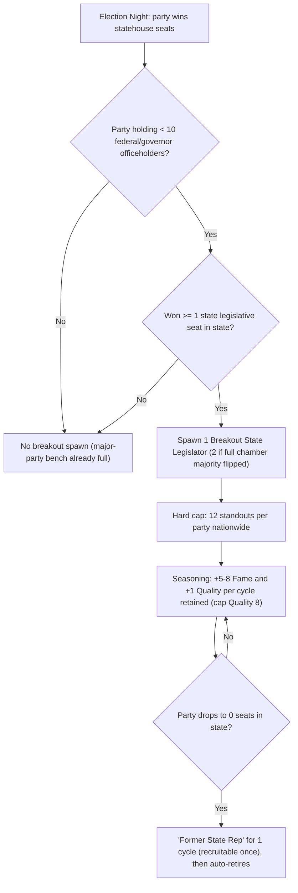
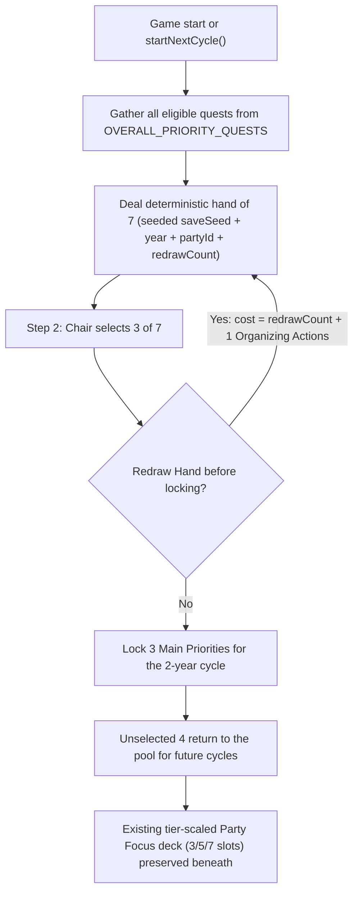
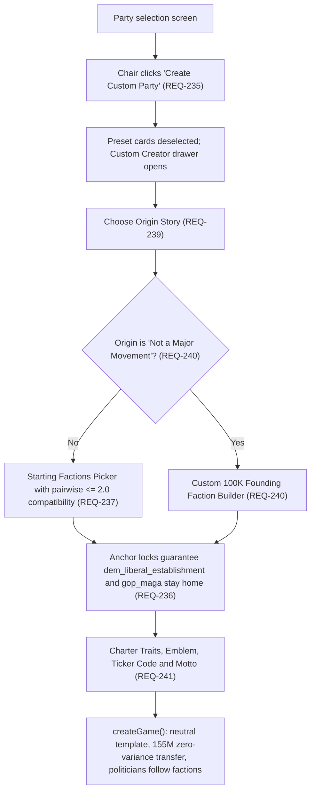

# Coalition Builder: Party Chair — Version 0.16.2 Design Document
## The Comprehensive Build: Statehouse Farm Team, Draft-of-7 Priorities, Historical Party Systems Canon & the Custom Party Mode & Faction Anchor Rework

**Document Version:** 1.0  
**Target Release:** `0.16.2` (Comprehensive Build — third-digit bump; the package contains no Huge or Large requirements, per the Comprehensive Version protocol)  
**Precondition:** Version 0.16.1 completes implementation in Antigravity; 0.16.2 builds directly on top of it and inherits all v0.16.1 systems.  
**Save Key:** `partyChairGame.save.v16.2` (with backward-compatible migration from `partyChairGame.save.v16.1`, `v16.0`, and all `v15.x` saves)  
**Scope:** 21 Numbered Requirements (`REQ-224` through `REQ-244` — 17 Small, 4 Medium) across 7 System Clusters  
**Build Command Executed:** "Build a Comprehensive Version" — packages ALL pending sized requirements of every tier except Massive. Zero Massive/Huge/Large items were pending; Medium and Small queues sweep fully into this release.  
**Implementation Modules:** `engine.js`, `app.js`, `styles.css`, `data.js`, `v07-scaffolding.js`, `factions-0.15.js`, `party-systems-data.js`, `party-systems-engine.js`, `party-systems-ui.js`

---

## 1. Executive Summary & Design Goals

Version 0.16.2 is the first Comprehensive Build in project history: it sweeps the entire pending sized backlog — the Statehouse Farm Team pipeline, the Draft-of-7 Major Priorities rework, the Strategic Quests catalog expansion, the Historical Party Systems Canon, and the full Custom Party Mode & Faction Anchor Rework — into a single release.

### Core Architecture Pillars

1. **The Statehouse Farm Team (Cluster A | `REQ-224` – `REQ-226`):**  
   Winning state legislative seats now produces a tangible, persistent talent pipeline for ascending minor parties: named Breakout State Legislators spawn from statehouse footholds, season across cycles, headline recruitment pools for federal and gubernatorial bids at $0 cost, and serve as a fallback party leadership bench that unlocks Keynote Speaker and State Tour operations for parties without federal officeholders. Chamber-total simulation is preserved with zero per-district bloat.

2. **The Draft-of-7 Major Priorities Engine (Cluster B | `REQ-230` – `REQ-231`):**  
   Step 2 becomes a strategic draft: each cycle deals a deterministic, anti-save-scum hand of 7 eligible Major Priorities with smart contextual/generic composition; the Chair locks in 3 per cycle and may burn Organizing Actions on unlimited escalating-cost redraws (`cost = redrawCount + 1`). The existing tier-scaled Party Focus deck (3/5/7 slots) is preserved beneath it.

3. **The Strategic Quests Catalog Expansion (Cluster C | `REQ-227` – `REQ-229`, `REQ-232` – `REQ-233`):**  
   Twelve new Major Priorities: four third-party institutional ascent quests (5% funding threshold, 15% debate barrier, 50-state ballot access, farm team), four mid-game leverage quests (regional bastion, electoral reform, kingmaker, lawmaker poaching), four climactic breakthrough quests (first Electoral Votes, 12th Amendment deadlock, overtaking a major party, Big-Tent Crossroads), two universal quests (Turnout Engine, Build Up the Bench), and two targetable hostile-territory conquests with permanent baseline lean shifts.

4. **The Historical Party Systems Canon (Cluster D | `REQ-234`):**  
   The Constitutional Chronicle timeline renders all six foundational eras of American party history, the 7th Party System retitles to The Modern Populist Era (2006 – Present), and a new ⓘ info modal explains the creator's "Two Signature Moments" era-dating philosophy.

5. **Custom Party Mode & Faction Anchor Rework, Part 1 — Creation & Anchoring (Cluster E | `REQ-235` – `REQ-237`):**  
   A dedicated Create Custom Party setup flow with clean neutral initialization, ironclad Democratic/Republican leading-faction anchor locks (`dem_liberal_establishment` & `gop_maga` can never bolt), and the Starting Factions Picker enforcing pairwise $\le 2.0$ ideological compatibility with exact 155M zero-variance voter transfer — every politician belonging to selected factions follows their faction into the Custom Party.

6. **Custom Party Mode & Faction Anchor Rework, Part 2 — Origins, Lifecycle & Identity (Cluster F | `REQ-238` – `REQ-242`):**  
   Minor-party merger dissolution with orphaned breakaway factions carrying a "Sellout Grudge", four mechanical Party Origin Story archetypes plus the hard-mode Not a Major Movement lock with the Custom 100K Founding Faction Builder, the Founding Charter Traits & Party Branding Suite (emblem, 3-letter broadcast code, motto), and the "Founder's Shadow" aura culminating in the "Survive the Founder" First Succession Crisis.

7. **Custom-Party-Exclusive Priorities (Cluster G | `REQ-243` – `REQ-244`):**  
   Nine `customOnly: true` contextual Major Priorities woven into the Draft-of-7 pool: Founding Momentum & Merger arcs (#1–#5) and Fortress, Grudge, Cross-Aisle & Homegrown Bench arcs (#6–#9).

> **Companion Document Note (Clusters E–G):** The version-agnostic deep technical schemas, exact zero-variance conservation math, UI wireframes, and acceptance checks for `REQ-235` – `REQ-244` live in `CUSTOM_PARTY_REWORK_DESIGN.md`. This document provides the authoritative release packaging. Where the two documents differ, `VERSION_0.16.2_DESIGN.md` governs.

---

## 2. Invariants & Style Guide Compliance

Every feature in `v0.16.2` strictly honors the following invariants:
- **155M Represented-Voter Scale:** All voter totals, registration gains, faction matrices, and the Custom 100K Founding Faction operate on the 155,000,000 represented-voter scale (1 internal sample = 100 real voters). The internal 1.55M abstraction must NEVER appear in game-facing UI.
- **Institutional Scale Invariants:** 435 House seats, 100 Senate seats, 538 Electoral College votes (50 states + DC), 98 partisan state legislative chambers, 5,462 baseline lower-house seats, 38 active factions.
- **Zero Code-Edit Scope Discipline (Design Agent):** This document is the complete design package; implementation belongs exclusively to the Coding Agent / Antigravity.
- **Atmospheric Vibes Rule (`GAME_STYLE_GUIDE.md` Rule 7):** Raw formulas, percentages, naked probabilities, and mechanic names must never appear in player-facing copy. Quests, quest successes, and crisis modals describe consequences through qualitative political narrative prose.
- **Zero In-Game Requirement Tags:** Requirement identifiers (`REQ-XX`) must never be visible to players in any UI, button, modal, or tooltip.
- **Universal Politician Terminology (`GAME_STYLE_GUIDE.md` Rule 6.5):** "Politician" refers universally to all characters — recruits, candidates, appointed leaders, sitting lawmakers, and state legislators alike.
- **Google Drive Compatibility:** All documentation remains clean, renderable Markdown.
- **Save/Reload Safety:** All new state initializes through `normalizeGame()` with backward-compatible defaults; no reload may double-execute spawns, transfers, grudge events, or succession crises.

---

## 3. Data Schemas & State Model Additions

The `v0.16.2` state schema extends `game` with backward-compatible defaults in `normalizeGame()`:

```typescript
// v0.16.2 State Additions
interface GameStateV16_2 {
  // Cluster A: Statehouse Farm Team
  stateLegStandouts?: Record<string, string[]>;      // partyId -> active stateLeg standout politician IDs (hard cap 12 per party)
  formerStateReps?: Record<string, string[]>;        // partyId -> 1-cycle 'Former State Rep' politicians (recruitable once)

  // Cluster B: Draft-of-7 Major Priorities Engine
  priorities?: {
    offeredQuestIds?: string[];                      // The dealt hand of 7 for the current cycle
    lockedMainPriorities?: QuestAssignment[];        // The 3 locked Main Priorities for the cycle
    redrawCount?: number;                            // Escalating cost = redrawCount + 1 Organizing Actions
    lastCycleOffered?: string[];                     // Anti-repeat tracking for smart composition
    handLocked?: boolean;                           // True once the Chair locks in 3 Main Priorities
  };

  // Cluster C: Targetable Hostile-Territory Priorities
  // (uses QuestAssignment.targetScope / targetId below)

  // Cluster E/F: Custom Party Mode
  customParty?: {
    enabled?: boolean;
    originStoryId?: 'schism' | 'civic' | 'grassroots' | 'executive' | 'notMajorMovement';
    parentPartyId?: string;                         // REQ-239: Major-Party Schism parent ('people' | 'heritage')
    selectedFactionIds?: string[];                   // REQ-237: catalog factions transferred in
    charterTraitIds?: string[];                      // REQ-241: 1-2 of 4 DNA rules
    emblemId?: string;                              // REQ-241: one of 10 inline SVG emblems
    tickerCode?: string;                            // REQ-241: 3-letter uppercase broadcast code
    motto?: string;                                 // REQ-241: 1-line founding motto
    foundingFaction?: {                             // REQ-240: 'Not a Major Movement' only
      id: string;
      name: string;
      econAlignment: number;                        // 1-10 slider
      socialAlignment: number;                      // 1-10 slider
      coreIssueIds: string[];                       // exactly 2 core/key issues
      stateAllocation: Record<string, number>;      // stateId -> voters (in 100-voter steps; sums to exactly 100,000)
    };
  };

  dissolvedParties?: string[];                       // REQ-238: permanently dissolved minor-party IDs

  factionGrudges?: Record<string, {                 // REQ-238: orphaned breakaway factions
    seekingPartyHome: boolean;
    selloutGrudge: boolean;                         // 'Sellout Grudge' against the Custom Party
  }>;

  founderLegacy?: {                                 // REQ-242
    auraActive?: boolean;                           // +20% fundraising & +1 recruitment lift
    auraCyclesRemaining?: number;                   // starts at 3
    successionPending?: boolean;                    // armed post-Succession-Crisis; arms Priority #4
    successionPath?: 'institutionalize' | 'anointedHeir' | 'powerStruggle';
  };
}

interface QuestAssignment {
  questId: string;
  targetScope?: 'state' | 'district';               // REQ-233 targetable quests
  targetId?: string;                                 // e.g. "OH" or "OH-12"; title renders as 'Crack an Opponent Stronghold (Ohio)'
  acceptedThisCycle?: boolean;
  completedAtCycle?: number;
}
```

---

## 4. Complete Sized Requirements Inventory (Grouped by Size)

Default sizing grouping rule: Inventory is reported primarily by SIZE, then by cluster.

| Size | Count | Requirement IDs | Clusters |
| :--- | :---: | :--- | :--- |
| **Massive** | **0** | — | — |
| **Huge** | **0** | — | — |
| **Large** | **0** | — | — |
| **Medium** | **4** | `REQ-237`, `REQ-238`, `REQ-240`, `REQ-242` | Clusters E, F |
| **Small** | **17** | `REQ-224`–`REQ-236`, `REQ-239`, `REQ-241`, `REQ-243`, `REQ-244` | Clusters A–G |
| **Tiny** | **0** | — | — |
| **TOTAL** | **21** | **REQ-224 – REQ-244** | **7 Clusters** |

### Requirements-by-Cluster Matrix

| Req ID | Title | Size | Cluster | Core Target Files |
| :--- | :--- | :---: | :---: | :--- |
| **REQ-224** | Breakout State Legislator Spawner, 12-Member Roster Cap & Seasoning Lifecycle | Small | A | `engine.js` |
| **REQ-225** | Statehouse-to-Higher-Office Recruitment Pipeline & Seamless Career Promotion | Small | A | `engine.js`, `app.js` |
| **REQ-226** | Fallback Party Leadership Bench & Stepping-Stone State Legislative Caucus Chair Role | Small | A | `v07-scaffolding.js`, `engine.js`, `app.js` |
| **REQ-230** | Deterministic Draft-of-7 Priorities Engine, Smart Hand Composition & Push Our Issues Gate | Small | B | `data.js`, `engine.js` |
| **REQ-231** | Step 2 Draft-of-7 Selection UI & Unlimited Escalating-Cost Redraws | Small | B | `engine.js`, `app.js`, `styles.css` |
| **REQ-227** | Third-Party Major Priorities Pack A — Vote-Threshold & Institutional Ascent (4 Quests) | Small | C | `data.js`, `engine.js`, `app.js` |
| **REQ-228** | Third-Party Major Priorities Pack B — Regional Bastion, Electoral Reform & Kingmaker Leverage (4 Quests) | Small | C | `data.js`, `engine.js` |
| **REQ-229** | Third-Party Major Priorities Pack C — Historic Breakthrough & Major-Party Displacement (4 Quests) | Small | C | `data.js`, `engine.js` |
| **REQ-232** | New Generic Major Priorities (Turnout Engine & Build Up the Bench) | Small | C | `data.js`, `engine.js` |
| **REQ-233** | Targetable Hostile-Territory Priorities (Crack an Opponent Stronghold & Crack an Opponent's Fortress) | Small | C | `data.js`, `engine.js`, `app.js` |
| **REQ-234** | Historical Party Systems Canon (1st–6th Eras), 7th Era Modern Populist Retitle & Timeline Info Modal | Small | D | `party-systems-data.js`, `party-systems-engine.js`, `party-systems-ui.js`, `styles.css` |
| **REQ-235** | Dedicated Create Custom Party Setup Flow & Clean Neutral Initialization | Small | E | `app.js`, `engine.js`, `styles.css` |
| **REQ-236** | Ironclad Democratic & Republican Leading-Faction Anchor Lock | Small | E | `engine.js`, `factions-0.15.js`, `app.js`, `party-systems-engine.js` |
| **REQ-237** | Custom Party Starting Factions Picker, Pairwise <= 2.0 Compatibility, 155M & Politician Transfer | Medium | E | `app.js`, `engine.js`, `factions-0.15.js`, `styles.css` |
| **REQ-238** | Minor-Party Merger Dissolution, Orphaned Breakaway Factions (seekingPartyHome) & "Sellout Grudge" | Medium | F | `engine.js`, `app.js`, `data.js` |
| **REQ-239** | Party Origin Stories — 4 Archetype Modifiers (Schism, Civic Reform, Grassroots Viral, Executive Third Way) | Small | F | `data.js`, `engine.js`, `app.js`, `styles.css` |
| **REQ-240** | Not a Major Movement Exclusivity Lock & Custom 100K Founding Faction Builder | Medium | F | `app.js`, `engine.js`, `styles.css` |
| **REQ-241** | Founding Charter Traits & Party Branding Suite (Emblem, 3-Letter Code & Motto) | Small | F | `data.js`, `engine.js`, `app.js`, `styles.css` |
| **REQ-242** | The "Founder's Shadow" Movement Aura & "Survive the Founder" First Succession Crisis | Medium | F | `engine.js`, `app.js`, `data.js`, `styles.css` |
| **REQ-243** | Custom-Party-Exclusive Priorities Pack A — Founding Momentum & Merger Arcs (#1–#5) | Small | G | `data.js`, `engine.js` |
| **REQ-244** | Custom-Party-Exclusive Priorities Pack B — Fortress, Grudge, Cross-Aisle & Homegrown Bench (#6–#9) | Small | G | `data.js`, `engine.js` |

---

## 5. Detailed Specifications: Cluster A — The Statehouse Farm Team (REQ-224 – REQ-226)



#### REQ-224: Breakout State Legislator Spawner, 12-Member Roster Cap & Seasoning Lifecycle (office: 'stateLeg')
- **Classification:** Small (Politician Lifecycle & State Legislature Simulation / `engine.js`)
- **Dependencies / Related:** `reallocateStateHouseSeatCounts()` (`engine.js`), `startNextCycle()`, `normalizeGame()`, Universal Politician Terminology (`GAME_STYLE_GUIDE.md` Rule 6.5).
- **Problem Statement:** State legislative elections simulate chamber control and seat counts cleanly without per-district or 5,462-legislator database bloat, but winning statehouse seats currently does not yield a visible, persistent talent pool for ascending minor parties. Spawning a small, curated roster of named "Breakout State Legislators" turns statehouse footholds into a tangible engine for third-party growth with zero performance bloat.
- **Mechanical Specification:**
  - **Lightweight Chamber-Total Invariant:** Preserve the existing chamber/seat-count state legislature simulation (`reallocateStateHouseSeatCounts`) — do not add individual state-house districts or a 5,462-member database.
  - **Breakout Standout Spawn Rule (Emerging / Minor Parties Only):** After each Election Night / cycle turnover, for any party holding `< 10` sitting federal/governor officeholders that wins `>= 1` state legislative seat in a state:
    - Spawn `1` named Breakout State Legislator (`office: 'stateLeg'`) for that state (or `2` if the party flips a full chamber majority in that state).
    - Major parties with full federal benches do not spawn stateLeg clutter.
  - **Hard Roster Cap (12 Max per Party):** Cap active `stateLeg` standouts at 12 per party nationwide. If a party exceeds 12, retain standouts from the states where the party holds the most state legislative seats.
  - **Title, Quality & Fame Scaling by State Caucus Strength:**
    - 1–4 seats in state $\to$ *State Representative (ST)* · Starting Quality 6, Fame 25–35.
    - 5–19 seats in state $\to$ *State Legislative Caucus Leader (ST)* · Starting Quality 7, Fame 35–48.
    - Chamber majority won $\to$ *State House Speaker / Senate President (ST)* · Starting Quality 7–8, Fame 48–60.
  - **Multi-Cycle Seasoning & Natural Attrition:**
    - Each cycle a standout retains their statehouse seat, they gain `+5–8 Fame` and `+1 Quality` (capped at 8).
    - If the party drops back to 0 statehouse seats in that state on a later Election Night, the standout transitions to *Former State Rep* for 1 cycle (still recruitable once) before auto-retiring if not elected to higher office.

#### REQ-225: Statehouse-to-Higher-Office Recruitment Pipeline & Seamless Career Promotion
- **Classification:** Small (Candidate Recruitment & Career Progression / `engine.js`, `app.js`)
- **Dependencies / Related:** `REQ-224` (`office: 'stateLeg'`), Politician Factions & Badges (`REQ-159`, `REQ-167`), `careerMilestones` & `termsServed.stateLeg` (`engine.js`).
- **Problem Statement:** Minor parties need winning state legislative seats in early cycles (e.g. 2028) to produce genuinely viable U.S. House, U.S. Senate, Governor, and Presidential candidates in later cycles (e.g. 2032) rather than relying solely on low-quality generic recruits.
- **Mechanical & UI Specification:**
  - **Featured Home-State Recruitment Placement (`app.js`, `engine.js`):** Whenever a Chair recruits candidates for U.S. House, U.S. Senate, Governor, or President, any sitting stateLeg standout (or 1-cycle Former State Rep) from that state is placed at the top of the recruitment/primary pool with an in-universe `★ Sitting State Lawmaker` badge (no REQ-XX text per `GAME_STYLE_GUIDE.md` Rule 4).
  - **Viability Edge & $0 Recruitment Cost:** Encouraging a sitting stateLeg standout to run for higher office costs **$0 extra treasury** and preserves their existing faction affiliation and personality traits. Higher baseline Quality (6–8) and +2 Experience over generic minor-party amateurs (Quality 3–5) deliver a tangible `+1.5%` to `+3.0%` home-state electoral credibility lift.
  - **Seamless Career Promotion:** If the standout wins federal or gubernatorial office, cleanly promote office (`'stateLeg'` $\to$ `'house'` | `'senate'` | `'governor'`), log `termsServed.stateLeg` in `careerMilestones`, and free up a slot in the party's 12-member stateLeg farm team for the next cycle.

#### REQ-226: Fallback Party Leadership Bench & Stepping-Stone State Legislative Caucus Chair Role
- **Classification:** Small (Leadership Hierarchy & Action Unlocking / `v07-scaffolding.js`, `engine.js`, `app.js`)
- **Dependencies / Related:** `REQ-224` (`office: 'stateLeg'`), `REQ-168` (Keynote Speaker & State Tour restricted to active Party Leaders), `REQ-127` (Chamber-Exclusive Scoping), `LEADERSHIP_ROLES_SCHEMA` (`v07-scaffolding.js`).
- **Problem Statement:** Third parties holding 0 Senators, 0 U.S. Representatives, and 0 Governors currently have an empty leadership bench, which also locks them out of Keynote Speaker and State Tour machine operations (`REQ-168`). Allowing Breakout State Legislators to serve as a fallback leadership bench — and introducing a stepping-stone caucus chair role — makes early statehouse wins immediately unlock core party-building actions.
- **Mechanical & UI Specification:**
  - **Automatic Fallback Eligibility (< 3 Federal/Governor Officeholders):** Whenever a party has `< 3` sitting federal/governor officeholders, automatically populate its sitting stateLeg standouts into selection dropdowns for non-chamber party roles:
    - Rhetorical Leader (`rhetoricalLeader`)
    - Policy Leader (`policyLeader`)
    - Unlocked Faction Leader slots (filtered to the faction as normal)
    - Label entries clearly as `[State Leg · ST]` (clean plain text inside `<select>` per REQ-167 dropdown rule) and sort them below any sitting federal/governor members once higher offices are won.
  - **Stepping-Stone Role — State Legislative Caucus Chair (`LEADERSHIP_ROLES_SCHEMA`):** Unlocks when a party holds $\ge 1$ state legislative seat while holding 0 U.S. House and 0 U.S. Senate seats. Passive effect: `+1.5` State Legislature support and counts as an active appointed Party Leader — immediately unlocking Keynote Speaker and State Tour actions under REQ-168. Gracefully retires / masks once the party wins Congressional seats and unlocks House Leader / Senate Leader.
  - **Strict Chamber Lock Preservation (`REQ-127`):** State lawmakers remain strictly ineligible for chamber-locked federal/executive roles (House Speaker, Senate Leader, Governors Assoc. Chair, Cabinet posts).

---

## 6. Detailed Specifications: Cluster B — The Draft-of-7 Priorities Engine (REQ-230 – REQ-231)



#### REQ-230: Deterministic Draft-of-7 Priorities Engine, Smart Hand Composition & Push Our Issues Gate
- **Classification:** Small (Step 2 Priority Draw Engine & Eligibility Rules / `data.js`, `engine.js`)
- **Dependencies / Related:** `OVERALL_PRIORITY_QUESTS` (`data.js:1584`), `REQ-227`–`REQ-229`, `startNextCycle()`, `normalizeGame()`.
- **Problem Statement:** Exposing the entire eligible quest catalog every cycle makes Step 2 repetitive and lets players pick the exact same optimal quests on autopilot. Dealing a randomized, smartly composed hand of 7 eligible priorities each cycle — seeded deterministically to prevent save-scumming — turns Step 2 into an engaging strategic draft while guaranteeing relevant contextual options.
- **Mechanical Specification:**
  - **Cycle Hand Generation (`generateOfferedPrioritiesHand(game, redrawCount)` in `engine.js`):**
    - At game start and each cycle transition (`startNextCycle`), gather all quests in `OVERALL_PRIORITY_QUESTS` whose eligibility predicate evaluates true for the player's party and deal a hand of 7 priorities.
    - Persist the dealt hand in `game.priorities.offered` (alongside `game.priorities.redrawCount = 0` and `game.priorities.lastCycleOffered` for anti-repeat tracking), with clean fallback migration in `normalizeGame()` for legacy saves.
  - **Deterministic Anti-Save-Scum Seeding:** Seed the shuffle/selection deterministically from `saveSeed + year + partyId + redrawCount` so reloading Step 2 always restores the exact same hand of 7 and cannot reroll for free.
  - **Smart Hand Composition:**
    - *2–3 Contextual / Milestone Slots:* Guaranteed to draw from party-specific or cycle-specific priorities whenever eligible (White House bids, chamber control battles, 3rd-party breakthroughs `REQ-227`–`REQ-229`, Stronghold/Fortress bids `REQ-233`).
    - *4–5 Generic / Strategic Slots:* Drawn from the universal pool, deprioritizing/avoiding back-to-back repeats from `lastCycleOffered` whenever enough eligible priorities remain in the pool.
  - **Eligibility Tightening on Existing Quest (`Push our issues`):** Update `Push our issues` in `data.js` to require holding $\ge 1$ state legislative chamber so 0-seat minor parties are never dealt an uncompletable quest in their hand of 7.
  - **Pool-Size Verification Across REQ-227–REQ-233:**
    - 0-Seat 3rd Party Midterm floor = 14 eligible quests (2× draw of 7).
    - 0-Seat 3rd Party Presidential = 17 eligible quests.
    - Rising 3rd Party = 18–20 eligible quests.
    - Major Party = 14–18 eligible quests.

#### REQ-231: Step 2 Draft-of-7 Selection UI & Unlimited Escalating-Cost Redraws (cost = redrawCount + 1)
- **Classification:** Small (Step 2 Priorities UX & Redraw Action Handler / `engine.js`, `app.js`, `styles.css`)
- **Dependencies / Related:** `REQ-230` (`game.priorities.offered`), `REQ-176` (`getMaxFocusSlots`: 3 / 5 / 7 tier-scaled Party Focus slots).
- **Problem Statement:** Players need a clear Step 2 Draft-of-7 interface to pick 3 of their 7 offered priorities, plus an escalating-cost redraw valve when a dealt hand does not match their strategic plan for the cycle.
- **Mechanical & UI Specification:**
  - **Draft-of-7 Selection UX (`app.js`):**
    - Display the 7 offered Main Priorities cleanly in Step 2; the Chair selects 3 of the 7 and locks them in permanently for the 2-year cycle (the unselected 4 return to the pool for future cycles).
    - *Preserve Existing Tier 2 Deck:* Keep the existing Party Focus / Additional Priorities slots (Issue / State / Region, preserving REQ-176's 3 / 5 / 7 tier-scaled slot count) unchanged beneath the 3 Main Priorities.
  - **Unlimited Escalating-Cost Redraws (`redraw-priorities-hand` in `engine.js` & `app.js`):**
    - Before locking in their 3 Main Priorities, the Chair may click Redraw Hand as many times as they have Organizing Actions available.
    - *Escalating Action Cost Formula:* `cost = redrawCount + 1` (1st redraw = 1 Action, 2nd redraw = 2 Actions, 3rd = 3 Actions, 4th = 4 Actions, etc.).
    - Executing a redraw deducts cost from `organizingActionsRemaining` / `actionsLeft`, increments `game.priorities.redrawCount`, clears any unconfirmed Main Priority picks from the prior hand, and deals a fresh deterministic hand of 7 (`saveSeed + year + partyId + redrawCount`).
    - Button dynamically displays the exact next cost (e.g. `Redraw Hand (1 Action)` $\to$ `Redraw Hand (2 Actions)`) and disables once priorities are locked in or when remaining Organizing Actions < nextCost.
    - Strictly obey `GAME_STYLE_GUIDE.md` Rule 4 (zero REQ-XX text in UI).

---

## 7. Detailed Specifications: Cluster C — Strategic Quests Catalog Expansion (REQ-227 – REQ-229, REQ-232 – REQ-233)

#### REQ-227: Third-Party Major Priorities Pack A — Vote-Threshold & Institutional Ascent (4 Quests)
- **Classification:** Small (Step 2 Strategic Quests Catalog / `data.js`, `engine.js`, `app.js`)
- **Dependencies / Related:** `OVERALL_PRIORITY_QUESTS` (`data.js:1584`), `PRIORITIES_REWORK_DESIGN.md`, `REQ-179` (FEC Matching), `REQ-180` (Debate Stage), `REQ-224` (Statehouse Farm Team).
- **Specification:** Add 4 Quests to `OVERALL_PRIORITY_QUESTS` + Evaluators in `engine.js`:
  1. **Cross the 5% Funding Threshold (Medium Difficulty):**
     - *Eligibility:* Minor party; prior national presidential vote < 5%; Presidential year.
     - *Goal:* Finish with $\ge 5.0\%$ national presidential vote (hooks REQ-179).
     - *Acceptance Bonus:* Slightly reduces Tier 1–2 Media Blackout drag for the cycle.
     - *Completion Reward:* +6 Member Happiness; +$12M FEC Matching Grant; automatic ballot retention in top 15 states.
  2. **Shatter the 15% Debate Barrier (Hard Difficulty):**
     - *Eligibility:* Minor party; polling/prior vote 4.0%–14.9%; Presidential year.
     - *Goal:* Hit $\ge 15.0\%$ national polling (Debate Stage REQ-180) OR finish $\ge 15.0\%$ national vote.
     - *Acceptance Bonus:* +2 Fame for Presidential Nominee & Rhetorical Leader.
     - *Completion Reward:* +12 Member Happiness; permanently clears Media Blackout drag; seeds an allied Super PAC (+$15M).
  3. **Secure 50-State Ballot Access (Medium Difficulty):**
     - *Eligibility:* Minor party missing ballot retention in $\ge 15$ states.
     - *Goal:* Qualify for (or retain) the ballot in all 50 states + D.C. by Election Night.
     - *Acceptance Bonus:* -25% petition/chapter organizing cost this cycle.
     - *Completion Reward:* +6 Member Happiness; automatic 50-state ballot retention locked in for the next 2 cycles.
  4. **Build a Statehouse Farm Team (Medium Difficulty):**
     - *Eligibility:* Minor party holding 1–14 total state legislative seats.
     - *Goal:* Hold $\ge 15$ total state legislative seats nationwide.
     - *Acceptance Bonus:* Spawns +1 immediate Quality-7 Breakout State Legislator (REQ-224).
     - *Completion Reward:* +8 Member Happiness; all sitting stateLeg standouts gain +8 Fame & +1 Quality (up to 8).

#### REQ-228: Third-Party Major Priorities Pack B — Regional Bastion, Electoral Reform & Kingmaker Leverage (4 Quests)
- **Classification:** Small (Step 2 Strategic Quests Catalog / `data.js`, `engine.js`)
- **Dependencies / Related:** `OVERALL_PRIORITY_QUESTS` (`data.js`), `REQ-170` (Courting), `REQ-184` (OVERLAPPING_REGIONS Snowball), `REQ-185` (State Electoral Systems), `REQ-187`/`REQ-188` (Kingmaker Caucus).
- **Specification:** Add 4 Quests to `OVERALL_PRIORITY_QUESTS` + Evaluators in `engine.js`:
  5. **Carve Out a Regional Bastion (Medium Difficulty):**
     - *Eligibility:* Minor party < 10% nationally; no state $\ge 20\%$ yet.
     - *Goal:* Win $\ge 20.0\%$ of the vote in any state (Pres/Sen/Gov) AND hold $\ge 5$ state legislative seats there.
     - *Acceptance Bonus:* +10,000 registered voters in your top polling state (155M represented scale).
     - *Completion Reward:* +8 Member Happiness; triggers OVERLAPPING_REGIONS snowball (REQ-184) & lifts regional Duverger floor.
  6. **Break the Duopoly (Electoral Reform) (Hard Difficulty):**
     - *Eligibility:* Minor party; < 5 states currently use RCV/Approval/PR (REQ-185).
     - *Goal:* Enact RCV, Approval, or Proportional Representation in at least 1 new state.
     - *Acceptance Bonus:* +3 Independents Trust immediately.
     - *Completion Reward:* +10 Member Happiness; boosts future electoral-reform momentum nationwide.
  7. **Become the Kingmaker (Hard Difficulty):**
     - *Eligibility:* Minor party; < 50 House seats and < 15 Senate seats.
     - *Goal:* Hold the balance of power in a hung U.S. House, hung U.S. Senate, OR $\ge 2$ hung State Chambers (REQ-187 / REQ-188).
     - *Acceptance Bonus:* +2.0% lift in your top 5 closest House / State Leg races.
     - *Completion Reward:* +12 Member Happiness; grants +1 extra concession during Confidence-and-Supply bargaining.
  8. **Poach a Sitting Lawmaker (Hard Difficulty):**
     - *Eligibility:* Minor party at $\ge$ Tier 2 (Emerging / Ballot-Qualified; Tier 1 Fringe parties strictly cannot court sitting lawmakers) with 0 Senators and < 5 House seats.
     - *Goal:* Successfully court a sitting U.S. Rep, Senator, or Governor to switch parties (REQ-170).
     - *Acceptance Bonus:* Loosens the Party Happiness courting gate by +8 points this cycle ($\le 48$ instead of $\le 40$).
     - *Completion Reward:* +10 Member Happiness; +25,000 registered voters in the defector's state; +2.0% Unified Party Approval; immediately updates the respective seat count tracker in the main KPI resource strip.

#### REQ-229: Third-Party Major Priorities Pack C — Historic Breakthrough & Major-Party Displacement (4 Quests)
- **Classification:** Small (Step 2 Strategic Quests Catalog / `data.js`, `engine.js`)
- **Dependencies / Related:** `OVERALL_PRIORITY_QUESTS` (`data.js`), `REQ-176` (Tier 5 Major Promotion), `REQ-190` (Multi-Party EVs), `REQ-191` (12th Amendment Contingent Election), `REQ-192`/`REQ-194` (Big-Tent Crossroads & Purist Backlash).
- **Specification:** Add 4 Quests to `OVERALL_PRIORITY_QUESTS` + Evaluators in `engine.js`:
  9. **Win Your First Electoral Votes (Hard Difficulty):**
     - *Eligibility:* Minor party; 0 historical EVs; Presidential year.
     - *Goal:* Win $\ge 1$ Electoral College vote (any state or ME/NE district).
     - *Acceptance Bonus:* +2.0% presidential lift in your single strongest state.
     - *Completion Reward:* +15 Member Happiness; +100,000 registered voters in winning state/region; removes regional "wasted vote" drag.
  10. **Force a 12th Amendment Deadlock (Insane Difficulty):**
      - *Eligibility:* Minor party with $\ge 10\%$ national polling; Presidential year.
      - *Goal:* Prevent both major parties from reaching 270 EVs, forcing a Contingent Election (REQ-191).
      - *Acceptance Bonus:* +1.5% lift in top 3 battleground states.
      - *Completion Reward:* +20 Member Happiness; maximum Contingent Election brokering leverage (Cabinet + reform concessions).
  11. **Overtake a Major Party (Finish 2nd) (Insane Difficulty):**
      - *Eligibility:* Minor party ranked 3rd or lower nationally.
      - *Goal:* Beat either Democrats or Republicans in the national popular vote (Presidential or House Generic).
      - *Acceptance Bonus:* None.
      - *Completion Reward:* +25 Member Happiness; immediate Tier 5 Major Party promotion (REQ-176); shifts 15% of the overtaken party's voter base.
  12. **Survive the Big-Tent Crossroads (Medium Difficulty):**
      - *Eligibility:* Minor party nearing REQ-192 Big-Tent Inflection Point.
      - *Goal:* Hit $\ge 10\%$ national vote while keeping Founding Faction happiness $\ge 60$ (zero purist bolt REQ-194).
      - *Acceptance Bonus:* +5 Founding Faction Happiness immediately.
      - *Completion Reward:* +8 Member Happiness; permanently lowers platform-broadening backlash (-20%).

#### REQ-232: New Generic Major Priorities (Turnout Engine & Build Up the Bench)
- **Classification:** Small (Universal Strategic Quests Catalog / `data.js`, `engine.js`)
- **Dependencies / Related:** `REQ-230`, `OVERALL_PRIORITY_QUESTS` (`data.js`), Candidate Traits (Rising Star), Voter Model (155M represented scale).
- **Specification:** Add 2 Universal Quests to `OVERALL_PRIORITY_QUESTS` + Evaluators in `engine.js`:
  - **Turnout Engine (Medium Difficulty · Eligible for All Parties):**
    - *Goal / Target:* Keep every active party faction at $\ge 65$ Happiness through Election Day and beat baseline base turnout.
    - *Acceptance Bonus:* +2 Happiness to all active party factions immediately.
    - *Completion Reward:* +5 Member Happiness; +2.0% national base turnout lift on Election Night.
  - **Build Up the Bench (Medium Difficulty · Eligible for All Parties):**
    - *Goal / Target:* Field and elect $\ge 3$ Rising Star (or Fame $\ge 70$ fresh) nominees on Election Night.
    - *Acceptance Bonus:* +4 Fame to your top 3 newly recruited nominees.
    - *Completion Reward:* +5 Member Happiness; +25,000 new registered voters nationwide (155M represented scale).

#### REQ-233: Targetable Hostile-Territory Priorities (Crack an Opponent Stronghold & Crack an Opponent's Fortress)
- **Classification:** Small (Targetable Hostile-Lean Quests & Permanent Lean Shift / `data.js`, `engine.js`, `app.js`)
- **Dependencies / Related:** `REQ-230`, `OVERALL_PRIORITY_QUESTS` (`data.js`), state/district partisan lean baselines (`engine.js`).
- **Mechanical & UI Specification:**
  - **Crack an Opponent Stronghold (State/District) (Hard Difficulty):**
    - *Eligibility:* Party controls $\ge 1$ federal seat (House/Senate) OR $\ge 1$ Governor's mansion, and contests at least one state or congressional district with $\ge +5$ hostile lean.
    - *Goal / Target:* Player selects the exact qualifying state or district upon choosing the quest (displayed dynamically in parentheses, e.g. *Crack an Opponent Stronghold (Ohio)*) and wins a federal (House/Senate) or gubernatorial race there on Election Night.
    - *Acceptance Bonus:* +3.0% persuasion in that selected state/district for the cycle.
    - *Completion Reward:* +10 Member Happiness; permanently shifts that state/district's baseline partisan lean +1.5 points toward the player's party.
  - **Crack an Opponent's Fortress (State/District) (Insane Difficulty):**
    - *Eligibility:* Party controls $\ge 1$ federal seat (House/Senate) OR $\ge 1$ Governor's mansion, and contests at least one state or congressional district with $\ge +10$ hostile lean.
    - *Goal / Target:* Player selects the exact qualifying state or district upon choosing the quest (displayed dynamically in parentheses, e.g. *Crack an Opponent's Fortress (Wyoming)*) and wins a federal (House/Senate) or gubernatorial race there on Election Night.
    - *Acceptance Bonus:* +3.0% persuasion in that selected state/district for the cycle.
    - *Completion Reward:* +20 Member Happiness; permanently shifts that state/district's baseline partisan lean +2.5 points toward the player's party.
  - **Target Picker UX (`app.js`):** When selecting either quest from the Draft-of-7 hand, render a clean inline `<select>` populated strictly with qualifying hostile-lean states/districts (plain-text labels per REQ-167), saving `targetScope` / `targetId` onto the locked quest object so its title renders with `(Target Name)` throughout the cycle.

---

## 8. Detailed Specifications: Cluster D — Historical Party Systems Canon (REQ-234)

#### REQ-234: Historical Party Systems Canon (1st–6th Eras), 7th Era Modern Populist Retitle & Timeline Info Modal
- **Classification:** Small (Historical Systems Data, Era Retitling & Educational UI Modal / `party-systems-data.js`, `party-systems-engine.js`, `party-systems-ui.js`, `styles.css`)
- **Requested By:** User
- **Dependencies / Related:** `MAS-01` (`PARTY_SYSTEMS_DESIGN.md`), `party-systems-data.js` (`BASELINE_ERA`, `ERA_CATALOG`), `party-systems-ui.js` (`renderHistoricalEraTimeline`), `styles.css`.
- **Mechanical & UI Specification:**
  - **Canonical 1st through 6th Former Party Systems Data (`party-systems-data.js`, `party-systems-engine.js`):**
    - Populate `game.partySystems.priorErasHistory` (or a dedicated immutable catalog `HISTORICAL_CANON_ERAS` merged in `renderHistoricalEraTimeline`) with the six foundational eras:
      1. *1st Party System (1792–1828):* The Federalist Era · Catalyst: Founding constitutional debates, rise of partisan press, Hamiltonian finance vs. Jeffersonian-Madisonian Democratic-Republican counter-mobilization.
      2. *2nd Party System (1828–1860):* The Antebellum Era · Catalyst: Jacksonian mass democracy, universal white male suffrage, spoils system, national nominating conventions, and Whig opposition.
      3. *3rd Party System (1860–1896):* The Industrial Era · Catalyst: Civil War realignment, Union Republican hegemony vs. Bourbon Democrats, Gilded Age growth, tariff battles, and rapid industrial urbanization.
      4. *4th Party System (1896–1932):* The Progressive Era · Catalyst: 1896 McKinley realignment, trust-busting, direct primary democratization, 1912 Bull Moose split, and regulatory state formation.
      5. *5th Party System (1932–1966):* The Liberal Era · Catalyst: FDR New Deal coalition, organized labor expansion, social security, and mid-century federal public investment.
      6. *6th Party System (1966–2006):* The Conservative Era · Catalyst: Southern realignment, Reagan coalition, supply-side deregulation, Contract with America, and post-Cold War market dominance.
  - **7th Party System Retitling & Baseline Adjustments (`party-systems-data.js`, `party-systems-engine.js`):**
    - *Active Years:* 2006 – Current (displays as `2006 – Present` during the 7th era; updates dynamically to `2006 – <Year>` once the 8th Party System triggers).
    - *Title:* Retitle from *Polarized Duopoly* to *The Modern Populist Era* (`fullTitle: 'The 7th Party System: The Modern Populist Era'`).
    - *Catalyst:* Update catalyst description to: "Rise of 21st-century populist movements, sparked by the 2006 Democratic wave and 50-state strategy, followed by Obama's coalition and Trump's working-class realignment."
    - *Initial State:* `currentEraStartYear: 2006` in `party-systems-engine.js` initialization and `normalizeGame()`.
    - *Invariant Preservation:* The 8th Party System floor (2040), the +5% escalating transition roll, and the 30-year subsequent-era floor (MAS-01) remain completely unchanged.
  - **Top-Right ⓘ Information Icon & Hover Tooltip (`party-systems-ui.js`, `styles.css`):**
    - Render a circular information button (`<button class="era-info-btn" aria-label="click for more information on the party systems years" title="click for more information on the party systems years">ⓘ</button>`) in the top-right corner of the timeline header (`.era-timeline-head`).
    - Hovering or focusing over the icon displays the exact native/CSS tooltip: `"click for more information on the party systems years"`.
  - **Party Systems Era Dating Philosophy Popup Modal (`party-systems-ui.js`):**
    - Clicking the ⓘ button triggers a modal dialog explaining the creator's historical design rationale:
      - *Intentional Divergence:* Clarifies that the game's era boundaries intentionally differ from traditional academic consensus based on a distinct historical perspective.
      - *Two Signature Moments Theory:* Explains that party systems typically have two signature moments:
        - Moment 1 (Emergence): 10–15 years before the "typical" start date, where an insurgent movement emerges.
        - Moment 2 (Maturity & Coalescence): Where the movement grows up, coalesces, and assumes governing dominance.
      - *7th Era Rationale:* "For the purposes of this game, the 7th party system began in '06, when the Democrats won in a wave year, followed by Obama's presidency. Trump's populism is also important in this era - it's defined by populism, that really started with the Democrats' 50-state strategy in '06."
      - *5th & 6th Era Rationale:* "As for the 6th and 5th, the 5th era ended in '66, because several key characteristics of that party system didn't exist in the last 14 years."
      - *Complete Chronological Reference:* Lists all 7 canonical eras (1st: 1792–1828 The Federalist Era through 7th: 2006–Current The Modern Populist Era).
  - **Style Guide Compliance:** Strictly follows `GAME_STYLE_GUIDE.md` Rule 4 (zero REQ-XX strings in UI copy), Rule 7 (qualitative atmospheric descriptions), and Section 3 visual styling (AI Games Studio palette).

---

## 9. Detailed Specifications: Cluster E — Custom Party Creation & Faction Anchoring (REQ-235 – REQ-237)



#### REQ-235: Dedicated Create Custom Party Setup Flow & Clean Neutral Initialization
- **Classification:** Small (Setup UX & Neutral Game Initialization / `app.js`, `engine.js`, `styles.css`)
- **Dependencies / Related:** `app.js#L1383-L1425`, `engine.js#L2774-L2960`, Ascent Tier Engine (`REQ-176`).
- **Problem Statement:** The existing `#custom-mode` checkbox toggle bleeds preset-party template data into custom games. Custom parties need a dedicated, clean setup flow that initializes from a truly neutral baseline.
- **Mechanical & UI Specification:**
  - **Standalone Setup Button:** Replace the `#custom-mode` checkbox toggle with a standalone *Create Custom Party* button that sets `selectedTemplate = 'custom'`, visually deselects all 6 preset party cards, and opens the Custom Party Creator drawer cleanly.
  - **Neutral Custom Template:** Eliminate all preset-party template bleed in `createGame()` using a neutral custom template (`baseTemplateId: 'custom'`).
  - **Honest Share Computation:** Compute `player.baseShare` strictly from actual starting voters (`startingVoters / 155,000,000 * 100`).
  - **Dynamic Tier Calibration:** Calibrate the starting Ascent Tier (1–5) and Party Focus slots (3 / 5 / 7) dynamically from the starting voter base per REQ-176, rather than assuming a major-party preset.
  - **Creator Drawer Flow (`app.js`, `styles.css`):** The drawer hosts, in order: Origin Story selection (`REQ-239`), Starting Factions Picker (`REQ-237`) or the Custom 100K Founding Faction Builder (`REQ-240`), Charter Traits & Branding (`REQ-241`), then a final confirmation panel that summarizes the movement in atmospheric prose before `createGame()` fires.

#### REQ-236: Ironclad Democratic & Republican Leading-Faction Anchor Lock
- **Classification:** Small (Faction Invariants & Internal Crisis Routing / `engine.js`, `factions-0.15.js`, `app.js`, `party-systems-engine.js`)
- **Requested By:** User
- **Dependencies / Related:** `boltFaction()` (`engine.js#L849`), `REQ-151`, `REQ-159`, `party-systems-engine.js`.
- **Problem Statement:** The Liberal Establishment and the Nationalist Populists (MAGA) are the load-bearing anchor factions of the two major parties. If either ever bolts, the party system's structural integrity collapses and downstream systems (forecasters, leadership eligibility, faction-sum conservation) break.
- **Mechanical & UI Specification:**
  - **Locked in Every Path:** Hard-lock `dem_liberal_establishment` (*The Liberal Establishment*, people) and `gop_maga` (*Nationalist Populists (MAGA)*, heritage) so neither faction can ever leave its party: locked/disabled in Custom Party setup, defensively stripped from selectable lists in `createGame()`, blocked in Faction Summits/poaching and party-system faction splits.
  - **`boltFaction()` Guard:** In `boltFaction()`, early-return both anchor faction IDs before any bolting logic executes.
  - **Internal Anchor Crisis:** When an anchor faction's extreme dissatisfaction would have triggered a bolt, instead fire an *Internal Anchor Crisis*: `-4.0%` turnout drag, `-15%` fundraising yield, and a primary revolt risk, presented through an atmospheric emergency modal prose event (zero raw numbers in UI per Rule 7).

#### REQ-237: Custom Party Starting Factions Picker, Pairwise <= 2.0 Compatibility, 155M Voter Transfer & Universal Politician Transfer
- **Classification:** Medium (Setup Faction Matrix, Compatibility Math & Electorate Transfer / `app.js`, `engine.js`, `factions-0.15.js`, `styles.css`)
- **Dependencies / Related:** `REQ-235`, `REQ-236`, `REQ-171` (Strict Faction-to-Party Inheritance).
- **Problem Statement:** Custom parties need a controlled, believable founding coalition: the player picks which existing voter factions break away to found the movement, the game enforces ideological coherence, and the transfer must conserve the 155,000,000 represented-voter electorate exactly while carrying sitting politicians along with their factions.
- **Mechanical & UI Specification:**
  - **Picker Availability:** Available for all Origin Stories except Not a Major Movement (`REQ-240`). Player picks 0 to N of the 36 non-anchored catalog factions.
  - **Pairwise Compatibility Enforcement:** Enforce strict pairwise compatibility — $|\Delta\text{Econ}| \le 2.0$ AND $|\Delta\text{Social}| \le 2.0$ (with 1e-9 float epsilon) — both dynamically in the UI (greying out incompatible factions with qualitative delta tooltips per Rule 7) and defensively in `createGame()`.
  - **Live Advisory Banner:** Display a live playstyle advisory as the coalition grows (atmospheric copy, no raw counts): `< 1.0M` founding voters = Realism Recommended; `2.0M–5.0M` with 3–5 factions = Healthy Balance Recommended; `> 5.0M` = Roleplay / Sandbox Experience.
  - **Exact Zero-Variance Voter Transfer:** Transfer exact state-by-state voter counts (`state.factions[fid]` $\to$ `state.affiliations.player`) conserving 155,000,000 represented voters with zero variance (largest-remainder allocation; test-asserted).
  - **Universal Politician Transfer:** Transfer every politician belonging to selected factions (`sittingMembers`, `politicians`, `generatedMembers`, `offers`) to `'player'` immediately post-hydration — updating `game.governorships`, `game.representatives`, `game.seats`, Senate rosters, and leadership eligibility so Senators, House members, Governors, and bench prospects all follow their factions into the Custom Party.

---

## 10. Detailed Specifications: Cluster F — Custom Party Origins, Lifecycle & Identity (REQ-238 – REQ-242)

#### REQ-238: Minor-Party Merger Dissolution, Orphaned Breakaway Factions (seekingPartyHome) & "Sellout Grudge"
- **Classification:** Medium (Multi-Party Lifecycle, Rehoming AI & Grudge Events / `engine.js`, `app.js`, `data.js`)
- **Dependencies / Related:** `REQ-237`, `partyList()`, `buildForecasters()`, `startNextCycle()`.
- **Problem Statement:** When a custom party absorbs a minor party's factions wholesale, the absorbed party must cleanly vanish from the simulation, while its unabsorbed hardliner siblings need a believable fate: homelessness, bitterness, and active sabotage.
- **Mechanical Specification:**
  - **Merger Dissolution:** Selecting any faction of liberty, green, constitution, or socialist permanently dissolves that minor party in the save (`game.dissolvedParties`), scrubbing it from rivals, partyList, organizations, forecasters, and ballots.
  - **Orphaned Hardliners:** Unselected sibling hardliners (e.g. `lib_ancaps`, `grn_eco_socialist_vanguard`, `soc_communists`) become Independent (`partyId = 'none'`, state voters shifted cleanly to `state.affiliations.independent` with 0 variance) with `seekingPartyHome: true`, actively seeking ideologically compatible surviving rival parties across cycles.
  - **Sellout Grudge Events:** While `seekingPartyHome === true`, they carry a temporary "Sellout Grudge" against the Custom Party — firing media snipes criticizing the merger and preferentially bolstering rival coalitions. Grudges clear when the faction rehomes with a compatible party or expires after a bounded set of cycles (atmospheric dispatch copy throughout; zero raw constants in UI).

#### REQ-239: Party Origin Stories — 4 Archetype Modifiers
- **Classification:** Small (Founding Archetypes & Asymmetric Modifiers / `data.js`, `engine.js`, `app.js`, `styles.css`)
- **Dependencies / Related:** `REQ-235`, `REQ-170`, `REQ-185`, `REQ-189`, `getMediaVisibilityProfile()`.
- **Problem Statement:** Every custom movement needs a founding myth with teeth: asymmetric mechanical identity that shapes the entire playthrough, not just a cosmetic label.
- **Mechanical Specification (Add `CUSTOM_PARTY_ORIGINS` archetypes alongside Not a Major Movement per REQ-240):**
  - **Major-Party Schism:** Parent Dem/GOP picker; stronger poaching (`REQ-170`) & defector bench vs. the parent party, offset by blood rivalry — zero Fusion Voting (`REQ-189`), hostile parent-party challenges, and elevated parent-state media resistance.
  - **Civic Reform / Anti-Duopoly Movement:** +12 Independents Trust and stronger RCV/Approval/PR leverage (`REQ-185`), offset by softer machine loyalty (reduced faction discipline and chapter mobilization yields).
  - **Grassroots Viral Movement:** $15M starting budget, 1.5× small-dollar fundraising scaling, 2× Volunteer Drives, and +12 recruit Fame upside, offset by volatile surge-and-fade media coverage cycles.
  - **Executive / Self-Funded Third Way:** $50M war chest and halved Media Blackout drag, offset by grassroots cynicism (reduced base turnout elasticity) and weaker small-dollar/populist appeal.
  - *All modifiers are surfaced in the Creator drawer through qualitative atmospheric descriptions (Rule 7): e.g. "Money speaks, but the streets stay quiet."*

#### REQ-240: Not a Major Movement Exclusivity Lock & Custom 100K Founding Faction Builder
- **Classification:** Medium (Hard-Mode Custom Faction Creator & 155M Zero-Variance Allocator / `app.js`, `engine.js`, `styles.css`)
- **Dependencies / Related:** `REQ-235`, `REQ-237`, `REQ-239`, `VERSION_021_ISSUES`, `OVERLAPPING_REGIONS`.
- **Problem Statement:** Hard-mode players want to found a genuinely tiny, homegrown movement from nothing — no catalog factions, no modifiers, just a named founding faction and 100,000 voters placed by hand across the map.
- **Mechanical & UI Specification:**
  - **The 5th Origin Story:** *Not a Major Movement* grants zero bonus modifiers and strictly locks out all 36 catalog factions (Starting Factions Picker disabled and hidden).
  - **Custom 100K Founding Faction Builder:** Name 1 brand-new founding faction of exactly 100,000 voters (155M represented scale) with:
    - *51-Jurisdiction State-by-State Voter Allocation:* Summing strictly to 100,000, with fast helper presets (even split, top-state concentration, regional focus) plus manual inputs in 100-voter steps.
    - *Alignment Sliders:* Economic (1–10) and Social (1–10).
    - *Core Issues:* 2 Core / Key Issues from the platform (`VERSION_021_ISSUES`).
  - **Zero-Variance Draw Source:** Draw voters cleanly from state Independents (and proportionally from state `swg_*` swing factions) preserving exact 155,000,000 voter and faction conservation (0 variance; largest-remainder allocation; test-asserted).
  - The founding faction effectively functions as a 39th active faction for all downstream systems (faction health meters, state allocations, forecaster ingestion) while wearing the Custom Party's branding.

#### REQ-241: Founding Charter Traits (Pick 1–2 DNA Rules) & Party Branding Suite (Emblem, 3-Letter Code & Motto)
- **Classification:** Small (Party DNA Modifiers & Broadcast Identity / `data.js`, `engine.js`, `app.js`, `styles.css`)
- **Dependencies / Related:** `REQ-235`, `REQ-223` (Election Night Broadcast Screen), `REQ-224` (Statehouse Farm Team).
- **Problem Statement:** A custom party needs durable constitutional DNA (what the movement will and will never do) plus a broadcast identity that renders correctly across every map, forecaster, and Election Night surface.
- **Mechanical & UI Specification:**
  - **Founding Charter Traits:** Select 1–2 from 4 options:
    - *No Super PAC / Small-Dollar Pledge:* Locked out of Super PAC solicitations; +15% small-dollar yield and an Independents Trust lift.
    - *Big-Tent Pragmatism:* Softer platform-shift backlash; mutually exclusive with Doctrinal Vanguard.
    - *Doctrinal Vanguard:* Harder platform-shift backlash but stronger base mobilization and purist faction contentment.
    - *State-First Federation:* Stronger state chapter and farm team yields (REQ-224 interaction); weaker national messaging lift.
  - **Party Branding Suite:**
    - *10 Inline SVG Vector Emblems:* Torch, Oak, Compass, Scales, Phoenix, Gear, Pine, Bison, Starburst, Shield — crisp single-color inline SVGs on the AI Games Studio dark palette (no photographic or gradient assets per Art Style rules).
    - *3-Letter Uppercase Broadcast Ticker Code (`customCode`):* Rendered across maps, forecasters, the Election Night Broadcast Screen, and the "Just Called" feed (`REQ-223`).
    - *1-Line Founding Motto:* Displayed on the party dossier header in the authentic serif heading face.

#### REQ-242: The "Founder's Shadow" Movement Aura & "Survive the Founder" First Succession Crisis
- **Classification:** Medium (Founder Lifecycle Aura & Succession Dilemma Event / `engine.js`, `app.js`, `data.js`, `styles.css`)
- **Dependencies / Related:** `REQ-235`, `REQ-239`, `REQ-92` (Politician Aging & Retirement).
- **Problem Statement:** Custom parties are founded around a singular leader — and movements built on one personality face one defining test: surviving that personality's departure.
- **Mechanical & UI Specification:**
  - **Movement Aura ("Founder's Shadow"):** Anchors custom parties around their Founding Leader with an early Movement Aura: +20% fundraising and +1 recruitment lift across the opening 3 cycles (`founderLegacy.auraActive`, `auraCyclesRemaining = 3`).
  - **Succession Trigger:** When the Founder retires (`REQ-92` aging/retirement rolls), loses a major bid, steps down, or the aura expires, fire the unique "Survive the Founder" First Succession Crisis modal.
  - **Three Strategic Paths:**
    - *Institutionalize the Party Machine:* Fade the founder's name into the institution; strongest long-term faction health, weakest short-term fundraising.
    - *Anoint a Handpicked Heir:* The founder's endorsed successor carries partial aura benefits (+10% fundraising) but risks internal jealousy (-6 Happiness to non-endorsed leadership factions).
    - *Open Factional Power Struggle:* A contested succession that resolves via faction standing — potential star emerges or lasting bitterness, driven by current faction Happiness/Confidence meters.
  - **Priority Arming:** Completing the crisis arms `founderLegacy.postSuccessionCyclePending`, which feeds the Survive the Founder custom-only Major Priority (`REQ-243 #4`) for the following cycle. All crisis copy written as atmospheric cable-network drama prose (Rule 7).

---

## 11. Detailed Specifications: Cluster G — Custom-Party-Exclusive Priorities (REQ-243 – REQ-244)

All 9 quests below are `customOnly: true` entries in `OVERALL_PRIORITY_QUESTS` with evaluators in `engine.js`, drawn exclusively through the Draft-of-7 engine's Contextual / Milestone Slots (`REQ-230`). They are never dealt to preset parties. Difficulty labels, eligibility gates, goals, acceptance bonuses, and completion rewards follow the standard quest schema; all player-facing copy is atmospheric (Rule 7).

#### REQ-243: Custom-Party-Exclusive Priorities Pack A — Founding Momentum & Merger Arcs (#1–#5)
- **Classification:** Small (Draft-of-7 Contextual Strategic Quests / `data.js`, `engine.js`)
- **Dependencies / Related:** `REQ-230` (Draft-of-7 Engine), `REQ-235`, `REQ-237`, `REQ-242`.
- **Mechanical Specification (Add 5 `customOnly: true` quests + completion evaluators):**
  1. **Beat the Sophomore Slump (Medium Difficulty):**
     - *Eligibility:* Custom party entering its second election cycle after a debut cycle that won $\ge 1$ office.
     - *Goal:* End Election Night holding at least as many total offices as the debut cycle AND keep the founding coalition's faction happiness healthy through certification.
     - *Acceptance Bonus:* All recruited nominees this cycle gain a modest Fame head start.
     - *Completion Reward:* Moderate Member Happiness boost; all sitting officeholders gain +5 Fame.
  2. **Seal the Merger (Hard Difficulty):**
     - *Eligibility:* Custom party created via Minor-Party Merger (`REQ-238`), first full cycle after founding.
     - *Goal:* Complete the founding cycle with zero merged factions below chronic-dissatisfaction thresholds and zero bolts.
     - *Acceptance Bonus:* Convening the merging factions at a summit carries no happiness penalty this cycle.
     - *Completion Reward:* Substantial Member Happiness boost; merger grudge noise against the party quiets early.
  3. **Outpoll Your Former Home (Hard Difficulty):**
     - *Eligibility:* Custom party spawned via Major-Party Schism (`REQ-239`), any cycle after founding.
     - *Goal:* Finish ahead of the parent party in the national popular vote (Presidential or House Generic).
     - *Acceptance Bonus:* Modest persuasion lift in the parent party's historically strongest states.
     - *Completion Reward:* Large Member Happiness boost; a visible slice of the parent's voters migrate to the movement (routing through the standard inter-cycle realignment rules).
  4. **Survive the Founder (Hard Difficulty):**
     - *Eligibility:* First cycle after the "Survive the Founder" First Succession Crisis (`REQ-242`, armed by `founderLegacy.postSuccessionCyclePending`).
     - *Goal:* Hold every faction above chronic-dissatisfaction thresholds and hold at least debut-cycle office count on the first Election Night after succession.
     - *Acceptance Bonus:* Modest immediate standing lift for the faction aligned with the chosen succession path.
     - *Completion Reward:* Large Member Happiness boost; the chosen succession path's benefits lock in permanently as party DNA.
  5. **Prove You're Not a Spoiler (Medium Difficulty):**
     - *Eligibility:* Custom party whose prior-cycle votes exceeded a losing ideological rival's margin in at least one race (a detected "spoiler" outcome).
     - *Goal:* Win at least one race outright that the party previously spoiled.
     - *Acceptance Bonus:* Modest polling credibility lift in the previously spoiled state/district.
     - *Completion Reward:* Moderate Member Happiness boost; regional "wasted vote" drag removed.

#### REQ-244: Custom-Party-Exclusive Priorities Pack B — Fortress, Grudge, Cross-Aisle & Homegrown Bench (#6–#9)
- **Classification:** Small (Draft-of-7 Contextual Strategic Quests / `data.js`, `engine.js`)
- **Dependencies / Related:** `REQ-230` (Draft-of-7 Engine), `REQ-238`, `REQ-224`, `REQ-243`.
- **Mechanical Specification (Add 4 `customOnly: true` quests + completion evaluators):**
  6. **Build a Home-State Fortress (Hard Difficulty):**
     - *Eligibility:* Custom party holding $\ge 1$ office in the Founder's home state.
     - *Goal:* Win a major-share statewide vote in the founder's home state AND control a state legislative chamber there.
     - *Acceptance Bonus:* Organizing actions in the home state yield amplified volunteer returns this cycle.
     - *Completion Reward:* Large Member Happiness boost; a permanent home-state baseline lean shift toward the party (consistent with the REQ-233 stronghold precedent).
  7. **Silence the "Sellout" Critics (Medium Difficulty):**
     - *Eligibility:* Active "Sellout Grudge" factions from a merger (`REQ-238`) still `seekingPartyHome`.
     - *Goal:* Rehome or formally reconcile every grudge-carrying faction (they join the party through a summit/compact, or find a compatible rival home) by cycle's end.
     - *Acceptance Bonus:* Grudge-driven media snipes soften immediately upon quest acceptance.
     - *Completion Reward:* Moderate Member Happiness boost; the "Sellout Grudge" clears permanently.
  8. **Forge an Unlikely Alliance (Hard Difficulty):**
     - *Eligibility:* Custom party holding balance of power in a hung federal or state chamber (`REQ-187` / `REQ-188`).
     - *Goal:* Extract and execute a formal Confidence-and-Supply or coalition agreement delivering at least one enacted policy concession.
     - *Acceptance Bonus:* Modest negotiation leverage lift entering talks.
     - *Completion Reward:* Large Member Happiness boost; +1 extra concession during future bargaining sessions.
  9. **Homegrown Bench (Medium Difficulty):**
     - *Eligibility:* Custom party with $\ge 1$ sitting stateLeg standout (`REQ-224`).
     - *Goal:* Promote $\ge 2$ homegrown statehouse standouts to federal or gubernatorial office by Election Night.
     - *Acceptance Bonus:* Farm team standouts season faster this cycle (accelerated Fame/Quality gains).
     - *Completion Reward:* Moderate Member Happiness boost; promoted lawmakers gain +5 Fame; the farm team spawns +1 extra standout next cycle.

*Exclusions:* Explicitly excludes #10, #11, and any auto-generated B-4 custom faction outside Not a Major Movement.

---

## 12. Save Schema & Backward-Compatible Migration

To ensure seamless migration from `partyChairGame.save.v16.1` (and older `v16.0`/`v15.x` saves):
1. Bump `SAVE_KEY` to `partyChairGame.save.v16.2`.
2. In `normalizeGame()` and `createGame()`, initialize all `GameStateV16_2` fields with backward-compatible defaults:
   - `game.stateLegStandouts = {}` and `game.formerStateReps = {}`.
   - `game.priorities = { offeredQuestIds: [], lockedMainPriorities: [], redrawCount: 0, lastCycleOffered: [], handLocked: false }` — legacy saves are dealt their first hand on the next Step 2 entry.
   - `game.customParty = null`; `game.dissolvedParties = []`; `game.factionGrudges = {}`; `game.founderLegacy = null`.
3. Merge `HISTORICAL_CANON_ERAS` into `game.partySystems.priorErasHistory` presentation without mutating stored v16.0/v16.1 party-systems state; set 7th-era display year band to `2006 – Present`.
4. Preserve all existing v16.1 primaries/ballot-access/election-night state, v16.0 Party Systems state, v15.9 institutional tiers, and 155M voter scale totals.
5. Zero-variance conservation asserts: Custom Party voter/figure transfers (`REQ-237`, `REQ-240`, `REQ-238`) must assert 155,000,000 total electorate and exact faction conservation in the migration path.

---

## 13. Automated Testing Plan (`scripts/test-v0162-integration.cjs`)

The automated integration suite for Version 0.16.2 executes across 8 suites:
- **Suite 1: Statehouse Farm Team (`REQ-224`–`REQ-226`):** Validates breakout spawn rules (party < 10 federal/governor officeholders; $\ge 1$ seat won; 2 spawns on chamber-majority flips), the 12-per-party roster cap with largest-seat-state retention, title/Quality/Fame scaling bands, seasoning gains (+5–8 Fame, +1 Quality capped at 8), Former State Rep 1-cycle transition, $0 recruitment placement with the `★ Sitting State Lawmaker` badge, career promotion (office reassignment + `careerMilestones` logging + slot freeing), fallback leadership bench population under < 3 officeholders, State Legislative Caucus Chair unlock conditions, passive +1.5 State Legislature support, Keynote/State Tour action unlocking, and chamber-lock ineligibility (`REQ-127`).
- **Suite 2: Draft-of-7 Engine (`REQ-230`–`REQ-231`):** Asserts deterministic hands (identical saveSeed + year + partyId + redrawCount $\to$ identical hand, reload-identical), 7-card hand size, contextual-slot guarantees, anti-repeat avoidance against `lastCycleOffered`, redraw cost escalation (`redrawCount + 1`), hand locking behavior, return of unselected cards to the pool, preservation of the tier-scaled Party Focus deck (3/5/7), and the `Push our issues` $\ge 1$ chamber eligibility gate. Verifies pool-size floors: 14 (0-seat midterm) / 17 (0-seat presidential) / 18–20 (rising 3rd party) / 14–18 (major party).
- **Suite 3: Strategic Quests Catalog (`REQ-227`–`REQ-229`, `REQ-232`–`REQ-233`):** Tests all 12 new quest entries: eligibility predicates, goal evaluators, acceptance bonuses, completion rewards, hooked integrations (FEC matching, debate stage, ballot access, kingmaker, contingent election, tier promotion), the hostile-territory target picker (qualifying lean thresholds, `targetScope`/`targetId` persistence, dynamic title rendering), and the permanent baseline lean shifts (+1.5/+2.5 points).
- **Suite 4: Historical Party Systems Canon (`REQ-234`):** Asserts 1st–6th era data presence and order, 7th-era retitle (*The Modern Populist Era*, `2006 – Present` dynamic display), catalyst copy fidelity, `currentEraStartYear: 2006`, unchanged 2040 8th-era floor and +5% escalation roll, ⓘ button rendering with exact tooltip text, and modal content (Two Signature Moments theory, owner rationale quotes, complete 7-era chronology).
- **Suite 5: Custom Party Creation & Anchoring (`REQ-235`–`REQ-237`):** Verifies the standalone Create Custom Party flow, zero preset-template bleed in `createGame()`, `baseShare` computed from `startingVoters / 155M`, dynamic tier/focus-slot calibration, anchor-lock guards in `boltFaction()` for both anchor factions, Internal Anchor Crisis substitution effects, pairwise compatibility enforcement (+ 1e-9 epsilon), and the zero-variance 155M voter transfer with universal politician transfer (governorships, representatives, seats, Senate rosters, leadership eligibility all follow).
- **Suite 6: Custom Party Lifecycle & Identity (`REQ-238`–`REQ-242`):** Tests merger dissolution scrubbing (rivals, partyList, organizations, forecasters, ballots), orphan rehoming (`seekingPartyHome`, independent shift, 0 variance), Sellout Grudge firing and clearing, all 5 origin-story modifiers, the Not a Major Movement lockout, the 100K Founding Faction Builder (allocation sums exactly 100,000 in 100-voter steps; 155M conservation; `swg_*` proportional draw), charter trait effects and mutual exclusivity, branding suite rendering (emblem, ticker code, motto), founder aura (+20% fundraising, +1 recruitment, 3 cycles), and all 3 succession paths with `postSuccessionCyclePending` arming.
- **Suite 7: Custom-Only Priorities (`REQ-243`–`REQ-244`):** Verifies `customOnly: true` eligibility isolation (never dealt to preset parties), all 9 quest evaluators, grudge-clearing resolution paths, and the excluded #10/#11/B-4 guards.
- **Suite 8: Save Migration & Invariants:** Verifies v16.1 $\to$ v16.2 save migration without crashing, 155M voter scale invariants across all Custom Party operations (0 variance asserted), and zero `REQ-XX` strings in all generated UI markup.

---

## 14. Implementation & Verification Checklist (Coding Agent Release Sequence)

1. Bump `package.json` to 0.16.2 and update the description.
2. Bump `SAVE_KEY` in `engine.js` to `partyChairGame.save.v16.2` with backward-compatible migration from v16.1 and all prior keys.
3. Bump engine version strings in `createGame()`, `normalizeGame()`, and `startNextCycle()`.
4. Bump the UI version badge in the `app.js` header.
5. Update documentation: Record shipped changes in `PRIOR_UPDATES.md`; archive implemented requirements from `DESIGN_BACKLOG.md` per the Selective Archival rule (NEVER wipe pending/TBD items).
6. Verify automated tests: `node scripts/test-mas01-phase4.cjs` and `node scripts/test-v0162-integration.cjs` must pass 100%.
7. Rebuild the Windows executable: `powershell -ExecutionPolicy Bypass -File .\build.ps1` producing `dist/release/Coalition Builder - Party Chair.exe`.

---

## 15. Master Copy-Pastable Handoff Prompt (Coding / Implementation Agent)

```text
You are the Implementation / Coding Agent for Coalition Builder: Party Chair.

TASK: Implement Version 0.16.2 as specified in VERSION_0.16.2_DESIGN.md.
This is a COMPREHENSIVE BUILD: 21 requirements (REQ-224 through REQ-244 — 17 Small, 4 Medium) across 7 clusters, sweeping the entire pending sized backlog.

SCOPE:
- Cluster A: Statehouse Farm Team (REQ-224 to REQ-226 in engine.js, v07-scaffolding.js, app.js)
- Cluster B: Draft-of-7 Priorities Engine (REQ-230, REQ-231 in engine.js, app.js, styles.css)
- Cluster C: Strategic Quests Catalog Expansion (REQ-227 to REQ-229, REQ-232, REQ-233 in data.js, engine.js, app.js)
- Cluster D: Historical Party Systems Canon (REQ-234 in party-systems-data.js, party-systems-engine.js, party-systems-ui.js, styles.css)
- Cluster E: Custom Party Creation & Faction Anchoring (REQ-235 to REQ-237 in app.js, engine.js, factions-0.15.js, styles.css)
- Cluster F: Custom Party Origins, Lifecycle & Identity (REQ-238 to REQ-242 in engine.js, app.js, data.js, styles.css)
- Cluster G: Custom-Party-Exclusive Priorities (REQ-243, REQ-244 in data.js, engine.js)

COMPANION DOCUMENT: For REQ-235 through REQ-244, CUSTOM_PARTY_REWORK_DESIGN.md contains the
version-agnostic technical schemas, zero-variance 155M conservation math, UI wireframes, and
acceptance checks. Where the two documents differ, VERSION_0.16.2_DESIGN.md governs.

IRONCLAD INVARIANTS:
- 155,000,000 represented-voter scale everywhere; never surface the internal 1.55 abstraction.
- Atmospheric vibes (GAME_STYLE_GUIDE.md Rule 7): no raw math, percentages, or naked probabilities in player-facing copy.
- Zero REQ-XX tags in any player-facing UI, button, modal, or tooltip.
- 2028 Ossoff/Vance fixed tickets, 8th Party System 2040 floor, and all MAS-01 rules remain untouched.
- Save key migration must be backward compatible: partyChairGame.save.v16.1 -> v16.2.

RELEASE REQUIREMENTS:
1. Bump package.json to 0.16.2.
2. Bump SAVE_KEY to partyChairGame.save.v16.2 in engine.js with backward-compatible migration.
3. Bump engine version strings (createGame, normalizeGame, startNextCycle) and the app.js UI badge.
4. Author and pass new test suite scripts/test-v0162-integration.cjs (8 suites per Section 13 of the design doc),
   and keep node scripts/test-mas01-phase4.cjs passing 100%.
5. Update PRIOR_UPDATES.md and DESIGN_BACKLOG.md per the Selective Archival rule
   (archive implemented requirements only; never wipe pending or TBD items).
6. Rebuild executable: powershell -ExecutionPolicy Bypass -File .\build.ps1.
```
