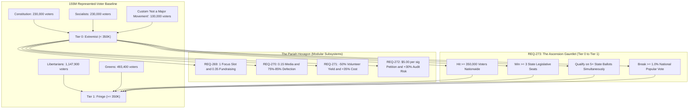

**THIS IS A REFERENCE FOR THE CODING AIs. DO NOT DO ANYTHING**

This document is reference-only. Coding AIs must not act on anything in this document unless explicitly tasked through the owner's handoff prompt. If you have questions about any requirement, route them to the Design Agent chat and reference this document as the authority.

# Coalition Builder: Party Chair — Version 0.16.4 Design Document

## 1. Release Header

- **Version:** 0.16.4 (third-digit bump from 0.16.3)
- **Release type:** Stabilization & systems-balance release. UI/engine terminology cleanup fixes, plus the Tier 0 "Extremist Movement" institutional classification system inserted below the existing 5-stage Institutional Ascent Ladder (REQ-176).
- **Workflow:** Same protocols as Version 0.16.3. Items are diagnosed/designed with the owner's architecture agent; the Design Agent numbers, sizes, and specs them; this document accumulates items one by one until the owner issues a build command. All requirements for 0.16.4 live in this one document; there is no separate workspace-backlog paste.
- **Version bump & SAVE_KEY:** Owned exclusively by the Release Integrator. Third-digit bump expected (no Huge/Large in scope); SAVE_KEY expected to remain unchanged unless the Integrator finds a genuine schema migration.
- **Status:** PACKAGED Nov 19, 2026 (owner build command: ONE lead implementing agent, sub-agents permitted under it). Master handoff prompt in Section 26. Awaiting implementation.
- **Scope so far:** REQ-266 through REQ-286 (10 Small, 11 Tiny).
- **Style-guide enforcement for this release:** Rule 1 (155,000,000 represented-voter scale, zero variance, all 51 jurisdictions), Rule 4 (zero REQ tags in player-facing UI), Rule 6.5 (universal "Politician" terminology), Rule 7 (atmospheric cable-news narrative tone; zero raw math, multipliers, or percentages in player-facing copy).

**ID renumbering note (owner's master-counter rule):** two items arrived labeled `REQ-LEG-01`/`REQ-LEG-02` and seven arrived labeled `REQ-260`–`REQ-266`. Those numeric labels were already consumed by Version 0.16.3, so the Design Agent allocated the next free master-counter IDs. Mapping: REQ-LEG-01 → **REQ-266**; REQ-LEG-02 → **REQ-267**; REQ-260 → **REQ-268** (Tier 0 classification); REQ-261 → **REQ-269** (asphyxiation/starvation); REQ-262 → **REQ-270** (media/defection); REQ-263 → **REQ-271** (civic stigma/field fricction); REQ-264 → **REQ-272** (petition lawfare); REQ-265 → **REQ-273** (ascension gauntlet); REQ-266 → **REQ-274** (branding/UI). A later batch arrived under the labels `BUG-BAL-01`/`BUG-BAL-02` (labels previously consumed as v0.16.3 QA traceability on REQ-258/259); allocated as **REQ-275** (turnout/trust parity) and **REQ-276** (support/chapter symmetry). A further item arrived labeled `REQ-264` (a third collision — that label is both a 0.16.4 Tier 0 source label and a v0.16.3 chapter-footprint ID); allocated as **REQ-277** (tier-scaled voter registration engine). A fourth batch arrived under the labels `BUG-LEAD-01`/`BUG-LEAD-02`/`BUG-LEAD-03` and `REQ-BALLOT-01`/`REQ-BALLOT-02`; allocated as **REQ-278–REQ-280** (leadership-party scoping) and **REQ-281–REQ-282** (ballot access presidential/downballot decoupling). A fifth batch arrived under the labels `REQ-FAC-01`/`REQ-FAC-02`; allocated as **REQ-283** (state EV property fix) and **REQ-284** (nationwide faction aggregation). A sixth batch arrived under the labels `REQ-FAC-03`/`REQ-FAC-04`; allocated as **REQ-285** (activist redistribution) and **REQ-286** (demographic disclaimer). All internal cross-references in this document use the renumbered IDs.

## 2. Requirements Inventory (Grouped by SIZE)

### Massive
- (none)

### Huge
- (none)

### Large
- (none)

### Medium
- (none)

### Small
- **REQ-268 — Tier 0 "Extremist Movement" Institutional Classification & Baseline Data Model**
- **REQ-269 — Tier 0 Organizational Asphyxiation & Warchest Starvation**
- **REQ-270 — Tier 0 Media Ostracization & Punitive Strategic Defection ("Radioactive Squeeze")**
- **REQ-271 — Tier 0 Civic Stigma & Street-Level Organizing Friction**
- **REQ-272 — Tier 0 Aggressive Petition Lawfare & Statutory Hostility**
- **REQ-273 — The Ascension Gauntlet: Breakthrough Milestones from Extremist (Tier 0) to Fringe (Tier 1)**
- **REQ-274 — Visual Branding, Dossier Badges & Atmospheric UI**
- **REQ-276 — Symmetric State Support & Minor Footprint Scaling in `supportByState`**
- **REQ-277 — Tier-Scaled Voter Registration & Outreach Engine (Tiers 0–5 Flat Absolute Yield & Cost Matrix)**
- **REQ-285 — Proportional Random Distribution of Non-Aligned Regional Activists to Parties**

### Tiny
- **REQ-266 — UI Display Cleanup — Resolve Raw `people`/`heritage` Strings to Democratic/Republican**
- **REQ-267 — Engine Logs & System Terminology Standardization**
- **REQ-275 — Turnout & Trust Parity at Game Start**
- **REQ-278 — Prevent Third & Custom Parties from Defaulting to Democratic Leadership Initializers**
- **REQ-279 — Enforce Strict Party Scoping in Leadership Selection Dropdowns & Assignment Engine**
- **REQ-280 — Fix Convention Running Mate & Keynote Speaker Hardcoded Major-Party Fallbacks**
- **REQ-281 — Clarify Presidential Scope & Downballot Separation in the Ballot Access Petition Panel**
- **REQ-282 — Decouple Presidential Petition Drives from Blanket Downballot Ballot Access**
- **REQ-283 — Correct State Electoral Vote Property & Label 50-State Dropdown**
- **REQ-284 — Add Nationwide Aggregation Option to the 50-State Faction Inspector**
- **REQ-286 — Ethnic & Cultural Voting Bloc Representation Disclaimer in Faction UI**

---

## 3. REQ-266 — UI Display Cleanup — Resolve Raw `people`/`heritage` Strings to Democratic/Republican

**Size:** Tiny
**Type:** Bug fix (UI terminology leak)
**Target file:** `app.js` (State Dossier, States tab KPI box, Field Director dispatch)
**Source:** Owner + QA agent diagnosis, Nov 19, 2026. *Note: submitted under the QA label "REQ-LEG-01"; allocated next free master-counter ID.*

### 3.1 Symptom
Internal prototype IDs `'people'` and `'heritage'` leak directly into user-facing interface text instead of displaying "Democrat(ic)" / "Republican" or "Dem" / "GOP":
1. **State Dossier (app.js line 5949):** `Lower: ${stateLeg[0]} · Upper: ${stateLeg[1]}` renders as `Lower: people · Upper: heritage` or `Lower: heritage · Upper: heritage`.
2. **States tab KPI box (app.js line 6347):** `<b>Lower: ${stateLeg[0]} · Upper: ${stateLeg[1]}</b>` renders raw `people` / `heritage` strings.
3. **Field Director qualitative dispatch (app.js line 5987):** `Commissioned race polling confirms a ${pollSnapshot.leader} lead of +X%` prints `"confirms a people lead"` or `"confirms a heritage lead"`.

### 3.2 Fix Specification

#### Part 1 — Helper Party Name Resolver
In `app.js`, utilize or define a clean display formatter for chamber control and leader tags:
```javascript
function formatPartyDisplayName(partyId, format = 'short') {
  if (partyId === 'people') return format === 'short' ? 'Dem' : 'Democratic';
  if (partyId === 'heritage') return format === 'short' ? 'GOP' : 'Republican';
  if (partyId === 'nonpartisan') return 'Nonpartisan';
  return partyId;
}
```
(Fallback passthrough preserves custom and third-party acronyms.)

#### Part 2 — Statehouse Chamber Control Labels (app.js lines 5949 & 6347)
- Line 5949:
```javascript
<div><small>Governor & Legislature</small><b>Gov: ${formatPartyDisplayName(stateGovParty, 'full')} · Lower: ${formatPartyDisplayName(stateLeg[0], 'short')} · Upper: ${formatPartyDisplayName(stateLeg[1], 'short')}</b></div>
```
- Line 6347:
```javascript
<b>Lower: ${formatPartyDisplayName(stateLeg[0], 'short')} · Upper: ${formatPartyDisplayName(stateLeg[1], 'short')}</b>
```

#### Part 3 — Field Director Dispatch (app.js line 5987)
Format `pollSnapshot.leader` before string interpolation:
```javascript
const leaderName = formatPartyDisplayName(pollSnapshot.leader, 'full');
// produces "confirms a Democratic lead of +..." or "a Republican lead of +..."
```

### 3.3 Save-Compatibility Notes
None. Display formatting only; no schema change, no SAVE_KEY action.

### 3.4 Acceptance Criteria
1. No state dossier, map inspector, or States tab card displays raw `people` or `heritage` in chamber control lines (all display `Dem`, `GOP`, or `Nonpartisan`).
2. Field Director dispatches always state "Democratic lead" or "Republican lead", never "people lead" or "heritage lead".
3. Custom and third-party party identifiers continue to render as before (passthrough preserved).

### 3.5 Test Plan
New script: `scripts/test-v0164-party-display-names.cjs`:
1. Render the dossier, States tab KPI, and a Field Director dispatch with `people`, `heritage`, and `nonpartisan` inputs; assert output strings contain zero occurrences of the raw tokens `people`/`heritage` in party-position slots.
2. Assert the passthrough: a custom party id string renders unchanged.
3. Regress the three call sites against their expected formats (`Dem`/`GOP` short, `Democratic`/`Republican`/`Nonpartisan` full).

---

## 4. REQ-267 — Engine Logs & System Terminology Standardization

**Size:** Tiny
**Type:** Bug fix (engine terminology leak)
**Target files:** `engine.js` (`commissionRacePoll`, `buildForecasters`, fusion logs, action notes); `scenario-2028.js` (historical election baselines); `party-systems-coalition.js` (random coalition party name generator pools)
**Source:** Owner + QA agent diagnosis, Nov 19, 2026. *Note: submitted under the QA label "REQ-LEG-02"; allocated next free master-counter ID.*

### 4.1 Symptom
Internal logging strings, action dispatches, and historical records still contain legacy references referring to Democrats as "People" or Republicans as "Heritage":
1. In `engine.js` (`buildForecasters` lines 8901–8903, `calculateAccurateRaceSnapshot` line 6354), `leader` falls back to the raw string `'people'` / `'heritage'` instead of standard party display codes.
2. In `engine.js` action logs (e.g., fusion deals, ballot access challenges), notes occasionally refer to `"people line"` or `"heritage partner"`.
3. In `party-systems-coalition.js` (lines 71 & 77), auto-generated coalition party name lists still feature generic placeholders like `"National Heritage Party"` and `"Community & Heritage Party"`, creating ambiguity with the major party archetype.

### 4.2 Fix Specification

#### Part 1 — Forecaster & Polling Snapshots (engine.js lines 8901–8906)
Ensure `leaderCode` and `runnerUpCode` consistently evaluate to `'Dem'` / `'GOP'` (or custom/third-party acronyms), and `leaderName` evaluates to `'Democratic'` / `'Republican'`.

#### Part 2 — Action Notes & Year Log (engine.js)
Audit all `lastNote` and `yearLog` strings in `engine.js` so any party reference uses proper titles ("Democratic Party" / "Republican Party") rather than internal archetype IDs.

#### Part 3 — Coalition Party Name Catalog (party-systems-coalition.js lines 71, 77)
Replace ambiguous generator entries containing `"Heritage Party"` with distinct conservative third-party titles (e.g., `"American Renewal Party"`, `"Constitutional Heritage Coalition"`, `"Traditionalist Alliance"`).

### 4.3 Save-Compatibility Notes
None. Log and generator-string updates; historical records re-render with corrected labels on next access. No schema change, no SAVE_KEY action.

### 4.4 Acceptance Criteria
1. Commissioned poll snapshots, forecaster summary objects, and game year logs output `"Dem"` / `"GOP"` or `"Democratic"` / `"Republican"` across all generated election records.
2. Zero occurrences of "People Party" or "Heritage Party" appear in any user-facing action note, modal, or generated party name pool.

### 4.5 Test Plan
New script: `scripts/test-v0164-terminology-logs.cjs`:
1. Generate forecaster summaries and poll snapshots; assert `leaderCode`/`runnerUpCode` are `Dem`/`GOP` and `leaderName` is `Democratic`/`Republican`.
2. Sweep generated action notes and year log strings; assert no `"people line"` / `"heritage partner"` style references.
3. Sample the coalition name generator; assert no output contains "Heritage Party" / "People Party".

---

## 5. REQ-268 — Tier 0 "Extremist Movement" Institutional Classification & Baseline Data Model

**Size:** Small
**Type:** System addition (Institutional Ascent architecture; extends REQ-176)
**Target files:** `data.js`, `v07-scaffolding.js`, `engine.js`, `app.js`
**Dependencies / related:** REQ-176 (5-Stage Institutional Ascent Ladder), REQ-269–REQ-274 (the rest of the Tier 0 system), REQ-240 (custom "Not a Major Movement" 100K)
**Source:** Owner + architecture agent design, Nov 19, 2026. *Note: submitted under the label "REQ-260"; renumbered by the Design Agent. Sizes per the owner's audit: Constitution (230,000 voters) and Socialist (230,000 voters) are bundled incorrectly at Tier 1 with Libertarians (1,147,900) and Greens (493,400); sub-350,000-voter parties are ideologically isolated, doctrinally uncompromising sects treated as toxic pariahs by media, donors, and the general electorate.*

### 5.1 Tier 0 System Flow



### 5.2 Fix Specification
1. Add Tier 0 at the head of `INSTITUTIONAL_TIERS` (data.js) and `FALLBACK_INSTITUTIONAL_TIERS` (v07-scaffolding.js):
   ```javascript
   {
     tier: 0,
     id: 'extremist',
     name: 'Extremist Movement',
     shortLabel: 'Extremist',
     maxFocusSlots: 1,
     badgeColor: '#b91c1c', // Deep Crimson
     description: 'Operating on the ideological periphery under intense civic stigma, radioactive ballot scrutiny, and severe media hostility.',
     nextRequirement: 'Reach 350,000 registered voters nationwide, win 3 state legislative seats, or qualify on 5 state ballots to become a recognized Fringe Party.'
   }
   ```
2. Starting tier assignments in `buildInitialPartyTiers`:
   - People (Democrats): Tier 5
   - Heritage (Republicans): Tier 5
   - Liberty (Libertarians): Tier 1 (1,147,900 voters >= 350K)
   - Green: Tier 1 (493,400 voters >= 350K)
   - Constitution: Tier 0 (230,000 voters < 350K)
   - Socialist: Tier 0 (230,000 voters < 350K)
   - Custom "Not a Major Movement": Tier 0 (100,000 voters < 350K)
3. Update `computePartyInstitutionalTierRaw(game, partyId)` in engine.js and v07-scaffolding.js:
   - Return 0 if total represented voters < 350,000 AND the party has not completed any Ascension Gauntlet milestone (REQ-273).
4. Ensure all tier indexing preserves Tier 1–5 indices and tier-scaled focus slots (1 / 3 / 5 / 7). **No index shifts:** Tier 0 is appended at the head of the ladder without renumbering anything downstream.

### 5.3 Invariants
- Rule 1: the represented-voter catalog remains 155,000,000 nationwide with zero variance across all 51 jurisdictions; the 230,000 / 493,400 / 1,147,900 figures are catalog constants.
- All existing Tier 1–5 mechanics, APIs, and functions continue to work unchanged.
- Doctrine alignment: Tier 0 hardens the intentional minor-party difficulty doctrine for sub-350K parties while leaving a legitimate growth path (REQ-273).

### 5.4 Save-Compatibility Notes
Existing saves with Constitution/Socialist/custom parties will re-evaluate to Tier 0 at next computation — expected logical recalibration, not a schema migration. SAVE_KEY unchanged expected; Release Integrator confirms.

### 5.5 Acceptance Criteria
1. At 2028 initialization: People/Heritage are Tier 5, Liberty/Green are Tier 1, Constitution/Socialist/custom (100K) are Tier 0.
2. Tier 1–5 indices and their focus-slot scale (3 / 5 / 7 for Tiers 1–5) are untouched.
3. `computePartyInstitutionalTierRaw` returns 0 for any party under 350,000 voters that has not completed an Ascension Gauntlet milestone.
4. The 155,000,000 represented-voter total is conserved across the 51 jurisdictions after the catalog audit.

### 5.6 Test Plan
New script: `scripts/test-v0164-tier0-baseline.cjs`:
1. **Baseline invariant:** assert starting-tier assignments per 5.2 item 2.
2. **Index preservation:** assert Tier 1–5 tier objects are unchanged from 0.16.3 (no index shifts).
3. **Threshold predicate:** assert `computePartyInstitutionalTierRaw` returns 0 below 350,000 voters and 1+ at or above (absent gauntlet flips).
4. **Zero-variance:** assert the national represented-voter total is exactly 155,000,000 across 51 jurisdictions.

---

## 6. REQ-269 — Tier 0 Organizational Asphyxiation & Warchest Starvation

**Size:** Small
**Type:** System addition (resource constraints & focus slots)
**Target files:** `engine.js`, `v07-scaffolding.js`
**Dependencies / related:** REQ-268 (classification), REQ-273 (unlock), REQ-264/REQ-265 from v0.16.3 (chapter footprints / zero-infrastructure custom start)
**Source:** Owner + architecture agent design, Nov 19, 2026. *Note: submitted under the label "REQ-261"; renumbered by the Design Agent.*

### 6.1 Specification
1. **Focus Slot Clamp:** update `getMaxFocusSlots(game, partyId)` to return exactly 1 Focus Slot for Tier 0 (compared to 3 for Tiers 1–2, 5 for Tiers 3–4, and 7 for Tier 5).
2. **Fundraising Starvation:** in `calculatePartyFundraising()` (engine.js), apply a 0.35 fundraising multiplier for Tier 0 parties (compared to 0.75 for Tier 1 and 1.0 for Major parties). Major institutional donors, corporate conduits, and moderate small dollars completely refuse association.
3. **Starting Warchest Cap:** starting treasury in `createGame()` for Tier 0 parties is capped at $1.0M (compared to $3.0M for Tier 1 and $30M+ for Major parties).

### 6.2 Invariants & Doctrine
- These are engine-side values only; player-facing copy never surfaces the multipliers (Rule 7) — fundraising cards describe scarcity qualitatively (donor lockouts, hostile money environment).
- The starting warchest cap applies to new games; live treasuries in existing saves are untouched.

### 6.3 Acceptance Criteria
1. A Tier 0 party has exactly 1 focus slot, 3-slot/5-slot/7-slot scaling is preserved for Tiers 1–5.
2. Tier 0 fundraising output is exactly the 0.35 multiplier case; Tier 1 remains 0.75; Major remains 1.0.
3. A new game started as Constitution, Socialist, or a custom 100K party begins with at most $1.0M treasury.

### 6.4 Test Plan
New script: `scripts/test-v0164-tier0-resources.cjs`:
1. Assert focus-slot counts per tier (Tier 0 → 1; regression: 3 / 5 / 7 for Tiers 1–5).
2. Assert fundraising multipliers per tier (0.35 / 0.75 / 1.0).
3. Assert the starting warchest cap for all three Tier 0 start cases.

---

## 7. REQ-270 — Tier 0 Media Ostracization & Punitive Strategic Defection ("Radioactive Squeeze")

**Size:** Small
**Type:** System addition (media profile & strategic defection)
**Target file:** `engine.js`
**Dependencies / related:** REQ-268, REQ-273 (unlocks), REQ-258 from v0.16.3 (ballot access walls — composes, does not conflict)
**Source:** Owner + architecture agent design, Nov 19, 2026. *Note: submitted under the label "REQ-262"; renumbered by the Design Agent.*

### 7.1 Specification
1. **Media Ostracization:** in `getMediaVisibilityProfile(game, partyId)`, assign `earnedMediaMultiplier = 0.15` (Tier 1 is 0.45) and `waveMomentumCap = 0.0`. National political wave momentum cannot carry Tier 0 parties; establishment media completely blacks them out or covers them only through hostile exposés.
2. **The "Radioactive Squeeze":** in `computeStrategicDefection(game, partyId, stateId)`, Tier 0 parties suffer an escalated 75%–85% base strategic defection rate when projected below the state viability threshold (compared to Tier 1's 42%–65%). Voters reflexively abandon extremist candidates at the ballot box to avoid "legitimizing radicals."

### 7.2 Invariants & Doctrine
- Composes with (never overrides) the v0.16.3 ballot access walls and state-level polling rules: media starvation shapes visibility, not ballot access law.
- Defection rates are engine-side; player-facing copy expresses them qualitatively (Rule 7).

### 7.3 Acceptance Criteria
1. `getMediaVisibilityProfile` for a Tier 0 party returns `earnedMediaMultiplier = 0.15` and `waveMomentumCap = 0.0`.
2. Tier 1 media values (0.45) and existing wave momentum behavior are unchanged.
3. `computeStrategicDefection` for a below-threshold Tier 0 party lands in the 75%–85% base band, and the Tier 1 band remains 42%–65%.

### 7.4 Test Plan
New script: `scripts/test-v0164-tier0-media.cjs`:
1. Assert media profile values for Tier 0 and regression values for Tier 1/Major.
2. Assert wave momentum contribution is zero for Tier 0 in a national wave scenario.
3. Assert strategic defection bands for Tier 0 (75%–85%) and Tier 1 (42%–65%) against a controlled threshold matrix.

---

## 8. REQ-271 — Tier 0 Civic Stigma & Street-Level Organizing Friction

**Size:** Small
**Type:** System addition (field operations & persuasion penalties)
**Target file:** `engine.js`
**Dependencies / related:** REQ-268, REQ-273 (normalization on promotion), REQ-265 from v0.16.3 (custom zero-infrastructure start)
**Source:** Owner + architecture agent design, Nov 19, 2026. *Note: submitted under the label "REQ-263"; renumbered by the Design Agent.*

### 8.1 Specification
1. **Street-Level Organizing Resistance:** Volunteer Drive actions executed by Tier 0 parties suffer a -50% yield penalty and require +35% more Organizing Actions/cash, modeling severe local pushback, door-slamming, and civic bans.
2. **Civic Pariah Persuasion Penalty:** persuasion rolls in moderate, educated, or suburban districts suffer an inherent -4.5% Pariah Penalty, reflecting toxic brand recognition among mainstream voters.

### 8.2 Invariants & Doctrine
- Penalty application must respect Rule 6.5 terminology in any affected copy ("Politician", not internal labels).
- All values are engine-side; field reports express the stigma qualitatively (Rule 7).

### 8.3 Acceptance Criteria
1. Tier 0 Volunteer Drive yields are exactly 50% of baseline; organizing action/cash requirements are +35%.
2. Tier 0 persuasion rolls in qualifying districts carry the -4.5% penalty; non-qualifying districts are unaffected.
3. Non-Tier 0 parties' volunteer and persuasion math are unchanged.

### 8.4 Test Plan
New script: `scripts/test-v0164-tier0-fieldops.cjs`:
1. Volunteer Drive yield and cost checks for Tier 0 vs baseline.
2. Persuasion roll deltas in moderate/educated/suburban districts vs. others.
3. Regression: identical actions for Tier 1/Major parties produce pre-patch values.

---

## 9. REQ-272 — Tier 0 Aggressive Petition Lawfare & Statutory Hostility

**Size:** Small
**Type:** System addition (ballot access & legal defense)
**Target files:** `ballot-access.js`, `engine.js`
**Dependencies / related:** REQ-268, REQ-273 (cost normalization on promotion), REQ-258 from v0.16.3 (access walls)
**Source:** Owner + architecture agent design, Nov 19, 2026. *Note: submitted under the label "REQ-264"; renumbered by the Design Agent.*

### 9.1 Specification
1. **Lawfare Petition Inflation:** in `ballot-access.js`, petition drive signature acquisition costs rise to $5.00 per valid signature (up from $3.50), reflecting the difficulty of finding registered voters willing to sign and reliance on specialized circulators.
2. **Heightened Legal Scrutiny:** signature audit challenge probability by rival major parties increases by +30%, with aggressive legal challenges seeking signature invalidation.

### 9.2 Invariants & Doctrine
- Tier 0-only pricing: petition costs normalize to $3.50 upon Ascension Gauntlet promotion (see REQ-273). Non-Tier 0 parties see no change.
- Composes with (never overrides) the REQ-258 (v0.16.3) zero-access hard wall.

### 9.3 Acceptance Criteria
1. Tier 0 petition signature costs are exactly $5.00; all other tiers remain $3.50.
2. Audit challenge probability for Tier 0 petitions is +30% above baseline.
3. Ballot access law and the zero-access wall logic are otherwise unchanged.

### 9.4 Test Plan
New script: `scripts/test-v0164-tier0-petitions.cjs`:
1. Per-signature cost checks for Tier 0 vs other tiers.
2. Audit challenge probability delta (+30%) for Tier 0 petitions.
3. Regression: identical petition drives for Tier 1/Major parties produce pre-patch values.

---

## 10. REQ-273 — The Ascension Gauntlet: Breakthrough Milestones from Extremist (Tier 0) to Fringe (Tier 1)

**Size:** Small
**Type:** System addition (progression state machine & narrative milestones)
**Target files:** `engine.js`, `data.js`, `app.js`
**Dependencies / related:** REQ-268 (classification predicate), REQ-269 (unlocks), REQ-270 (unlocks), REQ-271 (normalizations), REQ-272 (normalizations), REQ-224 (statehouse seats synergize with Path 2)
**Source:** Owner + architecture agent design, Nov 19, 2026. *Note: submitted under the label "REQ-265"; renumbered by the Design Agent.*

### 10.1 Specification

#### Part 1 — Breakthrough Predicate
To elevate from Tier 0 to Tier 1, the party must achieve ANY ONE of four explicit breakthrough milestones:
- **Path 1 (Grassroots Expansion):** reach >= 350,000 represented registered voters nationwide.
- **Path 2 (Statehouse Foothold):** win and hold >= 3 state legislative seats nationwide (synergizing with REQ-224).
- **Path 3 (Statutory Multi-State Footprint):** certify and retain official ballot access in >= 5 states simultaneously.
- **Path 4 (Federal Popular Vote Beachhead):** win >= 1.0% of the national popular vote in a federal election cycle.

#### Part 2 — "Crossing into the Fringe" Milestone Modal
Upon achieving any condition, fire an atmospheric modal announcing that the party has broken through total public isolation and sheds its pariah stigma. Modal copy follows Rule 7: qualitative cable-news narrative, no raw multipliers, no REQ tags.

#### Part 3 — Immediate Unlocks
- Focus slots expand from 1 to 3.
- Earned media triples (0.15 → 0.45); wave momentum cap lifts to 1.5.
- Strategic defection penalty drops from the ~80% Tier 0 rate to the Tier 1 baseline (42%–65%).
- Petition costs normalize ($5.00 → $3.50) and volunteer yields normalize.

### 10.2 Invariants
- Promotion is permanent progression (no demotion back to Tier 0 within this requirement's scope; reclassification below 350K voters post-promotion is governed by REQ-268's predicate: once a gauntlet milestone is completed, the party never evaluates to Tier 0 again).
- All unlock values correspond exactly to the Tier 1 baselines specified in REQ-269, REQ-270, REQ-271, and REQ-272.

### 10.3 Acceptance Criteria
1. Each of the four paths independently triggers clean promotion to Tier 1 when achieved.
2. The milestone modal fires exactly once per promotion, with Rule 7 copy.
3. All four unlock groups take effect immediately on promotion, matching Tier 1 baselines exactly.
4. A promoted party never re-evaluates to Tier 0 by falling back below 350,000 voters (milestone memory persists in save data).

### 10.4 Save-Compatibility Notes
Milestone-completion memory must persist in save state. For existing 0.16.3-era saves of now-Tier 0 parties that already satisfy a gauntlet condition, promote on next evaluation (one-time catch-up). Release Integrator decides whether this memory requires a SAVE_KEY bump (a new persisted field may qualify; expected small — integrator's call per protocol).

### 10.5 Test Plan
New script: `scripts/test-v0164-ascension-gauntlet.cjs`:
1. **Path independence:** simulate each of the four milestones separately; assert promotion and unlocks each time.
2. **Unlock fidelity:** assert focus slots, media multiplier, wave cap, defection band, petition cost, and volunteer yield all match Tier 1 baselines post-promotion.
3. **Permanence:** drop a promoted party under 350,000 voters; assert it stays Tier 1 (milestone memory persists across a save/load cycle).
4. **Zero-variance:** assert registration gains and defection shifts across the gauntlet conserve exactly 155,000,000 voters nationwide.

---

## 11. REQ-274 — Visual Branding, Dossier Badges & Atmospheric UI

**Size:** Small
**Type:** System addition (UI rendering & atmospheric copy)
**Target files:** `app.js`, `styles.css`
**Dependencies / related:** REQ-268 (tier data), REQ-273 (progress strip data), REQ-254 from v0.16.3 (semantic theme variables — the new badge must bind to them)
**Source:** Owner + architecture agent design, Nov 19, 2026. *Note: submitted under the label "REQ-266"; renumbered by the Design Agent.*

### 11.1 Specification
1. **Institutional Dossier Badge:** render a deep crimson badge `[ Tier 0 · Extremist Movement ]` in the party header dossier, using `badgeColor: '#b91c1c'` from the tier object (data.js, REQ-268).
2. **Qualitative Atmospheric Tooltip (Rule 7):** display "Operating on the ideological periphery under intense civic stigma, radioactive ballot scrutiny, and severe media hostility." Strictly avoid raw mathematical multipliers (0.15, 0.35, 75%) or REQ-XX tags in game copy.
3. **Next Milestone Progress Strip:** render a live qualitative progress meter tracking distance to the nearest Ascension Gauntlet breakthrough path (REQ-273).

### 11.2 Invariants
- Rule 4: zero REQ tags in the UI. Rule 7: the progress strip is qualitative (e.g., narrative distance cues), never numeric percentages of milestone progress.
- The badge must bind to the existing semantic CSS custom properties for text/line/panel coloring (composes with the v0.16.3 theme binding work) so it renders correctly in light and dark dashboard modes; only the crimson badge background is tier-supplied.

### 11.3 Acceptance Criteria
1. A Tier 0 party's dossier shows the deep crimson Tier 0 badge with the exact tooltip copy above.
2. The progress strip updates live as each gauntlet path's distance changes, in Rule 7 language.
3. No raw multipliers, percentages, or REQ tags appear anywhere in the new UI surfaces.
4. The badge and strip render correctly in light and dark modes.

### 11.4 Test Plan
New script: `scripts/test-v0164-tier0-ui.cjs`:
1. Badge presence, label text, and color rendering for a Tier 0 party.
2. Tooltip string equality with the exact Rule 7 copy; strip text contains no digits, `%`, or `REQ-` tokens.
3. Progress strip responds to changes in each of the four gauntlet paths.
4. Static theme check: badge rules reference semantic variables; hardcoded values limited to the tier-supplied crimson.

---

## 12. REQ-275 — Turnout & Trust Parity at Game Start

**Size:** Tiny
**Type:** Bug fix (balance parity; unearned player advantage removal)
**Target files:** `engine.js` (`turnout`, `computeWaveMomentum`, `createGame`)
**Source:** Owner + QA agent diagnosis, Nov 19, 2026. *Note: submitted under the label "BUG-BAL-01" (label previously consumed as v0.16.3 QA traceability on REQ-258); allocated next free master-counter ID.*

### 12.1 Symptom
At game start, the player's party receives an artificial, hardcoded advantage in turnout and national wave momentum regardless of party selected:
1. **Hardcoded turnout base (engine.js line 6813):** `const base = party.id === 'player' ? 62 : 58;` — the player party gets a +4.0% base turnout bonus simply for being human-controlled.
2. **One-sided morale turnout bonus (engine.js line 6819):** `morale = party.id === 'player' ? (averageStandings - 50) * 0.13 : 0;` — player factions initialize at standing 64, granting an immediate unearned +1.82% turnout lift; rivals receive 0.
3. **Initial trust asymmetry (engine.js lines 8563–8570):** `playerTrust` defaults to 88, `rivalTrust` to 78. The +10 gap injects an automatic +1.2-point positive wave momentum into the player's races on turn 1 (`trustDiff = (138 - 128) * 0.12`).

Combined, the player party starts with an unearned ~13-point turnout and momentum advantage on turn 1.

### 12.2 Fix Specification
1. **Turnout base parity (engine.js line 6813):** equalize the base across player and rivals:
   ```javascript
   const base = 58; // Symmetric starting baseline for all parties
   ```
2. **Morale lift parity (engine.js lines 6819–6821):** symmetrize faction morale in `turnout()` so rival parties evaluate their faction standings with the same formula the player uses (apply the `(averageStandings - 50) * 0.13` term to all parties using their own faction standings). Producer's note: applying the uniform formula to rivals is preferred over zeroing the player term, because it preserves the standing-driven turnout dynamic as a real mechanic for everyone rather than deleting it.
3. **Trust symmetry at initialization (`createGame` in engine.js):** initialize both the player's party and major rivals with equal base supporter trust — 80 for major parties (people/heritage), 65 for minor parties (Liberty/Green/Constitution/Socialist/custom) — so `computeWaveMomentum` starts neutral (`trustDiff = 0`) before any player decision occurs. Trust then diverges through gameplay as designed.

### 12.3 Invariants & Interplay
- **Doctrine alignment:** this removes unearned human-player subsidies, hardening the no-free-advantage minor-party difficulty doctrine. Difficulty must come from systems, not from asymmetric `party.id === 'player'` constants.
- Composes with v0.16.3's REQ-259 (starting ≤3.0% polling ceilings) and REQ-261/262 environment calibration: the parity fix restores symmetric inputs; the ceilings and environment math are unchanged.
- Composes with REQ-270 of this release: `waveMomentumCap = 0.0` still zeroes wave momentum for Tier 0 parties on top of the now-neutral starting trust; the two mechanisms are independent and must not be merged.
- All values are engine-side; no player-facing copy changes (Rule 7 untouched).

### 12.4 Save-Compatibility Notes
Existing saves: trust and standings values already in save data are not rewritten (no schema change). The fix applies to new initializations in `createGame`; mid-game saves already carry evolved trust values. SAVE_KEY expected unchanged.

### 12.5 Acceptance Criteria
1. On turn 1 of a new game, every party's turnout base is identical (58); no `party.id === 'player'` branch remains in the base or morale terms of `turnout()`.
2. Rival parties' turnout reflects their own faction standings via the same morale formula.
3. `computeWaveMomentum` evaluates to 0.0 for the player at game start (`trustDiff = 0`) before any actions; player and major rivals initialize at equal trust (80/80 majors, 65/65 minors).
4. Mid-game morale and trust drift still function (post-decision asymmetry from gameplay is unaffected).

### 12.6 Test Plan
New script: `scripts/test-v0164-start-parity.cjs`:
1. Initialize a standard race and a custom-party race; assert unified turnout base (58) for all parties and zero player-only morale branches.
2. Compare player vs rival turnout for identical faction standings; assert equality.
3. Assert starting trust pairs are equal (majors 80/80, minors 65/65) and starting `computeWaveMomentum` == 0.
4. Regression: after simulated gameplay actions, trust divergence and standing-driven morale still produce different turnouts.

---

## 13. REQ-276 — Symmetric State Support & Minor Footprint Scaling in `supportByState`

**Size:** Small
**Type:** Bug fix (balance parity; human-minor selection poll jump)
**Target files:** `engine.js` (`supportByState`, `organizationFor`)
**Source:** Owner + QA agent diagnosis, Nov 19, 2026. *Note: submitted under the label "BUG-BAL-02" (label previously consumed as v0.16.3 QA traceability on REQ-259); allocated next free master-counter ID. Supplemented later the same day with additional acceptance criteria (see 13.5 items 6–7).*

### 13.1 Symptom
In `supportByState(game, state)` (lines 6672–6675), `rawCampaign` treats the player party asymmetrically from rivals:
1. **Footprint scaling omission for player minor parties:** rival minor parties have their campaign lift multiplied by `footprintScale` (0.35 for third parties, 0.08 for micro-minors), but the `sameAsPlayer` path omits `footprintScale`, letting a human-led third party (Libertarian, Green, Socialist, Constitution, custom) receive 100% full-scale campaign lift on turn 1 — minor parties jump 2x–7x in national polls the moment the player selects them.
2. **One-sided public mood injection:** `(game.publicMood * mediaProfile.earnedMediaMultiplier)` is added directly into the player's `rawCampaign`, while rivals receive 0 for public mood.
3. **Regional chapter asymmetry (`organizationFor`):** the player defaults to 2 chapters per region (`game.chapters`), rivals to 1.

### 13.2 Fix Specification
1. **Apply `footprintScale` to minor parties uniformly:** in `supportByState`, scale minor-party campaign lift by `footprintScale` regardless of human or NPC control:
   ```javascript
   const playerCampaignScale = isMajor ? 1.0 : footprintScale;
   ```
   A human player chairing a minor party starts at the realistic footprint scale (0.35 for third parties, 0.08 for micro-minors) and unlocks fuller scale through institutional tier breakthroughs (this release's REQ-273 Ascension Gauntlet promotion and the existing tier ladder).
2. **Symmetrize `publicMood` and baseline lifts:** apply the macro environment and public-mood contribution symmetrically across parties via each party's own `mediaProfile.earnedMediaMultiplier`, rather than injecting a raw lift exclusively into the player's array entry.
3. **Starting regional chapter parity (`organizationFor` in engine.js):** align starting regional chapter baselines so player and rival organizations evaluate from matching baseline structures. Producer's note: parity must be achieved by mirroring the rival logic path for the player — NOT by granting chapters. It must not resurrect v0.16.3's REQ-265 zero-infrastructure custom start (custom parties still start with 0 chapters) and must preserve REQ-264's verbatim rival chapter footprints (Liberty 80 / Green 40 / Socialist 15 / Constitution 15).

### 13.3 Invariants & Interplay
- **Doctrine alignment:** selecting a minor party must not change its standing. National polls on turn 1 must be identical whether a party is human- or AI-controlled — identical to the designer-authored difficulty (the "2x–7x poll jump on selection" is the canonical statement of this bug).
- Composes with (never overrides) v0.16.3's REQ-258 zero-access walls and REQ-259 ≤3.0% starting ceilings: footprint correction shapes the campaign-lift term inside those walls; the walls and ceilings themselves are untouched.
- Composes with this release's Tier 0 system: a Tier 0 human party's mood contribution is already gated by REQ-270's `earnedMediaMultiplier = 0.15`, so symmetrization plus Tier 0 media ostracization correctly yields near-zero mood lift — the multipliers must compose multiplicatively, with no double-dipping or override.
- Composes with REQ-275: both restore start-of-game symmetry (turnout/momentum vs. support footprint); they touch separate functions and must not be entangled in implementation.
- All values are engine-side; no player-facing copy changes (Rule 7 untouched).

### 13.4 Save-Compatibility Notes
Existing saves with human minor parties will see their `supportByState` outputs recalculate to footprint-scaled values at next evaluation — expected recalibration, not a schema change. No SAVE_KEY action.

### 13.5 Acceptance Criteria
1. A minor party's national/state polling numbers are identical on turn 1 whether selected by the human player or left as an NPC (A/B test).
2. `footprintScale` (0.35 / 0.08) applies to human-controlled minor parties at game start; full campaign scale unlocks via institutional tier progression.
3. The public-mood contribution to `rawCampaign` is symmetric across all parties (each gated by its own `earnedMediaMultiplier`).
4. `organizationFor` evaluates the player from the same baseline structure as rivals; v0.16.3's REQ-265 zero-chapter custom start and REQ-264 rival footprints are preserved.
5. Major-party support math (people/heritage) is unchanged by this fix.
6. Starting a game as Libertarian, Green, Socialist, or Constitution does not cause an immediate jump in initial baseline national polling above their design baselines (~1.8% for Liberty/Green, ~0.2% for Socialist/Constitution).
7. Running `supportByState` on a state where the player and a rival have identical chapters, membership, and ideological alignment yields equal campaign scores.

### 13.6 Test Plan
New script: `scripts/test-v0164-support-symmetry.cjs`:
1. **A/B selection test:** initialize two games with the same minor party, one human-controlled and one NPC; assert identical `supportByState` outputs in all 51 jurisdictions on turn 1.
2. **Footprint regression:** assert footprintScale values applied by tier (1.0 majors / 0.35 third / 0.08 micro) for both human and NPC control paths.
3. **Mood symmetry:** sweep `publicMood` values; assert the mood term is present and equal (via each party's media multiplier) for all parties.
4. **Chapter parity:** assert `organizationFor` player/rival baseline parity, custom-party 0-chapter start (REQ-265), and verbatim rival footprints (REQ-264).
5. **Wall regression:** REQ-258 gates (no ballot access → 0.0%) and REQ-259 start ceilings (≤3.0% at 2028 init) still hold after the fix.
6. **Design-baseline preservation (supplemented Nov 19):** start games as Liberty, Green, Socialist, and Constitution; assert turn-1 national polling lands at the design baselines (~1.8% Liberty/Green, ~0.2% Socialist/Constitution) with no selection-driven jump.
7. **Identical-inputs equality (supplemented Nov 19):** with player and rival state inputs equalized (chapters, membership, ideological alignment), assert equal `rawCampaign` scores for both parties.

---

## 14. REQ-277 — Tier-Scaled Voter Registration & Outreach Engine (Tiers 0–5 Flat Absolute Yield & Cost Matrix)

**Size:** Small
**Type:** System rework (action economy & voter model integration)
**Target files:** `engine.js`, `app.js`
**Dependencies / related:** REQ-165 (Voter Registration Base Action), REQ-176 (5-Stage Institutional Ascent Ladder), REQ-268 (Tier 0 Extremist Classification; submitted under the label "REQ-260")
**Source:** Owner + architecture agent design, Nov 19, 2026. *Note: submitted under the label "REQ-264" (third collision — that label is both a 0.16.4 Tier 0 source label and a v0.16.3 chapter-footprint ID); allocated next free master-counter ID.*

### 14.1 Problem Statement
Statewide Voter Registration currently charges a flat $5.0M across all parties and scales returns by state Electoral Votes (EV), penalizing cash-poor minor parties and punishing organizing in low-EV battleground states. Replacing EV scaling with an absolute flat voter yield and scaling treasury costs at $1M per tier ($0M for Tier 0) establishes a fair, predictable registration engine accessible to third parties from day one.

### 14.2 Mechanical Specification

**1. Tier-Scaled Treasury Cost Formula (engine.js):**
- Every execution consumes exactly 1 Organizing Action.
- Treasury cost scales strictly by party tier: `cost = tier * 1.0` (in millions):
  - Tier 0 (Extremist): $0M (cash-free; organized through volunteer labor)
  - Tier 1 (Fringe): $1.0M
  - Tier 2 (Ballot-Qualified Minor): $2.0M
  - Tier 3 (Federally Recognized): $3.0M
  - Tier 4 (Debate Contender): $4.0M
  - Tier 5 (Major Party): $5.0M

**2. Flat Absolute Voter Yield Formula (engine.js):**
- Eliminates the state EV multiplier; awards a fixed, absolute voter gain directly to `targetState`:
  - Tier 0: +100 registered voters
  - Tier 1: +1,000 registered voters
  - Tier 2: +2,000 registered voters
  - Tier 3: +3,000 registered voters
  - Tier 4: +5,000 registered voters
  - Tier 5: +10,000 registered voters
- Registered voters are added directly to the state party affiliations and registered rolls in `voterModel`, conserving the 155,000,000 represented-voter scale.

**3. Dynamic UI Rendering (app.js):**
- **Card header badge:** dynamically displays "1 action · $0M" (Tier 0), "1 action · $1M" (Tier 1), etc., based on the player party's tier.
- **Card description:** dynamically renders the current flat yield: "Target demographic communities or unaligned Independents inside a state to permanently expand your party's registered voter base (+{tierYield} registered voters at current institutional status)."
- **State selection dropdown:** retains the state picker, cleanly showing state name without EV-dependent math.
- **Button state:** disables only if `game.actionsLeft <= 0` OR `game.treasury < tierCost` (Tier 0 is never disabled for lack of funds).

### 14.3 Invariants & Interplay
- **Rule 1 conservation (two-ledger rule, per v0.16.3 REQ-248):** registered-voter gains are *transfers* into the party's state affiliation/registered blocks, not new voter creation. The donating blocks (unaligned Independents / opposing rolls) decrement by the same represented-voter amounts; the national total remains exactly 155,000,000 across all 51 jurisdictions.
- **Rule 7 / Rule 4:** the card copy's concrete registered-voter count is permitted (consistent with the 0.16.3 REQ-245 voter-count displays); no multipliers, percentages, formulas, or REQ tags appear in UI copy.
- **No player-only branches:** the cost/yield matrix keys strictly off institutional tier (REQ-176/REQ-268), consistent with this release's REQ-275/REQ-276 parity doctrine — no human-player carve-outs.
- **REQ-271 non-stacking note:** REQ-271's civic-stigma friction (-50% yield, +35% cost) targets Volunteer Drive actions; this engine's tier matrix already encodes Tier 0 economics (cash-free, minimal yield), so REQ-271 penalties must NOT stack onto registration drives. Do not double-tax the same action.
- **REQ-273 doctrine note:** Tier 0's +100-per-action yield is a deliberately slow but legitimate growth path toward the Ascension Gauntlet (Path 1: 350,000 voters); difficulty is encoded in the grind, not in inaccessibility.
- Composes with REQ-259 (v0.16.3) starting ceilings: registered-voter rolls are affiliation bookkeeping, not polling share; registration gains do not bypass the ≤3.0% 2028 initialization clamp.

### 14.4 Save-Compatibility Notes
No schema change expected. Existing saves recalculate the action's cost/yield from the party's tier at execution time. Release Integrator confirms at build; no SAVE_KEY action expected.

### 14.5 Acceptance Criteria
1. Executing registration in Wyoming (3 EV) and Pennsylvania (19 EV) awards identical absolute gains: +100 (T0), +1,000 (T1), +2,000 (T2), +3,000 (T3), +5,000 (T4), +10,000 (T5).
2. Tier 0 movements can execute registration drives with a $0 treasury balance.
3. Treasury deductions match `tierCost` exactly ($0M, $1M, $2M, $3M, $4M, $5M); every execution consumes exactly 1 Organizing Action.
4. The incoming voters are balanced by equal outflows from donor blocks; the national represented-voter total is exactly 155,000,000 after every execution.
5. Card header, description, and button states render dynamically per the player party's tier; Tier 0's button is never disabled for lack of funds.
6. Zero REQ-XX tags in UI markup per GAME_STYLE_GUIDE.md Rule 4.

### 14.6 Test Plan
New script: `scripts/test-v0164-tier-registration.cjs`:
1. **EV decoupling:** execute registration in Wyoming and Pennsylvania at each tier; assert identical absolute gains and exact treasury deductions per the tier matrix.
2. **Tier matrix sweep:** assert yields 100 / 1,000 / 2,000 / 3,000 / 5,000 / 10,000 and costs 0 / 1 / 2 / 3 / 4 / 5 (millions) for Tiers 0–5, each consuming exactly 1 Organizing Action.
3. **Tier-0 zero-funds path:** execute with `treasury = 0` at Tier 0; assert success and zero deduction; assert the button is not disabled for lack of funds.
4. **Conservation:** after each execution, assert donor-block decrements match the gain and the national total remains exactly 155,000,000 across 51 jurisdictions.
5. **Non-stacking regression:** assert REQ-271 penalties do not alter registration drive costs/yields.
6. **UI sweep:** assert dynamic badge, description yield interpolation, state picker, and disabled-state logic per tier; assert zero `REQ-` tokens and zero percentage strings in rendered cards.

---

## 15. REQ-278 — Prevent Third & Custom Parties from Defaulting to Democratic Leadership Initializers

**Size:** Tiny
**Type:** Bug fix (party-identity fallback leak)
**Target file:** `v07-scaffolding.js` (`hydrateV07GameState` lines 755–757, `initializeLeadershipRolesForParty` lines ~610–613)
**Source:** Owner + QA agent diagnosis, Nov 19, 2026. *Note: submitted under the label "BUG-LEAD-01"; allocated next free master-counter ID.*

### 15.1 Symptom
1. In `hydrateV07GameState` (lines 755–757), `playerIdentity` is determined via `['people', 'heritage', 'liberty', 'green'].includes(game.player.baseTemplateId)`. For the Constitution Party (`constitution`), Socialist Party (`socialist`), or a custom party, this check fails and falls back to `'people'` (Democratic).
2. Because `playerIdentity` evaluates to `'people'`, `initializeLeadershipRolesForParty(hydrated, 'people')` runs at game start, assigning Democratic politicians (Chuck Schumer, Alexandria Ocasio-Cortez, Hakeem Jeffries, Elizabeth Warren, Jim Clyburn, Tim Walz, Jon Ossoff) to the player's leadership roles.
3. In line 612, `speakerOfHouse` uses an unconditional fallback to `house:NY-8` (Hakeem Jeffries) with no party check, leaking a Democratic fallback into other parties.

### 15.2 Fix Specification
1. **Identity resolution (lines 755–757):** recognize all supported party IDs:
   ```javascript
   const playerIdentity = game.player.custom
     ? 'player'
     : (game.player.baseTemplateId || game.player.id || 'people');
   ```
2. **Speaker fallback (lines 610–613):** `findMemberId` returns `'house:NY-8'` only when `partyIdentityId === 'people'`; for any other party lacking a House representative, `speakerOfHouse` is `null`.
3. **Vacant-by-default rule:** when initializing leadership roles for any party lacking seated politicians in the required chamber/office, the role defaults to `null` (Vacant) rather than selecting an out-of-party politician.

### 15.3 Invariants & Interplay
- **Oracle rule:** the full set of supported playable parties is recognized (`people`, `heritage`, `liberty`, `green`, `constitution`, `socialist`, custom); no party falls through to a major-party default.
- **Adjacency:** REQ-279 (dropdown/assignment scoping) and REQ-280 (convention fallbacks) finish the same party-scoping doctrine in other surfaces; implement together wherever functions overlap.
- Composes with the custom-party lifecycle flows hardened in v0.16.3 (REQ-245/246): `game.player.custom ? 'player'` matches the custom-creator identity path.
- **Doctrine alignment:** consistent with this release's parity theme — a third party begins with an authentic, mostly vacant bench, not a borrowed major-party establishment.
- Rule 6.5: any role-null UI renders with "Politician" terminology; no archetype IDs in copy.

### 15.4 Save-Compatibility Notes
Existing third/custom-party saves hydrate with the corrected identity on next load; previously assigned out-of-party leaders are not retroactively removed by this requirement (see REQ-279's engine-side rejection for new assignments). No schema change; SAVE_KEY expected unchanged.

### 15.5 Acceptance Criteria
1. Starting a game as Libertarian, Green, Constitution, Socialist, or a custom party initializes all unseated institutional leadership roles to `null` (Vacant).
2. No Democratic or Republican politician IDs appear in `game.player.leadershipRoles` or `game.leadershipRoles.player` for third parties at game start.
3. `playerIdentity` resolves for every supported playable party without falling through to `'people'`.
4. `speakerOfHouse` is non-null only for parties with a genuine House member (including `'people'`'s `house:NY-8` fallback).

### 15.6 Test Plan
New script: `scripts/test-v0164-leadership-initializers.cjs`:
1. Start games as every supported playable party (including custom); assert resolved `playerIdentity` and that unseated roles are `null`.
2. Assert no `people:`/`heritage:` politician IDs exist in third-party or custom `leadershipRoles` at initialization.
3. Assert the NY-8 speaker fallback fires only for `'people'`.
4. Cross-check that people/heritage games initialize their intended leadership benches unchanged (regression).

---

## 16. REQ-279 — Enforce Strict Party Scoping in Leadership Selection Dropdowns & Assignment Engine

**Size:** Tiny
**Type:** Bug fix (cross-party appointment leak)
**Target files:** `app.js` (`role selection dropdown` ~line 6733–6734, `partyLeaderPool` lines 3230–3233), `engine.js` (`assign-leadership-role` handler lines 13263–13287)
**Source:** Owner + QA agent diagnosis, Nov 19, 2026. *Note: submitted under the label "BUG-LEAD-02"; allocated next free master-counter ID.*

### 16.1 Symptom
1. **Dropdown incumbent leak (app.js ~6733):** the role dropdown renders an incumbent placeholder when `holder && !pool.some((p) => p.id === holder.id)`, generating a selectable `<option>` for an out-of-party Democrat/Republican incumbent.
2. **Keynote/Tour pool leak (app.js 3230–3233):** `partyLeaderPool` maps `appointedLeaderIds` to member records without filtering by `m.party === identity`, letting out-of-party politicians leak into the Step 4 National Convention Keynote Speaker and Tour Leader dropdowns.
3. **Engine-side validation gap (engine.js 13263–13287):** the `assign-leadership-role` handler validates chamber/office requirements but never validates `member.party === playerIdentityId`, permitting cross-party leader appointments.

### 16.2 Fix Specification
1. **Incumbent option (app.js ~6733):** render the existing holder option only when `holder.party === identity` (or, for custom parties, `holder.party === 'player' || !holder.party`). Suppress out-of-party incumbents from rendering.
2. **Empty-pool option (app.js ~6734):** when `pool.length === 0`, render:
   ```html
   <option value="" disabled>— No Eligible Party Members Available —</option>
   ```
3. **Pool filtering (app.js 3231–3233):** restrict `partyLeaderPool` strictly to the player's own party:
   ```javascript
   const partyLeaderPool = appointedLeaderIds
     .map((id) => memberById(id))
     .filter((m) => m && (m.party === identity || (identity === 'player' && (!m.party || m.party === 'player'))));
   ```
4. **Engine validation (engine.js ~13263):** add a party check to the `assign-leadership-role` handler:
   ```javascript
   const memberParty = member.party || (member.id?.startsWith('custom-') ? 'player' : null);
   if (memberParty && memberParty !== playerIdentityId && !(playerIdentityId === 'player' && memberParty === 'player')) {
     return {
       ...game,
       lastNote: `Cannot assign ${member.name}: belongs to another party.`,
     };
   }
   ```

### 16.3 Invariants & Interplay
- **Defense in depth:** UI filtering (items 1–3) and engine validation (item 4) are BOTH required; the engine check is the security boundary, the UI checks are courtesy rendering.
- The rejection note (item 4) is an engine-localized player message; it uses the politician's name (Rule 6.5 compliant), no internal archetype IDs, no REQ tags.
- Composes with REQ-278 (initializers) and REQ-280 (convention fallbacks): together they enforce "your party's bench only" across initialization, appointment, and convention surfaces.
- Custom-party note: custom politicians (`custom-*` IDs) resolve to `'player'` party; never filtered out of their own party's pools.

### 16.4 Save-Compatibility Notes
Existing saves that already hold out-of-party appointments are not force-cleaned by this requirement (engine rejects new ones; UI hides legacy ones). Optional one-time cleanup is a Release Integrator call at implementation. No schema change.

### 16.5 Acceptance Criteria
1. Third-party leadership dropdowns never display Democratic or Republican politicians.
2. If a third party has no seated politicians for a chamber-exclusive role (Senate Leader, House Leader, Speaker, Whips, Gov Assoc Chair), the dropdown displays `— Vacant —` and `— No Eligible Party Members Available —`.
3. Keynote Speaker and Tour Leader dropdowns in Step 4 contain only valid members of the player's own party.
4. The `assign-leadership-role` engine action rejects appointments of politicians from rival parties with the party-scoping note.

### 16.6 Test Plan
New script: `scripts/test-v0164-leadership-scoping.cjs`:
1. Render role dropdowns for each third party with an out-of-party incumbent; assert no rival-party `<option>` appears; assert empty-pool placeholder text.
2. Build `partyLeaderPool` with mixed-party `appointedLeaderIds`; assert only own-party members survive filtering; assert custom-member passthrough for custom parties.
3. Invoke `assign-leadership-role` with cross-party members; assert rejection; assert same-party and custom-party assignments succeed.
4. Regression: people/heritage appointment flows behave identically to pre-patch (their own benches are untouched).

---

## 17. REQ-280 — Fix Convention Running Mate & Keynote Speaker Hardcoded Major-Party Fallbacks

**Size:** Tiny
**Type:** Bug fix (convention data-generation fallback leak)
**Target file:** `presidential-primaries.js` (`nominatingConventionModalMarkup` data generator, lines 836–855)
**Source:** Owner + QA agent diagnosis, Nov 19, 2026. *Note: submitted under the label "BUG-LEAD-03"; allocated next free master-counter ID.*

### 17.1 Symptom
In `presidential-primaries.js:836–855`, when convention data is built for a party with fewer than 4 prospective VP contenders or zero sitting keynote speakers (the common case for third parties without federal officeholders), the fallback hardcodes major-party politicians:
- `name: partyId === 'people' ? 'Sen. Tammy Baldwin' : 'Gov. Chris Sununu'`
- `name: partyId === 'people' ? 'Gov. Andy Beshear' : 'Sen. Tim Scott'`

Third parties therefore receive Republican figures (Chris Sununu, Tim Scott), and custom parties falling back to `'people'` receive Democratic figures.

### 17.2 Fix Specification
Update the fallback generation so third and custom parties draw running mates and keynote speakers from party-aligned archetype names or candidate records rather than hardcoded Democratic/Republican politicians:
- `partyId === 'liberty'`: Libertarian leaders (e.g., Chase Oliver, Mike ter Maat).
- `partyId === 'green'`: Green leaders (e.g., Jill Stein, Kshama Sawant).
- `partyId === 'constitution'`: Constitution Party leaders (e.g., Randall Terry, Scott Bradley).
- `partyId === 'socialist'`: Socialist leaders (e.g., Claudia De la Cruz, Brian Carroll).
- Custom or generated parties: generate synthetic party-aligned bench leaders matching the party's identity rather than borrowing major-party politicians.

### 17.3 Invariants & Interplay
- **Rule 6.5:** fallback names render with proper titles ("Sen.", "Gov.", "Politician" terminology) consistent with the existing major-party entries.
- Composes with REQ-278/REQ-279: the party-scoping doctrine now extends through the nominating convention surface — benches, appointments, and convention fallbacks are all in-party.
- Rule 7: no fallback copy contains multipliers, percentages, or formulas (names only). Rule 4: zero REQ tags.

### 17.4 Save-Compatibility Notes
None. Convention data is generated at modal build time; no schema change, no SAVE_KEY action.

### 17.5 Acceptance Criteria
1. Third parties reaching the nominating convention stage see only running mate options and keynote speaker candidates belonging to their own party.
2. Democratic and Republican politicians never appear on a third-party convention ballot (audited across all four third-party IDs and a custom party).
3. Major-party (people/heritage) convention fallback behavior is unchanged.

### 17.6 Test Plan
New script: `scripts/test-v0164-convention-fallbacks.cjs`:
1. Build convention data for liberty/green/constitution/socialist/custom below the contender thresholds; assert every VP and keynote entry is party-aligned (no `people`/`heritage` roster IDs or major-politician names).
2. Assert people/heritage conventions render their pre-patch fallback figures unchanged.
3. Sweep rendered strings for `partyId` leakage artifacts or REQ tags.

---

## 18. REQ-281 — Clarify Presidential Scope & Downballot Separation in the Ballot Access Petition Panel

**Size:** Tiny
**Type:** Bug fix (UI copy clarity; presidential/downballot scope)
**Target file:** `app.js` (action-card `v07-petition-card`, lines 3446–3480; state dropdown filter 3448–3451)
**Source:** Owner + QA agent design, Nov 19, 2026. *Note: submitted under the label "REQ-BALLOT-01"; allocated next free master-counter ID.*

### 18.1 Problem Statement
The action card in Step 4/5 ("Choose This Year's Work") is titled "Launch Ballot Access Petition Drive" with button text "Petition State Ballot Line". The description generically promises qualification for "state ballot lines", misleadingly implying universal ballot access across all contests in the state. In reality the drive qualifies the party's presidential ticket for the Electoral College, and downballot offices (Senate, House, Governor, State Legislature) require separate ballot access (see REQ-282).

### 18.2 Fix Specification
1. **Header & badge:** retitle to `Launch Presidential Ballot Access Petition Drive`; action head badge becomes `1 action · Statutory Cost · Presidential Slate`.
2. **Card description:** explicit distinction (Rule 7-sanitized — see 18.3):
   ```html
   <p>Circulate petitions to collect verified citizen signatures to qualify the party's presidential ticket for the state's Electoral College ballot. <b>Note: Downballot ballot access (U.S. Senate, House, Governor, and State Legislature) must be obtained separately per contest.</b> Active state chapters trim statutory filing costs, and a deep signature buffer shields the drive against rival audits.</p>
   ```
3. **Action button:** relabel to `Petition Presidential Ballot Line`.
4. **State dropdown filter (app.js 3448–3451):** the `uncertified` list checks presidential qualification rather than downballot offices:
   ```javascript
   const uncertified = STATES.filter((s) => {
     const acc = game?.ballotAccess?.[identity];
     return !(acc && (acc.presidential?.[s.id] || acc[s.id]));
   });
   ```
5. **Completion banner:** update the 50-state completion badge:
   ```html
   ✓ <b>Full 50-State Presidential Ballot Access Certified:</b> Your party's presidential ticket is qualified across all 50 states + DC. (Downballot candidates must qualify per contest).
   ```

### 18.3 Invariants & Interplay
- **Rule 7 note (Design Agent edit to the submitted copy):** the submitted description contained "grants -35% cost discount", a raw percentage, which violates GAME_STYLE_GUIDE.md Rule 7 for player-facing copy. Sanitized to the qualitative phrasing in 18.2 ("Active state chapters trim statutory filing costs"). Engine behavior (the chapter discount) is unchanged.
- **51-jurisdiction check:** "all 50 states + DC" is consistent with Rule 1's 51-jurisdiction scale; the copy is correct as written.
- **Prediction:** REQ-282 implements the engine-side decoupling this copy describes; the two ship together (copy first would lie about behavior if 282 slips) — implement in the same agent pass or sequence REQ-282 first.

### 18.4 Save-Compatibility Notes
None. Copy, badge, filter, and banner text only; no schema change, no SAVE_KEY action.

### 18.5 Acceptance Criteria
1. The panel title, description, button, and completion banner explicitly state the drive applies to the presidential election.
2. The card body clearly notes downballot ballot access must be obtained separately.
3. States where presidential ballot access is already certified are removed from the dropdown list.
4. Zero raw percentages, formulas, or REQ tags in the rendered copy (Rule 7/4).

### 18.6 Test Plan
New script: `scripts/test-v0164-ballot-copy.cjs`:
1. Render the petition card with a state/strategy mix; assert the exact title, badge, description, and button strings (including the downballot-separation note).
2. Assert the dropdown excludes presidential-certified states and includes uncertified ones under the new filter.
3. Assert the completion banner text; sweep the card's rendered strings for `%`, formulas, and `REQ-` tokens (Rule 7/4).

---

## 19. REQ-282 — Decouple Presidential Petition Drives from Blanket Downballot Ballot Access

**Size:** Tiny
**Type:** Bug fix (engine behavior change; presidential/downballot access separation)
**Target files:** `ballot-access.js` (`launchPetitionDrive` lines 299–320, `canLaunchPetitionDrive` lines 256–258), `engine.js` (`petitionBallotAccess` lines 401–414)
**Source:** Owner + QA agent design, Nov 19, 2026. *Note: submitted under the label "REQ-BALLOT-02"; allocated next free master-counter ID.*

### 19.1 Problem Statement
In `ballot-access.js:299–320` and `engine.js:401–414`, a successful `launchPetitionDrive`/`petitionBallotAccess` writes `true` to `senate[stateId]`, `governor[stateId]`, `leg[stateId]`, and every House district `house[d.id]` — granting blanket downballot ballot access alongside presidential qualification. This contradicts the design requirement that downballot ballot access be obtained separately per contest.

### 19.2 Fix Specification
1. **`launchPetitionDrive` (ballot-access.js 299–320):** strictly set presidential access; preserve the state-qualification key used by presidential polling:
   ```javascript
   const nextBallotAccess = JSON.parse(JSON.stringify(game.ballotAccess || {}));
   nextBallotAccess[partyId] = nextBallotAccess[partyId] || { senate: {}, governor: {}, house: {}, leg: {}, presidential: {} };
   nextBallotAccess[partyId][stateId] = true;
   nextBallotAccess[partyId].presidential = nextBallotAccess[partyId].presidential || {};
   nextBallotAccess[partyId].presidential[stateId] = true;
   ```
   Remove the automatic `senate[stateId] = true`, `governor[stateId] = true`, `leg[stateId] = true`, and `house[d.id] = true` grants.
2. **`petitionBallotAccess` (engine.js 401–414):** mirror the change in the fallback path: only `nextBallotAccess[targetParty].presidential[stateId] = true` and `nextBallotAccess[targetParty][stateId] = true` are granted.
3. **`canLaunchPetitionDrive` (ballot-access.js 256–258):** the qualification check becomes:
   ```javascript
   const alreadyHasPresAccess = Boolean(access && (access.presidential?.[stateId] || access[stateId]));
   if (alreadyHasPresAccess) return false;
   ```

### 19.3 Invariants & Interplay
- **REQ-258 (v0.16.3) zero-access invariant holds:** a party with `{}` access still polls 0.0% everywhere. NEW corollary after this fix: a party with presidential-only access in a state polls in that state's presidential race but 0.0% in its downballot contests (`commissionRacePoll`, `version01CandidateField`, `reallocateStateHouseSeatCounts` must key off their contest-specific access flags, never off the blanket `[stateId]` key as a proxy for downballot access).
- **REQ-273 Gauntlet Path 3:** the Ascension Gauntlet's "5-state ballot access" milestone counts presidential-certified states (`presidential[stateId]` / blanket state key); decoupling clarifies, not changes, the milestone.
- **REQ-268/270 Tier 0 composure:** this release's "Radioactive Squeeze" (REQ-272 lawfare pricing) raises Tier 0 petition costs but does not interact with which offices the petition covers — no cross-contamination.
- **REQ-281 copy pairing:** the UI copy (presidential-only) becomes truthful once this decoupling lands; ship together.
- **Doctrine alignment:** downballot wall hardening — minor parties must contest each office's access deliberately, consistent with the no-subsidy doctrine; gains in one arena no longer auto-grant another.

### 19.4 Save-Compatibility Notes
Existing saves that already granted blanket downballot access via earlier petition drives are NOT retroactively revoked (forward-only change; save data untouched). New petitions apply the strict presidential grant. Release Integrator re-runs `test-v0163-ballot-access-invariant.cjs` to confirm REQ-258's zero/strict access behaviors still hold under the split flags. No schema change; SAVE_KEY expected unchanged.

### 19.5 Acceptance Criteria
1. Petitioning a state via the presidential ballot drive certifies the presidential ticket in that state without granting automatic ballot lines for Senate, House, Governor, or State Legislative contests.
2. Downballot races in that state remain locked or uncertified until their own qualification criteria are met (`senate`/`house`/`governor`/`leg` entries absent).
3. `canLaunchPetitionDrive` returns false for states where presidential access already exists.
4. Presidential polling and support math still flow correctly from the state qualification key (REGRESSION vs REQ-258 test expectations).
5. This change is invalidated if REGRESSION is violated: implementer notifies the Design Agent to confirm intent rather than softening zero-access gates.

### 19.6 Test Plan
New script: `scripts/test-v0164-presidential-access-decoupling.cjs`:
1. Execute petition drives in every state at several party identities; assert ONLY `presidential[stateId]` and `[stateId]` become true; assert `senate`/`governor`/`leg`/`house` remain empty.
2. Assert `canLaunchPetitionDrive` blocks already-presidential-certified states.
3. **Downballot gate regression:** construct a party with presidential-only access; assert presidential race polls normally and all downballot races (Senate/House/Governor/leg) poll 0.0% / show no candidate per REQ-258 semantics.
4. Assert petition prices and audit risk per party tier (Tier 0 lawfare per REQ-272) are unaffected by the scope decoupling.
5. Assert RE-REGRESSION: v0.16.3 test-v0163-ballot-access-invariant expectations still pass unchanged.

---

## 20. REQ-283 — Correct State Electoral Vote Property & Label 50-State Dropdown

**Size:** Tiny
**Type:** Bug fix (data property binding & control label)
**Target file:** `app.js` (`factionsTabMarkup`, lines 7106–7120)
**Source:** Owner + QA agent diagnosis, Nov 19, 2026. *Note: submitted under the label "REQ-FAC-01"; allocated next free master-counter ID.*

### 20.1 Symptom
1. In `app.js:7109` and `app.js:7118`, the dropdown options and summary strip reference `s.electoralVotes || 3`. State records in `window.PartyChairData.STATES` store electoral votes under the property key `s.ev`, so every state evaluates to `undefined || 3` and erroneously displays `3 EV` for all 51 jurisdictions (Alabama shows 3 EV instead of 9; California 3 instead of 54; Texas 3 instead of 40).
2. The dropdown control label reads `Select State:` rather than identifying the control as the 50-state dropdown.

### 20.2 Fix Specification
1. **Electoral vote property fix:**
   - `app.js:7109` — `${s.electoralVotes || 3} EV` becomes:
     ```javascript
     ${s.ev || s.electoralVotes || 3} EV
     ```
   - `app.js:7118` — `${activeState.electoralVotes || 3} Electoral Votes` becomes:
     ```javascript
     ${activeState.ev || activeState.electoralVotes || 3} Electoral Votes
     ```
2. **Dropdown labeling (app.js:7107):**
   ```html
   <label for="faction-state-select" style="font-size:13px;color:var(--muted)">50-State Dropdown:</label>
   ```

### 20.3 Invariants & Interplay
- Display-only fix; no engine or save-data impact. EV-first fallback chain preserves tolerance for either property key in future data refactors.
- Rule 1 alignment: correct per-jurisdiction EV counts reinforce the 51-jurisdiction catalog's accuracy (post-2000s apportionment figures come from the STATES data, not hardcoded strings).
- Shares the `factionsTabMarkup` surface with REQ-284 (nationwide aggregation); implement together in one pass to avoid double-opening the same function. See also the summary-strip EV omission rule added by REQ-284 for the Nationwide option.

### 20.4 Save-Compatibility Notes
None. Display binding only; no schema change, no SAVE_KEY action.

### 20.5 Acceptance Criteria
1. Each state in the dropdown and summary card reflects its actual electoral votes (`Alabama (AL) · 9 EV`, `California (CA) · 54 EV`, `Texas (TX) · 40 EV`, `Florida (FL) · 30 EV`).
2. The selector element is labeled `50-State Dropdown:`.
3. All 51 jurisdictions render their true EV values (no `3 EV` rows anywhere).

### 20.6 Test Plan
New script: `scripts/test-v0164-faction-ev-property.cjs`:
1. Render the dropdown over all 51 jurisdictions; assert each option's EV string matches the state record's `ev` value (spot-assert AL 9, CA 54, TX 40, FL 30, DC 3).
2. Assert the summary strip shows `{ev} Electoral Votes` for the active state.
3. Assert the control label text is exactly `50-State Dropdown:`.

---

## 21. REQ-284 — Add Nationwide Aggregation Option to the 50-State Faction Inspector

**Size:** Tiny
**Type:** Feature addition (inspector aggregation view)
**Target file:** `app.js` (`factionsTabMarkup`, lines 6838–6844, 7108–7138)
**Source:** Owner + QA agent design, Nov 19, 2026. *Note: submitted under the label "REQ-FAC-02"; allocated next free master-counter ID.*

### 21.1 Problem Statement
The State Faction Inspector only accepts individual state abbreviations from `STATES`. There is no option to inspect national aggregate faction voter totals across all 50 states + DC in one unified view.

### 21.2 Fix Specification
1. **"Nationwide" dropdown option:** insert a top-level option before the state loop in `#faction-state-select`:
   ```html
   <option value="nationwide" ${factionInspectorState === 'nationwide' ? 'selected' : ''}>Nationwide</option>
   ```
   Nationwide must NOT display any electoral vote string in the dropdown option.
2. **Nationwide data resolution:**
   ```javascript
   const isNationwide = factionInspectorState === 'nationwide';
   const activeState = isNationwide ? null : (STATES.find((s) => s.id === factionInspectorState) || STATES[0]);
   const stateFactions = isNationwide
     ? (game?.voterModel?.factions || window.PartyChairData?.FACTION_NATIONAL_TOTALS || {})
     : (game?.voterModel?.states?.[activeState.id]?.factions || stateMatrix[activeState.id] || {});
   const totalFactionVoters = isNationwide
     ? catalog.reduce((sum, f) => sum + Number(stateFactions[f.id] ?? stateFactions[f.name] ?? f.targetVoters ?? 0), 0)
     : catalog.reduce((sum, f) => sum + Number(stateFactions[f.id] ?? stateFactions[f.name] ?? 0), 0);
   ```
3. **Summary strip behavior for Nationwide (in `v15-state-summary-strip`):**
   - Title: `Nationwide`.
   - Subtitle: `All Regions · 50 States + DC` (omit any electoral vote count entirely when Nationwide is active).
   - Represented voters: displays the total national represented voters (~155,000,000) with subtitle `The full national electorate, allocated to factions` (Rule 7-sanitized; see 21.3).
4. **Faction table calculations:** `stateGroupTableMarkup` renders the national voter counts and national percentage shares for Democratic, Republican, Independent/Swing, and Minor factions when Nationwide is selected.

### 21.3 Invariants & Interplay
- **Rule 7 note (Design Agent edit to the submitted copy):** the submitted subtitle "100% of national electorate allocated to factions" contained a raw percentage, which violates GAME_STYLE_GUIDE.md Rule 7 for player-facing copy; sanitized to "The full national electorate, allocated to factions". No behavior change.
- **Rule 1 conservation:** the Nationwide aggregation must sum to exactly 155,000,000 represented voters (the displayed count derives from `game.voterModel.factions` / `FACTION_NATIONAL_TOTALS`, never from re-summing the 1.55M sample abstraction). The 155M figure renders per the existing voter-count display convention (e.g., "155.0M voters"), never the internal sample scale.
- **Two-ledger alignment:** the `f.targetVoters` fallback composes with v0.16.3's REQ-245 faction-picker fix (targetVoters-based faction display) and REQ-248's faction/voter-model injection; nationwide totals stay coherent with 100K Founding Faction transfers.
- Shares the `factionsTabMarkup` surface with REQ-283 (EV property fix); implement in one pass. EV omission rule: the Nationwide option and summary strip carry no EV string (REQ-283's `{ev} EV` chain applies only to individual states).
- Percentage table shares (Democratic / Republican / Independent / Minor) are data-inspector values, not narrative copy; they remain permitted as numeric inspector content per existing conventions.

### 21.4 Save-Compatibility Notes
None. The inspector is a read-only view over existing voter-model data; `nationwide` is a UI-only selector state, not persisted game state. No schema change, no SAVE_KEY action.

### 21.5 Acceptance Criteria
1. The 50-state dropdown includes `Nationwide` as its first option, with no electoral votes shown in the option.
2. Selecting `Nationwide` updates the summary strip and tables to display aggregated nationwide faction totals across all 50 states + DC (summing to exactly the 155,000,000 represented-voter total).
3. The summary card displays no electoral votes when Nationwide is selected.
4. Switching back to any individual state restores state-specific figures and that state's true EV count.
5. No raw percentage strings appear in the summary strip copy (table inspector percentages excepted); zero REQ tags in markup (Rule 4).

### 21.6 Test Plan
New script: `scripts/test-v0164-faction-nationwide.cjs`:
1. Assert `Nationwide` is the first dropdown option, selected-state persistence, and no EV string on the option.
2. With `factionInspectorState = 'nationwide'`, assert resolved `stateFactions` equals the national totals map and `totalFactionVoters` equals 155,000,000 (Rule 1 conservation).
3. Assert summary strip title/subtitle strings and zero EV tokens; assert the sanitized electorate subtitle text.
4. Toggle between `nationwide` and individual states; assert figures and EV counts restore correctly per state; assert DC renders as a jurisdiction.
5. Copy sweep: no `REQ-` tokens; no raw narrative percentages outside the data tables.

---

## 22. REQ-285 — Proportional Random Distribution of Non-Aligned Regional Activists to Parties

**Size:** Small
**Type:** System change (voter-model data & reallocation algorithm)
**Target files:** `factions-0.15.js` (`FACTION_STATE_MATRIX`, `FACTIONS_CATALOG`), `voter-model-0.5.js`, `engine.js` (`realignVotingBlocksBetweenElections`)
**Source:** Owner + architecture agent design, Nov 19, 2026. *Note: submitted under the label "REQ-FAC-03"; allocated next free master-counter ID.*

### 22.1 Problem Statement
- `unaff_regional_activists` ("Non-Aligned Regional Activists") represents 2,800,000 represented voters nationally currently sitting under `partyId: "unaffiliated"`.
- Because they are unaffiliated, these voters remain detached from the primary party machines, yet they represent civic and local activists who in reality participate in partisan primaries and general-election party coalitions.
- They must be distributed across the parties in each state randomly, but in a manner that leaves the existing partisan percentages of each state virtually unchanged.

### 22.2 Mechanical Specification
1. **Redistribution algorithm & partisan invariance:**
   - For each state `s ∈ STATES`, retrieve the state's existing partisan allocation shares `W_p(s)` for each recognized party `p` (Democrats, Republicans, Libertarians, Greens, Constitution, Socialist, etc.).
   - In each state, redistribute the state's `unaff_regional_activists` voter pool `V_activists(s)` across the parties using a weighted random distribution centered on `W_p(s)`:
     - `V_p(s) = round(V_activists(s) × (W_p(s) + ε_p))`, where `ε_p` is a zero-mean random noise term clamped such that `|ε_p| ≤ 0.005` (±0.5%) and `Σ_p ε_p = 0`.
   - **Constraint:** the resulting partisan vote percentages in any given state must not deviate by more than ±0.2% from their current baseline.
2. **Faction catalog & matrix updates:**
   - In `factions-0.15.js`: in each state's column in `FACTION_STATE_MATRIX`, the voters previously assigned to `unaff_regional_activists` are absorbed into the corresponding party factions within that state proportionally (or distributed into party-aligned regional activist wings).
   - The sum of all faction voters in every state must still reconcile with zero variance (100% of the state electorate allocated).

### 22.3 Invariants & Interplay
- **Determinism rule (Design Agent production note):** the distribution must resolve ONCE, not re-roll between elections. Preferred form: bake the absorbed allocations statically into `FACTION_STATE_MATRIX` (deterministic by construction, shipped in data). If resolved at runtime instead, it must be a one-time initialization captured in `voterModel` and persisted — `realignVotingBlocksBetweenElections` recomputes from the persisted shares and must NOT redraw the noise each cycle. Repeated re-rolling would drift state shares election over election.
- **Two-ledger / Rule 1 conservation:** the 2,800,000 activists' represented voters are *transferred* into party faction ledgers per state (REQ-248 two-ledger rule); the national total remains exactly 155,000,000 and every state reconciles with zero variance.
- **Custom parties:** a player's custom party participates in the distribution through its own state share `W_p(s)` where tracked; the recognized-party list is data-driven, with no hardcoded player carve-outs (parity doctrine).
- **REQ-284 interplay:** after absorption, `unaff_regional_activists` leaves `FACTIONS_CATALOG`; the nationwide aggregation, `FACTION_NATIONAL_TOTALS`, and the 155,000,000 conservation assertions (REQ-284 test item 2) must be evaluated against the absorbed figures, not the retired pool.
- **REQ-245 interplay:** `realignVotingBlocksBetweenElections` already recomputes the player block per v0.16.3 REQ-245; the activists' absorption composes with that recompute path (they enter the same affiliations ledger it rebuilds).
- All math (`W_p`, `ε_p`, ±0.2% bands) is engine/data-side; nothing surfaces in player-facing copy (Rule 7 untouched).

### 22.4 Save-Compatibility Notes
Existing 0.16.3 saves still carrying `unaff_regional_activists` under `"unaffiliated"` absorb the pool on next load/realign per the algorithm above (one-time recalibration; deterministic against the saved `W_p`). No schema migration expected — value redistribution only; the Release Integrator confirms at build. SAVE_KEY expected unchanged.

### 22.5 Acceptance Criteria
1. Non-Aligned Regional Activists are distributed across the parties in each state rather than remaining in an unaligned pool (pool resolves to zero in all 51 jurisdictions).
2. State partisan vote shares change by no more than ±0.2% across all 50 states + DC after redistribution.
3. 100% of the electorate remains reconciled to state population baselines with zero variance; the represented-voter total stays exactly 155,000,000.
4. The distribution is stable across reloads and realignment cycles (no re-rolling drift).
5. The absorbed voters are attributed to party factions (or party-aligned activist wings) inside each state's matrix column; the retired faction no longer appears in the catalog or inspector.

### 22.6 Test Plan
New script: `scripts/test-v0164-activist-redistribution.cjs`:
1. **Full absorption:** for all 51 jurisdictions, assert the `unaff_regional_activists` pool is zero and the absorbed per-state totals equal the original pool sizes (2,800,000 national).
2. **Partisan invariance:** compute per-party state shares before/after; assert deviation ≤ ±0.2% everywhere; assert the noise respects `|ε_p| ≤ 0.005` with `Σ_p ε_p = 0`.
3. **Conservation:** assert per-state zero-variance reconciliation and the exact 155,000,000 national total.
4. **Determinism:** initialize a fresh game twice and reload a saved game; assert byte-identical distributions (no redraw).
5. **Regression:** v0.16.3 REQ-245 realignment recompute and REQ-248 faction-injection checks still pass with the absorbed ledger; custom-party share path included in the distribution.

---

## 23. REQ-286 — Ethnic & Cultural Voting Bloc Representation Disclaimer in Faction UI

**Size:** Tiny
**Type:** UI addition (informational callout)
**Target file:** `app.js` (`factionsTabMarkup`, lines 7078–7115)
**Source:** Owner + architecture agent design, Nov 19, 2026. *Note: submitted under the label "REQ-FAC-04"; allocated next free master-counter ID.*

### 23.1 Problem Statement
Faction names representing specific ethnic, racial, or religious groups (e.g., `Black Voters`, `Mormons`, `Cubans`, `Traditional Latin Voters`) can be misinterpreted as asserting that *all* citizens of that demographic belong to that single faction or party. The UI lacks an explicit disclaimer explaining that these factions model distinctive, high-cohesion cultural/ethnic voting blocs rather than monolithic populations.

### 23.2 Fix Specification
1. **Callout placement:** insert an informational callout banner directly above the Faction Directory / 50-State Faction Inspector in `factionsTabMarkup`:
   ```html
   <div class="v15-demographic-disclaimer" style="margin: 12px 0 16px; padding: 10px 14px; background: rgba(56, 189, 248, 0.05); border: 1px solid rgba(56, 189, 248, 0.2); border-radius: 6px; font-size: 12px; color: #94a3b8; line-height: 1.5;">
     <span style="color: #38bdf8; font-weight: 600;">ℹ Demographic Faction Scope:</span>
     Explicit racial, ethnic, and religious factions (such as <i>Black Voters</i>, <i>Mormons</i>, <i>Cubans</i>, or <i>Traditional Latin Voters</i>) do not encompass all members of those demographic groups. Rather, they represent distinctive, politically organized voting blocs that mobilize and vote with high electoral cohesion within the party system.
   </div>
   ```
2. **Styling & presentation:** informational border and muted text so the disclaimer is legible and persistent without displacing key metrics.

### 23.3 Invariants & Interplay
- **Rule 7 / Rule 4 check (passed as submitted):** the copy contains no raw math, percentages, or formula names, and carries no REQ tags — no sanitization needed this time.
- **Theme binding note (REQ-254 doctrine, v0.16.3):** the submitted inline colors (`#38bdf8`, `#94a3b8`, rgba values) should bind to the semantic CSS custom properties hardened in v0.16.3's theme work wherever equivalents exist, so the banner renders correctly in light and dark dashboard modes; raw values remain only where no semantic variable covers them. Copy text stays verbatim.
- **Placement:** the banner sits above the same surface as REQ-283/284 (EV fix, Nationwide option); implement with that batch and re-verify layout non-displacement.
- Rule 1: no population figures appear in the disclaimer, so no voter-scale exposure.

### 23.4 Save-Compatibility Notes
None. Static UI markup; no schema change, no SAVE_KEY action.

### 23.5 Acceptance Criteria
1. The Factions tab displays the demographic disclaimer clearly above the National Coalition Directory / State Faction Inspector section, in both light and dark themes.
2. The text explicitly notes that racial and religious factions do not encompass entire demographic populations but represent cohesive voting blocs.
3. The banner does not displace or obscure the inspector's key metrics (state selector, summary strip, faction tables).
4. Zero REQ-XX tags and zero raw math/percentages in the rendered copy (Rule 4/7).

### 23.6 Test Plan
New script: `scripts/test-v0164-faction-disclaimer.cjs`:
1. Render the Factions tab; assert the banner exists above the directory/inspector and contains the exact copy including the four named factions.
2. Rule 4/7 sweep: assert zero `REQ-` tokens and zero digits/percentage strings in the banner text.
3. Theme check: assert style rules reference semantic theme variables where available; render in light and dark mode assertions.
4. Layout regression: REQ-283 (EV strings) and REQ-284 (Nationwide option) assertions still pass with the banner present.

---

## 24. Testing Summary (grows with each requirement)

| Test Script | Covers |
| --- | --- |
| `scripts/test-v0164-party-display-names.cjs` | REQ-266 (chamber control labels, dispatch leader names, passthrough regression) |
| `scripts/test-v0164-terminology-logs.cjs` | REQ-267 (forecaster codes, log sweep, coalition name pool) |
| `scripts/test-v0164-tier0-baseline.cjs` | REQ-268 (tier assignments, index preservation, threshold predicate, 155M zero-variance) |
| `scripts/test-v0164-tier0-resources.cjs` | REQ-269 (focus slots, fundraising multipliers, warchest cap) |
| `scripts/test-v0164-tier0-media.cjs` | REQ-270 (media profile, wave cap, defection bands) |
| `scripts/test-v0164-tier0-fieldops.cjs` | REQ-271 (volunteer yields, pariah persuasion penalty) |
| `scripts/test-v0164-tier0-petitions.cjs` | REQ-272 ($5.00/sig lawfare, +30% audit risk) |
| `scripts/test-v0164-ascension-gauntlet.cjs` | REQ-273 (four-path promotion, unlock fidelity, permanence, conservation) |
| `scripts/test-v0164-tier0-ui.cjs` | REQ-274 (badge, tooltip copy, progress strip, theme binding) |
| `scripts/test-v0164-start-parity.cjs` | REQ-275 (unified turnout base, symmetric morale formula, equal starting trust, neutral wave momentum) |
| `scripts/test-v0164-support-symmetry.cjs` | REQ-276 (A/B selection parity, footprint scaling, mood symmetry, chapter parity, access-wall regression) |
| `scripts/test-v0164-tier-registration.cjs` | REQ-277 (EV decoupling, tier cost/yield matrix, Tier-0 zero-funds path, 155M conservation, non-stacking, UI sweep) |
| `scripts/test-v0164-leadership-initializers.cjs` | REQ-278 (identity resolution per party, vacant-by-default roles, no major-party politician IDs, NY-8 fallback scoping) |
| `scripts/test-v0164-leadership-scoping.cjs` | REQ-279 (dropdown incumbent suppression, empty-pool placeholder, partyLeaderPool filtering, engine cross-party rejection) |
| `scripts/test-v0164-convention-fallbacks.cjs` | REQ-280 (party-aligned VP/keynote fallbacks for all third parties + custom, major-party regression) |
| `scripts/test-v0164-ballot-copy.cjs` | REQ-281 (presidential-scope copy, downballot-separation note, dropdown filter, Rule 7/4 sweep) |
| `scripts/test-v0164-presidential-access-decoupling.cjs` | REQ-282 (presidential-only grants, downballot gate regression vs REQ-258, forward-only saves, gauntlet Path 3 clarity) |
| `scripts/test-v0164-faction-ev-property.cjs` | REQ-283 (true EV values for all 51 jurisdictions, summary strip binding, control label) |
| `scripts/test-v0164-faction-nationwide.cjs` | REQ-284 (Nationwide first option, 155M aggregation, EV omission, state-restore toggling) |
| `scripts/test-v0164-activist-redistribution.cjs` | REQ-285 (full absorption, ±0.2% partisan invariance, 155M conservation, determinism, REQ-245/248 regression) |
| `scripts/test-v0164-faction-disclaimer.cjs` | REQ-286 (banner presence, exact Rule 7 copy, theme binding, layout regression with REQ-283/284) |

## 25. Release Checklist (executed by the lead implementing agent, acting in the Release Integrator role, strictly last)
1. All REQ sections in this document implemented and individually tested.
2. Full regression: prior suite regression layers (`test-v0162-*.cjs`, `test-v0163-*.cjs`, `test-mas01-phase4.cjs`) plus all twenty-one `test-v0164-*.cjs` scripts; explicitly re-run `test-v0163-ballot-access-invariant.cjs` against REQ-282's split access flags.
3. Version string bump to `0.16.4` (Release Integrator only).
4. SAVE_KEY decision confirmed (watch item: REQ-273's persisted milestone memory; integrator decides whether the new persisted field requires a key bump).
5. `powershell -ExecutionPolicy Bypass -File .\build.ps1` clean build.
6. Owner smoke test per acceptance criteria in each REQ section.
7. Owner archives implemented fixes in the workspace `DESIGN_BACKLOG.md` active queue where logged (Selective Archival rule; TBD items are never touched).

## 26. Master Handoff Prompt (Single Lead Agent)

Per the owner's build instruction of Nov 19, 2026, Version 0.16.4 goes to **ONE** implementing agent, not four parallel agents. That agent may spawn sub-agents to execute work packages, but it alone owns merging, integration, and the release steps. The prompt below is self-contained; the owner must export this document to the workspace root as `VERSION_0.16.4_DESIGN.md` before launching the agent.

```text
COALITION BUILDER: PARTY CHAIR — VERSION 0.16.4 IMPLEMENTATION
SINGLE LEAD AGENT COMMISSION

You are the sole implementing agent for Version 0.16.4 of Coalition Builder:
Party Chair. You own the ENTIRE workload. You MAY spawn sub-agents to parallelize
work packages, but you alone own file integration, conflict resolution, and the
release steps. Sub-agent output is untrusted until you review and merge it.

WORKSPACE
  c:\Users\rober\.gemini\antigravity\scratch\party-chair-game

AUTHORITY
  The authoritative specification is VERSION_0.16.4_DESIGN.md in the workspace
  root. It is the sole design authority for all 21 requirements (Sections 3-23:
  full mechanical specs, invariants, interplay rules, acceptance criteria, and
  per-requirement test plans). Rules of engagement:
  - If code and the doc conflict, the doc governs.
  - If the doc is ambiguous or two requirements appear to collide, STOP and ask
    the owner. Do not resolve by softening an invariant.
  - NEVER edit VERSION_0.16.4_DESIGN.md or any other .md design document.
  - Every requirement in the doc ships in this release. No partial scope.

SCOPE (REQ-266 through REQ-286, per doc sections 3-23)
  - REQ-266 (Sec 3)  UI display cleanup: `people`/`heritage` -> Dem/GOP
                     via formatPartyDisplayName (app.js 5949, 6347, 5987)
  - REQ-267 (Sec 4)  Engine log/terminology standardization (engine.js
                     buildForecasters 8901-8906, lastNote/yearLog sweep,
                     party-systems-coalition.js 71/77 name pools)
  - REQ-268 (Sec 5)  Tier 0 classification + baseline data model (data.js,
                     v07-scaffolding.js; INSTITUTIONAL_TIERS HEAD insertion,
                     NO index shifts Tiers 1-5)
  - REQ-269 (Sec 6)  Tier 0 focus slots (1), 0.35 fundraising, $1.0M warchest cap
  - REQ-270 (Sec 7)  Tier 0 media 0.15 earned / waveMomentumCap 0.0 /
                     75-85% strategic defection
  - REQ-271 (Sec 8)  Tier 0 field ops: -50% volunteer yield, +35% action/cash,
                     -4.5% pariah persuasion penalty
  - REQ-272 (Sec 9)  Tier 0 petition lawfare $5.00/sig (from $3.50), +30% audit
  - REQ-273 (Sec 10) Ascension Gauntlet: 4 breakthrough paths, Tier 0 -> Tier 1
                     promotion, "Crossing into the Fringe" modal (Rule 7 copy),
                     immediate unlocks, milestone memory persisted in saves
  - REQ-274 (Sec 11) Tier 0 UI: deep crimson #b91c1c badge, Rule 7 tooltip,
                     qualitative gauntlet progress strip (theme-variable bound)
  - REQ-275 (Sec 12) Turnout & trust parity: base 58 for ALL parties, symmetric
                     morale formula, equal starting trust (80/80 majors, 65/65
                     minors), computeWaveMomentum starts neutral
  - REQ-276 (Sec 13) supportByState symmetry: footprintScale applies to human
                     minors (no 2x-7x selection jump), symmetric publicMood,
                     organizationFor chapter parity BY MIRRORING rival logic
                     (never grant chapters; preserve REQ-265 zero-chapter
                     custom starts and REQ-264 rival footprints)
  - REQ-277 (Sec 14) Tier-scaled registration engine: cost = tier x $1.0M
                     ($0M Tier 0), flat absolute yields +100/+1K/+2K/+3K/+5K/
                     +10K registered voters (Tiers 0-5), EV multiplier removed
                     (Wyoming == Pennsylvania), transfers conserve 155,000,000
  - REQ-278 (Sec 15) Leadership initializers: identity resolution for every
                     playable party (custom -> 'player'), NY-8 speaker fallback
                     only for 'people', unseated roles default null (Vacant)
  - REQ-279 (Sec 16) Party scoping: dropdown incumbent suppression,
                     empty-pool placeholder, partyLeaderPool own-party filter,
                     engine assign-leadership-role cross-party rejection
                     (UI filters AND engine validation BOTH required)
  - REQ-280 (Sec 17) Convention fallbacks: party-aligned VP/keynote benches for
                     liberty/green/constitution/socialist/custom; zero
                     major-party politicians on third-party convention ballots
  - REQ-281 (Sec 18) Petition panel copy: presidential scope title, badge,
                     button, downballot-separation note, presidential
                     qualification dropdown filter, 50-state+DC banner
  - REQ-282 (Sec 19) Presidential/downballot decoupling: petition drives grant
                     ONLY presidential[stateId] + [stateId] (remove auto
                     senate/governor/leg/house grants); forward-only for
                     existing saves; presidential-only access polls 0.0% in
                     downballot races per REQ-258 semantics
  - REQ-283 (Sec 20) Faction inspector EV property fix (s.ev fallback chain)
                     + "50-State Dropdown:" label
  - REQ-284 (Sec 21) Nationwide option in the faction inspector: first option,
                     no EV string, national totals from voterModel.factions /
                     FACTION_NATIONAL_TOTALS, sums to exactly 155,000,000
  - REQ-285 (Sec 22) Non-Aligned Regional Activists redistribution: weighted
                     random per state centered on W_p(s), zero-sum noise
                     |epsilon| <= 0.005, state shares deviate <= 0.2%,
                     DETERMINISM: resolve once (bake into FACTION_STATE_MATRIX or
                     persist at init); realignment must NOT redraw noise
  - REQ-286 (Sec 23) Demographic voting-bloc disclaimer banner above the
                     faction directory/inspector (copy verbatim from Sec 23.2;
                     theme-bind colors where semantic variables exist)

WORK PACKAGES (optional sub-agent delegation; ONLY ONE agent may edit a given
file at any time; merge packages strictly in this order)
  1. Tier 0 core: REQ-268, 269, 270, 271, 272, 273 (data.js,
     v07-scaffolding.js, engine.js, ballot-access.js)
  2. Tier 0 + registration UI: REQ-274, REQ-277 (app.js, styles.css)
  3. Balance parity (engine): REQ-275, REQ-276 (engine.js; merge AFTER
     package 1 — both touch support/momentum paths)
  4. Leadership scoping: REQ-278, 279, 280 (v07-scaffolding.js, app.js,
     engine.js, presidential-primaries.js)
  5. Ballot decoupling + faction panel: REQ-281, 282, 283, 284, 286
     (app.js, ballot-access.js, engine.js)
  6. Voter model + cleanup: REQ-285, REQ-266, REQ-267 (factions-0.15.js,
     voter-model-0.5.js, engine.js, app.js, party-systems-coalition.js;
     merge LAST because REQ-285 changes the faction catalog referenced by
     package 5 totals)
  HOT FILE WARNING: engine.js appears in packages 1, 3, 4, 5, 6 and app.js in
  2, 4, 5, 6. NEVER allow two sub-agents to edit the same file concurrently.
  Either serialize those packages or own the shared file yourself and have
  sub-agents deliver patch proposals instead of direct edits.

IRONCLAD RULES (violations invalidate the work)
  - Rule 1: represented population is exactly 155,000,000 voters, zero
    variance, 51 jurisdictions. Never surface the internal sample-unit
    abstraction in any player-facing string.
  - Rule 7: zero raw math, multipliers, or percentages in player-facing copy.
    The doc contains pre-sanitized copy (REQ-281/REQ-284 wording) — use it
    verbatim; do NOT reintroduce raw figures.
  - Rule 4: zero REQ tags in player-facing UI.
  - Rule 6.5: universal "Politician" terminology; no internal archetype IDs
    in copy.
  - No player-only carve-outs: no party.id === 'player' advantage branches
    remain in the systems this release touches.
  - Composition rules: REQ-271 penalties must NOT stack onto REQ-277
    registration drives; Tier 0 composes with (never overrides) the REQ-258
    access walls and REQ-259 start ceilings; REQ-282 is forward-only for
    saves (do not retroactively revoke existing blanket access).

SAVE DATA
  - SAVE_KEY is expected to remain UNCHANGED at partyChairGame.save.v16.2.
  - REQ-273's gauntlet milestone memory: persist as a new field INSIDE the
    existing save object; write defensively so 0.16.3-era saves load without
    it. Bump the key ONLY if a genuine schema migration is unavoidable, and
    if so document the reason in the release summary.

TESTS
  Author all 21 test scripts exactly per the doc's Test Plan subsections, in
  scripts/test-v0164-*.cjs:
    test-v0164-party-display-names.cjs        (REQ-266)
    test-v0164-terminology-logs.cjs           (REQ-267)
    test-v0164-tier0-baseline.cjs             (REQ-268)
    test-v0164-tier0-resources.cjs           (REQ-269)
    test-v0164-tier0-media.cjs                (REQ-270)
    test-v0164-tier0-fieldops.cjs             (REQ-271)
    test-v0164-tier0-petitions.cjs            (REQ-272)
    test-v0164-ascension-gauntlet.cjs         (REQ-273)
    test-v0164-tier0-ui.cjs                   (REQ-274)
    test-v0164-start-parity.cjs               (REQ-275)
    test-v0164-support-symmetry.cjs           (REQ-276)
    test-v0164-tier-registration.cjs         (REQ-277)
    test-v0164-leadership-initializers.cjs    (REQ-278)
    test-v0164-leadership-scoping.cjs         (REQ-279)
    test-v0164-convention-fallbacks.cjs       (REQ-280)
    test-v0164-ballot-copy.cjs                (REQ-281)
    test-v0164-presidential-access-decoupling.cjs (REQ-282)
    test-v0164-faction-ev-property.cjs        (REQ-283)
    test-v0164-faction-nationwide.cjs         (REQ-284)
    test-v0164-activist-redistribution.cjs    (REQ-285)
    test-v0164-faction-disclaimer.cjs         (REQ-286)
  Fix test failures in ways consistent with the doc's doctrine. If a fix would
  require softening any invariant (walls, ceilings, parity, conservation),
  STOP and report to the owner instead of changing the design.

RELEASE (lead agent, strictly last, after all packages merged and green)
  1. Verify every REQ's acceptance criteria in the doc have been met.
  2. Bump the version string to 0.16.4 (third digit ONLY; do NOT move the
     second digit).
  3. Confirm the SAVE_KEY decision (expected unchanged; document if bumped).
  4. Full regression: all 21 test-v0164-*.cjs, plus test-v0162-*.cjs,
     test-v0163-*.cjs (explicitly including test-v0163-ballot-access-
     invariant.cjs against REQ-282's split access flags), and
     test-mas01-phase4.cjs.
  5. Clean build: powershell -ExecutionPolicy Bypass -File .\build.ps1
  6. Produce a release summary: each REQ 266-286 with implemented/verified
     status, per-script test results, SAVE_KEY decision, and the version
     string. Route any open design questions to the Design Agent chat via
     the owner.
```