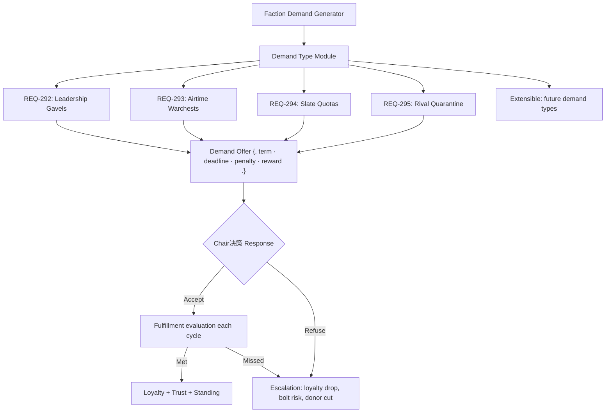

**THIS IS A REFERENCE FOR THE CODING AIs. DO NOT DO ANYTHING**

This document is reference-only. Coding AIs must not act on anything in this document unless explicitly tasked through the owner's handoff prompt. If you have questions about any requirement, route them to the Design Agent chat and reference this document as the authority.

# Coalition Builder: Party Chair — Version 0.17.0 Design Document (Faction Systems Release)

## 1. Release Header

- **Version:** 0.17.0 (working designation; the official version-string bump belongs exclusively to the build agent at release time). With 2 Large requirements in scope, second-digit geometry is plausible if the owner issues a standard build command — but the bump decision is never made in this document.
- **Release type:** Faction systems release. Twelve TBD concepts promoted from `TBD_UPDATES.md` into full specified requirements: differentiated registration growth, primary intervention & endorsement ecosystems, faction-tied Super PACs, the age-engine delta, a modular Coalition Demands system, power-vs-size attrition, faction cohesion, and per-state party platforms.
- **Baseline:** All specifications build on the current **v0.16.9** build and its authoritative changelog (`antigravity_handoff_v0_16_9.md`). Where this document references primaries, aging, happiness equilibrium, trust caps, or the 223-seat statewide roster, the v0.16.9 implementations are the substrate — extend, never re-implement or regress them.
- **Workflow:** Same protocols as Versions 0.16.3/0.16.4. The Design Agent numbers and sizes items; items arrive under their TBD labels (TBD-XX), which are retained only as traceability notes. This document accumulates items one by one until the owner issues a build command; the master handoff prompt is written only then. All requirements for this release live in this one document; there is no separate workspace-backlog paste.
- **Status:** COMPLETE / SHIPPED in Version 0.17.0. All 12 requirements (REQ-287 through REQ-298) fully implemented and verified.
- **REQ counter note:** the v0.16.5–v0.16.9 builds were external to the Design Agent and show no REQ-ID usage; these twelve items are allocated REQ-287 through REQ-298 from the master counter on that assumption. If the owner reports reserved IDs in that range, the Design Agent remaps on notice (established precedent).
- **TBD migration note:** TBD-03, -09, -10, -11, -13, -16, -17, -20, -21, -26, -27, and -29 are now formally specified. On build, they leave `TBD_UPDATES.md` (Selective Archival rule; remaining TBD items stay untouched).
- **Style-guide enforcement:** Rule 1 (155,000,000 represented voters, zero variance, 51 jurisdictions), Rule 4 (zero REQ tags in UI), Rule 6.5 (universal "Politician" terminology), Rule 7 (atmospheric cable-news tone; zero raw math, multipliers, or percentages in player-facing copy).
- **Build-environment invariants (v0.16.9):** `BUILD_EXE.bat` / `build.ps1` must retain strict Windows CRLF; the 5-slot IndexedDB save system and `SAVE_KEY = 'partyChairGame.save.v16.2'` remain the persistence substrate; all seven user-confirmed intended mechanics from the handoff are inviolable.

**ID allocation note (owner's master-counter rule):** items arrive under TBD labels; the Design Agent allocates the next free master-counter IDs. Mapping: TBD-03 → **REQ-287**; TBD-09 → **REQ-288**; TBD-10 → **REQ-289**; TBD-11 → **REQ-290**; TBD-13 → **REQ-291**; TBD-16 → **REQ-292**; TBD-17 → **REQ-293**; TBD-20 → **REQ-294**; TBD-21 → **REQ-295**; TBD-26 → **REQ-296**; TBD-27 → **REQ-297**; TBD-29 → **REQ-298**. All internal cross-references use the master IDs.

## 2. Requirements Inventory (Grouped by SIZE)

### Massive
- (none)

### Huge
- (none)

### Large
- **REQ-290 — Faction-Tied Super PACs & Swing PAC Ecosystem**
- **REQ-298 — State & State-Party Policy Preferences (3-Point Bounding & Regional Elasticity)**

### Medium
- **REQ-287 — Party-Differentiated Voter Registration Patterns**
- **REQ-288 — Modular "Filtering Support" Architecture (Primary Interventions)**
- **REQ-289 — Modular Faction Endorsement Repercussions**
- **REQ-296 — Faction Power vs. Size Attrition Mechanics**

### Small
- **REQ-291 — Politician & Candidate Chronological Age Engine (v0.16.9 Delta)**
- **REQ-292 — Coalition Demands Framework & Leadership Appointments Demand**
- **REQ-293 — Coalition Demands: Super PAC Airtime Warchest Commitments**
- **REQ-294 — Coalition Demands: Candidate Slate Quotas**
- **REQ-295 — Coalition Demands: Rival Faction Quarantine**
- **REQ-297 — Faction Ideological Tightness (Cohesion/Orthodoxy) Metric**

### Tiny
- (none)

---

## 3. REQ-287 — Party-Differentiated Voter Registration Patterns

**Size:** Medium
**Type:** System extension (registration engine × faction data model)
**Target files:** `engine.js` (Statewide Voter Registration action), `factions-0.15.js` (FACTIONS_CATALOG archetype metadata, FACTION_STATE_MATRIX), `voter-model-0.5.js`, `data.js`
**Source:** Owner batch, Nov 20, 2026. *Traceability: `TBD-03`.*

### 3.1 Concept
Move away from uniform percentage-based voter registration growth across all factions. Base registration growth rates on a faction's ideological archetype, field organizing footprint, demographic appeal, and regional relevance — e.g., the Capital L Left surges in urban/campus clusters; True Libertarians grow in high-elasticity Western states; Socialists (Peace and Freedom) concentrate in labor strongholds.

### 3.2 Specification
1. **Faction archetype growth profile (factions-0.15.js):** each catalog faction gains a growth-profile descriptor: archetype cluster tags (urban/campus, high-elasticity frontier, labor stronghold, suburban, rural, exurban business, etc.), a demographic-appeal weight, and a regional-relevance map (state clusters where the faction organizes naturally). Data-driven; no player-facing exposure.
2. **State registration lift (engine.js):** when a registration drive (or faction-level organizer growth) awards registered voters, the per-state allocation is shaped by the driving faction(s)' archetype profile:
   - Urban/campus archetypes receive multiplied lift in dense metro and college-town jurisdictions.
   - High-elasticity archetypes (e.g., `lib_true_libertarians`) receive multiplied lift in Western high-elasticity states.
   - Labor archetypes receive multiplied lift in labor-stronghold states.
   - Factions outside their relevance map receive diminished (not zero) lift.
3. **Composition with the tier-scaled registration engine:** REQ-277's tier cost matrix and flat absolute yields remain the base engine. This requirement shapes the *distribution* of those yields across factions and states, not the yield totals.
4. **Conservation:** all shaped gains remain transfers (donor blocks decrement equally); the national total stays exactly 155,000,000 with per-state zero-variance reconciliation.

### 3.3 Invariants & Interplay
- Rule 1: shaping redistributes gains; it never creates or destroys represented voters.
- Rule 7: player-facing copy stays qualitative ("your campus networks are paying off in the state's college towns"), never the lift multipliers.
- Composes with REQ-285 (v0.16.4, absorbed activists): the absorbed party-aligned activist wings inherit their faction archetype's growth profile.
- Composes with the v0.16.7.2 tier drop-down logic: footprint shaping keys off factions, not party tier; tier math is untouched.
- Era systems (v0.16.9): Era #16 robot factions carry their own dedicated faction archetypes; growth profiles must come from their faction data, never fall back to Democratic archetypes.

### 3.4 Acceptance Criteria
1. Registration growth per state varies meaningfully by driving-faction archetype (an urban-cluster faction grows fastest in metro/campus jurisdictions; a frontier archetype in high-elasticity Western states).
2. REQ-277's tier cost/yield matrix is unchanged as the base engine.
3. All shaped distributions conserve 155,000,000 exactly; per-state reconciliation holds zero variance.
4. No raw multipliers appear in player-facing copy.

### 3.5 Test Plan
New script: `scripts/test-v0170-registration-patterns.cjs`:
1. Execute registration drives with urban, frontier, and labor archetypes across a state sample; assert lift ordering matches the archetype relevance maps.
2. Assert tier-based cost/yield regression (REQ-277 matrix unchanged).
3. Assert 155,000,000 conservation and per-state zero variance after shaped drives.
4. Assert era-robot factions use their own archetypes (no Democratic fallback).

---

## 4. REQ-288 — Modular "Filtering Support" Architecture (Primary Interventions)

**Size:** Medium
**Type:** System redesign (primary intervention economy)
**Target files:** `engine.js` (`filterPrimarySupport`, `takeActionInternal` primary actions), `app.js` (primary UI action bar), `data.js`
**Source:** Owner batch, Nov 20, 2026. *Traceability: `TBD-09`.*

### 4.1 Concept
Customizable primary endorsement and candidate-filtering mechanics. Allow the chair to deploy targeted political capital, staff support, and donor conduits to alter primary election odds without clumsy hardcoded interventions.

### 4.2 Specification
1. **Intervention toolkit:** replace/augment the v0.16.8 `filter-primary-support` action with a modular toolkit of deployable assets, each with a cost and an effect on a chosen candidate's primary odds:
   - **Political capital** (trust/standing spend): targeted polling lift for the chosen candidate.
   - **Staff support**: transfers field organization weight to the candidate's campaign in scheduled early states.
   - **Donor conduits**: redirects a slice of the party warchest into the candidate's coffers.
2. **Modularity:** each asset is independently deployable per candidate, per intervention window; the chair composes them. Effects are bounded and deterministic given the deployment.
3. **Cost ledger:** every deployment draws from visible, bounded pools (political capital, actions, treasury); zero-cost secret lifts are prohibited (parity doctrine: no hardcoded free interventions).
4. **Generalization:** the toolkit applies across the party's primary field (the v0.16.8 one-candidate-per-faction structure with the 1-faction-party 2-candidate exception) and extends cleanly to the other party-system contexts the primary engine serves.
5. **UI (app.js):** the primary action bar renders the deployable assets with qualitative, Rule 7 cost/effect copy; the existing neutrally-rewarded no-intervention path is preserved and must remain a legitimate strategy.

### 4.3 Invariants & Interplay
- **Migration of the v0.16.8 mechanic:** the existing debate/filter interventions and the neutrality reward (+5% happiness for zero interventions) remain; this requirement modularizes the support channel rather than deleting the primary calendar engine.
- Composes with REQ-289 (endorsement repercussions): deploying assets FOR a faction's candidate triggers loyalty effects; deploying AGAINST triggers backlash (handled there, not here).
- The delegation/partition RNG (`applyRandomizationPartition`, normalized `version01Hash`) is untouched.
- User-confirmed intended mechanic #6: the legacy `advancePrimaryWave` stub stays untouched.
- Rule 7/4: cost copy qualitative ("a week of senior staff time"), no REQ tags.

### 4.4 Acceptance Criteria
1. The chair can deploy each support asset class at a candidate, with exact bounded cost deduction and bounded odds effect.
2. No free (costless) intervention path exists.
3. The zero-intervention neutrality reward still functions.
4. Existing v0.16.8 primary regression suite (`test-presidential-primaries.cjs`) passes unchanged where mechanics are preserved.

### 4.5 Test Plan
New script: `scripts/test-v0170-filtering-support.cjs`:
1. Deploy each asset class; assert cost ledger deductions and bounded odds deltas.
2. Compose multiple assets on one candidate; assert deterministic combined effect and no negative-cost paths.
3. Assert zero-intervention neutrality reward preserved.
4. Regression: run against the existing primary engine's candidate structure (faction filtering, 1-faction-party exception intact).

---

## 5. REQ-289 — Modular Faction Endorsement Repercussions

**Size:** Medium
**Type:** System addition (faction reaction engine for primary endorsements)
**Target files:** `engine.js` (endorsement/primary result evaluation, faction trust/standing writes), `factions-0.15.js`, `app.js` (Step 3 endorsement surfaces, primary UI)
**Source:** Owner batch, Nov 20, 2026. *Traceability: `TBD-10`.*

### 5.1 Concept
Realistic faction backlash when the party chair intervenes in contested primaries. Endorsing a faction's preferred candidate builds deep loyalty (+Trust, +Standing); opposing that candidate triggers faction resentment, threats to withhold donor support, or bolt warnings.

### 5.2 Specification
1. **Loyalty branch:** when the chair's endorsement/intervention (REQ-288 assets or an explicit endorsement) backs the faction's preferred primary candidate, the faction gains trust and standing (bounded; feeding the happiness equilibrium).
2. **Resentment branch:** when the chair backs a rival candidate against the faction's preference, the faction's reaction scales with the size of the intervention and the faction's cohesion (REQ-297): trust/standing penalties, escalation events in order of severity — resentment, then donor-withholding threats, then bolt warnings.
3. **Preference model:** each faction computes a preferred candidate in its party's primary field (its own faction's candidate where present, else the ideologically nearest candidate under the faction archetype and platform deltas).
4. **Escalation events:** donor-withholding threats suspend that faction's donor conduit contribution; bolt warnings feed the existing factional loyalty/bolt machinery (and, for coalition-era contexts, the Coalition Demands system REQ-292).
5. **Endorsements from Step 3:** the existing endorsement flows (Senate/Governor/Other Statewide/State Leg) receive the same reaction logic, scoped to factions with stakes in that race.

### 5.3 Invariants & Interplay
- All effects route through `applyScaledFactionHappinessDelta()` (Option C) so faction states cannot pin at 0/100; the ±20 flip cap (Option A) and 25% equilibrium pull (Option B) still govern.
- Trust interactions respect the v0.16.6.2 third-party trust caps (`10 × partyTier`, Tier 0 = 0) — loyalty bonuses cannot push above the cap.
- Composes with REQ-288 (assets are the trigger surface) and REQ-297 (cohesion scales severity).
- Rule 7: reactions render as cable-news narrative ("the faction's donors are making calls", "whispers of a walkout"), never raw trust deltas; Rule 4: no REQ tags.

### 5.4 Acceptance Criteria
1. Both branches fire correctly off a single intervention event, with bounded deltas scaled by faction cohesion.
2. Escalation order is respected: resentment precedes donor threats, which precede bolt warnings.
3. Donor-withholding actually suspends the faction's donor contribution until repaired.
4. All faction-state writes pass through the Option C scaler; trust caps respected.

### 5.5 Test Plan
New script: `scripts/test-v0170-endorsement-repercussions.cjs`:
1. Endorse with and against a faction's preference; assert loyalty/resentment deltas and escalation ordering.
2. Assert cohesion scaling (high-orthodoxy faction punishes harder than a big-tent faction).
3. Assert donor suspension and repair; assert bolt warning feeds the loyalty machinery.
4. Assert Option A/B/C equilibrium constraints hold after all writes; trust caps respected for minor parties.

---

## 6. REQ-290 — Faction-Tied Super PACs & Swing PAC Ecosystem

**Size:** Large
**Type:** System addition (campaign-finance ecosystem)
**Target files:** `data.js` (Super PAC registry), `engine.js` (finance flows, faction relations, REQ-180 unlock gate integration), `party-systems-engine.js`, `app.js` (finance UI), `scenario-2028.js`
**Source:** Owner batch, Nov 20, 2026. *Traceability: `TBD-11`; carries the owner's REQ-180 and REQ-193 cross-references.*

### 6.1 Concept
Connect Super PACs directly to specific factional ecosystems. Super PACs are affiliated with underlying party factions; if a party expels or alienates a faction, it loses access to that faction's allied Super PAC. Independent Swing PACs evaluate party platforms and candidate quality before deploying independent expenditures.

### 6.2 Specification
1. **Faction-tied Super PAC registry (data.js):** each major faction ecosystem (and the era-party ecosystems) carries allied Super PAC entries: name, ideological profile, aligned faction(s), baseline war chest, expenditure behavior tags. Six to ten entries at national scope for launch; data-driven for extension.
2. **Institutional unlock gate (per REQ-180 cross-reference):** Tier 4 of the Institutional Ascent Ladder (>= 15% national polling) is the institutional unlock allowing faction-tied Super PACs to form for ascending minor parties, seeding 1–2 fledgling faction-aligned Super PACs that plug directly into this ecosystem. The existing REQ-180 seeds are the entries; the formation gate is evaluated by the v0.16.7.2 `evaluatePartyInstitutionalTiers()` cycle logic (including tier drop-down revocation).
3. **Access coupling:** a party's access to a faction's allied Super PAC is gated on that faction's standing in the coalition. Expelling or alienating the faction (bolt events, REQ-295 quarantine, deep resentment per REQ-289 revoking access to that faction's allied Super PAC; reconciliation restores access.
4. **Swing PAC ecosystem (independent expenditures):** unaligned Swing PACs evaluate party platforms (native platform and REQ-298 state-party platform deltas where relevant) and candidate quality before deploying independent expenditures — modeled as periodic independent-expenditure grants into races where the party's platform position and candidate quality cross an evaluation threshold. Not controllable; influenceable.
5. **Finance flows (engine.js):** Super PAC money is separate from the party warchest (independent expenditures land in races/cycles, not the treasury). Strategic doctrinal coupling per REQ-193 cross-reference: Moderate & Professionalize accelerates institutional-donor and Swing PAC alignment; Stay Pure / Populist Vanguard relies on grassroots/small-donor warchests and shifts evaluations accordingly.

### 6.3 Invariants & Interplay
- **Doctrine:** Super PACs are external actors. They never violate the no-subsidy minor-party doctrine — minor parties earn them at Tier 4, majors have ecosystems from day one.
- Composes with REQ-289 (resentment/suspension path), REQ-293 (airtime commitments demand references this registry), REQ-295 (quarantine revoking access), REQ-298 (platform evaluation inputs), and REQ-193 doctrine paths.
- Era systems: robot-party factions (Era #16) and coalition parties (Era #18) map into the same registry structure; no Democratic fallback.
- SAVE_KEY: the Super PAC alliance state is new persisted data (faction->PAC access flags, seeded formations); persist defensively inside the existing save object; bump decision belongs to the build agent.
- Rule 7: finance UI copy is narrative ("a seven-figure air buy landed overnight in the governor's race"); Rule 4: no REQ tags.

### 6.4 Acceptance Criteria
1. Each faction-tied Super PAC deploys per its affiliation; a party that expels/aliennates the faction loses access to its allied PAC; reconciliation restores access.
2. Tier 4 promotion seeds 1–2 fledgling faction-aligned Super PACs for ascending minor parties (REQ-180 gate respected); tier drop-down revokes unmatched formations.
3. Swing PACs deploy independent expenditures according to platform + candidate-quality evaluation, not chair control.
4. Independent expenditures land in races/cycles, never directly in the party treasury.
5. REQ-193 doctrine interaction changes evaluation thresholds in the correct direction for each path.

### 6.5 Test Plan
New script: `scripts/test-v0170-superpac-ecosystem.cjs`:
1. Registry integrity: every faction-tied PAC resolves its aligned faction(s) and era mappings (robot/coalition parties included).
2. Access coupling: expel/alienate a faction; assert loss of its allied PAC; reconcile; assert restoration.
3. Unlock gate: promote a minor party to Tier 4 (v0.16.7.2 tier evaluation); assert 1–2 fledgling PACs seed; demote; assert revocation.
4. Swing PAC evaluation: sweep platform positions and candidate qualities; assert deployment thresholds function; assert no direct treasury injections.
5. Doctrinal coupling: assert REQ-193 path deltas on evaluation thresholds.

---

## 7. REQ-291 — Politician & Candidate Chronological Age Engine (v0.16.9 Delta)

**Size:** Small
**Type:** System extension (delta over the shipped v0.16.9 aging engine)
**Target files:** `engine.js` (`ensureAndAdvancePoliticianAges`, retirement logic, trait assignment), `data.js` / `v07-scaffolding.js` (trait pools), `app.js` (dossier rendering)
**Source:** Owner batch, Nov 20, 2026. *Traceability: `TBD-13`.*

### 7.1 Concept and Delta Statement
**The v0.16.9 build already ships the chronological core:** deterministic start ages, +2 years/cycle advancement, retirement rolls (45%/cycle at 78–83), mandatory retirement at 84+, and seat replenishment. **This requirement specifies ONLY the unshipped remainder** — do not re-implement the existing engine; extend it:
1. **Birth-year persistence:** stamp `birthYear = startYear - age` on every politician/sitting member so derived age is always computable and survived across schemas.
2. **Career-longevity tracking:** track active career span (years in office / on the national stage) per politician; longevity feeds retirement likelihood (long-career politicians retire earlier within the band) and trait aging-out rules.
3. **Trait age gates:** assign age-gated traits at generation: e.g., Rising Star restricted to candidates under 60; elder-statesman-grade traits gated upward; existing `POLITICIAN_TRAITS_MAP` entries gain optional `minAge`/`maxAge` bounds. On aging past a gate, the trait retires cleanly.
4. **Generational turnover retirements:** at cycle start, retired-out politicians release their rosters, factions lose their officeholder figures, and the v0.16.7.2 `replenishVacantSittingMembers()` spawner fills seats — with a small era-appropriate nudging so successor generations gradually reflect their faction's current strength (no hard quotas; bounded drift).

### 7.2 Invariants & Interplay
- **Do not regress v0.16.9:** deterministic seeding, retirement bands, replenishment, and the exclusion of `pastPresidents`/2-term winners from primary fields remain untouched.
- Rule 6.5: trait and age copy uses "Politician" terms; retirement news reads narratively (Rule 7), never raw odds.
- Composes with REQ-296: retired officeholders reduce faction officeholder counts, feeding the power-vs-size calculation.

### 7.3 Acceptance Criteria
1. Every politician carries a persisted `birthYear`; derived ages match the +2/cycle engine exactly.
2. Career-longevity modifies retirement likelihood within the shipped bands; no retirement before the shipped age floor.
3. Age-gated traits assign and retire cleanly at their bounds (e.g., Rising Star never on a 60+ politician).
4. Turnover flows through the existing replenishment spawner; `pastPresidents`/2-term exclusions intact.

### 7.4 Test Plan
New script: `scripts/test-v0170-age-engine-delta.cjs`:
1. Birth-year persistence and derived-age equality across a save/load cycle.
2. Longevity-adjusted retirement likelihood monotonicity (inside shipped bands).
3. Trait gate sweeps: assignment below bounds, retirement above bounds; Rising Star < 60 strictness.
4. Full regression against `test-v0169-fixes.cjs` aging checks (16/16 baseline preserved).

---

## 8. REQ-292 — Coalition Demands Framework & Leadership Appointments Demand

**Size:** Small
**Type:** System addition (framework + first demand module)
**Target files:** `engine.js` (coalition/negotiation evaluation), `factions-0.15.js`, `app.js` (faction negotiation UI), `party-systems-engine.js` (era-18 coalition contexts)
**Source:** Owner batch, Nov 20, 2026. *Traceability: `TBD-16`; defines the shared framework used by REQ-292–REQ-295.*

### 8.1 Shared Framework: Modular Coalition Demands

1. **Faction demand generator:** major factions periodically issue demands as join-or-remain conditions (higher probability when the faction's power-vs-size gap per REQ-296 is negative, or its REQ-297 cohesion is high, or after REQ-289 grievance events).
2. **Demand offer schema:** every demand is a uniform data object — type, term (structured payload per type), deadline, penalty for refusal/violation, reward for fulfillment — evaluated each cycle.
3. **Response loop:** the chair accepts or refuses; outcomes feed faction loyalty/trust/standing using the equilibrium scalers; refusals escalate per REQ-289's severity ladder up to bolt.
4. **Extensibility:** new demand types register against the framework (per the owner's modular architecture intent); REQ-292–295 are the launch modules.
5. **Rule 7/4:** demand copy renders narratively (an ultimatum, a threat, a promise) — never the reward/penalty numbers or any REQ tag.

### 8.2 Demand Type: Leadership Appointments
Major factions demand congressional leadership gavels — Speaker of the House, Senate Majority Leader — or National Committee Co-Chairmanship as a condition for joining or remaining in the coalition.
1. **Structured term:** the office demanded (from the game's leadership-role registry, per the v0.16.4-era party-scoped roles) and the faction's candidate for it.
2. **Fulfillment:** the party must hold the office (post-election chamber math) and seat the faction's candidate in it; fulfillment is evaluated cycle-by-cycle while the demand term lasts.
3. **Interaction with party scoping:** faction candidates for gavels must belong to the coalition party (the REQ-278/279 scoping doctrine carries into coalition contexts — a faction cannot demand a rival-party gavel).
4. **Reward/penalty:** fulfillment grants deep trust/standing; refusal or gavel-loss mid-term triggers the escalation ladder.

### 8.3 Acceptance Criteria
1. The framework accepts, deadlines, and evaluates any registered demand type uniformly.
2. Leadership demands fire only for factions with eligible gavel opportunities; hostile/feasibility filters work (no demands for offices the party cannot hold).
3. Acceptance + fulfillment pays the loyalty reward; refusal/dropped office triggers escalation through REQ-289's ladder.
4. New demand types can register without touching the framework core.

### 8.4 Test Plan
New script: `scripts/test-v0170-demands-leadership.cjs`:
1. Framework unit: generate demands of all four launch types; assert uniform offer schema, deadlines, penalties, rewards.
2. Leadership term: grant and revoke the demanded gavel; assert reward and penalty paths.
3. Scoping: assert faction gavel candidates stay within the coalition party (no rival-party leakage).
4. Escalation continuity with REQ-289: refusals raise severity in order, capped by the equilibrium scalers.

---

## 9. REQ-293 — Coalition Demands: Super PAC Airtime Warchest Commitments

**Size:** Small
**Type:** System addition (demand module over REQ-290's registry)
**Target files:** `engine.js`, `data.js` (Super PAC registry coupling), `app.js`
**Source:** Owner batch, Nov 20, 2026. *Traceability: `TBD-17`.*

### 9.1 Specification
Factions require formal commitments of independent-expenditure advertising dollars — a demanded airtime warchest band — directed exclusively into their regional bastions via allied Super PACs.
1. **Structured term:** demanded airtime band, beneficiary faction, bastion region set (its REQ-287 relevance map), allied PAC channel(s) from REQ-290's registry.
2. **Fulfillment:** the commitment is met when committed independent-expenditure dollars actually deploy into the bastion regions through the faction's allied PACs during the term (post-election spend audits the flows).
3. **Coupling:** the demand presumes access to the faction's allied PAC; if access is lost (expulsion/alienation per REQ-290), the demand converts to an automatic escalation (impossible-to-fulfill demand = betrayal, not delay).
4. **Scale:** bands are anchored on magnitude, sized by the faction's size and the era economy (e.g., tens of millions of airtime commitments, per band parameters, never surfaced in copy).

### 9.2 Acceptance Criteria
1. Airtime demands carry a structured term, deadline, and bastion set; fulfillment audits the flows through allied PACs only (their own faction's, not arbitrary spend channels).
2. Deployment outside the bastions does not count toward fulfillment.
3. Access loss converts the demand to escalation immediately.
4. All band figures remain engine-side (Rule 7); copy reads like a political ultimatum.

### 9.3 Test Plan (extends `scripts/test-v0170-demands-leadership.cjs`)
1. Airtime term flows: deploy inside vs outside bastions; assert fulfillment math counts only ally-PAC bastion spend.
2. Registry lockout: suspend ally access; assert immediate escalation conversion.
3. Regression: REQ-290's expenditure ledger unchanged outside committed flows.

---

## 10. REQ-294 — Coalition Demands: Candidate Slate Quotas

**Size:** Small
**Type:** System addition (demand module over recruitment pipelines)
**Target files:** `engine.js` (candidate recruitment, primary field generation), `app.js` (recruitment/endorsement UI), `v07-scaffolding.js`
**Source:** Owner batch, Nov 20, 2026. *Traceability: `TBD-20`.*

### 10.1 Specification
Major factions require that a fixed share of all recruited primary candidates across the 50 states belong to their faction (a quota term, e.g., a quarter to a third of the recruiting class).
1. **Structured term:** quota share of the current recruiting cycle's primary candidate class, faction ID, evaluation window (the cycle from acceptance to the next election filing point).
2. **Fulfillment evaluation:** at window close, the recruited-class roster is audited: the faction's share of recruits must meet the quota. The v0.16.7.2 dynamic spawner (`generateFreshPoliticianForSeat`) makes fulfillment feasible — the chair can steer recruitment toward the faction's states/districts per REQ-287 relevance maps.
3. **Interaction with party scoping:** all counted recruits must be party members per the REQ-278/279 doctrine.
4. **Reward/penalty:** meeting the quota pays the demand reward at renewal time; falling short triggers the escalation ladder; the chair may renegotiate on cycle renewal.

### 10.2 Acceptance Criteria
1. Quota demands evaluate against the actual recruiting class roster; the share math is exact (engine-side).
2. All counted recruits pass party-scoping validation.
3. Fulfillment/shortfall reward/penalty flows through the shared framework unchanged.
4. Recruitment UI shows compliance state qualitatively (Rule 7); no raw quota percentages in player copy? — see 10.3: the quota share is engine-side; UI copy narrativizes ("the faction is watching the incoming class closely").

### 10.3 Test Plan (extends `scripts/test-v0170-demands-leadership.cjs`)
1. Quota eval: recruited-class sweeps over/under the term; assert reward/penalty edges.
2. Scoping filter: out-of-party recruits are never counted.
3. Spawner feasibility: quota fulfillment achievable via steered recruitment (simulate a viable fulfill path).

---

## 11. REQ-295 — Coalition Demands: Rival Faction Quarantine

**Size:** Small
**Type:** System addition (demand module over faction relations)
**Target files:** `engine.js`, `factions-0.15.js`, `app.js`
**Source:** Owner batch, Nov 20, 2026. *Traceability: `TBD-21`.*

### 11.1 Specification
Ideologically aggressive factions demand the public repudiation or committee demotion of a hostile rival faction as a condition for coalition entry.
1. **Structured term:** target rival faction, demanded action (public repudiation by the chair; committee/party-structure demotion of the rival's officeholders and influence posts, extending the existing demotion powers), irrevocability flag (a public repudiation cannot be quietly walked back).
2. **Fulfillment:** repudiation/demotion actions actually executed and visible; the target faction consequently suffers REQ-289-level grievance (the demand knowingly creates a second front — the demanding faction's gain intentionally funds the rival's resentment; both reactions are live).
3. **Actions available:** the chair may satisfy, refuse, or fake compliance (public repudiation without structural demotion); the faked path satisfies partially (short-term trust, relationship-decay risk, escalating re-demand probability under high REQ-297 cohesion).
4. **Nobody is protected:** a quarantined faction can bolt (existing loyalty machinery) in proportion to the severity of the action taken.

### 11.2 Acceptance Criteria
1. Quarantine demands fire between genuinely hostile faction pairs (archetype hostility-data-driven, not random).
2. All three response paths work; faked compliance decays per cohesion.
3. Both the demanding faction's reward and the target's grievance fire correctly and simultaneously.
4. Demotion actions composes with party-scoped committee/role machinery (Rule 6.5 terminology).

### 11.3 Test Plan (extends `scripts/test-v0170-demands-leadership.cjs`)
1. Hostility pairfilter: assert demands only between hostile pairs.
2. Three-path outcomes; fake-compliance decay curve.
3. Dual-reaction: reward and grievance co-fire at bounded magnitudes (equilibrium scalers respected).

---

## 12. REQ-296 — Faction Power vs. Size Attrition Mechanics

**Size:** Medium
**Type:** System addition (faction political-power audit engine)
**Target files:** `engine.js` (cycle-start faction evaluation), `data.js`, `scenario-2028.js`, `factions-0.15.js`, `app.js` (faction dossier UI)
**Source:** Owner batch, Nov 20, 2026. *Traceability: `TBD-26`.*

### 12.1 Concept
Factions expect institutional representation commensurate with their voter membership base. Calculate an expected representation threshold per faction from sitting faction officeholders across State Legislatures, U.S. House, U.S. Senate, Governorships, and the White House. When a faction's political power falls significantly below its membership size, it steadily suffers member attrition until power and size re-balance.

### 12.2 Specification
1. **Officeholder audit:** count sitting faction officeholders across the five levels — state legislative slates (the state-leg seat allocation paths), 435 House, 100 Senate, 50 Governor + 223 statewide executive offices (offices counted at theWeighted gubernatorial tradition: statewide executives count as a share of gubernatorial power, matching the 1/5th happiness weight doctrine from 0.16.6.1), and the White House (party control event).
2. **Expected-power computation:** expected representation for each faction derives from its membership share of the party's registered base (the v0.16.4-era affiliations/faction ledgers conserving 155M); the audit compares actual officeholder power vs expected; the deficit/surplus moves it.
3. **Attrition loop (engine-side):** a significantly under-represented faction (power well below membership size) suffers steady member attrition each cycle — registered members re-align toward rival factions or the unaffiliated pool — until power and size re-balance; over-represented factions enjoy slow membership drift inward (recruitment gravity), capped and bounded to avoid runaway spirals.
4. **Feedback coupling:** attrition shrinks the faction's membership share, which raises the demand probability in the Coalition Demands frameworks (REQ-292 et al:: voice-driven — power deficit = louder demands) and feeds REQ-297 cohesion effects (high-cohesion factions attrition harder but demand earlier).
5. **User-adjacent guardrail per handoff item #1–2:** member attrition here is intentional drift on faction ledgers — it must NOT interact with the user-confirmed intentional voter-model drift items (midterm realignment and era-spawn drift stay untouched).

### 12.3 Invariants & Interplay
- Rule 1: attrition is transfer flow between faction ledgers/unaffiliated pool; national total conservation 155,000,000 exact; per-state zero-variance reconciliation maintained.
- Rule 7: the faction dossier describes the drift qualitatively ("restless in the ranks"); no audit numbers in copy.
- Composes with REQ-291 retirement (officeholder losses feed the audit), the 808 sitting-members roster and `replenishVacantSittingMembers()` (replacement orientation shapes power balance), REQ-292–295 demands, REQ-297.
- The 1/5th statewide doctrine from 0.16.6.1 carries into the officeholder audit weighting.

### 12.4 Acceptance Criteria
1. The audit counts officeholders across all five levels with correct weights; the 808-member roster and state-leg allocations reconcile.
2. Under-represented factions attrit; over-represented ones attract, both bounded, both reversible via genuine power gains.
3. Attrition conserves 155,000,000 exactly and per-state zero variance.
4. Intentional drift items from the handoff (midterm realignment, era spawns) are demonstrably unaffected.

### 12.5 Test Plan
New script: `scripts/test-v0170-power-size-attrition.cjs`:
1. Construct synthetic power/size gaps; assert monotone bounded attrition toward re-balance and recruitment-gravity cap logic.
2. Full-ledger conservation audit across a simulated multi-cycle attrition run (155,000,000 invariant).
3. Regression: midterm realignment and era-spawn drift test fields unchanged (`test-v0169-fixes.cjs` 16/16 baseline).
4. Weight integrity: audit spot-checks across House/Senate/Governor/statewide/state-leg/White House representations.

---

## 13. REQ-297 — Faction Ideological Tightness (Cohesion/Orthodoxy) Metric

**Size:** Small
**Type:** System addition (faction data attribute + enforcement effects)
**Target files:** `factions-0.15.js` (FACTIONS_CATALOG attribute), `engine.js` (deviation enforcement, scalers), `app.js` (faction dossier rendering)
**Source:** Owner batch, Nov 20, 2026. *Traceability: `TBD-27`.*

### 13.1 Specification
1. **Metric (factions-0.15.js):** each faction gains a `cohesion` attribute modeling how strictly members enforce platform conformity — from disciplined doctrinal blocs (e.g., the six `extremist`-tagged factions and ideological hardliners) to loose big-tent wings.
2. **Enforcement effects (engine.js):** high-cohesion factions punish chair/candidate ideological deviation harder (larger trust/standing penalties in REQ-289 backlash), demand more often (REQ-292 generator probability input), attrition harder but demand earlier (REQ-296), and tolerate less platform deviation from their own candidates (candidate positioning fuzz tolerance in REQ-298).
3. **Low-cohesion factions:** tolerate deviation, bolt less readily, demand less, but grant shallower loyalty rewards (soft enthusiastic base).
4. **Dossier rendering (app.js):** the faction dossier shows the quality in Rule 7 vocabulary (e.g., "An ironclad doctrinal bloc" vs "A sprawling, easygoing coalition" — final copy at implementation must avoid polarity baggage; keep language informational) with the v0.16.6.2 extremist-badge pattern (visual tag if warranted).

### 13.2 Acceptance Criteria
1. Every FACTIONS_CATALOG faction carries a cohesion value in the designed band.
2. REQ-289 severity, REQ-292 demand probability, REQ-296 attrition curve, and REQ-297's own copy scaling key off the metric in the correct direction and are bounded.
3. Era factions (robot factions included) carry their own cohesion; no default fallback.
4. Rule 7: the metric never surfaces numerically in copy; Rule 4: no tags with REQ IDs.

### 13.3 Test Plan
New script: `scripts/test-v0170-cohesion-metric.cjs`:
1. Catalog sweep: cohesion present for all factions, era mappings included.
2. Effect regression: high vs low cohesion drives REQ-289/292/296 behavior deltas at the correct sign, within equilibrium scalers.
3. Deviation tolerance: candidate positioning fuzz per REQ-298 respects cohesion bounds.
4. Copy sweep: dossier renders qualitative labels only.

---

## 14. REQ-298 — State & State-Party Policy Preferences (3-Point Bounding & Regional Elasticity)

**Size:** Large
**Type:** System addition (policy-position data model + candidate positioning)
**Target files:** `data.js` (state classification, issue catalogs), `engine.js` (positioning computation, candidate platform derivation), `scenario-2028.js`, `app.js` (dossier/platform UI), `presidential-primaries.js` (positioning inputs)
**Source:** Owner batch, Nov 20, 2026. *Traceability: `TBD-29` (migrated from retired LTA-03).*

### 14.1 Concept
Every state models its own organic policy preferences, both statewide and for each state party organization (Texas Democrats, California Republicans, Georgia Democrats).

### 14.2 Specification
1. **Policy issue space:** the state's organic issue positions derive from the existing state ideological data (lean/baseline archives) over the game's issue catalog; no literal percentage math in any player text.
2. **State party organizations:** each state carries a platform delta object per party (Dems/GOP/liberty/green/P&F/constitution/custom) representing the state party's organic drift from the national platform.
3. **3-point national platform bounding:** individual state parties cannot stray more than 3 points from their national party's unified platform on any given issue — a hard clamp on every state-party delta.
4. **Asymmetric regional elasticity:**
   - **Liberal states (e.g., CA, NY, VT, MA):** substantially more variation, with all parties pulled leftward — state Democrats become strongly progressive; state Republicans shift left on cultural/climate positions.
   - **Conservative states (e.g., WY, ID, TX, AL):** substantially more variation, with all parties pulled rightward — state Republicans become strongly conservative; state Democrats adopt culturally conservative / pro-energy stances.
   - **Moderate states (e.g., PA, MI, WI):** closely mirror national party baselines, with only modest local variation.
5. **Effect surfaces:** state-party platform deltas feed (a) primary candidate positioning in that state (candidate platform proximity affects faction candidate matching), (b) the REQ-290 Swing PAC platform evaluation inputs, (c) state dossier rendering of a state party's profile, (d) general-election favorability touches where candidates already compute lean-based performance (composes with the v0.16.3-era lean/environment formulas — this requirement must NOT regress the REQ-261/262 calibration).
6. **Custom parties:** the custom party's national platform (creator-defined) is its baseline; its state-party deltas derive through the same elasticity/bounding pipeline.

### 14.3 Invariants & Interplay
- Rule 7: any UI preview of a state party's profile renders narratively ("the state party keeps its distance from the national line on energy"); raw point deltas never surface. Rule 4: no REQ tags.
- Rule 1: policy data is preference modeling, not voter accounting; it must not perturb the 155,000,000 conservation ledgers.
- Composes with REQ-297 (cohesion constrains how far a high-orthodoxy faction's candidates may drift onto the state-party platform), REQ-288/289 (primary odds via positioning proximity), the 0.16.8.1 faction/party filtering (candidates remain within their own party's state organizations), and Era #18 coalition contexts (post-breakup coalition parties carry national baselines).
- SAVE_KEY: state-party delta maps are new persisted data; persist defensively in the existing save object; bump decision belongs to the build agent.

### 14.4 Acceptance Criteria
1. All 51 jurisdictions across all playable parties carry bounded platform deltas: |delta| <= 3 points on every issue from the national platform.
2. Elasticity classes hold their character: liberal-state parties drift leftward (within bounds), conservative-state parties drift rightward, moderate states stay near baseline — with more variation in the elastic classes than the moderate class.
3. State-party deltas feed all four effect surfaces without regressing the v0.16.3 environment-calibration regressions.
4. Custom parties derive correctly.

### 14.5 Test Plan
New script: `scripts/test-v0170-state-platforms.cjs`:
1. Bounding sweep: all 51 x parties x issues clamped within 3 points.
2. Elasticity checks: directional pull verified for named exemplars (CA/NY/VT/MA; WY/ID/TX/AL; PA/MI/WI) and cluster averages.
3. Effect-surface wiring: primary positioning, Swing PAC inputs, dossier rendering, favorability — each receives the same delta object; REQ-261/262 regressions hold.
4. Custom-party pipeline: creator-platform baselines produce bounded deltas.

---

## 15. Testing Summary (grows with each requirement)

| Test Script | Covers |
| --- | --- |
| `scripts/test-v0170-registration-patterns.cjs` | REQ-287 (archetype lift ordering, tier-matrix regression, 155M conservation, era fallback integrity) |
| `scripts/test-v0170-filtering-support.cjs` | REQ-288 (asset costs/effects, no free lifts, neutrality reward, primary engine regression) |
| `scripts/test-v0170-endorsement-repercussions.cjs` | REQ-289 (loyalty/resentment branches, escalation order, donor suspension, equilibrium/trust-cap compliance) |
| `scripts/test-v0170-superpac-ecosystem.cjs` | REQ-290 (registry integrity, access coupling, Tier 4 gate per REQ-180, Swing PAC evaluation, doctrine coupling) |
| `scripts/test-v0170-age-engine-delta.cjs` | REQ-291 (birth-year persistence, longevity likelihood, trait gates, v0.16.9 regression) |
| `scripts/test-v0170-demands-leadership.cjs` | REQ-292 (framework unit, gavel demand flows, party scoping, escalation; extended by REQ-293/294/295 modules) |
| `scripts/test-v0170-power-size-attrition.cjs` | REQ-296 (five-level audit, bounded attrition/gravity, 155M conservation, intentional-drift regression) |
| `scripts/test-v0170-cohesion-metric.cjs` | REQ-297 (catalog sweep, effect scaling, deviation tolerance, copy sweep) |
| `scripts/test-v0170-state-platforms.cjs` | REQ-298 (3-point bounding, elasticity classes, effect surfaces, custom parties, calibration regression) |

## 16. Release Checklist (executed by the build agent, strictly last)

1. All REQ sections implemented and individually tested; every acceptance criterion verified.
2. Full regression on the existing 229-check suite (`test-v0169-fixes.cjs`, `test-presidential-primaries.cjs`, `test-statewide-offices.cjs`, `test-v0165-bicameral-haven.cjs`, `test-v0162-integration.cjs`) plus all nine `test-v0170-*.cjs` scripts and the surviving `test-v0163-*`/`test-v0164-*` suites where still present in the workspace.
3. Version-string bump per the owner's build command (second-digit bump 0.17.0 expected for a standard build given 2 Large in scope; the build agent owns the final decision).
4. SAVE_KEY decision: expected unchanged `partyChairGame.save.v16.2` — new persisted fields (Super PAC alliance state, REQ-290; state-party platform deltas, REQ-298; birth years, REQ-291) persist defensively inside the existing save object; bump only on genuine migration, documented.
5. All seven user-confirmed intended mechanics re-verified untouched; the intentional drift items explicitly re-run.
6. `BUILD_EXE.bat` / `build.ps1` retain strict Windows CRLF; clean build passes: `powershell -ExecutionPolicy Bypass -File .\build.ps1`.
7. Owner smoke test per acceptance criteria in each REQ section.
8. Owner archives the twelve built items from `TBD_UPDATES.md` (Selective Archival rule; remaining TBD items untouched).

## 17. Master Handoff Prompts

PENDING — generated when the owner issues a build command. Will follow the owner's standing instruction format from Version 0.16.4 (single lead agent with optional sub-agents) unless he directs otherwise at build time. Per that registered variant: one self-contained `text` block, six suggested work packages with merge order and hot-file serialization, ironclad rules inline, SAVE_KEY watch items (REQ-290 / REQ-298 / REQ-291 new persisted fields), full regression list, and release steps last.